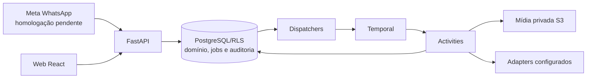

# SDD geral — Meu Braço Direito

## Retomada BL04.3 — qualidade com referências

O próximo trabalho é executar a avaliação em quatro passos descrita no
[SDD ativo](phases/BL04-context-and-ai-production.md#bl043--qualidade-e-economia-pendente):
conferir aprendizados; comparar peças com/sem aprendizados mantendo os demais
insumos e configurações; revisar com o titular; corrigir e repetir medindo custo
por peça aceita. A feature de referências está entregue localmente, mas essa
rodada de qualidade ainda não foi executada. O snapshot comprovado no piloto
não equivale a uma peça final avaliada.

Preparar corpus, plano comparativo e estimativa antes dos efeitos pagos, mantendo
as guardas, o histórico e os ciclos existentes. Dúvidas de produto são resolvidas
por entrevista; orçamento de geração dessa rodada não decorre dos US$ 5 de
Google/Apify/Jev. O SDD ativo é a fonte do ponto de retomada e das saídas de cada passo.

## Estado corrente de referências — 04/11/2026

A origem por endereço na web deve refletir exclusivamente o endereço próprio
persistido, em campos `readOnly`. Sem esse cadastro, orientar seu preenchimento
e impedir salvar a origem por endereço. A atualização do cadastro reflete-se na
exibição e no próximo envio explícito das preferências; não é uma pesquisa nem
um salvamento automático. Não há segundo endereço editável para descoberta.
Perfis manuais continuam independentes da região; GPS confirmado mantém seu fluxo.

`GET /references` calcula `discovery_available` com
`Settings.reference_discovery_ready()`: flags, credenciais e configuração do
executor/custos. A mensagem de indisponibilidade na web é consequência desse
estado operacional, não do ciclo semestral nem da validação do endereço. As
credenciais locais estão presentes, mas as flags persistentes seguem desligadas;
a configuração temporária do piloto não foi promovida ao runtime normal.

Descoberta, custos, seleção, análise semestral e projeção para geração estão
integrados na árvore local até 0111. A seleção gera uma associação canônica e
janela durável; o Temporal executa a coleta e agenda a próxima janela a partir
do aceite. O ledger 0109 vincula cada amostra Jev ao run Apify, referência e versão
selecionada, sem persistir publicações. Legendas não se repetem na recuperação.
Propostas novas congelam a seleção e os padrões existentes; os efeitos pagos
revalidam a associação na mesma transação da reserva. Registros legados continuam
legíveis. Documentos de design detalham os contratos; afirmações de integração
pendente nos marcos anteriores são históricas. CI combinado aprovado: 4.734
testes, 100% de linhas/ramos, Ruff e mypy. O ensaio real comprovou descoberta,
seleção, análise parcial e projeção de padrões; não declara homologação comercial.

O parser Nearby aceita valores padrão ausentes/vazios em componentes opcionais
de endereço, validando os campos presentes antes de ignorar componentes sem
evidência utilizável. Matcher e MAC conservam seus invariantes. Ver
[contrato e prova real](design/google-places-address-components.md). O banco
local está na revisão 0111, com backups anteriores preservados; testes continuam
usando bancos `_test` próprios.

Os adapters Apify aguardam trinta segundos após o término e conferem os
contadores disponíveis antes de liberar reservas. O primeiro valor terminal pode
ser preliminar; a correção não permite novo POST da mesma coleta. Revisões tardias
preservam histórico e ajustam somente a diferença nos mesmos contadores, pela
0111. Custos acima da reserva são registrados e bloqueiam o piloto, sem aumentar
o teto. A reconciliação dos onze recibos do ensaio foi aplicada e conferida.
Ver [reconciliação](design/apify-cost-reconciliation.md) e
[contrato de contabilização](design/apify-cost-settlement.md).

O titular confirmou que só entram publicações de autoria direta: `ownerUsername`
deve corresponder ao perfil escolhido. Coautoria ou marcação não substitui essa
condição. Vídeos/Reels contribuem somente `displayUrl` e legenda, sem `videoUrl`,
áudio ou transcrição. Carrosséis mistos usam imagens/capas explícitas dos filhos;
arrays sem correspondência com os itens são descartados. Capas mantêm análise
parcial. Essa extensão passou em 164 unitários/100% e cinco integrações; o CI
integral posterior à mudança está aprovado. Não há decisão de conteúdo pendente
neste recorte; o orçamento mensal comercial e a calibração permanecem posteriores.

O ensaio de referência manual confirmou nove padrões derivados de onze
publicações e quarenta imagens no snapshot validado para geração. A leitura
autenticada informa análise parcial e atualização agendada a partir do aceite.
Nenhuma geração de imagem ou publicação externa fez parte desse ensaio. Evidência
e limitações no [relatório do piloto](evals/reference-feature-pilot-2026-11-04.md).

Contrato vigente revisado em **29/10/2026**. Produto aceito em
[DECISIONS](DECISIONS.md), estado executivo em [PROJECT](PROJECT.md), sequência
em [fases](phases/README.md) e detalhamento na [fase BL04](phases/BL04-context-and-ai-production.md).
O [snapshot anterior](history/2026-10-28-pre-documentation-reconciliation/SDD.md)
preserva a redação substituída. Designs e evals têm estado e data próprios;
planejamento, teste simulado e homologação comercial são estados distintos.

O banco local de desenvolvimento foi atualizado da revisão 0059 à 0099 em
03/11, com backups privados cuja leitura integral foi verificada. A API iniciada
antes da 0099 requer reinício para atualizar sua verificação de prontidão.

## Atualização de 30/10 — copy e canal comercial

O contexto versionado admite `preferences.cta_destination` opcional, informado
pelo titular, distinto do telefone de identificação. Canal e valor devem ser
compatíveis com a chamada gerada; na ausência, o modelo recebe orientação para
uma chamada neutra. A solicitação editorial distingue texto público de direção
visual e dúvidas; a pré-checagem rejeita identificadores internos em copy e
interação de clique presumida. A conferência factual ignora apenas notações
técnicas reconhecidas na direção, sem autorizá-las como valores comerciais.
As mesmas regras são reaplicadas antes do efeito visual. Essa verificação é
parcial, não inspeciona a imagem e não comprova verdade semântica ou destino
ativo. Contexto e rastros mantêm os controles e versões existentes.

O percurso de referências deve combinar perfis indicados pelo cliente
com até dez candidatos elegíveis descobertos por fonte a avaliar, destacando até
três recomendações do Jev com motivo e evidência disponíveis. O cliente pode
escolher de uma a três entre os candidatos exibidos. A
origem, os direitos e a atualidade limitam seu uso. O titular escolheu que Jev
avalie semelhança e elimine os candidatos inadequados antes de aplicar a
pontuação de reputação aos restantes, apresentando critérios e nota para até três recomendações apenas com
fonte e uso permitidos. Essa
avaliação ainda não está implementada e Jev não é fonte de pesquisa. Nota e
quantidade de avaliações de estabelecimentos não medem engajamento social.

A preferência `reference_search` é opcional, pertencente ao contexto versionado
do negócio. O contrato lê `national` sem raio/origem apenas como legado; novas
alterações só aceitam alcance `local` de 5, 20 ou 50 km. O schema continua
reconhecendo raios de 1 a 50 km para preservar registros existentes. A origem
local é manual por CEP ou cidade/UF, ou coordenadas do dispositivo expressamente
confirmadas. Preferência legada igual ou omitida é preservada; `null` explícito
a remove. Replay e alterações pendentes admitidas antes da regra mantêm sua
compatibilidade.
Não inferir que localização do dispositivo é endereço do negócio.
Na web a nova escolha é entre 5, 20 e 50 km; raios anteriores são preservados.
Origem manual não tem coordenadas nesta fatia e aguarda futura resolução e
confirmação de precisão. Adapter de Google Geocoding isolado permanece desligado,
sem guardião concreto de custos nem integração. A busca e a geocodificação reais
permanecem indisponíveis.
Preferência não deve ser enviada junto a prompts de
criação editorial ou visual enquanto não for usada pela pesquisa autorizada.

O titular cadastra ou remove um @ ou URL de perfil do Instagram,
com observação opcional. A inclusão é sua escolha explícita de referência; o
perfil permanece não verificado, sem acesso ou análise alegados. A proposta
congela as indicações presentes na criação, para compor briefing e trace privado
com origem e estado; alterações posteriores não reescrevem esse snapshot. O
modelo não deve inventar conteúdo, estilo ou métricas dos perfis não acessados;
a observação é opinião, não fato comercial nem autorização para copiar. A tela
de alcance usa cartões responsivos preservando os controles e regras existentes.
As alterações gravam auditoria e eventos `reference.created`/`reference.removed`
na outbox, sem dados do perfil no payload. Não há consumidor desses eventos: o
relay os mantém pendentes. Eles se acumulam e a entrega ou outra destinação
durável precisa ser resolvida antes da operação continuada da funcionalidade.

A descoberta começa no raio pedido. Pela decisão de 04/11, Google vazio amplia
automaticamente de 5 para 20 e depois 50 km; se todos vierem vazios, permitir
nova tentativa sem iniciar seis meses. Para listas com resultados, vale uma
pesquisa por raio em cada ciclo, com até dez candidatos por raio; sobreposições
não garantem 30 negócios únicos e falha comprovada não consome a tentativa.
Em 03/11, o titular esclareceu que a primeira confirmação de uma a três
sugestões inicia um prazo comum de seis meses. Cada raio pode ser pesquisado
uma vez no ciclo, mesmo após confirmação em outro raio; todos voltam a estar
disponíveis ao fim do prazo original. Mudança de endereço ou segmento não libera
raio já pesquisado. A seleção pode combinar negócios de raios diferentes; trocas
não renovam o prazo e a seleção permanece até outra confirmação; referências já
selecionadas em ciclos anteriores podem ser combinadas com as da nova pesquisa. As referências
manuais são adicionais. Durante o ciclo, o Apify não deve repetir consulta a
negócios já encontrados que tenham retornado perfil, mas pode consultar negócios
novos de outro raio e repetir tentativa que falhou sem retornar perfil. Não haverá
pesquisa nacional.
Cada nova pesquisa forma a lista de até dez a partir dos negócios retornados na
própria pesquisa Google, usando a nota mais recente e sem trazer automaticamente
resultados antigos ausentes da resposta. A nota de cada pesquisa permanece no
histórico. Se referência já escolhida ficar fora dos dez, o cliente decidirá se
deseja mantê-la; essa jornada ainda não existe no fake.
Negócios sem @ também devem aparecer, permitindo informar o perfil. Se uma consulta pública falhar ou sofrer limitação, a interface deve
informar a falha e permitir nova tentativa posterior, sem fingir verificação.
As sugestões descobertas exigem aceite do cliente; a inclusão manual já é sua
escolha. Places para a busca inicial e Apify para enriquecimento ainda exigem
configuração de custos, integração e tratamento de cobertura e associação dos perfis.
O titular quer guardar os até dez negócios apresentados por pesquisa, incluindo
Place ID, pontuação e perfis disponíveis, para troca sem nova consulta. O titular
confirmou que somente o Place ID será guardado dos dados Google; estrelas e
contagem serão entradas transitórias para gerar a nota própria. Também confirmou
que a nota e a associação de perfis obtidos pelo Apify podem ser armazenadas.
Para recuperação de uma pesquisa, autorizou guardar temporariamente até vinte
Place IDs e notas; Jev deve filtrar a semelhança antes de calcular qualquer nota.
O nome virá de uma fonte independente obtida pelo Apify, como o próprio perfil
Instagram, quando disponível; o nome do Google retransmitido por um ator Apify
continua sendo dado Google e não deve ser persistido. Na ausência, exibir o perfil ou outro
identificador disponível, sem persistir o nome obtido do Google.
Na primeira versão serão usados perfis do Instagram. Um único perfil retornado
pelo Apify será usado automaticamente sem confirmação do cliente; sua origem não
representa verificação independente. Havendo várias opções, usar o principal
indicado ou, se não houver, o primeiro retornado; o cliente poderá informar outro
@ quando estiverem incorretas.
O titular deseja analisar via
Apify até 20 publicações recentes do feed por perfil escolhido, incluindo imagens
e legendas públicas acessíveis quando disponíveis. Guardar somente padrões e
aprendizados, sem cópias das publicações; usar o material acessível e sinalizar
análise parcial quando não for possível obter tudo; atualizar automaticamente os
padrões a cada seis meses. Os até três destaques do Jev considerarão
semelhança e nota e mostrarão critérios e nota, sem justificativa livre; candidatos
com semelhança incerta ficam fora. Não há nota mínima de corte.
Nota e quantidade de avaliações não demonstram engajamento em rede social.
O titular escolheu testar pontuação de reputação de 0 a 10 com nota e contagem,
sem armazenar os campos originais; a decisão anterior de não pontuar negócios
com menos de dez avaliações foi revista: a partir de uma avaliação pode haver
nota. Sem média ou avaliações disponíveis, o código não pontua nem inclui
o negócio, conforme decisão confirmada pelo titular.
O titular confirmou em 03/11 que deseja continuar testando e
calibrando a segunda fórmula antes de defini-la; sua penalidade continua
provisória. Na descoberta fake, resultados de
semelhança definidos nas fixtures eliminam incompatíveis antes da pontuação;
as notas integrais e as versões da fórmula e fixture são gravadas em cada
pesquisa e preservadas na leitura; são ordenadas antes do arredondamento. Não há
ranking real ou avaliação real pelo Jev. Ver [avaliação](evals/reference-reputation-eval-2026-10-31.md).
A persistência da nota própria e dos perfis associados ainda não foi implementada.
A base privada de buscas e resultados reais está preparada com RLS e leitura
restrita; um writer protegido grava somente lote intermediário a partir de
efeitos simulados comprovados. Não existe rota ou publicação integrada.
Uma projeção de leitura interna foi testada com dois titulares, isolamento RLS,
resultados privados e seleção anterior; ainda não possui rota nem publisher real.
O adapter Places entrega à guarda o pedido exato e a credencial protegida para
vinculação por HMAC; há um adapter Jev de semelhança limitado a HTTP simulado.
A reserva Google e Jev no teto compartilhado do ensaio e o vínculo do resultado
ao lote privado foram exercitados com HTTP simulado. Apify no mesmo teto,
reconciliação e ativação real ainda faltam.
Há preparação isolada de coleta do feed Instagram com até 20 posts por perfil,
imagens e legendas transitórias e status parcial, limitada a HTTP simulado. O
adapter não baixa imagens nem implementa análise ou integração com Temporal.
O titular esclareceu que não deseja uma etapa obrigatória de exclusão dos
armazenamentos internos do Apify; as publicações continuam sem persistência na
nossa base, em logs ou no histórico do workflow.
A interface deverá usar os raios 5/20/50, permitir que titulares ativos
compartilhem as referências do negócio e deixar o cliente iniciar a próxima
pesquisa após o prazo. A confirmação sobre referências anteriores fora dos dez
é pedida no início da nova rodada, não em outra pesquisa de raio da mesma rodada. O próprio negócio do cliente não será sugerido; sua
identificação confiável por nome e endereço será automática quando clara, com
confirmação apenas em caso de dúvida. Um comparador conservador em memória foi
testado, mas falta seu vínculo e integração ao fluxo real. Desempates na décima
posição passam pelo Jev; os três
destaques combinam semelhança e nota. O endereço e as coordenadas do próprio
negócio devem permanecer no cadastro, conforme correção do titular. A análise deverá
considerar todas as imagens acessíveis de carrosséis e aprender tom, temas,
formatos e elementos visuais, com primeira análise após a escolha de um perfil e
atualização a cada seis meses; essas decisões ainda não estão integralmente implementadas.
O [suporte de imagens do Jev](https://typesafe.ai/blog/jev-1-14) é apresentado
pelo fornecedor como experimental. O titular autorizou testá-lo ou avaliar outro
modelo econômico, escolhendo pela qualidade e custo; nada disso está integrado.
O adapter de desempate está restrito a HTTP simulado; guarda de custo, prova de
empate e publicação ainda faltam. Se o Jev se abstiver, usar a ordem da resposta
Google, conforme decisão do titular; a recuperação poderá guardar conclusão
estruturada de semelhança do Jev sem guardar os dados brutos do Google.
O [contrato de projeção de aprendizados](design/reference-learning-context.md)
ainda não tem fonte, persistência autorizada ou integração à geração; não prova
origem nem que texto fornecido realmente derive das publicações.
A admissão privada de pesquisas com localização por dispositivo tem ciclos
reais separados das fixtures, raio e versão de contexto vinculados, operação
idempotente, auditoria e outbox, mas não tem rota nem executor real. A primeira
seleção que inicia seis meses ainda não está disponível. A função interna de
cancelamento libera raio somente se não houver intenção de fornecedor e continua
sem grant runtime. Liberação após outras falhas comprovadas e sua recuperação
automática ainda precisam ser implementadas.
Um carregador privado para a futura activity lê apenas a versão vigente da
pesquisa e os dados necessários, verificando o evento e a assinatura da
identidade antes de retornar os dados em memória. Ele ainda não está conectado
ao pipeline executável; mudança posterior é bloqueada pelo fence antes de
novos efeitos.
As regras de raios, limite de seleção, prazo, troca, preservação e compensação
de falhas são exercitadas na infraestrutura local `fake`, desligada por padrão,
com operação, auditoria, outbox, Temporal e fixtures anônimas. A reconciliação
de autor revogado também foi testada. O fake permite raios ainda não pesquisados
após a confirmação, preservando o prazo comum. Esse recorte não consulta provedores nem
habilita busca ou candidatas reais na interface. Os adapters Google Places com
tipos principais múltiplos, Geocoding, consulta de perfil e enriquecimento por
Place ID via Apify, e mapeamento Jev de tipos fornecidos pelo chamador permanecem
isolados e desativados, sem guardião integrado ou execução real. A taxonomia fornecida
não é automaticamente validada como oficial; o mapeamento é opinião do modelo.
Um retorno de perfil
não encontrado de fonte não comprovada é inconclusivo e admite nova verificação;
o adapter não confirma associação ao negócio ou análise das publicações. A
retenção de datasets no provedor ainda depende de política própria.

Uma política de custos compartilhada, sem versão ativa por padrão, controla
limites por pesquisa, por fornecedor e mensais em UTC em testes locais. Intenções,
reservas e eventos fictícios têm identidade, auditoria/outbox e consumidores
Temporal; um efeito incerto conserva o hold e não é liquidado sem evidência.
O processo já admitido pode concluir após revogação, sem admitir nova etapa.
As fixtures não chamam provedores e não autorizam efeitos reais. O vínculo de
identificadores e parâmetros reais, evidência de cobrança e mês efetivo,
rotação da chave HMAC e provisionamento restrito continuam pendentes. O teto de
reserva não impede um custo externo que exceda a estimativa.
A chave HMAC da simulação ainda é única: se mudar com trabalho pendente, o
processamento aguarda a chave anterior e preserva eventual hold já criado.

## 1. Objetivo e fronteira do produto

Receber material/pedido por WhatsApp, recuperar contexto do próprio negócio,
produzir uma candidata privada, pedir aprovação específica e publicar nos canais
habilitados. A web complementa configuração e revisão. Proatividade sem mensagem
nova faz parte do resultado pretendido e será integrada na BL05.

Uma conta de cliente e uma organização por negócio (C02). A API e a migration
0057 garantem no máximo um negócio por organização; cobrança continua por
organização. Memberships e seleção legadas permanecem por compatibilidade.
Staff e convites administrativos não exigem cadastrar negócio.

Um número WhatsApp ativo de cliente por negócio (C03), distinto do número
oficial da plataforma. Material já associado continua processando durante troca
de número; a entrega simulada usa o vínculo ativo novo (C05). Meta real e envio
de candidata/aprovação pelo WhatsApp ainda precisam de integração/homologação.
Não atribuir retroativamente mensagens ainda não associadas sem prova de origem.

IA textual, visual, interpretação e transcrição integram um único aceite do
serviço por negócio, apresentado em Plano e acesso antes do checkout (C01).
Contas existentes aceitam a versão uma vez antes de usar as rotas de serviço.
O POST valida owner, versão/hash e ação explícita; grava ator/data e auditoria,
com replay idempotente. Cadastro, pagamento e redirect não substituem o aceite.
Registros legados são preservados; novos pedidos têm identidade contratual que
não reativa a fila editorial antiga. A web não oferece permissões por modelo,
fornecedor ou transcrição. O aviso atual ainda é para validação local.

Instagram é o primeiro destino pretendido. Vitrine de Facebook/TikTok não
integra essas redes. Foto/story são a oferta inicial; vídeo/franquia ainda não
foram definidos. Avatar/voz sintética ficam após o primeiro piloto (C12/C13).
Não prometer alcance, vendas, frequência ou canais sem evidência.

## 2. Arquitetura e execução

Monólito Python/FastAPI modular: `app/core`, `api/v1`, `schemas`, `services`,
`db`, `adapters`, `workflows`. Regras pertencem aos serviços. PostgreSQL guarda
domínio, permissões, identidades e filas persistentes; Temporal coordena a
execução e activities fazem IO. React fica em `local-spark-web`; mídia usa S3
compatível. Redis não é dependência ativa. Não usar Celery, RabbitMQ ou outro
runner concorrente para os mesmos processos.

API, correlação, dispatchers e workers têm processos separados. A task queue
Temporal não substitui o estado de domínio no banco. Não fazer rede sob row
lock nem IO em workflows determinísticos. Operações externas ambíguas não são
rollback SQL; exigem estado durável e reconciliação apropriada.

A [análise da jornada](design/arquitetura-jornada-whatsapp.md) explica a
composição de workflows atuais e a fronteira entre o estado de domínio e o
histórico Temporal. Ela não estabelece uma saga única, compensações universais
ou decisão de divisão de repositórios.

CRUD de negócio/kit tem auditoria transacional sem novo workflow de recibo.
Relay, tabelas e handlers legados são mantidos para compatibilidade, fora do
startup comum; removê-los exige avaliação do histórico e decisão específica.

## 3. Isolamento, identidade e permissões

- Tabelas compartilhadas com `tenant_id`, negócio e RLS. Header de tenant
  seleciona contexto; não concede autorização. Validar identidade e membership.
- Logins restritos por capacidade para app, identidade, cobrança, ingestão e
  correlação, sem superuser/BYPASSRLS no runtime. Migração usa conexão própria.
- Auth nativa com Argon2id, access JWT em memória na web, refresh HttpOnly,
  sessão revogável, Origin/CSRF e ações de e-mail de uso único.
- Staff exige MFA e é distinto de owner. Leitura administrativa é restrita e
  auditada; não entrega prompts, fotos ou material privado irrestrito.
- O aceite único é autoridade contratual, não autorização global de banco,
  concessão financeira, direito sobre qualquer imagem ou aprovação de publicação.

Desenvolvimento/teste aceitam localhost/127.0.0.1 na mesma porta/protocolo da
origem autorizada. Staging/produção exigem origem exata. Checkout congela a
origem; cookies continuam host-only. Contrato em [auth nativa](design/native-auth.md).

## 4. Jornada web e configuração do negócio

Cadastro/login → confirmação de e-mail → organização/negócio em setup → aceite
do serviço e plano/patrocínio conforme a contratação → telefone e vínculo.
Setup, acervo e kit podem ser preparados antes de pagar; geração/publicação
exigem acesso e orçamento aplicáveis. Checkout aberto ou retorno não ativa plano.

Menus: **Início, Plano e acesso, WhatsApp, Sobre meu negócio, Conteúdos, Kits
visuais**. Organização/negócio ativos são compartilhados em memória; a API/RLS
mantém a autorização. Onboarding captura atividade, descrição, cor HEX e
cidade/UF/código IBGE de snapshot local versionado. Município não é endereço
verificado nem geocodificação.

- `/app/content` acompanha propostas/prévias e revisões; publicação simulada é
  identificada. Não exige operar ideia, roteiro e renderer manualmente.
- `/app/ideas` redireciona para Conteúdos; `/app/guide` para Início.
  `/app/phone` é utilitária da configuração WhatsApp.
- `/app/editorial-lab` guarda os controles técnicos só no build DEV.
- Sobre meu negócio reúne informações/preferências, Produtos e serviços e Meu espaço,
  sem fluxo de permissão de IA. `posts_per_week` histórico é preservado sem
  campo manual até cadência por formato/plano.

A consulta financeira continua visível antes do aceite. Contratos e estados da
interface ficam no [SDD web](../../local-spark-web/docs/SDD.md).

## 5. Fontes, contexto, kit e acervo

| Recurso | Contrato vigente | Estado local |
| --- | --- | --- |
| Envios WhatsApp | Texto, imagem, áudio e vídeo associados preservados como origem, sem exclusão pelo histórico. Condições explícitas do pedido e revisões devem fundamentar a própria peça, sem atualizar automaticamente o catálogo; interpretação ambígua exige esclarecimento. | Migration 0058 e leitores adaptados; extração e vínculo de fatos promocionais ao pedido ainda pendentes. Limpeza técnica de não atribuídos/órfãos separada. |
| Contexto | Preferências, palavras e características gerais são versionadas; fatos de cada pedido devem ter fonte e validade. | Palavras e características implementadas; fatos livres antigos do contexto não alimentam novas peças. Fatos do pedido WhatsApp ainda não são extraídos e vinculados integralmente. |
| Kit | Vitrine fictícia pública separada da seleção/overrides privados versionados. | BL01/BL02 locais; aplicação no modo simulado. Kit piloto ainda `public_demo`. |
| Acervo | Produtos/serviços e fotos de item/espaço, opcionais, privados e versionados. Promoções, ofertas e horários para a peça vêm do WhatsApp, não de cadastro na interface. | BL03.1/BL03.2 locais; BL03.3 importará cardápio como rascunho. Novos snapshots editoriais ignoram promoções legadas; antigos mantêm sua política. |
| Prévia gerada | Arquivo/versão privados preservados sem expiração automática enquanto a conta estiver ativa (C09). | Concluídas saem do purge por prazo; proposta/roteiro e snapshots referenciados são conservados. `expires_at` continua delimitando criação/aprovação, não retenção. |

A remoção de fotos desatualizadas do acervo permanece disponível. Promover foto
WhatsApp cria cópia com direitos declarados; não muda a finalidade nem a
identidade do envio original. Guardar um arquivo não cria produto, preço,
memória pesquisável ou skill. Aprovar peça não confirma seus fatos comerciais.

Kit usa `operation_id`, versão esperada/CAS, histórico imutável, logo privado e
URLs temporárias. Propostas congelam o documento confirmado. O editor guiado
não é editor livre de pixels. Catálogo público hoje está no build web; objetos
/CDN e novos nichos entram na BL06. Material privado nunca compõe a vitrine.

Preservação de arquivo não estende URL assinada, validade de fato ou janela de
aprovação. Os critérios de publicação permanecem atuais e específicos.

## 6. Conversa e inteligência editorial

A direção de 30/10/2026 é gerar a peça completa com briefing que reúne pedido,
fatos vigentes, kit, acervo pertinente, skill de feed/story e referências aceitas
quando disponíveis. A conferência deve avaliar preço, grafia, identidade,
fidelidade e legibilidade do arquivo resultante; presença desses itens no prompt
não demonstra que a imagem os reproduziu. O trace deverá ser acessível apenas
a atores autorizados e preservar versão das fontes e configuração sem imprimir
mensagens, imagens ou credenciais em logs. O snapshot de indicações manuais foi
implementado localmente; pesquisa e aceite de sugestões externas seguem pendentes.
Pela decisão C18, oferta explicitamente promocional de R$ 19,90 no pedido vale
para a peça, mesmo que o catálogo registre R$ 25; a diferença não exige
confirmação e não atualiza o catálogo. Fatos do pedido e de suas revisões têm
escopo da criação. Para calcular desconto percentual, usar somente preço válido
do catálogo; esclarecer dados ausentes ou ambíguos sem inventar condições. Não
há cadastro de promoções, ofertas ou horários pela interface na jornada definida;
permanece campo simples de características gerais. O titular autorizou remover
informações antigas dessa área sem preservar histórico. Essa mudança é pendente:
o WhatsApp/Jev atual não interpreta e vincula todos esses fatos nem efetua o
cálculo e suas validações. A interface removeu os formulários de fatos e
promoções; código e registros físicos legados não foram purgados, mas novos
snapshots editoriais ignoram promoções antigas e os antigos mantêm sua política.

Inbox valida assinatura e cifra; correlação atribui origem ao negócio. O
processamento usa vínculo, acesso, aceite aplicável e controles internos.
Transcrição tem adapter e teto diário próprios, sem checkbox separado.

O diálogo determinístico atual reconhece intenções delimitadas; o worker local
pode usar Jev com saída estruturada e reserva para interpretação/retrieval do
acervo em desenvolvimento/teste. É opcional, desligado por padrão, com fontes
revalidadas e tratamento de orçamento/resultado incerto. Não é chat geral nem
conversa completa com memória. A comparação sintética não homologa produção.

Texto editorial usa OpenAI Responses estruturada, `store: false`, sem tools,
limites e reservas. `gpt-5-mini` é default configurável, não escolha comercial
final; transcrição referencia `gpt-transcribe`. A resposta real deve incluir
texto da arte, legenda e CTA gerados pelo modelo, guardados na proposta
versionada e verificados antes do efeito visual. O preço válido e versionado do
catálogo pode ser citado; resposta incompleta ou fora das regras é rejeitada,
sem substituição por copy fixa no caminho real. Com provedor editorial desativado,
uma nova proposta é rejeitada em vez de produzir baseline. O briefing com skill
usa redação natural e verifica IDs, valores e expressões comerciais delimitadas;
essa checagem não comprova a verdade semântica e não substitui revisão humana.
O reconhecimento de que o pedido exige preço ainda não é estruturado; incluí-lo
entre os fatos e solicitá-lo no prompt não garante sua presença na peça.
A legenda gerada é devolvida como campo próprio na candidata e compõe a prova
de aprovação. Aprovação, agendamento e publicação simulada revalidam a validade
factual; o vencimento não impede o titular de pedir ajustes.
Para novos feed/story, o briefing inclui a skill versionada, pedido, kit,
foto de origem e acervo pertinente. A imagem do exemplo do kit demonstrativo do
formato, identificada por versão e hash, entra como referência visual separada,
assim como a logo autorizada quando houver. O modelo recebe a direção criativa
e gera a peça inteira; o serviço não aplica a faixa ou textos fixos anteriores.
Indicações manuais não verificadas são incluídas no snapshot; conteúdos de
concorrentes não foram acessados ou analisados. O fato selecionado
tem comprovação e validade verificadas; fatos adicionais no pedido visual ficam
limitados aos confirmados sem vencimento até existir revalidação individual.
A conferência semântica automática e a detecção do conflito C18 não existem.

Novas prévias visuais usam `full_piece_v1`; local estático de feed/story,
receitas visuais anteriores e propostas de baseline com provedor desligado não
iniciam novos efeitos. Prévias antigas concluídas permanecem acessíveis, e jobs
legados pendentes não são despachados. A migration 0061 fixa a receita e grava
traces cifrados com RLS em tabelas próprias, sem conteúdo privado em logs. O
trace editorial guarda a requisição preparada; o visual inclui método, endpoint,
corpo sem bytes das imagens, referências/hash, skill e versões. O estado
`prepared` não prova envio de uma tentativa incerta; a reprodução exige
recuperar os arquivos autorizados. Endpoints do proprietário usam `no-store`.

A aprovação por API da peça integral exige confirmação humana vinculada ao SHA
da imagem de preço/condições, grafia, identidade, fidelidade e legibilidade;
a publicação simulada revalida a confirmação. Não há OCR/visão automática
comprovando os itens e o fluxo WhatsApp ainda não apresenta esse checklist, logo
o comando antigo de aprovação não completa a aprovação integral. A geração visual
real continua restrita a desenvolvimento/teste, desligada por padrão, com
orçamento e credenciais configurados; não é capacidade de produção homologada.
No ensaio isolado posterior, quatro das seis artes trazem o preço e duas o
omitem na imagem; duas propostas usam “apresente” como copy voltada ao público.
Os pares compartilham a copy e a skill só orienta a imagem; um único fato foi
pré-selecionado. A guarda aprovou as saídas e não demonstrou qualidade comercial.
[Evidência](evals/editorial-copy-visual-after-2026-10-29.md).

Não existem pesquisa automática de concorrentes, treinamento automático ou
cadência proativa integrada. O briefing de feed/story usa skill versionada;
a avaliação real do novo caminho ainda está pendente. Retrieval usa somente
fontes pertinentes do negócio. Quando necessária, no máximo uma referência de
kit do formato escolhido, separada das fotos reais. Não enviar a galeria inteira.

O repositório separado `meu-braco-direito-skills` contém instruções iniciais para
briefings de feed e story, casos fictícios e protocolo de comparação. Validação
do formato e dois exercícios independentes com fatos ausentes/vencidos foram
executados; isso não comprova ganho sobre baseline, imagem gerada ou integração
ao produto naquele ensaio. O novo caminho seleciona a skill do formato na proposta
e utiliza seu ID/hash no briefing e no pedido visual; a seleção completa pelo
WhatsApp e a avaliação com modelos reais continuam pendentes.
Um ensaio exploratório posterior comparou sonda isolada do baseline com saídas
de agentes em casos fictícios. Detectou falta de esclarecimento de ambiguidade em
story; o ajuste foi repetido uma vez com sucesso. Diferenças de entradas e métodos
impedem atribuir ganho às skills. Nenhum provedor pago ou renderer foi chamado.
O ensaio pareado real autorizado de texto foi iniciado posteriormente e parou na
primeira tentativa com resultado incerto, sem resposta completa; não existe
comparação de qualidade concluída. Preservar hold e identidade conforme a
[evidência](evals/skills-paired-attempt-2026-10-29.md), sem repetir o efeito.
Um ensaio visual independente posterior gerou duas peças fictícias com o mesmo
acervo/kit e acabamento, orientadas com e sem skill, usando o adapter visual;
não percorreu o worker e não prova ganho ou aprovação comercial. As imagens,
restrições ignoradas e custos estimados constam na [evidência visual](evals/skills-visual-comparison-2026-10-29.md).
Um ensaio anterior com três negócios e seis prévias percorreu Temporal e a
guarda local com Jev/imagem reais. Todas omitiram preços pedidos e confirmados:
naquele ensaio a copy seguia o primeiro fato do baseline e a skill atuava na
direção visual. A geração integral de 30/10 ainda não foi avaliada com modelo real.
Mensagem de origem entra já processada, segunda prévia é solicitada internamente
e acervo repete a foto; não há prova de webhook Meta, seleção automática da skill
ou ganho comercial. [Evidência](evals/three-business-visual-ab-2026-10-29.md).

A direção aprovada prioriza skills reutilizáveis para feed/story, alimentadas
por contexto, kit e acervo privados; depois, referências indicadas pelo cliente
e descoberta automática de negócios semelhantes em destaque. Resultados externos
são evidência com origem e limitações, não fatos do cliente nem instruções
confiáveis; padrões inspiram criação original, sem copiar mídia ou identidade.
Jev foi escolhido para avaliar candidatos autorizados, mas não é fonte de dados;
essa avaliação ainda não está implementada. A
[proposta por fases](design/skills-e-referencias-editoriais.md) descreve
integração, avaliações e decisões abertas; a descoberta automática não está entregue.

## 7. Produção, revisão e publicação

Percurso pretendido: pedido → briefing congelado → geração/edição → prévia →
ajuste ou aprovação → publicação → resultado. Pillow prepara arquivos e FFmpeg
permanece no percurso de vídeo; o acabamento fixo de imagens foi descontinuado.
Nenhuma receita está aprovada comercialmente só por funcionar nos testes.

Há candidata, decisão explícita e publicação simulada locais; hash do arquivo,
legenda, destino e horário são revalidados. Ajuste ainda não regenera a peça.
Não há envio real de candidata WhatsApp nem Instagram homologado. Silêncio,
aceite contratual, escolha de kit ou confirmação de preço não aprovam publicação.

Para representar produto/local reais, partir de fontes reais com direito e
preservar sua identidade. Fonte insuficiente pede informação ou conceito
identificado; não inventar preço, agenda, embalagem ou ambiente documental.
Roteiro de gravação e receitas de vídeo real estão em
[vídeo e voz](design/video-real-and-voice.md); identidade sintética permanece F05.

### Alterações e continuidade aprovadas

- C06/C07: mudanças de kit/foto/contexto aguardam criações admitidas, cancelam
  fila ainda não iniciada e bloqueiam novas admissões até aplicar a mudança.
  A prévia anterior fica para revisão, identificada como anterior à alteração.
- C08: vencimento do plano não interrompe criação já iniciada nem impede revisar
  sua prévia; novas criações e publicação ficam bloqueadas até renovar.
- C09: preservar prévias enquanto a conta estiver ativa, incluindo proveniência
  suficiente para revisão. O prazo após encerramento da conta fica em P03.
- C10: só staff pode recuperar pendência cujo autor perdeu acesso, com ação
  registrada, sem assumir a identidade dele ou conceder acesso geral à mídia.
  Em 29/10, o proprietário adiou essa implementação para evolução de gestão de
  acesso/suporte; não bloqueia o fechamento da fatia simulada validada.

**Estado atual:** C06/C07 coordenam os escritores atuais nos modos `visual_fake`
e `visual_ai`. A admissão visual revalida usuário/membership, fontes, aceite e plano na transação
owner antes do run durável, na ordem proposta → visual → comercial. C08 permite
conclusão e revisão privada de criação visual admitida após o vencimento financeiro;
bloqueio explícito e revogação de patrocínio não são tratados como vencimento.
Novos inícios e publicação continuam exigindo plano vigente. O renderer local
legado ainda não recebe essa exceção de conclusão.

C09 preserva prévias concluídas e proveniência, com consulta histórica e download
privado para revisão mesmo após o prazo da proposta/prévia. A janela de aprovação
e a validade de fatos permanecem próprias. Tentativas visuais iniciadas sem
resultado resolvido não são apagadas pelo purge. Resultados concluídos de ambos
os modos visuais continuam revisáveis quando a execução visual for desligada;
permissão de revisão não reativa geração nem dispensa owner/direitos/prova durável.
C10 bloqueia a substituição ou
o descarte da pendência por outro owner. A recuperação restrita de staff, com
auditoria, fica adiada; até sua entrega, a exceção administrativa permanece
bloqueada. O adiamento não aprova novas permissões nem reabre a decisão C10.
Retirada de consentimento por fornecedor permanece somente como compatibilidade
legada para negócios sem o
contrato; não é um novo fluxo de produto a desenvolver para quem aceitou C01.

### Integração visual conectada e primeira chamada controlada concluída

Persistência/API aceitam `local`, `visual_fake` e `visual_ai`. A migration 0059
exige fingerprint para ambos os modos visuais e recusa downgrade que perderia
uma identidade `visual_ai`; não relabela simulações existentes nem acrescenta
grants. Foi validada no `_test` na parte 2 e aplicada ao banco local da aplicação
para a execução autorizada da parte 3.

`visual_ai` liga pedido, dispatcher, `VisualGenerationWorkflow`, activity e
`DatabaseVisualGenerationRunner` à preparação de fontes, guarda, adapter OpenAI,
acabamento e commit privado. O percurso é exercitado com PostgreSQL/Temporal
locais e transporte HTTP simulado do adapter real na parte 2. A parte 3 concluiu
uma chamada OpenAI real de feed para Café do Cedro, após autorização de fontes
CC0/logo e teto total de US$ 1. Jev, workflow/worker, guarda, adapter, acabamento
e leitura autenticada da prévia privada participaram; entrada/prova de canal Meta
foram sintéticas e a entrega da candidata foi simulada. Não houve publicação,
edição manual de roteiro ou homologação WhatsApp/Instagram. Evidência em
[primeira imagem pelo produto](evals/bl042-first-product-image-2026-10-29.md).

Ativação exige desenvolvimento/teste, `VISUAL_AI_MODE=openai`, flag
`VISUAL_AI_EXECUTION_ENABLED=true`, chaves não vazias de provedor e criptografia,
aceite único C01 exigido e reserva por tentativa positiva dentro dos tetos mensal
por tenant e agregado. Variáveis usam o prefixo `MEU_BRACO_DIREITO_`; a flag é
desligada e a reserva zero por padrão. O pedido da API usa apenas o pool owner;
o worker exige o pool correlator restrito separado. A seleção automática de
item/fontes usa Jev com configuração e orçamento existentes, sem substituir a
interpretação por correspondência lexical automática.

A parte 1 implementa `DatabaseVisualEffectGuard` e `GuardedVisualSubmissionClaims`
com roles existentes: prova owner renovada, reserva/fence por tenant/agregado,
claim durável única e commit privado. Roteiro coordena mudanças pendentes em
transação proposta → visual após finish; writers financeiros usam o comercial.
Material atribuído não muda de identidade quando o telefone é trocado. A parte 2
liga a guarda ao modo explícito `visual_ai`; a parte 3 exercitou essa conexão
com uma imagem paga autorizada. Flags persistentes seguem desligadas; a execução
delimitada não autoriza uso recorrente ou novo orçamento.
Detalhes no [protocolo da guarda](design/BL04-effect-guard.md).

Fontes/aceite/plano e o run são validados na mesma transação owner; a reserva e o
fence continuam atômicos em outra transação correlator. Os dois commits não são
uma transação única: falha intermediária conserva a admissão bloqueante e não
autoriza nova submissão. A recuperação de criação visual obsoleta/falhada sem
reserva torna a prévia terminal na transação correlator, provando ausência de
tentativa e reserva sob locks prévia → ledger tenant. Somente após confirmar
esse commit conclui o run original na sessão owner. Confirmação perdida permite
repetir a reconciliação, nunca a geração. Duplicata viva retorna sem falhar a
execução original; reserva existente, inclusive não vinculada, conserva o bloqueio.
O renderer simulado usa essa recuperação no redispatch; o runner real pode
recuperar somente uma admissão com ausência comprovada de tentativa e reserva.
Não há varredura automática para recuperar runs fora desses consumidores nesta fatia.
O inventário atual identifica fontes imutáveis e escritores coordenados; novos
writers de acesso devem participar do protocolo antes de ganhar capacidade runtime.
Não manter locks durante IO.
Propostas antigas de grants/holds e exclusão WhatsApp são históricas, não
solução aprovada. Detalhes e testes da entrega estão na
[BL04](phases/BL04-context-and-ai-production.md).

O dispatcher visual usa ID `visual-preview/<preview>`, rejeição de duplicata e
lease de 12 minutos. A activity tem até dez minutos, espera de agendamento de um
minuto e uma tentativa. Falha de confirmação do início não enfileira outro
efeito; lease vencida marca resultado incerto, conservando run/hold. Não há
redispatch automático do `visual_ai` já reclamado. O fluxo estático conserva
workflow/IDs e tempos históricos; a espera da candidata cresce por patch Temporal
`visual-preview-wait-v1`, preservando replay antigo.

Reserva e claim revalidam os prazos com `clock_timestamp()` em instrução posterior
à aquisição dos locks; reserva revalida também após esperar orçamento, revertendo
a transação se a lease/janela venceu. Os testes cobrem espera pela prévia, ledger
tenant e agregado OpenAI, concorrência da última reserva e custo tardio sem crédito
duplicado. Uma liquidação sem confirmação não conclui automaticamente o run.

Gate BL04.3: titular avalia post/story novos no celular, com fontes consentidas,
texto/preço/CTA exatos, legibilidade, identidade e fidelidade a produto/local.
Contar rejeições, refações, todas as tentativas e custo por peça aceita. Uma
amostra fictícia isolada não encerra o gate comercial.

## 8. Consistência, falhas e rastreabilidade

Identidade durável por operação/evento, replay validado pelo payload, transações
curtas e auditoria; efeitos assíncronos exigem job/outbox do domínio na mesma
transação. CAS, lease e fence impedem confirmação por execução vencida.

Retries são limitados por efeito e fornecedor. Resposta perdida, timeout,
cancelamento ou lease expirada não provam que o efeito externo terminou e não
autorizam segunda cobrança/publicação. Manter estado incerto e reserva até uma
reconciliação segura. Auditoria/ledger são dados duráveis; logs usam eventos e
campos permitidos, sem segredos, prompts ou material privado.

`billing_jobs` e auditoria financeira permanecem. A migration 0038 retirou apenas
a outbox financeira sem consumidor, preservando evidência. Tabelas/handlers de
recibos genéricos seguem por compatibilidade. Não criar outro runner Temporal.

## 9. Custos, planos e recomendação

Reservar quota/custo atomicamente antes do envio pago, com identidade de
operação e orçamento configurado. Reserva, token observado, estimativa e custo
faturado são dados distintos. Há controles por capacidade, teto visual por
negócio/tenant e agregado OpenAI, com alcance limitado ao ledger que os usa.
Isso não limita toda a fatura externa nem cobre automaticamente outros adapters.

R$ 99/mês e teto desejado de R$ 50 de custo total por cliente/mês orientam a
medição, incluindo IA, mídia, mensageria, cobrança, tentativas, infraestrutura e
custos atribuídos. Faltam tarifas versionadas/COGS completo e franquias por
formato/revisão. Plano limita volume; recomendação de cadência deve ficar dentro
dele, com evidência e pausa. Não prometer posts ilimitados ou vendas causais.

## 10. Superfície de APIs e integrações

Prefixo de negócio: `/api/v1/organizations/{tenant_id}/businesses/{business_id}`.
Schemas/Swagger e SDD da fase detalham payloads; existência de rota não homologa
fornecedor ou torna todo controle uma etapa da interface.

| Grupo | Contratos existentes |
| --- | --- |
| Identidade | `/api/v1/auth/*`, sessão, perfil e onboarding; Origin/CSRF conforme a operação. |
| Negócios | Cadastro, referência de municípios/UF e administração auditada. |
| Contratação | `GET/POST service-agreement`; billing, checkout, webhook Stripe, patrocínio e reconciliação. |
| WhatsApp | Webhook assinado; vínculo, histórico, conversa e transcrição configurável. |
| Contexto/acervo/kit | Contexto versionado; catálogo, fotos privadas, draft/confirm/history de kit e logo. |
| Conteúdo | Propostas/roteiros, prévias, entregas e decisão da candidata. |
| Staff | Convites/MFA, cobrança e projeções operacionais limitadas e auditadas. |

Stripe tem adapter sandbox exercitado; produção/staging pendentes. SMTP/Mailpit
captura e-mails localmente. Twilio depende de configuração/homologação por
ambiente. Meta/Instagram reais e avaliação comercial da imagem produzida ainda faltam. AWS/Redis/CDN
não são serviços comerciais ativos só por constarem no desenho.

## 11. Sequência e condições de liberação

BL01/BL02 e BL03.1/BL03.2 locais → BL04.2 guarda, conexão e primeira chamada
controlada concluídas (partes 1/2/3) → skills de feed/story e avaliação com
simulações → pesquisa de referências indicadas e descoberta automática → uso
controlado dos padrões na geração → gate BL04.3 de qualidade/custo com titular
→ BL05 jornada, ajuste e proatividade → expansão. A pesquisa não depende de
fechar antecipadamente o gate comercial; continua exigindo fontes permitidas.
BL03.3 importa cardápio depois; BL06 amplia nichos/CDN depois de provar reaplicação.

Piloto exige receitas aprovadas, material consentido, franquia/orçamento,
Meta oficial, staging, observabilidade, suporte e recuperação. Avatar/voz ficam
após o primeiro piloto. A meta de 200 mil clientes orienta testes graduais de
capacidade, não comprova escala. P03 foi adiado pelo proprietário; P05 depende
de medição. Não inventar prazo de exclusão pós-encerramento ou quantidade do plano.

## 12. Qualidade e governança

Backend: Ruff/formatação, mypy, unitários e integração PostgreSQL/Temporal, com
100% de linhas e branches, sem exclusões produtivas artificiais. Web: TypeScript,
formatação, testes/build e jornadas de navegador, com 100% nos quatro critérios.
Banco de teste dedicado termina em `_test`, com runtime restrito; nunca limpar
ou migrar o banco da aplicação para testes. Falta de serviço falha, não vira skip.

Evidência anterior de aplicação: 1.583 testes backend e complemento de 24 com sete
casos novos, cobertura final 100%; web com 360 testes/cobertura integral, build e
três jornadas Chromium. Ver [CHANGELOG](CHANGELOG.md). A parte 1 acrescenta
testes de admissão concorrente, continuidade, retenção/proveniência e autoria de
pendências. A entrega de recuperação acrescenta crash/confirmação perdida entre
commits, tentativa tardia, espera de locks até vencer prazo, tetos concorrentes
e mudança de kit/logo, guarda concreta, roteiro pendente, writers financeiros,
relink por outro owner e validade factual após locks. `make ci`: **1.829 testes**,
**100% de linhas e branches** (9.284 statements, 2.550 branches), Ruff/formatação e
mypy (149 módulos). PostgreSQL `_test`
com roles restritas e Temporal locais; nenhum efeito pago ou nova homologação
externa ou novos grants. Web: **365 testes**, 100% nas quatro métricas,
build/formatação e três jornadas Chromium. São evidências da parte 1.

Parte 2: `make ci` aprovado com **1.914 testes**, **100% de linhas e branches**
(9.394 statements, 2.582 branches), Ruff/formatação e mypy (151 módulos). Testes
novos cobrem modo/API, wiring Temporal, adapter real com HTTP simulado,
versão/hash, orçamento e resultado incerto sem nova submissão. Web: **375 testes**,
**100% nas quatro métricas**, build/formatação e **quatro jornadas Chromium** na
árvore final. Não houve chamada paga, novo grant ou migração do banco da aplicação
na parte 2.

Parte 3: uma imagem de feed `visual_ai` concluída e run `finished`, JPEG privado
obtido pela API/S3, candidata pendente e publicação nula. Estimativa de uso total
de **US$ 0,029701** (uma imagem e duas interpretações Jev); não é fatura e a
reserva visual de **US$ 0,99** conserva custo incerto. A tentativa anterior foi
interrompida no wrapper antes do HTTP de imagem, com zero submissões demonstradas;
reconciliação explícita em zero preservou tentativa, marcadores e auditoria.
Nova origem com formato esclarecido produziu o feed sob a mesma autorização,
sem reenvio de imagem incerta. `make lint types` e **94 testes unitários dirigidos**
aprovados, mypy em 151 módulos; código de produção inalterado, sem novos grants.
O último `make ci` é o da parte 2, não repetido nesta execução. Consulta/download
owner mantiveram o hash com modo `disabled`, flag desligada e limites zero;
acesso anônimo retornou 401 e os processos habilitados foram encerrados.
Essa peça não revalida nem substitui os testes C08/C09
ou o gate BL04.3 de post/story, revisão de titular e custo por peça aceita.

Em cada entrega, atualizar PROJECT, SDD, fase e CHANGELOG. Decisões novas entram
em DECISIONS; distinguir decisão aceita, código implementado e homologação.
Registros datados e alternativas rejeitadas são preservados com seu contexto.
Não remover dados, tabelas, migrations ou proteções por inferência editorial.

## Endereço próprio do negócio

O [cadastro de endereço](design/business-address.md) distingue a informação
explicitamente declarada pelo titular da origem da pesquisa. GET/PUT compartilham
dados entre titulares ativos, com versão esperada e operação idempotente; mudanças
conservam o histórico. O save não chama provedores nem altera limites do ciclo.
Geocodificação e vínculo à descoberta ainda não foram conectados.

## 04/11/2026 — Tipo de pesquisa antes do Google

`JevPrimaryPlaceTypeMapper` usa `google-places-table-a-2026-11-04-v1`: 478 códigos
oficiais de filtro em 19 categorias. Uma requisição contém escolha de categoria
e tipos por categoria; a resposta da categoria principal define até um tipo.
Cada Choice respeita 255 critérios. Abstenções de categorias alheias não anulam
uma escolha conclusiva; empates retornam incerteza e não há tipo presumido.
Payload completo e versão entram no binding antes do efeito; contexto e
probabilidades não são persistidos pelo adapter. Guard/workflow 0106 cuidam do
ledger e retomada. [Contrato e fontes](design/google-place-type-mapping.md).

## Localização própria e identidade vinculada

A [fatia0103](design/business-geocoding.md) consome o cadastro0100 com operação
idempotente, execução Temporal e claim financeiro antes do HTTP. Coordenadas do
endereço próprio ficam persistidas; dados textuais Google transitam só em memória.
A seleção de ponto ocorre apenas em ambiguidade. Busca manual exige o mesmo
endereço cadastrado e resolvido, associa a origem paga e inclui seu custo no teto.
O nome atual e as versões do cadastro são vinculados por HMAC à admissão e
revalidados antes da publicação. HTTP simulado valida o percurso; credenciais,
tarifas e políticas explícitas continuam necessárias para qualquer ensaio pago.

## Integração de resultados, perfis e custos — 04/11

`0101_reference_publication` publica a shortlist preparada, conservando notas e
ordem da pesquisa, e fornece leitura/seleção compartilhada aos titulares ativos.
A exigência de decidir sobre escolhas ausentes é congelada por ciclo/primeiro
resultado. `0102_shared_search_budget` agrega reservas/custos por pesquisa entre
titulares, sem compartilhar tokens executores. `0104_reference_profile_overrides`
registra correções de @ com operação, versão esperada e audit/outbox, sem reiniciar
o ciclo. A associação explícita prevalece sobre a sugestão automática.

`0105_reference_contacts_runs` persiste apenas identidade operacional do run e
custo terminal declarado. Recibo repetido é idempotente; valor conflitante,
run/token divergente ou soma mensal inconsistente não libera reserva. GET de
recuperação usa o mesmo run; resultado incerto nunca autoriza novo POST. O adapter
confere build/preço Compass antes da submissão e envia os campos oficiais.
Ausência de custo mantém a reserva. Não há exclusão remota de datasets.

Validação dirigida: publicação 21 testes/100% nos módulos novos; override 12/100%;
agregação de orçamento cinco casos; run/custo/guarda Apify 14 integrações; contrato
Apify/MAC 164 unitários/100%. A validação integral da árvore final e o executor
ainda estão pendentes; essas provas locais não são homologação paga.

## Transporte de feed e imagens — 04/11

`ApifyInstagramFeed` aceita rede somente com flag explícita, guarda durável,
build fixa, preço PPE compatível e identidade do Actor Instagram validada. O
resultado terminal inclui custo declarado opcional; pending nunca libera saldo.
O MAC v2 representa `directUrls`, `resultsType` e `resultsLimit`; o campo não
oficial `skipPinnedPosts` foi removido. GETs retomam o run persistido.
`FeedImageDownloader` permite só HTTPS nos CDNs Instagram/Meta, sem redirects,
proxy ou retries de transporte; mantém limites de bytes, MIME, pixels e guardas
de seleção/run/post/URL. Nenhuma publicação/imagem é persistida. O executor de
análise e sua agenda precisam conectar esses transportes.

### Configuração do piloto de referências, 04/11

O script `scripts/configure_reference_pilot.py` prepara a política local e o
piloto acumulado de US$ 5, sem zerar consumo ou habilitar fornecedores. Plano
por padrão; aplicação exige banco local/admin separado e preserva configurações
divergentes. 14 unitários e três testes SQL aprovados; execução real ainda pendente. Ver
[operação](design/reference-pilot-operations.md).

## Retirada de caminhos inacessíveis após C17/C18

A criação local preserva replay histórico e validações, seguida de rejeição;
não mantém inserção/render/upload que não podiam ser alcançados. Propostas
novas com fatos admitidos vêm do catálogo e usam a skill de feed/story; a
execução conserva trace cifrado e request preparado antes do efeito. Não há
alteração de acesso histórico, C08 ou política de geração. A [validação
dirigida](evals/ci-resume-2026-11-04.md) não substitui o CI integral pendente.

### Banco local e leitura de referências, 04/11

Banco de desenvolvimento atualizado de 0099 para 0105 após backup privado
`.local/backups/pre-reference-20261104-111303-372421.dump`, com índice do arquivo
validado pelo pg_restore da mesma versão. A leitura de referências do negócio
informado passou usando runtime restrito e autorização de titular ativo. Isso
valida o serviço/banco; a sessão autenticada do navegador ainda não foi repetida.
O banco da aplicação não foi usado como banco de testes.

### Análise estruturada de publicações, 04/11

O adapter Jev aceita legenda e/ou imagem em memória e devolve apenas códigos
de um vocabulário próprio. A agregação gera até nove padrões gerais de tom, temas,
formatos e elementos visuais, sem conteúdo das publicações. 65 testes passaram
com 100% de linhas e branches nos dois módulos novos; Ruff e mypy aprovados.
Persistência, agenda de seis meses e uso no gerador permanecem em integração.
O teto local acumulado de US$ 5 foi configurado; flags persistentes continuam
desligadas e não houve chamadas pagas nesta retomada.

### Contrato integrado de identidade e família de busca (0107)

`reference_filtered_commit_with_identity` grava lote sanitizado, julgamentos próprios e correspondência da loja atomicamente. Ranking e publicação exigem resolução e excluem o Place ID reconhecido. A confirmação auditada emite `reference.search_reviewed` com os IDs da execução original; o Temporal retoma por sinal e não repete Google. Endereço/nome atuais continuam versionados e validados sob locks.

`advance_empty_search` admite somente o próximo raio aprovado após prova durável de resposta Google vazia. Ligações imutáveis autorizam a mudança do raio efetivo sem alterar o documento de preferências. O leitor fornece `family_root_id`, `family_current_search_id`, `family_status` e `can_retry_family`; a interface não infere a sequência. Reservas da família e geocodificação usada entram uma vez no teto compartilhado. O resultado vazio final é publicável sem inventar lote Jev; não exige decisão de retenção sem uma lista alternativa.

### Execução integrada da descoberta, 04/11

0106+0107 conectam admissão, Temporal, Google, Jev, Apify e publicação sob o
ledger existente. A API recebe operação e carrega contexto/raio do servidor;
retomada comprovada do Apify não repete Google/Jev. A tela usa o estado canônico
da família de raios. Flags persistentes continuam desligadas. A validação dirigida
passou em 57 testes, incluindo 17 integrações, com cobertura integral dos módulos
novos de execução; adapters e wiring passaram nos recortes próprios. CI integral
e ensaio pago permanecem pendentes. Veja docs/design/reference-discovery-execution.md.

### Referências escolhidas na geração — fatia 0110

Novas propostas capturam a seleção canônica e os aprendizados da versão exata
do perfil em `reference_generation_snapshot`, separado do histórico manual.
Briefing editorial e peça visual usam a mesma cópia imutável. Ausência de análise
e cobertura parcial permanecem explícitas; notas internas e semelhança orientam
a seleção e não autorizam afirmações comerciais. Posts, legendas e imagens de
terceiros não são armazenados nem enviados como referências visuais.

Retirada ou troca de perfil bloqueia novo efeito que utilizaria a associação
antiga; uma alteração durante o efeito impede aceitar o resultado editorial.
A revalidação não substitui a cópia histórica. Prévias concluídas e traces
continuam acessíveis pelas regras existentes. Propostas legadas com coluna
nula conservam o fingerprint e o significado de suas indicações manuais.
Não há truncamento silencioso a32 referências; o limite de tamanho do pedido
editorial continua sendo conferido antes da reserva.

Contrato e validação em [integração de referências na geração](design/reference-generation-context.md).
177 testes unitários e 13 casos PostgreSQL passaram nos recortes desta fatia,
incluindo leitura 0108 e geração visual com HTTP simulado. A agenda completa e
o CI integral continuam pendentes; essas provas não demonstram qualidade comercial.

### 0108 — autoridade e agenda da análise de referências

Associações canônicas versionam o perfil efetivamente escolhido, incluindo o
perfil original do Apify. Escritores de seleção, correção e indicação manual
sincronizam a autoridade e audit/outbox na mesma transação. Janelas de análise
revalidam seleção/versão, admitem um run e calculam cada aniversário diretamente
a partir do aceite. Resultados conservam somente padrões próprios respaldados
pelos códigos dos efeitos concluídos, contagens, estado e nome oportunista Apify.
A projeção para geração e o leitor de status compartilham essa autoridade; GET
não inicia efeito. Detalhes: [desenho 0108](design/reference-learning-storage.md).

### Aprendizados das referências na API e na jornada, 04/11

O GET autenticado `reference-learnings` entrega somente os estados, datas e
padrões persistidos para as referências escolhidas e sua associação vigente.
Titulares ativos compartilham essa leitura; viewer, outro tenant e sessão ausente
são rejeitados. A consulta não inicia efeitos nem altera a agenda. Quando o feed
já obtido forneceu um nome válido, a tela o apresenta junto ao @; na ausência,
continua usando o perfil. Não há nova chamada para obter nome.

O painel distingue espera, execução, indisponibilidade, análise concluída/parcial
e atualização programada. Seleção, correção do @ e referências próprias
invalidam a leitura. Não afirma sucesso enquanto os padrões não estão salvos.
16 testes unitários passaram com 100% de linhas/branches dos três módulos de
leitura; dois testes HTTP/PostgreSQL passaram com runtime restrito e provaram
isolamento e ausência de novas reservas, resultados, eventos ou auditorias no
GET. Mypy e Ruff passaram. A web passou em 100 testes focados/100% das quatro
métricas e em Chromium 390/1440px com fixtures locais. CI integral combinado e
ensaio externo controlado continuam como gates da entrega completa.
