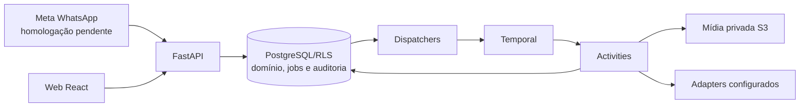

# SDD geral — Meu Braço Direito

**Leitura das instruções de motion — 13/11/2026.**
A auditoria documental identificou gates históricos, versões, custos e estados
operacionais descritos como “atuais” em registros antigos. Para a próxima rodada,
consultar `docs/design/motion-orientacao-vigente-2026-11-13.md` e o roteiro de 13/11.
Relatos abaixo permanecem históricos no escopo de cada entrega; não renovam
orçamento, não repetem migração e não substituem instruções atuais do titular.
Correção somente documental; capacidades propostas ainda não implementadas.

**Roteiro técnico até uma nova peça completa — 13/11/2026.**
Análise convertida em sete etapas com entregáveis e critérios de avanço:
baseline, mecanismos executados, planejamento/material, ciclo de revisão,
validação/orçamento, geração completa e avaliação do resultado. Roteiro em
`docs/design/motion-roteiro-melhoria-peca-completa-2026-11-13.md`.
Estado: proposto, ainda não implementado. Esta alteração é documental;
nenhuma nova chamada paga, migração, render ou mudança de produção. A próxima
execução deve entregar MP4 pelo processo melhorado, distinguindo prova técnica,
melhora visual e aceite do titular. Orçamento novo exige autorização explícita.

**Prévia reprovada visualmente; 41 referências analisadas — 12/11/2026.**
Titular considera a peça abaixo do mínimo em cenas/conteúdo/transições/impacto;
áudio é avanço pontual, sem aprovação global da mistura. Não é falta de exemplos
nem escolha obrigatória de um estilo. Analisados 16 links e 26 Shorts do canal
PropagandaIA (um em comum): 41 vídeos, 542,586 s, 2.166 amostras em toda a duração,
87 amostras adicionais de quatro passagens e notas individuais/galeria privada.
Sem escuta perceptiva ou auditoria de ferramentas dos autores. Diagnóstico:
conteúdo/material, encenação e inspeção executada são insuficientes na rodada;
fidelidade ao plano e cobertura declarada não garantiram elaboração visual.
Capacidade de imagem disponível no produto estava desabilitada; vídeo gerado/3D
não podem ser presumidos. Parte importante das referências é motion por código.
Mudança proposta: material/direção factíveis, construção por partes, revisão da
peça completa e aceite calibrado; sem impor 100 quadros ou quantidade de cenas.
Nenhum código de produção, chamada paga, render novo, migração ou serviço
iniciado nesta análise. Estudo e 41 fichas:
`docs/evals/analise-41-referencias-motion-2026-11-12.md`.
Relatos anteriores de avanço técnico não representam aceite visual do titular.

**Prévia audiovisual completa entregue — 12/11/2026.** Titular autorizou gerar
a peça. MP4 local de 11,2 s, 720 × 1280 a 30 fps, H.264/AAC, 336 quadros,
voz + servir conforme plano, sem outra chamada paga. Código exato conferido no
checkpoint/owner/RLS e materiais restaurados pelo serviço existente; execução
Temporal de tentativa única com renderer isolado, sem alterar código de produção.
Quadros decodificados mostram xícara → U de PAUSA, campo móvel e convite; avaliação
de fluidez/integração tipográfica/escuta ainda cabe à reprodução da peça.
Prévia supervisionada privada, sem fabricar aprovação artística, publicação ou
conclusão nativa: checkpoint nativo render autoriza storyboard e produção posterior
exige revisão paga; pedido nativo permanece no checkpoint, sem alterar decisões.
Workflow da prévia COMPLETED, MP4/35 evidências privados em render-preview-v1.
Saída validada/decodificada, -15,3 LUFS e pico amostral -3,6 dBFS; métricas não
substituem escuta. Global disabled/execução false, cinco serviços exited, nenhum
banco migrado; custo pago acumulado estimado continua US$ 0,774901. CI global
mantém os gates anteriores. Resultado e limites:
`docs/evals/previa-motion-completa-2026-11-12.md`.
Registros anteriores de ausência de render descrevem o estado antes desta autorização.

**Código do plano aprovado gerado e revisado — 12/11/2026.** Titular autorizou
avançar para implementação com parada antes do render. Aprovação exata persistida;
uma chamada de código pelo fluxo real, composição recebida e awaiting_render.
Metadados idênticos ao plano, um vídeo contínuo e áudio original + servir previsto.
Sintaxe/bundle sem execução passaram; fórmulas da trajetória em arco evitam a
janela do vídeo em 10.001 amostras por passagem. Sem prévia/escuta ou certificação
artística. Guarda privada inicial confundiu ordem de chaves JSON; falhou antes
de claim/contagem/reserva/submissão. Corrigida e criada continuação interna
explícita, auditada/idempotente, somente sem efeito de código/upload iniciado;
aprovação e falha preservadas. Sem retry pago, endpoint ou migração novos.
1.657 testes motion (dois skipped), casos PostgreSQL de checkpoints e 40 unitários
do orquestrador passaram; checkpoints 100% linhas/branches. Ruff/formato/Mypy e
diff --check aprovados; CI global ainda pendente nos gates anteriores.
Código US$ 0,332548 estimados, reserva US$ 1,25 uncertain mantida; três chamadas
da sequência somam US$ 0,774901 estimados, sem fatura conciliada. Workflow
COMPLETED, pedido running/token liberado, checkpoint de render sem decisão.
Nenhum render/quadro/asset de IA, migração ou serviço iniciado; global disabled,
cinco serviços restritos exited. Escopo, revisão, custos e pendências:
`docs/evals/implementacao-motion-plano-aprovado-2026-11-12.md`.
Registros de awaiting_plan/código não autorizado abaixo são históricos.

**Correção validada em novo plano — 12/11/2026.** Após autorização de uma
chamada substituta até US$ 1,25, encerrada a rodada anterior pelo checkpoint com
feedback e histórico preservados. Correções: piso v2 exige desenvolvimento visual
no pedido simples; entrada separa escuta por fase; guard permite ação dentro do
vídeo-fonte com layout em hold, sem liberar outro vídeo/grafismo parado. Entrada
final v9 (v8 superada antes de envio), ASR novo e fluxo real até awaiting_plan.
Novo plano transforma xícara no U de PAUSA e apoio em campo de leitura; propõe
servir em 1.900–3.680 ms ligado ao vídeo parado e omite contato sem ação observada.
Validadores e compilação de soundtrack em memória passaram; raw e plano iguais.
Pontos anteriores tratados na proposta escrita; metamorfose, proteção da fonte,
leitura e som/mistura ainda exigem execução/prévia/escuta. Sem aprovação artística
ou decisão de implementar. Estimativa desta chamada US$ 0,228198, reserva US$ 1,25
uncertain mantida; duas chamadas somam US$ 0,442353 estimados, sem fatura.
1.657 testes motion (dois skipped), 24 integrações e 100 dirigidos passaram;
qualidade/catálogo com 100% de linhas/branches, lint/formato/Mypy aprovados.
CI global continua pendente. Nenhuma nova migração, código, asset de IA, render
ou serviço iniciado; global disabled e cinco serviços restritos exited. Resultado:
`docs/evals/plano-audiovisual-corrigido-2026-11-12.md`.
Os estados anteriores de entrada v8/espera de orçamento/ausência de plano são históricos.

**Correção da preparação do planejamento — 12/11/2026.** Pedido posterior
mandou encontrar o problema e ajustar. Identificadas lacunas verificáveis:
desenvolvimento visual aparecia em orientações condicionais, mas não como critério
próprio do piso; escuta humana e pendência da mistura não eram sintetizadas por
fase na entrada. Perfil novo motion-production-quality-v2 exige oitavo critério
visual_development no pedido simples e explicita a escolha composicional;
planning_input agrupa disponibilidade/relato humano/hash/revisão futura de som,
sem exigir efeitos ou apagar limitações. Snapshots v1 preservados na recaptura;
plano/checkpoint original intactos, payload anterior reproduzido byte a byte.
Pacote v8 montado com ASR local novo e conferido, sem nova geração paga/admissão/
render. 1.652 testes motion (dois skipped), 23 integrações e 26 dirigidos passaram;
100% linhas/branches em motion_quality, lint/formato e Mypy 334 + oito scripts
aprovados. CI global segue pendente. A correção da entrada não demonstra melhora
artística; novo plano precisa ser gerado/revisado. Chamada anterior consumida;
nova proposta de uma chamada até US$ 1,25 ainda não autorizada. Detalhes:
`docs/design/motion-correcao-planejamento-2026-11-12.md`.
Estados de sete critérios e preparação v7 abaixo descrevem o histórico.

**Plano audiovisual recebido e revisado — 12/11/2026.** Titular autorizou
explicitamente somente a migração 0118 e uma chamada de plano até US$ 1,25.
Backup privado verificado; dev 0117 → 0118, sem tabela nova ou dados removidos.
Admissão/owner/RLS → Temporal/ASR novo → contagem/reserva → plano → checkpoint
real awaiting_plan. Payload exato v7, 15 quadros da fonte/zero de peça anterior;
nenhum código, asset de IA, render ou aprovação automática. Workflow completado;
pedido running com execution_token liberado, aguardando decisão. Retorno/entrada/
raw e custo preservados. Estimativa US$ 0,214155 (39.898 tokens entrada/11.441 saída),
sem fatura; reserva US$ 1,25 uncertain mantida no ledger. Direção propõe três
momentos tipográficos com vídeo contínuo e omite ambos os efeitos. Validadores
passaram; revisão do assistente recomenda desenvolver composição além de títulos/
barras/reposicionamento e melhorar motivo da omissão de servir café; omissão de
contato tem base na fonte. Não é reprovação de vídeo ainda não renderizado nem
exigência de usar som. Plano original/checkpoint não foram alterados ou aprovados.
Configuração paga só no processo já encerrado; global disabled, cinco serviços
restritos exited. CI integral permanece pendente. Resultado, revisão e limites:
`docs/evals/plano-audiovisual-motion-2026-11-12.md`.
Os estados anteriores de espera de autorização/ausência de plano são históricos.

**Plano solicitado, execução preparada — 12/11/2026.** Titular autorizou
somente gerar/revisar plano, até US$ 1,25 da proposta nova; código/render seguem
sem autorização. Corrigida formatação dos 13 arquivos com AST idêntico, sem
alterar lógica. Lint, formato de 905 arquivos e Mypy (334 módulos app + oito
scripts) passaram; 1.646 testes motion (dois skipped) e 23 integrações de motion/
checkpoints passaram. CI integral continua pendente: cobertura Node abaixo de
100%; backend ampliado interrompido após 108 aprovados/sete falhas de geocodificação,
incluindo policy_id ausente no _test. Sem corrigir schema implicitamente.
Execução privada preparada com admissão/RLS, ledger/Temporal e limite de uma
chamada, payload v7 exato, sem aprovação automática ou renderer. Dev confirmado
0117: aplicar 0118 para persistir checkpoint depende da autorização específica
solicitada, conforme restrição original contra migração implícita. Credenciais
presentes/Temporal saudável; backup compatível preparado, ainda não executado.
Sem migração, admissão ou chamada paga nesta rodada; plano ainda não existe.
Registro: `docs/evals/plano-motion-solicitado-2026-11-12.md`.
Os estados anteriores de 13 arquivos pendentes de formato foram superados.

**ASR e evidência sonora vinculada — 12/11/2026.** Preparação v7 executa
ASR novo pelo serviço/adapter real, com claim/recibo privados de inspeção,
sem admissão/Temporal ou transcrição arquivada. Contrato de análise capturado
somente para novos pedidos de qualidade; loader mede PCM limitado fora da
transação, retomada compara análise e plano respeita duração decodificada.
Evidência opcional audio exige ID/hash/bytes; escuta humana permanece identificada,
sem virar aprovação de eventos/mistura. Snapshots/serializações históricos
preservados. Fonte original intacta; 30 palavras com uma de confiança baixa,
sem revisão humana do texto/tempos. Entrada v7 verificada e orçamento US$ 2,50
proposto, não autorizado. Testes/Ruff/Mypy aprovados, 100% em análise/catálogo;
CI/cobertura global pendentes por 13 arquivos de formato anterior. Sem migração,
chamada paga ou render. Contrato/resultado/gates:
`docs/design/motion-asr-avaliacao-sonora-orcamento-2026-11-12.md`.
Registros v5/v6 abaixo preservam o histórico anterior ao fechamento local.

**Qualidade sem base obrigatória — 12/11/2026.** Geração nova no percurso
acompanhado captura `motion-production-quality-v1` automaticamente: sete critérios
do produto, alvos/justificativa/verificação no plano, sem IDs/frames de peça
anterior. Contrato de geração v2, criativo v9 e preparação v3; versões históricas
preservadas. Builder rejeita histórico misturado a esse modo. Requisitos de fala
e pendências essenciais são conferidos antes de gastar com planejamento. Exportador
não injeta ASR arquivado: preparação real v5 sem histórico, explicitamente bloqueada
pela falta de ASR configurado. Avaliação comparativa dos ensaios fica separada da
entrada de geração; critérios declarados não garantem qualidade observada.
Ruff/Mypy e testes dirigidos/integrações passaram; CI/cobertura integral pendentes
pela formatação anterior. Sem migração, gasto, render ou serviço novo. Contrato:
`docs/design/motion-piso-qualidade-independente-2026-11-12.md`.

**Planejamento audiovisual revisável — 12/11/2026.** `propose_direction=true`
habilita `proposed-audiovisual-output-v1`/criativo v8/preparação v2: mensagem exata
e contexto recuperado → direção, plano temporal e seleção sonora propostos →
checkpoint `plan`. A interpretação ainda depende da chamada futura; nenhuma nova
direção foi gerada nesta entrega. Seleção `motion-evolution-v2` vincula funções à
base real/evidências e exige alvos/justificativas no plano, sem impor composição.
Após aprovação exata, metadados completos/hash ficam imutáveis no código; resolver
materiais antes de implementar e manter `awaiting_render` antes de storyboard.
Capacidade reserva a próxima chamada em pedidos com checkpoints, sem criar saldo
ou autorização. Catálogo sonoro local fixado por hash fornece arquivos/metadados;
eventos precisam de ação temporal/cena/elemento e candidatos omitidos têm razão.
Compilação usa mixer v2 com original protegido; adequação/duplicação/inteligibilidade
permanecem pendentes de escuta. Repertório v4 sem os oito prints mantém exemplos e
histórico. Sem tabelas/serviços/migração, gasto ou render novos. Testes de propagação,
RLS, inconsistências e pausas passaram; 100% nos dois módulos novos, CI/cobertura
integral ainda pendentes pela formatação anterior. Pacote privado v4 montado pelo
builder real, dev 0117/runtime disabled e `_test` 0118 preservados. Escopo, validação,
capacidade integrada versus instrução/fonte e próxima autorização:
`docs/design/motion-planejamento-audiovisual-revisavel-2026-11-12.md`.
As pendências de implementação dos registros abaixo descrevem o estado anterior.

**Curadoria de referências revisada — 12/11/2026.** Retirar da próxima seleção
os oito prints examinados pelo titular, mantendo pacotes históricos e as demais
evidências/capacidades. O builder atual vincula todas as imagens do pacote por
ID/hash; evoluir seleção/contrato sem relaxar essas guardas. Referência nova exige
necessidade da cena, mecanismo demonstrável, evidência adequada, adaptação viável
e verificação posterior. Decisão/limites em
`docs/evals/ensaio-acompanhado-motion-2026-11-12.md`; implementação pendente.

**Conferência da entrada acompanhada — 12/11/2026.** Captura/builder reais
produziram pacote inspecionável sem submissão. Entrevista posterior superou o
rascunho: mensagem natural, piso funcional sem template e seleção sonora pública
licenciada. Probes locais mostram direção obrigatória/imutável no modo acompanhado;
classificar hipótese não libera redesenho. Áudio só recebe IDs/eventos previamente
selecionados; informação sobre fornecedores nas referências não aciona aquisição.
Sem mudança de runtime; reconciliação de entrada, obtenção de materiais e avaliação
funcional ainda pendentes. Evidências/estado:
`docs/evals/ensaio-acompanhado-motion-2026-11-12.md`.

**Checkpoints de preparação — 12/11/2026.** `MotionRequest` aceita `preparation`
e `review_checkpoints`; sem campos novos, mantém serialização/percurso históricos.
Builder verifica vínculos entre evidências declaradas e bytes anexados. Pausas
`plan`/`render` usam efeitos privados existentes e decisão com hash exato; pedido
fica ativo sem execution_token durante espera. Aprovação retoma por outbox e
Temporal com identidade própria, sem repetir plano/ASR. `render` libera apenas
storyboard; MP4 mantém aprovação posterior. Migração 0118 amplia quatro eventos,
sem tabela/serviço novo, aplicada somente no `_test` autorizado. 65 testes dirigidos
passaram, cobertura 100% nos quatro módulos novos; regressões descritas no contrato.
CI global pendente em 17 arquivos de formatação anterior. Sem nova qualidade
visual demonstrada. Contrato, API, limites e pendências:
`docs/design/motion-preparacao-e-revisao-fases-1-3-2026-11-12.md`.
OpenCode foi identificado para uma possível interface de diagnóstico: proposta em
`docs/design/opencode-e-inspecao-do-produto-2026-11-12.md`; ainda não integrado.

**Rastreamento técnico completo — 12/11/2026.** Documentados ASGI/API, snapshot,
outbox, Temporal, inputs, ASR local, contagem de tokens/Responses, normalização de
plano/código, storyboard e preview separado. Direção reinserida pelo servidor;
respostas literais e hashes conferidos nos recibos. Execução não percorreu intenção
natural nem crítica/correção/complete. Sem alteração de runtime; detalhes em
`docs/evals/auditoria-fluxo-motion-2026-11-12.md`.

**Conferência das fronteiras da geração — 12/11/2026.** Builder real reproduziu
semanticamente a entrada histórica; hash original conferido no recibo. Não é nova
admissão. Plano/materiais/implementação hoje encadeiam sem pausa humana; retomada
durável intermediária é pendência para a execução acompanhada, não implementada.
Nenhuma mudança de runtime/banco. Relatório e evidências:
`docs/evals/auditoria-fluxo-motion-2026-11-12.md`.

**Direção e alcance do feedback — 12/11/2026.** Distinguir requisito explícito,
observação, exemplo e hipótese antes de fixar a direção. Fidelidade à direção
não avalia sua qualidade. Estudo por janela de cerca de 4–5 s proposto com tempo
absoluto, contexto de passagem e avaliação do conjunto; não há modo novo de
geração por trecho implementado. Montador, executor e controles preservados;
somente análise/documentação. Escopo e pendências:
`docs/evals/revisao-acabamento-cinematografico-motion-2026-11-11.md`.

**Feedback favorável e próximo acabamento — 11/11/2026.** Titular gostou do MP4
atual e o considera melhor que o último, mas distante do impacto da referência.
Preservar esta versão/hash como referência de continuidade; sem aceite final nem
aprovação fictícia no banco. Auditoria confirma 18 elementos, zero eventos sonoros
extras e referências Maestros de trajetória (80/84/88 s), não os trechos de
luz/câmera. Próximo foco proposto: preparação/revelação em ambiente coerente; A/B
sonoro separado. Distinguir incremento localizado de conclusão global do contrato
(o seletor atual exige ganho nas quatro dimensões); manter não regressão.
Revisão recorrente por rodada definida, ainda não automatizada. Somente análise
e documentação, sem nova geração/gasto/runtime. Evidências e prioridades:
`docs/evals/revisao-acabamento-cinematografico-motion-2026-11-11.md`.

**R5 — MP4 de avaliação autorizado e entregue, 11/11/2026.** Titular pediu o vídeo
após ver os quadros. Mesmo plano/código/material/áudio, renderizados no executor e
Temporal existentes: 720 × 1280, 30 fps, 11,2 s, áudio original; decodificação
verificada. Sem chamada paga adicional, edição do código gerado ou publicação.
Pedido original continua falho; não se fabricou aprovação persistida nem se
relaxou a recaptura. MP4 local para avaliação: `.local/evals/motion-recovery-run-20261111/nova-peca-avaliacao.mp4`.
Cinco serviços parados; qualidade criativa, persistência e CI ainda pendentes.
Evidências: `docs/evals/execucao-recuperacao-motion-2026-11-11.md`.

**R5 — geração recebida, entrega bloqueada, 11/11/2026.** Plano e implementação
concluídos; persistência do storyboard falhou por colisão de identidades dos quadros
globais v3. Bug corrigido, teste adicionado; migração 0117 permite dois eventos de
recaptura, sem novas tabelas. Recuperação por Temporal, sem provider, parou por
diferença de pixels. Diagnóstico guardou 20 quadros: 19 hashes iguais, diferença
em 2.800 ms ainda não localizada. Pedido `failed`, sem storyboard aprovado ou MP4.
US$ 2,50 reservados; estimativa US$ 0,568106, sem fatura. Não repetir chamadas nem
relaxar o controle. Prévia e evidências em
`docs/evals/execucao-recuperacao-motion-2026-11-11.md`. Qualidade visual não aprovada.

**Recuperação R5 — nova rodada autorizada, 11/11/2026.** Titular autorizou gerar
com teto novo da proposta US$ 6,25, sem imagens novas, somente áudio original,
até uma correção delimitada e aprovação do storyboard antes do MP4. Admissão
real e executor sintético conferidos; 77 testes dirigidos passaram. CI integral
permanece pendente; rodada operacional não equivale a merge/aceite visual.
Execução/evidências: `docs/evals/execucao-recuperacao-motion-2026-11-11.md`.

**Recuperação R1–R5 — entrega técnica, 11/11/2026.** Pedido posterior autorizou
implementar as cinco fatias. R1–R4: base histórica vinculada ao contexto real,
imagem original reutilizável, matriz de preservação, direção revista, cobertura
temporal v3 e seleção comparativa que bloqueia regressão/empate/incerteza.
R5: pacote real preparado e verificado; execução pendente, sem qualidade visual
nova validada. Etapas 1–6 preservadas; etapa 7 aberta. Nenhuma chamada paga,
asset novo, render, tabela ou serviço criado. Reserva nova proposta US$ 6,25,
não autorizada; storyboard continua anterior ao MP4. 1.114 testes passaram,
dois skipped; Mypy em 325 módulos. CI parou na formatação preexistente; cobertura
integral e integração `_test` pendentes. Evidências e limites:
`docs/evals/recuperacao-motion-r1-r5-2026-11-11.md`.
Os registros abaixo descrevem estados anteriores, superados por esta entrega.

**Plano operacional de recuperação — 11/11/2026.** R1–R5 definidos em
`docs/design/plano-recuperacao-e-evolucao-motion-2026-11-11.md`. Preservar contratos
atuais e snapshots; distinguir base histórica da candidata usada na correção.
Vínculo autorizado de artefatos, payload efetivo, obrigações declaradas antes de
construir e seleção comparativa são entregas futuras, não controles já ativos.
Reusar serviços/armazenamento/identidades existentes. R1–R4 sem geração de peça;
R5 exige nova autorização e storyboard antes do MP4. Nesta entrega: documentação,
conferência de fontes locais e diff; sem testes de runtime ou CI integral.

**Recuperação sem retirar capacidades — 11/11/2026.** Preservar implementações
das etapas 1–6 e corrigir o vínculo/comparação com a base dentro do fluxo atual.
Falta verificar capacidades ativas na entrada/execução real e bloquear conclusão
criativa/seleção como nova referência quando houver regressão ou evidência ausente
na rubrica existente. Teste estrutural não certifica ganho artístico. Decisão
documentada no contrato de qualidade; nenhum bloqueio novo implementado aqui.

**Lacuna de preservação criativa — 11/11/2026.** Auditoria da etapa 7 confirma:
`baseline/*` no export não vincula a base à geração; entradas reais de plano e
implementação têm `previous_composition=null`. Direção fornecida e IDs são
imutáveis, mas já perderam sete elementos desde a etapa 1. Prova local com os
validadores confirma rejeição ao restaurar um desses elementos sem rever o
contrato de entrada. Correção delimitada protege a candidata da mesma rodada,
não a qualidade de uma base histórica. Falta vínculo e verificação comparativa
de funções antes de nova execução. Nenhuma alteração de runtime/banco/serviços;
diagnóstico, limites e evidências em
`docs/evals/diagnostico-regressao-motion-2026-11-11.md`.

**Reprovação criativa da etapa 7 — 11/11/2026.** Validação estrutural e hashes
corretos não impediram um plano visual genérico. Titular reprovou a composição;
correção delimitada preserva o plano e não cobre sua reformulação narrativa.
Sem aprovação do storyboard, MP4 ou nova chamada. Estado persistido ainda
awaiting_approval; feedback registrado na documentação, sem decisão terminal
via API. Diagnóstico: `docs/evals/comparacao-qualidade-motion-etapa7-2026-11-11.md`.

**Etapa 7 de qualidade motion — parada no storyboard, 11/11/2026.** Nova operação
admitida por API, outbox e Temporal; plano → uma imagem → implementação → 18 quadros
concluídos. Entradas reais reproduzidas por SHA-256; executor qualificado. Reservas
US$ 3,00 preservadas como incertas no ledger; estimativa US$ 0,372465. Teto US$ 6,75,
sem reutilização anterior. Workflow concluído em awaiting_storyboard, storyboard
awaiting_approval, nenhuma decisão/evento de aprovação ou MP4 do cliente. Worker
encerrado; sem migração ou novo serviço. CI integral e qualidade visual pendentes.
Recibos e limites: `docs/evals/comparacao-qualidade-motion-etapa7-2026-11-11.md`.

**Etapa 7 de qualidade motion — preparação, 11/11/2026.** Exportação usa builders
reais e verifica invariantes da base; só o payload de plano está completo. Schemas
futuros, dependências, rubrica não avaliada e proposta de reservas são explícitos.
Executor reconstruído por digest, sem deploy/qualificação; API/Temporal/dev não
foram acionados. 24 testes dirigidos, Ruff e Mypy passaram; CI integral pendente.
Sem gasto, geração ou render. Execução e aceite da etapa 7 ainda exigem autorização;
não há etapa 8 definida. `docs/design/motion-etapa-7-preparacao-comparacao-2026-11-11.md`.

**Etapa 6 de qualidade motion — 11/11/2026.** Novas capturas incluem contrato
de correção localizada; snapshots antigos preservados. Implementação pode mudar
HTML/JS, mantendo todos os metadados do plano, direção e áudio. Hashes de todos os
rasters antes da codificação comparam região protegida no mesmo ambiente fixado;
falha rejeita a candidata, sem crítica paga adicional nem seleção. Evidência e
resultado registrados como revisão local com reserva zero. Sem banco ou render
real; CI, imagem do executor e aceite visual pendentes. Etapa 7 aguarda OK.
Detalhes: `docs/design/motion-etapa-6-correcao-delimitada-2026-11-11.md`.

**Etapa 5 de qualidade motion — 11/11/2026.** Complementos selecionados e
atestados pelo titular usam acervo e vínculos existentes; ramo original protegido,
fades, ducking exclusivo da música e medição implementados. Testes sintéticos
locais aprovados; sem peça, escuta ou A/B. Falta material adequado autorizado e
reconstruir/fixar a imagem do executor antes do uso. Etapas 6–7 pendentes; etapa 6
requer OK. Detalhes: `docs/design/motion-etapa-5-som-e-voz-2026-11-11.md`.

**Etapa 4 de qualidade motion — 11/11/2026.** Skill HTML v13 acrescenta exemplo
opcional de preparação, objeto apoiado, repouso e retorno coordenado de gravação,
fundo e texto usando movement-v3. Snapshots anteriores, executor e bancos não foram
alterados. Montador real exportou entrada de plano v4 com fonte, kit, áudio,
transcrição e referências preservados, sem chamada ou render. 14 testes Node,
133 Python dirigidos, Ruff e Mypy do loader aprovados; sem CI integral. Isso não
comprova acabamento visual ou sincronia. Etapas 5–7 pendentes; etapa 5 requer OK.
Detalhes: `docs/design/motion-etapa-4-espaco-coreografia-2026-11-11.md`.

**Etapa 3 de qualidade motion — 11/11/2026.** Novas capturas com direção usam
v4: plano validado → materiais resolvidos → previews verificados → implementação;
v1–v3 históricas preservadas. Imagens ausentes interrompem a implementação;
pedido de revisão de plano preserva recibo e não gera nova chamada automática.
Exportação e adapters locais comprovam o vínculo, sem gasto ou render. Não há
prova visual nem retomada parcial automática; imagem anterior não foi encontrada
em `.local`. Etapas 4–7 pendentes; etapa 4 requer OK. Verificações e limites:
`docs/design/motion-etapa-3-assets-antes-do-codigo-2026-11-11.md`.

**Etapa 2 de qualidade motion — 11/11/2026.** Política temporal v2 distribui
janelas entre passagens e ação, respeitando o teto de 20 quadros e declarando
omissões; v1 histórica preservada. Storyboard apresenta sequências estáticas e
continua sendo portão após código, antes do MP4. Ao retomar, confere materiais,
direção e runtimes vinculados; quadros não comprovam movimento contínuo nem som.
Caso Café Pausa reproduz seleção de duas passagens e entrada da xícara, com
46 de 49 eventos omitidos; sem nova captura ou crítica. Testes dirigidos, Ruff
e Mypy aprovados; sem CI integral. Sem gasto, banco, geração ou render. Qualidade
visual e etapas 3–7 pendentes; etapa 3 requer OK do titular. Evidências e limites:
`docs/design/motion-etapa-2-revisao-representativa-2026-11-11.md`.

**Etapa 1 da evolução de qualidade motion — 11/11/2026.** Entrega técnica de
direção verificável e repertório aplicado: direção e brief revisados para Café
Pausa, matriz de problemas com instantes, regiões relevantes identificadas por
revisão humana e fichas selecionadas; sem impor borda ou efeito por palavra.
Novas capturas usam skill v12; o repertório opcional `business-reel-v2` incorpora
amostras e fichas rastreáveis, preservando versões históricas. Exportação offline
pelo montador do produto em `.local/exports/motion-qualidade-etapa1-final-20261111/`;
fonte, kit, áudio e transcrição iguais à base; seis quadros da fonte e cinco
imagens de referência. Restaurados, por autorização do titular, os contratos
removidos no commit posterior `4adb596` para manter o fluxo existente. Não há
peça nova nem qualidade visual aprovada.
Testes dirigidos: 96 Python, 62 de skill/contexto e 7 Node (grupos sobrepostos,
sem soma); Ruff e Mypy em quatro módulos aprovados. CI integral não executado. Verificação dos cinco contêineres
bloqueada pelo socket; não se afirma seu estado atual. Sem gastos, geração de
assets ou renderização. Etapas 2–7 permanecem pendentes, e a próxima depende de
OK do titular. Evidências e proposta:
`docs/design/motion-etapa-1-direcao-verificavel-2026-11-11.md`.

**Contrato de evolução de motion planejado — 11/11/2026.** Sete etapas com
entregas, pontos de implementação e aceites: direção, cobertura de revisão,
asset disponível antes da implementação, composição espacial, som protegido,
correção verificável por intervalo e comparação. Preserva Temporal/ledger e
executor atuais; nenhum serviço/tabela novo prescrito. Storyboard existente é
posterior ao código; correção localizada não promete render parcial. Sem mudança
de runtime ou testes nesta entrega documental. Todas as etapas pendentes em
`docs/design/contrato-evolucao-qualidade-motion-2026-11-11.md`.

**Reanálise de qualidade após feedback do titular — 11/11/2026.** A comparação
executou corretamente, mas a moldura foi considerada estranha e a xícara sem a
expressividade esperada. Seis frentes detalhadas: direção por sentido da fala,
integração da gravação, fundo, presença do objeto, som e revisão por cena.
Auditoria confirmou direção excessivamente prescritiva em moldura, código antes
dos pixels da imagem, storyboard desligado na rodada e seleção de três eventos
de fala concentrados no mesmo momento (46 de 49 eventos omitidos). A referência
Maestros foi reexaminada com transcrição e quatro sequências adicionais; não foi
incorporada automaticamente à entrada da peça. Prioridade proposta: direção e
repertório aplicáveis, cobertura da revisão, construção com asset visto, som e
refinamento delimitado; percepção/3D somente conforme necessidade. Nenhuma nova
implementação, geração, gasto, migração ou CI nesta análise. Plano e evidências:
`docs/design/motion-qualidade-direcao-e-gaps-2026-11-11.md`.

**Comparação concluída após reposição de créditos — 11/11/2026.** Novo pedido
pelo fluxo API/Temporal gerou plano e código completos, uma xícara conceitual
fotográfica, MP4 de 11,2 s (720×1280/30 fps) e crítica adequada. Mesma fonte/voz/kit
e 12 imagens, sem refações. Moldura, alternância e mudança dos planos de fundo
observadas; transições próximas de 4 s e 8,8 s ainda merecem refinamento. Crítica
limitada a amostras, sem escuta; nenhum aceite humano ou publicação.
Estimativa desta tentativa US$ 0,737973; reservas US$ 2,75 no teto US$ 3.
Pedido/reservas anteriores preservados separadamente. Worker exclusivo encerrado;
cinco serviços seguem parados. MP4 e comparação em
`.local/evals/motion-staged-retry-20261111/`. Relatório:
`docs/evals/comparacao-construcao-em-etapas-2026-11-11.md`.

**Prova real v3: plano completo; implementação bloqueada por créditos da API.**
Nova rodada de US$ 3 executada pela API/Temporal no banco de desenvolvimento
existente. Planejamento validado e preservado (3 cenas, 36 beats); segunda chamada
recusada pelo provedor com `insufficient_quota/credit_balance_exhausted`.
Não foi outra saída truncada. Nenhuma imagem, crítica ou nova peça produzida;
conclusão da implementação e acabamento continuam pendentes. Estimativa conhecida
US$ 0,22592, reservas US$ 1,50 mantidas; rejeição sem usage/custo conhecido.
Sem repetição ou reutilização de orçamento. Worker exclusivo encerrado; cinco
serviços seguem parados. Entrada exata da implementação exportada e verificada
por hash, sem chamadas adicionais. Evidências e próximo desbloqueio:
`docs/evals/comparacao-construcao-em-etapas-2026-11-11.md`.

## Atualização — 11/11/2026

**Contrato de construção v3 implementado.** Plano e implementação são efeitos
duráveis distintos no Temporal/ledger existentes; sem tabela ou serviço externo
novo. Plano completo validado antes de código, áudio/direção/metadados preservados
na montagem, schema com ordem deliberada e wire hash separado do hash canônico.
V1/v2 e correções completas mantidos. Preflight exige orçamento para as duas
etapas e crítica; nenhuma tentativa implícita. Exportador distingue as etapas.
Dev já está na revisão 0116; não alterado. Prova de API/render e qualidade pendentes,
sem gasto nesta fatia. Limites de recuperação e validação documentados em
`docs/design/motion-construcao-em-etapas-2026-11-11.md`.
Validação: 473 testes dirigidos, 100% nos seis módulos medidos; Mypy/Ruff OK.
23 integrações passaram; Temporal local indisponível impediu concluir o conjunto.

**Análise técnica da referência Maestros concluída.** Preservar Python/API,
Temporal, renderer isolado, kits, acervo e controles de custo. Próxima fatia
recomendada: plano/construção com artefatos completos recuperáveis, helpers
reutilizados e serialização de schema separada do hash canônico. É proposta,
não implementação nem comprovação da causa raiz do limite. Relatório confronta
transcrição/quadros com executor, ASR, áudio e revisão existentes; nenhuma nova
dependência ou serviço. Edição longa permanece fora do escopo atual.
Referência: `docs/evals/analise-video-maestros-WuzMxEKJHkQ-2026-11-11.md`.

**Análise das interrupções concluída, sem chamada paga adicional.** Retornos
reproduzidos offline no parser: corte em scene_init vem marcado pela API; limites
locais de bytes, orçamento e falta de anexos não explicam a falha registrada.
Identificados saída indivisível, ordenação alfabética do schema colocando código
após plano e reasoning=high fixo. A causa raiz do limite reportado continua sem
comprovação: uso abaixo do teto e dos limites públicos do modelo. Compactação de
20,87% não era prova de conclusão. Próximos passos documentados, não implementados.
Relatório: `docs/evals/diagnostico-interrupcao-motion-2026-11-11.md`.

**Tentativa com contrato compacto concluída sem MP4.** O provedor voltou a retornar
MOTION_AI_OUTPUT_LIMIT, com JSON cortado em scene_init, após 562,74 s. Contrato v2
foi efetivamente enviado, mas a compactação não resolveu o bloqueio. Contagem:
35.340 tokens de entrada, 27.924 de saída (18.425 de reasoning); teto solicitado
e retornado 54.000. A causa do limite permanece indeterminada. Três tentativas
encerradas: estimativa acumulada US$ 0,998378, reservas US$ 2,80 mantidas. Nenhuma
imagem, crítica ou nova peça gerada. Sem novas tentativas autorizadas. Worker
exclusivo encerrado e cinco serviços seguem parados. Próxima geração exige uma
solução verificada para a saída incompleta; não repetir apenas ajustes de prompt.
Evidências: `docs/evals/comparacao-quatro-melhorias-2026-11-10.md`.

## Estado vigente — 10/11/2026

**Histórico — contrato compacto v2 preparado em 10/11/2026.**
Representação dos beats reduzida em 20,87% no plano completo da resposta anterior,
com igualdade exata dos 63 movimentos após expansão. Contratos antigos preservados;
mesmas validações e formato completo na persistência/crítica/render. 234 testes
dirigidos aprovados; cobertura integral dos dois módulos medidos, Ruff/Mypy OK.
Nenhuma nova chamada paga ou peça gerada. Entrevista de autorização pendente para
uma tentativa adicional: reservas acumuladas máximas US$ 3,95 no teto US$ 4.
A causa da interrupção anterior permanece indeterminada; redução não garante
sucesso. Detalhes: `docs/design/motion-contrato-compacto-2026-11-10.md`.

**Histórico — duas tentativas da comparação bloqueadas; sem novo MP4.** Duas
composições tentadas, incluindo a recuperação explicitamente autorizada dentro
do teto acumulado US$ 4. Ambas retornaram MOTION_AI_OUTPUT_LIMIT e JSON cortado
em scene_init. Recuperação: 364,07 s, 35.075 tokens de entrada e 19.856 de saída
(8.804 de reasoning), apesar de max_output_tokens=64.000 solicitado e retornado.
Não atribuir causa definitiva ao modelo nem confundir com falha de renderização.
Estimativa acumulada US$ 0,630788; reservas US$ 2,15 mantidas. Nenhuma imagem,
crítica ou MP4 produzido; não há terceira tentativa autorizada. ASR local funcionou
nas duas operações e registrou 30 palavras com custo zero. Qualidade visual ainda
não qualificada. Cinco serviços continuam parados; worker exclusivo encerrado.
Antes de outro gasto, investigar a saída interrompida e reduzir a repetição entre
plano e código sem perder as quatro melhorias. Detalhes e evidências:
`docs/evals/comparacao-quatro-melhorias-2026-11-10.md`.

**Histórico da entrega — etapa visual 4 implementada antes da comparação.**
Backend local faster-whisper baseado na abordagem do Clipador Viral dos Maestros
da IA: tempos por palavra, confiança e origem não revisada, com possibilidade de
entrada humana revisada. Execução no fluxo Temporal existente, claim durável e
reutilização em correção/storyboard. Skill v11, validação de fonte/onsets/focos e
amostragem dos eventos ligados. Mantidas moldura, fundo, objeto e alternância.
Configuração desabilitada por padrão; dependências/modelo ainda não instalados no
worker e nenhuma inferência real executada. Sem chamadas pagas, asset novo, MP4
ou Docker. 346 testes Python e 11 Node aprovados; cobertura integral nos sete
módulos medidos. Precisão/qualidade dependem da comparação.
Aguardar OK do titular para iniciar essa comparação, com escopo/orçamento próprios.
Vídeos brutos longos e cortes continuam futuros. Detalhes em
`docs/design/motion-fala-alinhada-2026-11-10.md`.

**Histórico — etapa visual 3: objeto realista em camadas.**
Novas capturas usam skill v10: seleção de imagem autorizada ou conceitual gerada,
material/luz coerentes e helper executável de recorte com sombra coordenada.
Moldura, fundo narrativo e alternância preservados; snapshots v1–v9 intactos.
Direção Café Pausa e especificação de uma única imagem preparadas; substituem
preenchimento do desenho por chegada/assentamento. Dependem de asset e capacidade
configurada; nenhuma imagem ou novo MP4 foi gerado. 131 testes Python e 11 Node
passaram, cobertura integral no loader medido e Ruff/Mypy aprovados. Sem chamadas
pagas ou Docker. Etapa 4 (fala alinhada) aguarda OK; qualificação visual pendente.
Detalhes: `docs/design/motion-objeto-realista-2026-11-10.md`.

**Histórico — etapa visual 2: fundo narrativo.**
Novas capturas usam skill v9, preservando moldura/escala da etapa 1 e movement-v3.
Incluído exemplo executável de base opaca, campo de cor e detalhe com movimentos
coordenados, repouso e contraste planejado. Café Pausa recebe três elementos de
fundo; os 16 elementos anteriores permanecem intactos. Capturas antigas conservam
suas skills. 97 testes Python e 9 Node passaram; cobertura integral no loader
medido, Ruff/Mypy aprovados. Pacote offline montado/verificado, sem geração paga,
asset novo ou MP4 nesta fatia. Acabamento visual permanece por qualificar.
Etapa 3 (objeto realista) aguarda OK. Detalhes em
`docs/design/motion-fundo-narrativo-2026-11-10.md`.

**Histórico — etapa visual 1: tratamento da gravação.**
Novas capturas usam skill v8 e movement-v3: orientação e exemplo executável de
moldura, entrada/assentamento, aproximação uniforme e saída coordenada. Corrigido
reset implícito do arredondamento CSS; radius explícito mantém controle. V1/v2 e
skills anteriores preservados por hash, inclusive recapturas e repertório v2.
99 testes Python e 30 Node passaram; cobertura 100% nos três serviços medidos,
Ruff e Mypy aprovados. Sem CI global, geração paga, asset novo ou MP4 nesta fatia.
Pacote offline preparado pelo montador; acabamento visual ainda não qualificado.
Etapa 2 (fundo vivo) aguarda OK do titular. Detalhes em
`docs/design/motion-tratamento-gravacao-2026-11-10.md`.

**Docker — pedido paralelo de diagnóstico atendido.** Cinco serviços em ciclo de
reinício consumiam mais de quatro núcleos na amostra inicial. Foram parados com
autorização explícita para mantê-los parados, sem restaurar ao final. Nenhum dado,
volume ou contêiner foi removido. Nove contêineres ativos na leitura posterior,
aproximadamente 492 MiB; limite da VM de ~3,83 GiB não é uso por contêiner.
Detalhes/limites em `docs/evals/diagnostico-docker-2026-11-10.md`.

**Histórico — etapa 1 de confiabilidade; comparação local concluída.**
Novas capturas com direção fornecida usam `provided-direction-output-v1`: o
modelo não repete scene_direction; o servidor a restaura integralmente antes
das validações/persistência. Snapshots antigos e direção proposta pelo modelo
preservados. Respostas inválidas agora conservam uso/custo estimado/request ID;
encerramento do subprocesso drena pipes após interrupção, evitando espera com
buffer cheio. Sem retry pago implícito ou relaxamento das validações.

O MP4 local da composição completa v6 foi concluído em 99,35 s: 11,2 s,
720×1280/30 fps, 336 quadros e áudio original, correlação de sinal 0,99998847.
A pausa temporária de cinco serviços com mais de 1.300 reinícios cada foi
explicitamente autorizada; os cinco foram restaurados após a captura. O teste
curto caiu de 75,90 para 26,38 s; limites e sandbox não foram ampliados.
Causa dos reinícios permanece fora desta fatia e pode voltar a afetar o ambiente.

Comparação: `.local/evals/motion-reliability-20261110/comparacao.html` e
`comparacao-alternancia.mp4` na mesma pasta. HTML/JS gerados preservados; apenas
os dois ajustes descritivos anteriores do plano. Não é nova geração v7 nem
qualificação automática: os pedidos anteriores continuam failed. Fundo ativo,
moldura e asset realista ainda precisam da prova específica. Zero novas chamadas
pagas; nenhuma reutilização de orçamento. Contrato compacto validado offline;
qualificação por modelo requer rodada própria autorizada.

Validação final: 441 testes Python dirigidos passaram (38,64 s), com 100% de
linhas/ramos nos quatro módulos medidos: adapters motion_ai/motion_html_renderer,
schema e serviço motion_generation. Ruff e Mypy de seis módulos aprovados;
exportação final verificada, links e JavaScript da comparação conferidos.
Sem CI global, testes SQL ou migração. A saída de exemplo cai de 39.029 para
29.970 bytes (23,21%); reconstrução offline preserva direção validada, HTML e JS.

Detalhes, evidências e pacote externo novo em
`docs/design/motion-confiabilidade-geracao-captura-2026-11-10.md`.

**Histórico anterior — alternância, fundo e confiabilidade; comparação então pendente.**
O titular pediu alternância entre gravação e motion e correção dos defeitos de
recorte/crítica; depois acrescentou fundo ativo, variação de moldura/escala do
vídeo e objetos mais realistas. Novas capturas usam skill v7, executor v2,
criativo v6/v7, movimento v2 e crítica v3. Snapshots antigos permanecem intactos.

Movement-v2 não cria máscara em tracks sem clip explícito. A crítica v3 liga
checks aos problemas por índices e inclui os quadros reais desses problemas,
sem relaxar mínimos de evidência ou inventar suporte. Passaram 393 testes Python
com cobertura integral nos cinco módulos avaliados; 66 testes de contexto/skills/
exportação após o feedback v7; 25 Node, Ruff e Mypy dos dez módulos. A prova
sintética no Chromium confirmou o conserto do recorte com máscaras preservadas.
Sem CI global ou SQL nesta fatia.

A rodada de até US$ 3 teve duas gerações autorizadas: primeira completa mas com
plano inválido (v6), recuperação incompleta (v7). Zero renders/críticas pelo fluxo,
pedidos failed e workers encerrados. Uso estimado total US$ 0,572968, incluindo
cálculo local da primeira resposta cujo ledger ficou sem estimativa; reservas
retidas US$ 2,15. Nenhuma imagem paga, retry adicional ou uso do saldo autorizado.

Não foi concluído novo MP4 para comparação. A variante local da primeira resposta
completa reuniu apenas dois intervalos descritivos do plano, HTML/JS intactos.
A captura integral excedeu 600 s; a tentativa local em trechos falhou por timeout
do navegador. Restaram três quadros estáticos, sem validação de movimento/áudio.
Processo diagnóstico encerrado; nenhum renderer remanescente. A resposta parcial
v7 não foi executada. Ver `previas-parciais.html` na pasta local do ensaio.
Asset realista em camadas (2.5D) é viável com os recursos de imagem existentes;
geometria 3D giratória ainda exige outra integração. Qualificação visual pendente.

Próximo gate: saída completa/validável, captura confiável, recuperação limitada e uso/custo de erros
preservados, antes de liberar a jornada do Reel. Depois: pedido/ajuste/aprovação/
download, fala alinhada, story em vídeo, carrossel e operação. Postagem é posterior.
Detalhes em `docs/design/motion-alternancia-e-confiabilidade-2026-11-10.md`,
`docs/evals/plano-motion-alternancia-2026-11-10.md` e
`docs/design/fechamento-produto-geracao-2026-11-10.md`.

**Histórico — interação entre mensagem e elementos, comparação entregue.** O titular pediu
setas, ícones e objetos com acabamento adulto e ações ligadas às frases. A direção
anterior restringia esses recursos indevidamente. A skill v4 e a nova direção
Café Pausa orientaram tempo→percurso, café→preenchimento, pausa→repouso/convite.
A coreografia usa texto editorial; não há transcrição alinhada nem sincronismo
vocal comprovado. Fonte, áudio, kit e versões históricas foram preservados.

A primeira geração veio incompleta. A recuperação explicitamente autorizada
renderizou, mas contêineres aninhados recortaram o vídeo; a crítica apontou o
defeito e falhou na vinculação exata das evidências. O pedido permaneceu `failed`.
Foi entregue uma variante com correção CSS local apenas desses recortes, pelo
mesmo renderer isolado, sem novas chamadas pagas ou aprovação automática.
Novas capturas usam skill v5, que acrescenta orientações sobre esses dois problemas;
recapturas conservam seus hashes. A v5 ainda não foi qualificada em geração real.

Teto acumulado US$ 3 respeitado: reservas US$ 2,90; estimativa pelo uso retornado
US$ 0,758614, distinta de fatura. O ledger da crítica inválida ficou sem estimativa;
o total inclui cálculo local explicitamente separado. Worker encerrado, ambiente
temporário removido. Passaram 100 testes Python e quatro Node; cobertura dirigida
do loader 100% de linhas/ramos, sem CI global. MP4 local: 11,2 s, 720×1280/30 fps.
Amostras visuais e sinal de áudio conferidos; acabamento depende do titular.
Ver `docs/design/motion-interacao-mensagem-2026-11-10.md` e
`docs/evals/plano-motion-interacao-2026-11-10.md`. Pendentes: confiabilidade do fluxo
automático, qualidade da v5 em prova futura e sincronismo com fala real. Nenhuma
nova chamada ou uso do saldo está autorizado.

**Comparação após a refatoração concluída.** Sob teto novo de US$ 5, o fluxo
API/Temporal gerou e renderizou uma candidata Café Pausa e concluiu uma crítica,
sem refações nem imagens pagas. Uso total estimado US$ 0,322005; reservas US$ 2,80,
distintas de fatura. MP4 720×1280/30 fps, 11,2 s; parecer `adequate` sem truncamento
nesta rodada, sem comparação automática com a peça anterior ou aceite humano.
Worker dedicado encerrado. Comparação A/B, custos, validação e limites em
`docs/evals/plano-comparacao-refatoracao-motion-2026-11-10.md`.
Aguardar avaliação do titular; saldo restante não autoriza novos efeitos.

**Decisão mais recente — etapa 6 concluída; pacote externo entregue.**
O titular confirmou a proposta Café Pausa em entrevista. O exportador usa o mesmo
montador de instruções/contexto do produto e `build_request`, com dados factuais
e amostras verificados da prova registrada. Nenhum prompt paralelo de construção.
ZIP com 39 arquivos em `.local/exports/motion-cafe-pausa-20261110.zip`: prompt
integral, JSON/schema/parâmetros, 12 imagens, contexto, direção, repertório/licenças,
fonte MP4, fontes e runtimes. Manifesto separa entrada do modelo de execução.
Uso e caminhos em `docs/evals/pacote-externo-motion-2026-11-10.md`.

Sem credenciais, consulta ao banco, despacho Temporal, contagem remota, API paga,
novos assets ou render. IDs locais novos e ilustrações desabilitadas nesta entrada;
nenhuma autorização anterior de orçamento reutilizada. Dados factuais e amostras
são históricos, não uma recaptura/admissão operacional atual. O chat externo pode
alterar papéis, schema ou leitura; vídeo/runtimes extras são variações documentadas.

Passaram 69 testes curtos com insumos sintéticos: igualdade do payload, anexos,
hashes, ZIP, ausência de dados privados de teste, bloqueio de rede e compatibilidade
do montador. Contexto com 100% de linhas/ramos na cobertura dirigida; Ruff, tipos
e diff aprovados. Pacote real e ZIP verificados, sem CI global ou teste SQL.
As seis etapas de preparação estão concluídas; aguardar o resultado externo.
Acabamento, movimento e áudio continuam sem nova prova, sem autorização de produção.

**Histórico — etapa 5 implementada e validada localmente.**
Novos snapshots incluem `motion-review-v2`, com o mesmo alvo de acabamento na
geração, crítica e correção. Integridade técnica, legibilidade e preservação do
kit são distintas de desenvolvimento visual; evidências da peça permanecem
separadas das referências. Falha criativa acionável deve compartilhar quadro
atual com o problema correspondente; ausência de evidência não autoriza refação.

A resposta compacta usa IDs de quadros, convertidos ao parecer durável com tempo
e SHA antes das validações. Prosa/problemas são limitados, mantendo os checks.
Somente a entrada da crítica omite HTML/JavaScript das composições; a correção
recebe código completo. Snapshots anteriores conservam o contrato anterior.
Sem novo serviço, tabela, executor ou aumento de orçamento/teto: crítica permanece
limitada a 8.000 tokens ou ao limite configurado menor, sem retry automático.

Passaram 214 testes dirigidos; cobertura de linhas/ramos em 100% no serviço de
crítica e no schema compacto. Ruff, tipos dos quatro módulos e diff aprovados.
Na fixture sintética, 76,1% menos bytes de resposta para o mesmo parecer; não é
medição de tokens/custo nem garantia contra truncamento. Sem CI global, banco,
API real, geração de assets ou render. Detalhes e limites em
`docs/design/critica-motion-2026-11-10.md`. Acabamento continua sem prova visual.
O OK para a etapa 6 foi dado na solicitação seguinte.

**Histórico — etapa 4 implementada e validada localmente.**
Novos pedidos HTML usam a skill `instagram-reel-v3`, com orientações concretas de
hierarquia tipográfica, máscaras, planos em profundidade, ação com resultado,
contraste de movimento, leitura e continuidade. Dois exemplos completos usam
MotionV1 existente: passagem entre focos com gravação contínua e entrada escalonada
com tempos finais disponíveis para o plano. Não são cenas impostas nem APIs novas.
A direção fornecida orienta a implementação; identidade, gravação e voz permanecem.

O texto e os exemplos chegam por `authorized_context.skill`, no mesmo corpo
contado/limitado. O mapa de uso orienta a adaptação do repertório da etapa 2 sem
copiar identidade. Recapturas HTML carregam o ID/hash original da skill; v1/v2,
pacote de referências, renderer e runtimes permanecem intactos. Sem novo serviço,
componente, tabela, motor ou geração de mídia. Caminhos e uso em
`app/assets/motion_skills/README.md`.

Passaram 170 testes Python e quatro testes Node direcionados. Os dois módulos
de produção alterados atingiram 100% de linhas/ramos na cobertura dirigida.
Ruff, tipos e diff aprovados; sem CI global, banco, API real ou render.
Os testes JavaScript executam os exemplos da própria skill com DOM substituído;
validam continuidade de estado e busca temporal, não qualidade visual. A proposta
Café Pausa continua sem aceite criativo. O OK para a etapa 5 foi dado na
solicitação seguinte. Exportação integral permanece na etapa 6.

**Histórico — etapa 3 implementada e validada localmente.**
O pedido aceita `scene_direction` opcional com o schema existente. Quando fornecida,
a direção fica no snapshot antes da construção, sob `reel-creative-v5`, e orienta
plano e código. O payload distingue direção fornecida de proposta pelo modelo,
identifica origem/hash e não infere aprovação humana. O serviço rejeita troca da
direção na geração/correção antes de imagens ou render; tempos e curvas continuam
no único `motion_plan`. Sem direção fornecida, mantém o fluxo existente em v4.

Proposta revisável Café Pausa: “abrir espaço para uma pausa”, com gravação contínua,
planos e tipografia em dois momentos específicos da prova. Não exige jarra/xícara
desenhadas; usa o kit e preserva a voz. A proposta ainda não foi aprovada pelo titular.
Contrato, uso e briefing substituto em `docs/design/direcao-visual-motion-2026-11-10.md`;
entrada em `docs/evals/direcao-cafe-pausa-2026-11-10.json`. Sem planejador automático,
nova chamada, tabela ou alteração do executor. Aprovação de quadros continua separada.

Passaram 228 testes Python direcionados; novo módulo com 100% de linhas/ramos na
cobertura dirigida. Ruff, tipos dos seis módulos de produção e diff aprovados.
Sem CI global, banco, API real, geração de assets ou render. Igualdade da direção
não comprova fidelidade visual do HTML nem acabamento. O OK para a etapa 4 foi
dado na solicitação seguinte. Exportação integral fica na etapa 6.

**Histórico — etapa 2 implementada e validada localmente.**
O pedido pode selecionar explicitamente `repertoire_id=business-reel-v1`.
O mesmo montador do produto captura três exemplos completos adaptados de
Maestro, Finalizador e claude-video, com fontes/licenças/hashes, e entrega seis
quadros de Felipe Borges e Lucas Leite ao modelo. Referências têm rótulo, tempo
aproximado, sequência, uso permitido e limitações; ficam fora dos assets de render.
Não há estilo imposto globalmente, novas tabelas ou novo executor. Pedidos sem
seleção e snapshots históricos conservam seu conteúdo.

Os anexos seguem para geração, revisão e correção e integram o mesmo corpo da
contagem/tetos de entrada existentes. Limites locais de texto/imagens e hashes
falham antes de envio quando há ausência, alteração ou associação incorreta.
Pacote: `app/assets/motion_repertoire/README.md`. Passaram 163 testes Python
focados e dois testes Node sem mídia renderizada; novo módulo com 100% de
cobertura de linhas/ramos na verificação dirigida. Ruff, tipos dos sete módulos
alterados e `git diff --check` aprovados; sem CI global.
Nenhuma API real, geração de assets ou render. Acabamento visual ainda não provado.
O OK para a etapa 3 foi dado na solicitação seguinte.

**Histórico — etapa 1 da refatoração implementada e validada localmente.**
O titular pediu documentar a execução em etapas: (1) contrato/contexto sem
contradições; (2) repertório e referências efetivamente enviados; (3) direção
visual distinta da construção; (4) orientações e exemplos de construção/movimento;
(5) crítica alinhada ao alvo e aos limites; (6) exportação do payload completo.
Plano: `docs/design/refatoracao-contexto-motion-2026-11-10.md`.
Novos pedidos usam a skill `instagram-reel-v2`, o contrato
`html-motion-executor-v1` e a projeção `html-executor-style-v1` das fichas;
arquivos e hashes históricos permanecem intactos, assim como a recaptura de
pedidos anteriores. Passaram 95 testes direcionados de contexto, skills, estilos
e adaptador; Ruff check/format e `git diff --check` aprovados, sem CI completo.
O OK para a etapa 2 foi dado na solicitação seguinte. Ao final da sequência, entregar
prompt, anexos e manifesto para teste manual em ChatGPT, Grok ou outro modelo.
Parar antes de chamadas pagas, geração de assets ou render da peça. Não preparar
um prompt paralelo como se fosse a entrada exata do produto. Aguardar resultado
externo para decidir prova integrada. Infraestrutura existente e kit preservados.

**10/11 — vídeo renderizado; melhora parcial, qualidade desejada não atingida.**
Após a recuperação dos quadros (migração 0115), o titular aprovou a versão exata.
A API registrou o aceite e o Temporal montou o MP4 reutilizando composição e
materiais. Comparativo: `.local/evals/reel-storyboard-composition-20261109/comparison.html`.
O titular reconheceu mais elementos visuais, mas considerou o desenho infantil e
o resultado ainda distante do acabamento profissional das referências. Esse
feedback não é aprovação criativa final. Pediu analisar dois novos vídeos como
referência de acabamento. Esclareceu que edição de bruto para YouTube é outra
ideia, fora do escopo atual: manter a gravação do cliente e explorar muito mais
a composição/movimento ao redor dela na postagem do negócio. Cortes do bruto
não são pré-requisito para esta melhoria.

A única crítica prevista veio truncada no limite de 8.000 tokens, sem parecer
válido. Pedido encerrado como `failed/MOTION_AI_OUTPUT_LIMIT`, MP4 e recibos
preservados. Corrigida a identidade de falha da continuação para não colidir com
a falha anterior em audit/outbox; migração aditiva 0116 aplicada no dev, sem
limpeza. Nenhuma repetição de IA, render ou correção automática nessa recuperação.

Acumulado da prova: quatro chamadas textuais, estimativa US$ 0,775244 e reservas
US$ 3,40 retidas; nenhuma imagem gerada paga. Estimativa não equivale à fatura.
Qualquer nova chamada exige plano/autorização próprios; não reutilizar o saldo
como autorização automática. 69 testes unitários direcionados (1,55 s) e três
testes SQL em banco `_test` (7,52 s) passaram, com Ruff aprovado. Sem CI completo.
Ponto 4 não qualificado; etapa 5 não iniciada. Resultado detalhado em
`docs/evals/resultado-video-composicao-2026-11-10.md`.

**Análise posterior das referências:** download e inspeção dos dois vídeos de Lucas
Leite concluídos por amostragem visual. Auditoria da chamada confirmou seis quadros
da fonte, nenhuma referência visual de acabamento, skill resumida e três fichas
antigas com restrições incompatíveis com o executor HTML. Modelo `gpt-6.1-sol`,
esforço alto, geração completa; não há benchmark que atribua a causa ao modelo.
A direção da prova também induziu os desenhos de jarra/xícara. Corrigir contexto
e testar uma cena exigente é o próximo recorte proposto, ainda não implementado.
Detalhes: `docs/evals/analise-acabamento-motion-2026-11-10.md`. Nenhuma nova chamada paga.

**Adaptação do fluxo de Lucas Leite:** mapeamento das oito etapas e dos guias
publicados concluído em `docs/design/adaptacao-fluxo-edicao-2026-11-10.md`.
Base técnica existente reaproveitável; falta separar decisão visual de construção,
transmitir referências e instruções coerentes e demonstrar acabamento numa cena.
Hoje direção/plano/código são gerados juntos, antes da aprovação dos quadros.
O documento é proposta, não integração concluída. Sem nova API paga ou mudança
no executor; cortes de bruto para YouTube continuam fora do escopo.

**Histórico — reformulação da composição autorizada, antes do vídeo.**
O titular gostou das xícaras desenhadas e autorizou reformular a composição.
Isso não aprova a galeria anterior para animação. A nova direção alterna gesto
real, transformação ilustrada e convite à pausa, com foco, escala e organização
distintos; preserva desenhos figurativos, kit, fonte integral, áudio e aprovação
humana dos quadros. Esse roteiro é específico da prova Café Pausa.

Orientação geral de geração/crítica ajustada para avaliar evolução da composição,
sem impor variedade arbitrária: acrescentar desenhos a um layout repetido não
demonstra elaboração por si só. Repetição com função narrativa continua válida.
Vinte testes direcionados passaram em 1,09 s; Ruff/format aprovados. Worker
reconstruído; renderer, runtime, hashes históricos e banco não foram alterados.

Novo payload preparado para o produto, dentro da autorização original: até
US$ 3,70 restantes + US$ 1,70 retidos = US$ 5,40. Duas chamadas textuais/contagens,
até duas ilustrações opcionais, sem correção automática; parar nos quadros.
Plano: `docs/evals/plano-reformulacao-composicao-2026-11-09.md`.
Pendente: nova galeria real, aceite humano e vídeo/crítica. Etapa 5 não iniciada.

**Histórico da retomada anterior — três quadros após correção técnica local.**
Retomada autorizada executou uma geração completa, validada pelo contrato. O modelo
criou três cenas com desenhos SVG próprios; não solicitou ilustrações pagas.
O render integrado falhou (`MOTION_RENDER_EXECUTION_FAILED`): elementos estáticos
receberam tracks com `beats:[]`, mas a biblioteca exige ao menos um intervalo.

Diagnóstico local preservou o original e acrescentou somente holds idênticos ao
estado inicial dessas tracks. O mesmo renderer isolado capturou três PNGs reais,
sem nova IA, MP4 ou alteração/reabertura do pedido encerrado. Galeria aberta para
o titular: `.local/evals/reel-storyboard-resume-20261109/diagnostic-gallery.html`.
É uma captura após correção técnica, **não** uma galeria aprovada/persistida pelo
fluxo integrado. O titular depois solicitou reformular essa direção antes do vídeo. Movimento/áudio não
foram avaliados; a composição ainda repete vídeo à esquerda e desenho à direita.

Instruções da biblioteca agora explicitam 1–12 beats por track e hold para elementos
estáticos. Runtime e hashes dos snapshots permanecem intactos; não adicionamos
recuperação automática ou nova geração. Cinco testes direcionados passaram em
0,68 s, Ruff aprovado; captura real passou pelo sandbox/protocolo 2. Sem CI completo.

Uso estimado da retomada: US$ 0,180125; somado à tentativa truncada, US$ 0,421603.
Reservas das duas tentativas: US$ 1,70 retidos para conciliação. Nenhuma imagem ou
crítica paga, nenhuma correção paga. Os limites autorizados não foram ampliados.
Plano/resultado: `docs/evals/plano-retomada-storyboard-integrada-2026-11-09.md`.
Pendente: decisão visual, tratamento da falha na integração e vídeo/crítica final.
Nenhuma equivalência às referências demonstrada; nenhuma etapa 5 iniciada.

**Histórico da conclusão do ponto 3 — quadros completos por cena e aprovação antes do MP4.**
Pedidos com `storyboard=true`, quando a capacidade estiver explicitamente habilitada,
produzem um PNG completo por cena com a composição e os assets reais da geração.
O modelo indica o momento representativo; o renderer captura somente esses momentos,
sem codificar vídeo/áudio. Não são todos os frames nem evidência de ritmo/mixagem.

Galeria HTML e metadados privados ficam disponíveis pela API autenticada. O aceite
vincula versão e hash do conjunto; reprovação registra feedback e encerra o pedido,
sem tentar outra chamada paga. A aprovação emite outbox e retoma pelo Temporal,
reutilizando composição e ilustrações, revalidando fontes, consentimento e orçamento.
Reentregas são bloqueadas por identidade durável. A revisão/aprovação final da peça
continua distinta da aprovação inicial de composição.

Validação: 295 testes Python direcionados em 3,70 s e 72 testes Node em 0,55 s;
mypy e Ruff aprovados. IO de banco/browser/provedor substituído nos testes locais;
regressão SQL de isolamento/aceite/reentrega adicionada, não executada. Sem CI
completo, chamadas pagas, reconstrução Docker, migração aplicada ou prova criativa.

**Pendências registradas ao concluir o ponto 3 (resolvidas na preparação do ponto 4):** aplicar `0114_motion_storyboards`, reconstruir
renderer com protocolo 2 e configurar seu novo digest; habilitar
`motion_storyboard_enabled` (default false) e enviar `storyboard=true`.
Pedidos antigos continuam no fluxo anterior. Naquela conclusão, o ponto 4 aguardava comando: prova real
com IA, apresentação dos quadros para o titular e avaliação do vídeo após aceite.
Não há uma nova peça real produzida nesta implementação nem orçamento reutilizado.

**Histórico do ponto 2 — componentes, acervo e ilustrações sob demanda.**
O fluxo do Reel reúne 16 componentes vetoriais, desenho original por código,
até quatro fotos autorizadas do acervo e até duas ilustrações geradas quando
necessárias. A mesma geração textual declara a arte e seus caminhos; o serviço
cria os PNGs antes do render, e a crítica recebe os pixels gerados. Kits, skills,
biblioteca de movimento, Temporal e histórico privado continuam preservados.

Ilustrações têm identidade por pedido/asset, reserva própria no ledger compartilhado,
registro de uso/proveniência e upload privado verificado. Correções reutilizam os
mesmos arquivos e não podem alterar a lista para disparar novas imagens. Despacho
repetido, falha incerta, custo desconhecido/excedido e falta de orçamento interrompem.
A reserva é limite de admissão local, não teto de faturamento imposto pela Images API.

Ativação explícita desabilitada por padrão: `motion_illustrations_enabled=false`,
reserva e orçamento de imagens zero. O orçamento de imagens é parte do orçamento
total do Reel; precisa deixar espaço para geração e crítica. Sem novas permissões,
migração ou chamadas pagas. Modelos e contratos históricos preservados; não há
ativação retroativa para pedidos capturados sem essa capacidade.

**Na conclusão do ponto 2, o próximo ponto era:** quadros principais com a arte
pronta antes do vídeo (ponto 3, implementado conforme registro acima). Prova visual com IA real e aceite criativo continuam posteriores;
esta implementação não demonstra que o acabamento já atingiu as referências.
Validação: 273 testes direcionados aprovados em 3,76 s, Ruff/format e mypy
em 12 módulos aprovados. Pixels sintéticos e transporte simulado; sem CI completo,
banco ou render integrado. Regressão SQL adicionada para o `_test`, não executada.

**Histórico do ponto 1 — direção criativa por cena.**
Novos pedidos capturam `reel-creative-v3` e exigem `scene-direction-v1`: base no
briefing, representação visual, composição, ação narrativa, ordem de atenção e
aparência/construção de cada elemento. A direção se vincula às cenas/elementos
do `motion_plan-v1`, que conserva os tempos, estados, relações e transições.
Geração/correção usam a mesma chamada; não há geração de assets nesta fatia.
O serviço recusa vínculos incompletos/inválidos antes de reservar render. Direção
acompanha composição privada, crítica e correções; v1/v2 históricos permanecem
compatíveis. Kits, acervo, skills, motion lib, orçamento e Temporal preservados.

201 testes direcionados em 5,18 s; Ruff/format e mypy aprovados. Cobertura de
100% nos três módulos medidos de direção/plano/contrato, não CI da aplicação.
Regressão SQL acrescentada, não executada. Sem banco, API paga, render ou deploy.
À época, criação/seleção de elementos aguardava comando; estado atual acima. Quadros principais,
crítica aprimorada e comprovação visual continuam posteriores. Implementar o
contrato não comprova que o modelo atingirá o acabamento desejado.
[Escopo, decisões e validação](design/evolucao-qualidade-motion-referencias-2026-11-09.md).

**Pesquisa de composição concluída:** Maestro contém geração de objetos
recortados, busca de takes e captura de páginas; Finalizador contém 70 cenas em
código; claude-video já prevê arte por cena antes da animação. Fontes externas
oficiais confirmam catálogo de componentes e mídia. Na pesquisa, esses recursos ainda não estavam
integrados ao Reel; adaptação parcial registrada acima; a pesquisa não demonstra qualidade nem autoriza gastos.
O titular posteriormente confirmou liberação do conteúdo Maestro para nosso uso;
a observação anterior sobre o ZIP não bloqueia o escopo autorizado.
[Inventário, fontes e próximo recorte](evals/pesquisa-elementos-motion-2026-11-09.md).

**Quarto passo: fluxo técnico concluído; melhora parcial, alvo criativo não atingido.** A retomada
Café Pausa terminou `completed` pelo worker/Temporal dev, com uma versão real,
crítica e download autenticado conferido por SHA. Comparativo A/B aberto para o
titular; não houve correção. Duas chamadas/contagens, 574,11 s, US$ 0,379066 estimado.
Com a tentativa truncada anterior: US$ 0,562636 estimado e US$ 2,55 reservado,
dentro do teto original de US$ 3,40. Reservas não são fatura/uso conciliado.

Modelo retornou `adequate`, quatro checks criativos `met` e temporais `pass`.
Entretanto, as três janelas cobriram entrada de palavra, ponto gráfico e hold de
CTA; **37 de 40 eventos omitidos**, incluindo as principais transições sem sequência
próxima completa. Isso valida o fluxo técnico, não o acabamento esperado ou a
eficácia do crítico nesse alvo. Geração usou 18.102 tokens com override de 32.000;
defaults gerais de 16.000 não foram alterados. Crítica: 7.924 de 8.000 tokens.
Worker próprio encerrado; sem CI completo, migração, publicação ou expansão de
formato. Avaliação humana recebida: melhorou, mas ainda muito longe; faltam
componentes figurativos, imagens e ícones relacionados à mensagem. Não há aceite
criativo/comercial nem confirmação específica de áudio ou ausência de regressões.
A auditoria encontrou entrada restrita a vídeo/fontes/logo, direção centrada em
tipografia/enquadramento e ausência de transcrição. MotionV1 oferece movimento,
mas não constrói por si só esse repertório visual. Próximo recorte proposto:
planejamento visual por mensagem, materiais/componentes associados ao kit e
crítica das cenas principais. A direção foi implementada posteriormente, conforme
registro acima; demais pontos pendentes e nenhum novo gasto.
[Plano concreto](evals/plano-prova-motion-temporal-integrada-2026-11-09.md).
[Plano de retomada](evals/plano-retomada-motion-temporal-2026-11-09.md).

**Terceiro passo da evolução de motion implementado — crítica temporal.**
Novos snapshots incluem `motion-temporal-v1`: até três eventos distribuídos pela
peça, cinco quadros de contexto e até cinco por evento, mantendo **no máximo 20
quadros por versão**. Tempos do plano orientam a extração; somente quadros reais
decodificados do MP4 fundamentam a crítica. O manifesto privado registra IDs,
tempos, hashes, cobertura, bordas e eventos omitidos. Nenhuma chamada adicional
é obrigatória; texto e imagens continuam na contagem/reserva existente.

`MotionReview` passa a exigir, nessa capacidade, continuidade, sobreposição,
tempo de leitura e coordenação. Um parecer conclusivo requer sequência completa
com pelo menos três tempos citados, incluindo seus extremos. Correção temporal
precisa apontar issue acionável compatível e localizada nessa evidência; incerteza
não autoriza refação. Preferência pela versão nova requer sequências das duas
versões. Histórico sem capacidade temporal conserva o comportamento anterior.
Kit e referências continuam separados; calibrações externas são textuais, sem
alegar comparação visual com vídeos não enviados.

Validação: **292 testes direcionados em 7,29 s**, Ruff e mypy aprovados; proteção
adicional contra issue genérica de motion contornando incerteza confirmada em
41 testes (0,80 s). Extração do MP4 sintético anterior: 16 quadros, três eventos
completos e 12 omitidos explicitamente; sequências inspecionadas. Sem IA paga,
novo render, CI completo, teste SQL, migração ou deploy. Isso valida implementação
e vínculo das evidências, não acerto do julgamento da IA ou ganho criativo.
**Quarto passo com execução técnica concluída e qualidade criativa insuficiente**, conforme
avaliação humana acima. Não expandimos formatos nesta fatia.

**Segundo passo da evolução de motion implementado — execução reutilizável.**
`MotionV1` oferece timeline com estados numéricos, curvas cúbicas/Bézier/mola,
entradas escalonadas, máscaras e transformações coordenadas, calculadas por
`seek(ms)` sem relógio ou playhead acumulado. A API, versão e SHA-256 entram no
contrato capturado; o serviço verifica disponibilidade antes da geração paga.
O adapter inclui os bytes conferidos no início de `scene.js`, pelo canal isolado
já existente. Assim, a imagem do renderer não precisa incorporar uma nova
biblioteca; o worker precisa receber o código atualizado. Pedidos históricos
sem essa capacidade conservam os bytes originais da cena. Kit, acervo, skills,
estilos, áudio, versões e limites de orçamento permanecem no fluxo existente.

Validação: **266 testes Python em 4,20 s**, 8 testes Node em 0,51 s, Ruff e mypy
aprovados; após um ajuste de compatibilidade, 30 testes afetados em 1,98 s.
Reprodução sintética local de **4 s / 120 quadros / 360×640 / 30 fps**, com
Chromium, CSP/roteamento e FFmpeg reais; quadros extraídos do MP4 inspecionados.
A demonstração foi escrita manualmente, sem áudio ou geração por IA: comprova
execução dos recursos, não ganho criativo. Não houve CI completo, teste SQL,
migração, build/deploy, API paga ou nova prova Linux/Temporal naquela fatia. O
terceiro passo foi implementado posteriormente, conforme registro acima. A prova
integrada continua necessária para demonstrar qualidade do produto.

**Primeiro passo da evolução de motion implementado — contrato de movimento.**
Novos pedidos usam `reel-creative-v2` e exigem `motion-plan-v1` na mesma chamada
que produz/corrige HTML: cenas e elementos identificados, tempos absolutos,
estados, trajetória/curva, relações e propósito. Kit, acervo autorizado, skill e
biblioteca de motions continuam no contexto; referências orientam acabamento do
movimento, preservando a identidade do negócio. O plano acompanha as versões
cifradas e a crítica existente. Antes de reservar o efeito de render, o serviço
confere duração, estilo selecionado e assets autorizados; o schema rejeita
lacunas de cenas, eventos fora de intervalo e relações inválidas. Sobreposição
entre cenas é permitida para transições; entre beats do mesmo elemento, não.
Históricos sem plano e `reel-creative-v1` continuam legíveis e processáveis.

Validação desta fatia: **155 testes direcionados passaram em 8,75 s**, Ruff e
mypy aprovados. Regressão SQL adicionada para falha sem plano e reentrega sem
repetir geração; não executada nesta rodada. Sem CI completo, banco, render,
API paga ou deploy naquela fatia. A conformidade do plano **não comprova execução
visual** do HTML. O segundo passo foi implementado posteriormente, conforme
registro acima; a crítica temporal também está implementada. A prova integrada
(quarto passo) foi executada; o alvo criativo continua não atingido. Detalhes no plano de evolução de qualidade de motion.

**A fatia local de integração do Reel está implementada e tecnicamente
qualificada.** Pedido/contexto privado, efeitos duráveis, Temporal, renderer
HTML isolado, crítica/correção condicionais e versões imutáveis estão ligados.
A coleção permite revisão, cinco confirmações por arquivo e download privado;
a aprovação não cria postagem. A versão mais nova não é automaticamente a melhor.

O [CI da base anterior à proteção completa de orçamento](../.local/ci-motion-integration-20261109/run-20261109T154537Z/result.json) passou: **5.353 testes, 100% de 18.570 linhas e 5.090 branches**,
sem skips. Passaram também 363 testes Python do laboratório, 137 Node dos
renderers, lint/formatação e tipos. Web: 524 testes/100% nas quatro métricas,
tipos, build, formatação e QA de interface em 390/1440 px. O código daquela execução permaneceu
estável durante o CI; os bancos eram exclusivos `_test`, com roles restritas.

Os quatro replays Linux preservaram código/assets: Intensa 67,3 s, Dog 75,2 s,
Luma 73,3 s e Giz B 107,2 s. A prova do pedido ao download passou em 97,6 s
com API/auth, SQL/RLS, relay, Temporal, renderer e storage reais; **modelo e
crítico simulados**. Reentrega não repetiu efeitos; acesso de outro tenant e
anônimo foi bloqueado. Não houve aprovação humana fabricada nem chamada paga.
[Comparações, resultados e limites](evals/qualificacao-integracao-reel-2026-11-09.md).

Os dez workers parados com autorização foram restaurados. O storage descartável
da prova foi parado, preservando dados e arquivos. A primeira execução do CI
falhou numa expectativa antiga de tabela; o teste foi alinhado à guarda que
inclui Reels. Novas provas SQL cobrem bloqueio durante execução e repetição de
aprovação antiga após surgir outra versão, sem duplicar efeitos ou aprová-la.

**Isso não encerra a ativação comercial da etapa 4 nem a v0.** A configuração
continua desativada por padrão e restrita a negócios/materiais sintéticos.
A validação completa do orçamento (ponto 1) foi implementada: contagem da
entrada multimodal antes da geração, soma com a saída máxima e bloqueio
quando exceder a reserva compartilhada. A contagem inclui instruções, schema
e quadros de origem/versões, sem gerar conteúdo. Política qualificada para
`gpt-6.1-sol` Standard: tarifa conservadora cobre escrita de cache; entrada
acima de 272 mil tokens e modelos/tarifas não qualificados são bloqueados.
Cálculo e versão da política ficam no registro cifrado da operação.
Validação desta mudança: **100 testes unitários direcionados em 1,62 s**,
Ruff e mypy aprovados; sem CI completo, SQL, render ou chamada externa. O CI
acima documenta a base anterior, não uma nova execução desta mudança.
**Ponto 2 implementado após autorização:** target `motion-worker` com cliente
Docker, overlay opcional com configuração consistente de API/relay/worker e
pasta temporária compartilhada no mesmo caminho. O renderer recebe somente a
entrada da própria tentativa; socket/credenciais permanecem fora dele. Há um
comando de verificação sintética de dois quadros para executar antes da prova.
**130 testes direcionados passaram em 4,49 s**, Ruff/mypy e Compose resolvido
aprovados (desativado e fixture fake, sem carregar o `.env` real). Na entrega
do ponto 2 não houve build/render real; eles foram executados no ponto 3 abaixo.
**Primeira rodada do ponto 3 — histórico da falha:** a prova Café Pausa com IA real
produziu duas versões de 11,2 s pelo worker do produto, Temporal local autorizado
e banco dev existente (migrações 0112/0113 aplicadas com autorização, sem limpeza).
A crítica detectou acentos corrompidos; a correção preservou o JavaScript e
corrigiu o texto observado nos quadros. Foram três chamadas ao modelo e quatro
contagens (a última inferida pelo avanço até o claim); uso estimado conhecido
**US$ 0,412521**, reservas **US$ 2,55**, teto autorizado US$ 3,40. Fatura não conciliada.
O PostgreSQL cancelou o INSERT do pacote da crítica final em `motion_effects`
por ultrapassar o prazo de 10 s. A quarta chamada ao modelo não foi enviada.
Pedido `failed`, duas versões preservadas, sem peça liberada na coleção:
crítica final e download ficaram pendentes naquela rodada, concluídos em nova
operação no item 3 abaixo.
Não houve retry pago, aceite humano ou publicação. Worker próprio encerrado.

O defeito de UTF-8 foi corrigido no runner, com 71 testes direcionados (1,17 s)
e verificação real mínima da imagem nova; a prova paga preservou o digest antigo.
**Correção de persistência implementada após a rodada:** pedidos multimodais e
quadros cifrados acima de 64 KiB passam ao armazenamento privado existente;
SQL mantém referência cifrada pequena, hashes e identidade de operação.
Upload é registrado antes do IO, conferido por tamanho/hash e nunca repetido
automaticamente; falha interrompe antes da chamada paga. Serialização/cifra saíram
das transações desses registros. Leitura recupera registros inline antigos e
referências novas, validando tenant/negócio/pedido antes de buscar o objeto.
No pacote salvo do Café Pausa, o campo SQL caiu de **42.205.388 para 716 bytes**,
com conteúdo recuperado exatamente (medição offline, 1,417 s). **81 testes
unitários direcionados passaram em 1,42 s**, Ruff/mypy aprovados. Acrescentadas
duas regressões SQL para o CI futuro; não executadas nesta fatia.
Não houve migração, alteração do dev, build/deploy, CI completo ou API paga.
O pedido antigo continua falho; a nova prova integrada está registrada abaixo.
Não foi aumentado o timeout global nem removida a trava de custos.
A exportação somente leitura usou prazo local de 60 s para recuperar as evidências.
Temporal dev voltou ao estado parado original, com histórico preservado; seu
problema permanece separado. Sem CI completo nesta rodada.
[Vídeos, resultado, custos e limites](evals/plano-prova-reel-integrada-2026-11-09.md).
**Item 2 anterior — direção e critérios criativos:** esta entrega introduziu
`reel-creative-v1` (novos pedidos agora usam v2, conforme atualização acima) no contexto cifrado e no fingerprint. Geração/correção recebem
orientação para planejar tempos, estados visuais e função das transformações no
`concept`, com calibrações textuais de Intensa, Dog, Luma e Giz B. Nenhuma mídia
desses ensaios foi incorporada ou enviada; estilo/intensidade não são universais.
A crítica exige quatro avaliações: atendimento ao briefing, progressão narrativa,
função do movimento e desenvolvimento visual. Cada uma liga pedido, observação
e quadros; as três temporais exigem dois tempos distintos da versão atual.
`adequate` não admite requisito criativo falho/incerto; lacuna criativa acionável
usa a correção condicional existente. Incerteza sem defeito concreto não dispara
refação. Acentos corrigidos não são ganho de motion. Leitura histórica preservada.
**98 testes direcionados passaram em 1,50 s**, Ruff/mypy aprovados. Acrescentada
regressão SQL de bloqueio de crítica apenas técnica, para execução futura.
Sem render, API paga, migração, build/deploy ou CI completo. Esses testes provam
as regras de validação, não a qualidade criativa do julgamento do modelo.
Itens 1 e 2 implementados; **item 3: prova técnica real concluída; melhora criativa
parcial, abaixo do nível esperado pelo titular**. Nova operação Café Pausa terminou `completed`, com
geração, render, crítica, coleção privada e download autenticado conferido por
SHA-256. Duas chamadas ao modelo e duas contagens; estimativa **US$ 0,266156**,
reservas novas **US$ 1,70**. Com US$ 2,55 anteriores, permanecem US$ 4,25 retidos
sob teto agregado autorizado de US$ 5,95; fatura ainda não conciliada.
A crítica marcou os quatro requisitos criativos `met` e não pediu correção:
há uma única versão nova. O A/B compara a peça histórica com a nova geração;
não demonstra ganho de correção automática. Payloads grandes usaram referências
SQL cifradas de 716 bytes, sem aumentar o timeout. Workflow em 667,63 s, incluindo
310,30 s de render; essa medição isolada não define tempo comercial de entrega.
Worker próprio encerrado. Sem migração, limpeza, retry pago ou CI completo.
[Plano da nova rodada](evals/plano-comparacao-criativa-integrada-2026-11-09.md).
Avaliação humana recebida: B ficou um pouco melhor, mas continua muito aquém dos
motion graphics e exemplos das bibliotecas esperados. O nível criativo pretendido
não foi atingido; não há aprovação de qualidade comercial. Áudio e outras possíveis
regressões não foram avaliados explicitamente na resposta. Os quatro checks `met`
do modelo não equivalem ao patamar criativo desejado. A rodada usou calibrações
textuais, sem comparar visualmente com as referências. Próxima necessidade:
definir uma referência concreta e calibrar geração/crítica contra seu acabamento,
preservando diversidade; escopo e orçamento de nova execução ainda não definidos.

Referência concreta recebida: vídeo de Felipe Borges, analisado visualmente desde
o início por sequências de quadros. [Análise e trechos](evals/referencia-motion-youtube-fqaEZqPzKZs-2026-11-09.md).
Os exemplos usam cenas gráficas, interfaces, diagramas e composição em camadas.
A referência esclarece o alvo, mas não conclui a qualidade do produto. Próximo
recorte proposto: enriquecer o planejamento de cenas e calibrar a crítica visual;
cortes e áudio alinhado exigem ampliação explícita da integração. Sem nova API paga.

O [Reel específico enviado depois](evals/referencia-reel-Db9axeiOotS-2026-11-09.md) foi baixado e
inspecionado por sequências de quadros. Ele prioriza hierarquia, revelação
progressiva, estados e alternância de composição. Recorte de pessoa e imagens
geradas não são pré-requisitos dessa próxima prova. Eventos ligados à fala
exigem alinhamento; em peças sem fala, usar tempos do roteiro. Sem nova geração.

Quatro Shorts adicionais foram analisados, incluindo legendas do tutorial de
cinco passos. [Plano consolidado de evolução](design/evolucao-qualidade-motion-referencias-2026-11-09.md).
Cálculo determinístico e render quadro a quadro já existem. A próxima evolução
proposta concentra direção visual/quadros-chave, comportamento dos elementos,
materiais próprios e crítica comparativa. Sem migração de executor ou exigência
automática de 60 fps. Nenhuma nova geração paga ou mudança de runtime.
Esclarecimento do titular: as referências orientam qualidade do movimento; kit
visual, fontes, cores e logo continuam sendo os do negócio. A sequência proposta
é contrato de movimento → recursos determinísticos → crítica temporal → prova
integrada; primeira prévia possível após as duas primeiras fatias, sem biblioteca
completa. Criticar movimento não exige parecer visualmente com a marca da referência.

Contrato para clientes reais e aceite criativo desta peça permanecem pendentes.
Esta fatia usa a gravação inteira e seu áudio reencodado; não acrescenta
transcrição, legendas alinhadas ou seleção de música. Quadros não comprovam
movimento integral ou escuta.
[Contrato da integração](design/integracao-reel-2026-11-09.md).

**Etapa 3 concluída no recorte demonstrado:** legibilidade do 1c e preferência
humana por Giz B (“B ficou melhor.”). Giz é refinamento com feedback/referência
adicionais; não prova ganho universal de autocrítica ou economia. Artefatos,
feedback e custos históricos permanecem separados no [registro](evals/motion-registro-de-validacao.md).

**Etapa 5 ainda não implementada.** O escopo autorizado anteriormente inclui
o ciclo de imagem feed/story, seguido de story em vídeo e carrossel animado.
A sequência vigente termina primeiro os três pontos do Reel, um por comando. O
[desenho de imagens](design/ciclo-revisao-imagens-2026-11-09.md) prevê inspeção do JPEG final antes da entrega,
correção condicional e preservação de versões; planejamento não é entrega.
A [matriz](design/v0-motion-etapa-0-formatos-e-casos.md) registra o reuso e as lacunas por formato.

WhatsApp (6) e piloto/operação comercial (7) continuam posteriores. Piloto de
autoatendimento com cobrança, ainda sem participantes reais; usar os quatro
casos fictícios. Preço/franquias dependem de custo por peça aceita. Publicação
automática no Instagram permanece posterior. Dúvidas de produto serão tratadas
em entrevista; manter o foco nas fatias autorizadas.

## Histórico da retomada — 08–09/11/2026, antes da preferência humana por Giz

Os registros abaixo preservam a sequência de preparo, execução e validação.
Pendências de avaliação humana descritas nessa sequência eram o estado de cada
momento; a conclusão vigente e os próximos trabalhos são os do bloco acima.

O [roteiro de sete etapas](design/execucao-ate-etapa-7-2026-11-07.md) segue agora
o texto recuperado pelo titular. A entrega atual alinha documentos e corrige
pendências técnicas para concluir a prova da etapa 3; comparação e julgamento
humano precedem a integração do Reel na etapa 4. Depois, implementar a etapa 5
por formato: imagens feed/story, story em vídeo e carrossel animado. Etapas 6/7
continuam no roteiro de jornada e preparação comercial, sem antecipar conclusão.

Entrevista respondida: **autoatendimento com cobrança**, sem participantes reais
definidos. Cafeteria, Ponto do Dog, Dog em Casa e Estúdio da Luma são cenários
fictícios para validação, não uma coorte recrutada. Preço/franquias seguem P05,
baseados na medição; P03 permanece. WhatsApp oficial faz parte da jornada real;
postagem Instagram é posterior ao piloto de geração, revisão e download.

A continuação independente `4338880a-10f2-48a7-96cd-54138f87dbdd` concluiu os
casos elegíveis Dog/Luma com contexto criativo v2: `adequate`, sem achados ou
correções, estado `completed_partial_human_pending`. Intensa e sua reserva
incerta permanecem bloqueadas, sem retry. Duas novas chamadas: US$ 0,175165
estimados. Acumulado da revisão Intensa/Dog/Luma: seis tentativas,
US$ 0,427215 conhecidos e
US$ 1,50 em reservas; custo total desconhecido pela tentativa anterior incerta.
O teto de US$ 6,75 não foi esgotado. Essa rodada não produziu A/B; o ensaio
separado do 1c abaixo já tem original/corrigida e legibilidade reconhecida pelo
titular, sem aprovação global criativa. [Resultado](evals/ensaio-ciclo-revisao-motion-2026-11-06.md).

Tipagem e ferramentas locais de mídia foram corrigidas/recuperadas, com hashes
conferidos; 107 testes Python de motion e o preflight dos três casos passaram.
O relatório foi ajustado para caminhos longos e validado a 390/1440 px nos modos
cego/identificado, com três players e sem overflow, erro JavaScript ou rede
externa, preservando vídeos/críticas/ledger. Após reproduzir o timeout e ajustar
a preparação dos testes de concorrência, o módulo passou em quatro testes
(93,61 s). As falhas posteriores de CI são históricas; a execução final de 09/11
passou, conforme abaixo. Desde a tentativa
anterior desta retomada, o recorte `app`/`migrations` mudou somente em
`test_destination_lock_proof.py`; produção e migrations permanecem intactas.
O CI de 06/11 é da árvore daquela execução.

O titular escolheu testar a correção do [Reel histórico 1c](evals/plano-revisao-reel-1c-2026-11-08.md)
com falha conhecida de legibilidade. O pacote offline de 69 arquivos está
concluído e preserva dez normalizações históricas; a origem continua sendo uma
direção declarativa, não HTML original. Ponte implementada com 146 testes locais
aprovados (57 da orquestração, 89 da ponte), Ruff e mypy estrito. A primeira
qualificação do run `3a52c376-e8ea-4bea-b997-94ba59c628de` parou ao interpretar
`size` textual e tempos `pkt_pts` do FFprobe 4.4.8; a tentativa foi preservada,
sem API. O leitor corrigido passou no preflight real de mídia já renderizada:
MP4 arquivado idêntico ao original; remux com hash distinto, mas 526 pacotes AAC,
PCM/tempos e 336 quadros RGB24/tempos idênticos. A segunda qualificação completa
passou depois, recompilando/renderizando a direção e confirmando as mesmas
provas de quadros, tempos e áudio. Seu hash é preservado no registro de admissão.

O titular autorizou em entrevista própria até três chamadas/US$ 1,25 e envio à
OpenAI; `authorization.json` vincula decisão, plano, primeiro pedido e
qualificação. A execução paga do 1c foi concluída; resultado, custos e comparação
estão abaixo; o titular confirmou legibilidade, sem aprovação global. O orçamento Intensa/Dog/Luma não
se transfere. A unidade
de tipografia já foi corrigida no schema atual, portanto eventual reparação não
prova ganho criativo amplo. Prova e avaliação humana da etapa 3 precedem a
integração do Reel (4), seguida pelos demais formatos (5); testes simulados ou
qualificação técnica não encerram esses gates.

O [ensaio 1c concluído](evals/ensaio-revisao-reel-1c-2026-11-08.md) produziu
original e v1 comparáveis. A crítica inicial encontrou uma falha `major` de
legibilidade; a correção ampliou títulos/legendas e foi renderizada sem ajuste
manual. A crítica final retornou `adequate`, sem achados, e preferiu v1; seis
critérios passaram e áudio ficou `uncertain`. AAC/PCM/tempos foram preservados.
O executor registra `completed_human_pending`. Depois, o titular confirmou:
“o B tem os titulos e legendas bem melhor”, mas questionou se era story e por
que faltava motion. A melhora de legibilidade foi reconhecida; não há aceite
global, de áudio ou de motion. O pedido original era `reel` com cortes,
transições, motion e legendas; a entrada era ilustrativa/licenciada com voz
sintética, não gravação de cliente real.

O 1c tem pequenos ajustes de enquadramento/fades. A prova reparou tipografia,
mas não qualificou acabamento criativo: presença de animação não comprova
adequação ao briefing. Intensa/Dog/Luma continuam as referências; 1c não vira
padrão. O relatório inicial passou em 390/1440 px, dois modos e oito reproduções
mutadas; isso comprova apresentação, não escuta humana ou qualidade criativa.

A apresentação foi corrigida depois: agora exibe `limitations[]` com escape de
HTML, explica `adequate` como ausência de outro defeito acionável nas evidências
e distingue parada automática de aceite criativo. Passaram 15 testes do
relatório, Ruff e mypy. Somente o HTML foi regenerado, preservando original,
código e hashes; vídeos, críticas e summary permanecem intactos. O QA dirigido
do novo HTML passou em 390/1440 px nos dois modos, com limites visíveis apenas
no identificado, dois players, sete links e nenhum overflow, erro JavaScript
ou rede externa. O QA anterior foi conservado. Sem API ou custo adicional.

Separar movimento observado de atendimento criativo pertence ao próximo
contrato de avaliação do Giz, agora implementado e testado, com calibração
criativa ainda pendente. A correção de apresentação do relatório 1c não
reclassifica as críticas históricas nem qualifica a criatividade por si só.

O titular respondeu **“Comprovar melhora do motion primeiro (recomendado)”**.
A etapa 3 exige prova criativa antes da integração. O candidato em análise é
Giz (`15adf19d`, lote `e2bbd3aa`), anteriormente avaliado abaixo de Intensa.
A auditoria não encontrou violação inequívoca do briefing original: motion e
desenho existem; pedidos de tema e janela contínua vieram no feedback posterior.
A próxima prova será de refinamento guiado por feedback/contexto adicional
declarado, sem atribuí-lo à descoberta de um erro do pedido inicial. O
[plano do Giz](evals/plano-refinamento-motion-giz-2026-11-08.md) e o pacote privado
foram concluídos: 70 arquivos (68 inventariados mais manifesto/digest), com
contexto original separado do feedback e das referências novas. O percurso
proposto tem até duas chamadas: refinamento pelo feedback conhecido e avaliação
comparativa; não repete esse feedback em uma crítica paga inicial.

O protótipo privado e o contrato estão implementados: confrontam
`theme_change`, `window_transformation` e `narrative_role`, separando movimento
observado de atendimento criativo. Passaram 160 testes de Giz/contratos/relatório/
legado e 66 declarativos; os caminhos genéricos não podem contornar as guardas
próprias de Giz/1c. `make types` passou a cobrir oito módulos do laboratório.

O replay real do run `1c758136-7530-43d8-96b7-39e4b0e44888` passou: MP4 bruto
byte a byte igual ao original e remux com 336 quadros RGB24/tempos e AAC/PCM/
tempos iguais. Código qualificado preservado em 14 arquivos. A equivalência do
baseline não demonstra ganho criativo. Depois, B passou nas inspeções locais de
código/artefato e preservação de 176 pacotes AAC, tempos e PCM. HTML, dois avisos
MIT, textos, assets e fontes foram conferidos; não houve reparo visual manual.
HTML/JS livre não garante invariância geral de fatos/textos por schema.

O teto de até duas chamadas/US$ 1,25 foi autorizado em **09/11/2026**, com
registro vinculado ao plano, qualificação e pedido. O ensaio Giz concluiu as
duas chamadas HTTP 200, sem retry ou operação incerta, e terminou
`completed_human_pending`. A crítica preferiu v1: três requisitos `met`, seis
critérios `pass`, áudio `uncertain` e nenhum achado. As amostras mostram mudança
verde → creme → verde e janela em arco com estados intermediários, preservando
a linguagem Giz. Isso ainda não é aceite humano de motion ou narrativa.

O [resultado Giz](evals/ensaio-refinamento-motion-giz-2026-11-09.md) registra
US$ 0,6482575 estimados incrementais e US$ 0,8686550 de subtotal de APIs com o
histórico. Comprometimento US$ 1,0138475, dentro de US$ 1,25; a comparação
excedeu sua reserva em US$ 0,0138475. Subtotal medido de 483,872 s exclui preparo,
qualificação, inspeções e intervalos. Não são fatura, COGS ou custo por peça aceita.
QA do relatório aprovado em 390/1440 px e dois modos, com oito reproduções
mutadas completas, links válidos e 248 arquivos preservados. Comparação aberta
no navegador e entrevista humana enviada com link; resposta/aceite pendentes.
O ganho avaliado é refinamento com feedback e referência posteriores, sem atribuí-lo à
autocrítica do briefing original ou generalizar benefício da revisão.

A [validação técnica de 09/11](../.local/ci-20261108/ci-final-result.json)
foi concluída: `make ci` terminou com exit 0, 5.043 testes aprovados e dois
inicialmente pulados por FFmpeg/FFprobe ausentes do PATH. Esses mesmos dois
testes reais de MP4 passaram separadamente em 4,97 s após corrigir somente o
PATH privado, sem alterar testes ou produção. Cobertura da aplicação: 100% das
17.229 linhas e dos 4.726 branches. Passaram também 363 testes Python motion,
três Node de áudio, 62 Node do renderer (100% linhas/branches/funções),
Ruff/formatação e mypy de 272 módulos app mais oito scripts.

Os 735 arquivos app/migrations e 29 do laboratório permaneceram iguais aos
snapshots. As 69 amostras de relógio não indicaram repouso, com diferença total
de −0,048 s em 1.114,6 s. As falhas anteriores de recibo/token e seus logs estão
preservados como histórico, sem credenciais; não são o estado da execução final.
O PostgreSQL descartável do CI usou `fsync`, `synchronous_commit` e
`full_page_writes` desligados: esta prova não qualifica perda de energia ou
recuperação do servidor e não altera requisitos de produção. A entrevista
humana da comparação Giz continua pendente; nenhuma integração foi iniciada.

No ensaio 1c, três chamadas HTTP 200, sem retry ou incerteza: **US$ 0,527685 estimados novos**,
US$ 1,25 reservados. Subtotal histórico de APIs US$ 0,106892; subtotal com revisão
US$ 0,634577, sem fatura ou COGS completo. Chamadas somaram 154,561 s; render e
evidências, 151,928 s; subtotal medido 306,489 s exclui setup/preflight/intervalos.
A prova e o feedback sustentam reparação desse defeito histórico, não ganho
criativo ou retorno financeiro geral. O CI foi concluído; a avaliação humana
da prova criativa precede integração do Reel (4) e demais formatos (5). A etapa 3
não recebeu aprovação global; a autorização posterior de Giz não altera esses
resultados ou o aceite limitado do 1c.

## Histórico: início do ciclo de revisão de Reel — 06/11/2026

Planejado em Python/API: gerar, renderizar, inspecionar evidências, corrigir
até duas vezes, renderizar e criticar cada versão. A comparação começa pela
mesma composição histórica A e preserva todas as versões; a escolha final é
humana. [Contrato](design/ciclo-revisao-motion-2026-11-06.md) e
[ensaio](evals/plano-ciclo-revisao-motion-2026-11-06.md) descrevem o protótipo
privado implementado; ainda não demonstram ganho ou avaliação humana. Clipe pessoal aguarda avaliação. Para três
casos, o titular autorizou até 15 chamadas, US$ 6,75 de reservas e envio de
quadros/contexto/código à OpenAI; áudio é técnico com escuta humana pendente.
Três críticas reais retornaram `adequate`, sem correções, com estimativa de
US$ 0,2520500 e reservas de US$ 0,75. Auditoria apontou omissão de direção,
feedback, skill própria e instruções criativas no contexto do crítico; o
resultado é funcional e de escopo incompleto, sem prova de qualidade. A
[continuação explícita](evals/plano-ciclo-revisao-motion-2026-11-06.md) parou
na primeira crítica com resultado incerto e sem resposta salva ou refações.
Acumulado: quatro chamadas, estimativa conhecida US$ 0,2520500 e custo da última
desconhecido, com US$ 1,00 em reservas. Sem retry; A/B e ganho permanecem pendentes.
[Resultado parcial e limites](evals/ensaio-ciclo-revisao-motion-2026-11-06.md).
`make ci` passou na árvore de 06/11: 5.045 testes Python da aplicação, cobertura
de 100% de linhas e branches (17.229 statements, 4.726 branches); 91 testes
Python de motion, três Node de áudio e 62 Node do renderer, Ruff e mypy.
Execução em `TZ=UTC`, com PostgreSQL `_test` e Temporal descartáveis; detalhes
e ensaios anteriores no [changelog](CHANGELOG.md). CI não comprova qualidade criativa.
Sem servidor Claude Code ou agentes
hospedados. O ensaio é privado e não integra o produto. Registros datados
abaixo conservam suas condições históricas; este bloco define a prioridade atual.

## Ensaio privado com material pessoal — 06/11/2026

Preparação separada do CLI sintético: modo `owner_media_evaluation`, consentimento
local por hash e mesmos controles de browser/allowlist/ambiente. Smoke confiável
de 1s/30fps passou sem API; não prova isolamento de SO nem uso genérico de cliente.
Fluxo proposto: ASR com tempos → direção → composição → render e mux do AAC
original. Sem banco/Temporal/produto novo; [plano e limites](evals/plano-clipe-musical-pessoal-2026-11-06.md).
Autorização específica pessoal recebida, três chamadas/teto US$ 1,60 adicionais.
ASR recebido; texto original e correções por evidência visual ficam separados.
Pipeline/modelos não recebem autoridade para modificar o significado do canto.
Peça renderizada integralmente (1.395 quadros), HTML/JS recebidos/executados
idênticos. AAC copiado com ADTS/PCM/tempos iguais. Divergência de `nb_frames`
do cabeçalho original foi registrada e validada por contagem real de pacotes,
sem refazer a peça. Comparação 3 players/26 links, 390/1440 px.
[Evidências e limites](evals/ensaio-clipe-musical-pessoal-2026-11-06.md).

## Dois cenários novos, mesmo executor de avaliação — 06/11/2026

Dog/Luma reutilizam o CLI de lote e o contrato aberto de composição da Intensa.
Proxies técnicos mantêm quadro/sequência, sem cortes/crop criativo. Intenção é
fixture manual declarada; sem fala não há ASR; geração real proposta é uma
composição por negócio. Não confundir ensaio criativo com integração de produto.
Preflight de hashes/ativos/reservas passou; sem mudança de código ou repetição
de testes/CI por novos dados. [Plano](evals/plano-motion-outros-negocios-2026-11-06.md).
Dois MP4s concluídos; Dog traduziu somente IDs de áudio após rejeição do contrato,
preservando resposta/custo/falha originais e renderizando offline. HTML/JS
coincidem com as respostas pagas. Comparação final conferida: quatro players,
22 links, 390/1440 px. [Evidências](evals/ensaio-motion-outros-negocios-2026-11-06.md).
Schema/IDs por caso precisam ficar explícitos antes da próxima rodada.
Feedback humano confirmou qualidade no nível da Intensa nos dois casos curtos.
Os pacotes tinham uma única música obrigatória; não demonstram seleção contextual
de trilhas. Disponibilizar alternativas licenciadas e registrar a escolha é
pendência para a próxima prova e integração. Nenhuma mudança de executor por este feedback.
Regra musical confirmada: seleção automática por negócio/peça, variedade entre
pedidos e repetição permitida em séries/campanhas. Registro da escolha e contexto
de continuidade devem acompanhar a integração; não foram implementados nesta decisão.

## Lote de avaliação criativa e transferência — 06/11/2026

`motion_batch_eval.py` coordena até três cenários congelados do executor de
ensaio, com reserva total conferida antes de efeitos, dois trabalhadores,
preflight/render serializados e relatório com duas referências. Conserva
respostas, custos conhecidos/desconhecidos, falhas e código executado; sem
retry automático. Não introduz runner de produção, banco ou mudança de Temporal.
O bloqueio de reenvio cobre lotes e registros individuais anteriores; o CLI
individual ainda não consulta registros de lote. Não usar ambos para o mesmo
corpo. [Plano e limites](evals/plano-motion-diversidade-2026-11-06.md).

Preflight do lote e 40 testes Python/três Node offline passaram; Ruff/mypy do
orquestrador aprovados. CI integral não repetido nesta fatia. O titular autorizou
as três chamadas e o pacote, até US$ 2,25 adicionais. Duas peças concluídas com
código recebido/executado idêntico; Papel incerto sem resposta salva, sem retry.
Subtotal conhecido US$ 0,3751375; custo total desconhecido. Quatro players e 26
links conferidos em 390/1440 px. [Resultado](evals/ensaio-motion-diversidade-2026-11-06.md).
Intensa permanece preferida; feedback/transferência estão no
[registro de transferência](evals/motion-registro-de-validacao.md). Integração
deverá preservar inputs/componentes/comportamento, além dos requisitos existentes
de orçamento, audit/outbox, RLS e isolamento para conteúdo não confiável.

## Variante de intensidade no mesmo executor — 06/11/2026

O ensaio intenso usou o mesmo contrato/executor, alterando somente o pedido
criativo e o cenário de comparação. O código recebido implementou inversões
por máscaras e mecanismos adicionais `cap5`/`cap6`; foi renderizado sem
intervenção. [Artefatos e limites](evals/ensaio-motion-intenso-2026-11-06.md).
Não houve mudança de arquitetura ou conclusão da qualidade do produto.

## Ensaio exploratório de motion mais intenso — 06/11/2026

O próximo [ensaio](evals/plano-motion-intenso-2026-11-06.md) responde ao pedido
de uma versão “exagerada”. A avaliação da rodada `276486e3` foi de leve melhora,
com preferência pelo v2 preservada. Explorar intensidade e os contrastes citados
no feedback não altera o contrato do produto, não fixa estilo universal nem
exige troca de executor. Comparação final, código recebido e trace continuam
sendo as evidências; a preparação não autoriza gasto adicional automaticamente.

## Ensaio com skill própria e componentes da biblioteca — 06/11/2026

A nova execução incluiu a skill própria Reel por loader/hash e implementou
funções adaptadas das fontes selecionadas. O relatório apresenta três vídeos
com cópias congeladas; código recebido e executado coincidem. Há evidência de
janela interpolada e ponto causal; qualidade superior ao piso não foi presumida.
[Resultado e limites](evals/ensaio-motion-biblioteca-2026-11-06.md).

## Benchmark como piso e referência concreta da biblioteca — 06/11/2026

O novo cenário de ensaio inclui a skill própria resolvida pelo loader e fontes
executáveis selecionadas após inspeção amostrada da galeria. O v2 define piso,
sem copiar layout/roteiro. O CLI aceita `comparisons` opcionais, verifica hashes,
congela mídias e apresenta players/downloads com labels, preservando casos antigos.
27 testes offline e Ruff/mypy passaram. [Plano e limites](evals/plano-motion-biblioteca-2026-11-06.md).
Preparação não representa nova peça, integração do produto ou autorização paga.

## Fidelidade criativa além da fidelidade de execução — 06/11/2026

O código novo foi executado fielmente, mas sua direção substituiu mecanismos
preferidos do v2 por recortes e varreduras. O titular não chamou a peça de ruim;
esperava mais e mantém a preferência anterior. O CLI usou apenas a skill externa
como contexto, sem as skills próprias por formato; não demonstrou o fluxo
completo de skills. Preservar e comparar propriedades concretas aprovadas antes
de promover outra composição como melhoria.
[Auditoria dos inputs e movimentos](evals/ensaio-motion-comando-2026-11-06.md).

## Composição nova executada sem intervenção — 06/11/2026

A retomada explícita após rejeição conhecida por saldo gerou uma composição
real e MP4 pelo CLI. Código recebido e código renderizado conferem por hash;
assets, resposta, custo e vínculo com a tentativa anterior foram preservados.
Não houve normalização visual ou alteração manual da cena. Isso demonstra
esta execução do caminho privado, sem validar integração de produto ou qualidade
superior ao v2. [Evidências](evals/ensaio-motion-comando-2026-11-06.md).

## Rejeição conhecida na primeira execução paga do CLI — 06/11/2026

O provedor recusou a geração por saldo esgotado (429, sem composição/usage).
O CLI preservou identidade, request/response e reserva e interrompeu antes do
render, sem retry. A prova offline continua válida para o encadeamento; não
houve validação remota de uma nova composição.
[Registro](evals/ensaio-motion-comando-2026-11-06.md).

## Entrada única para o ensaio criativo — 06/11/2026

`scripts/evals/motion_eval.py` encadeia preflight, uma resposta estruturada de
composição, assets fixados, Chromium/FFmpeg e relatório local. Execução paga
exige flag e orçamento explícitos; replay não usa rede. Resposta incerta bloqueia
reenvio. O cenário inicial é fictício e reaproveita etapas históricas declaradas.
O usuário dispensou os portões criativos intermediários nesse modo e avalia o
MP4 final. O JavaScript da cena roda na página com sandbox Chromium e recursos
controlados, nunca como Node; não é isolamento de produção nem runner do runtime.
[Contrato operacional e limites](evals/como-executar-ensaio-motion.md).

## Prova criativa antes de retomar a integração — 06/11/2026

A [retomada](evals/plano-retomada-qualidade-motion-2026-11-06.md) começa por um
Reel, com mídia/kit constantes e referência v2 efetivamente disponível. Código
dos três projetos selecionados será adaptado em composição específica revisada,
sem reduzir a direção antecipadamente ao contrato do renderer genérico. A escolha
continua automática por pedido; um estilo coerente por peça, sem padrão universal.
Guardar inputs, saída bruta, código derivado e cada intervenção, distinguindo
qualidade da direção, fidelidade de execução e aceite humano. WhatsApp/Instagram
e habilitação do produto não integram esta prova; novo efeito pago exige aprovação.

O titular autorizou as duas chamadas até US$ 1,50 adicionais e o envio do pacote
local. A primeira retornou HTTP 200/completed; cinco cards foram capturados e
aguardam aceite. A segunda chamada permanece condicionada a esse aceite;
não há composição animada ou vídeo novo. Saída bruta, custo e cards estão
vinculados no plano da retomada.

A reprodução local da composição WAAPI gerou MP4 com hash idêntico ao anterior.
Ela verifica essa base e configuração, sem demonstrar nova criação ou isolamento
de produção. O snapshot próprio de fontes preserva licenças e hashes; dependências,
fontes tipográficas, espelho completo e backup remoto continuam fora dessa prova.

## Regressão criativa observada — 06/11/2026

Titular rejeitou os três formatos da rodada 1c. O contrato parametrizado e as
fichas resumidas não preservaram a exigência criativa do ensaio v2; a referência
concreta aprovada não foi transmitida. Os planos já descreviam composição quase
fixa e movimentos mínimos. Investigar separadamente qualidade da direção e
fidelidade da execução: schema válido, decodificação e cobertura não demonstram
motion adequado. Não promover os resultados 1c a referência aprovada nem tratar
correções técnicas como solução da regressão.

## Aprendizados do ensaio 1c — 06/11/2026

A direção real evidenciou invariantes que o schema descritivo não explicava:
`font_size` é ponto-base da altura, interpolação é obrigatória antes do último
keyframe mesmo entre estados iguais, e `speech=preserve` exige faixa
`recorded_voice`. O wire privado dos dois pedidos restantes recebeu somente
esclarecimento em `instructions`; schema e app ficaram inalterados durante todas
as sete chamadas. Story/carrossel também falharam em invariantes locais.
Após encerrar as chamadas, foram adicionadas descrições ao schema exportado e
às instruções do builder: unidades tipográficas, tempos relativos à camada,
keyframes cobrindo toda sua duração, easing e justificativa somente para fala
omitida. Não houve mudança de versão, validadores ou normalização automática.
Teste verifica que as descrições chegam ao contrato enviado; o CI foi interrompido
a pedido do titular (saída 143), sem resultado final. O baseline anterior de
5.044 testes Python e 62 Node permanece válido somente para a fatia anterior.

O Reel mantém resposta/ledger rejeitados e cópias derivadas separadas: correções
técnicas sem mudar a edição e uma variante posterior de legibilidade, identificada
como intervenção visual do agente. Não converter isso em aceitação original do
modelo. Story/carrossel também usam derivados técnicos separados. O harness
recebeu extensão restrita ao último ID, vinculando as duas rejeições revisadas,
sem reembolso/replay ou nova alteração de request; 88 testes mock passaram.
A autorização explícita do titular e a revisão automática precederam os efeitos.
Rodada paga encerrada; montagem, aceite criativo e integração são verificações
distintas. [Relatório](evals/ensaio-motion-v0-rodada-1c-2026-11-06.md).

## Jev sem candidatos selecionáveis — 05/11/2026

O adapter omite a pergunta `offering` quando recebe lista vazia, preservando
validação e limiares de intenção/formato e de seleção com candidatos. Retorna
ausência de item, sem afirmar que o catálogo está vazio ou o briefing completo.
As checagens de material/fatos e a admissão durável são independentes; a jornada
editorial existente continua exigindo item resolvido. O bloqueio real que motivou
a correção está [registrado](evals/ensaio-motion-v0-rodada-1b-2026-11-05.md),
sem reclassificação ou repetição da resposta paga. Na retomada de 06/11/2026,
conferido CI integral aprovado: 5.044 testes Python e 62 Node, sem pulados,
com cobertura de 100%. O mock antigo da comparação foi adaptado para responder
somente às perguntas enviadas, preservando casos, gabaritos e cálculo de custo.

## Entrada de direção e planejamento de áudio — 05/11/2026

`motion_styles` verifica as três fichas próprias por ID/versão/hash.
`motion_direction_input` revalida o snapshot recebido do chamador autorizado,
reutiliza as projeções existentes de contexto/referências e envia todas as
fichas, sem decidir o estilo. Omite localização das fontes e destino comercial.
Texto e mídia continuam dados não confiáveis. O schema Pydantic descreve a
direção, mas ainda não é um envelope compatível com Responses strict; a camada
de envio deve prepará-lo e validar a resposta sem presumir aceitação remota.
IDs/pesos de fontes e anexos precisam de vínculos explícitos do executor.
Transcrição textual não demonstra tempos de palavra/segmento.

`MotionComposition.audio_plans` preserva por página fontes/hash, trims,
deslocamentos, ganho e fades; admite taxa 1:1 e ganho não positivo nesta fatia.
`audio_plan=true` não significa `audio=true`: a execução é somente um protótipo
local separado. `speech_semantics_verified=false` permanece explícito, pois
metadados não provam fidelidade da fala. As três fatias passaram nos testes
dirigidos com 100%; CI integral passou com 5.042 testes Python e 62 Node,
sem pulados e com cobertura integral. Sem API pública, rede ou mudança
de elegibilidade no produto.

O [harness privado da rodada 1b](evals/plano-motion-v0-rodada-1b-2026-11-05.md)
prepara wire strict, IDs de fontes/anexos e ponte para o compilador. Executa uma
operação autorizada por vez, com ledger privado e sem retry incerto; não substitui
Temporal no runtime. Cinco MP4s sintéticos passaram no executor geral local;
isolamento/empacotamento de produção e avaliação criativa continuam pendentes.

## Compilação visual declarativa — 05/11/2026

O contrato v2 tem keyframes relativos, geometria normalizada, tipografia por ID
de fonte do kit, fontes de mídia por UUID, fades independentes e plano de áudio
explícito. `motion_composition` revalida também instâncias de modelo alteradas,
confere os vínculos com snapshot confiável e traduz o subconjunto implementado.
O snapshot deve vir de um serviço autorizado e verificar arquivos/negócio; o
tradutor puro não substitui esse serviço. Velocidade variável falha explicitamente;
áudio agora tem plano técnico separado, conforme bloco acima. Legendas viram
camadas de texto, sem prova automática de sincronismo ou fidelidade.
`app/assets/motion_renderer` compila cenas e monta DOM/WAAPI com código próprio,
sem executar HTML/CSS/JS fornecido por modelo. O fade usa wrapper externo; sua
opacidade multiplica a dos keyframes. Perfil confiável separado limita 30 fps,
720×1280/1080×1920 em Reel/story e 1080×1350 no carrossel 4:5 confirmado pelo
titular. O driver de mídia, codificação, isolamento e persistência estão pendentes.
O CI inclui testes Node com 100% de linhas/ramos/funções; Python continua exigindo
100% de linhas/ramos sem exclusões de produção. CI integral do segundo bloco
passou: 4.987 testes Python sem pulados e 62 Node, todos com cobertura de 100%,
sem efeitos pagos ou APIs habilitadas.

## Motion: primeiras fatias de implementação — 05/11/2026

`motion_skills` carrega três snapshots próprios por ID/formato/SHA-256, sem
consultar diretórios pessoais ou habilitar formatos no pipeline estático.
`schemas.motion` define fontes por UUID, snapshots de skill/estilo, páginas e
intervalos em milissegundos, camadas e movimentos declarativos. Não aceita
campos executáveis HTML/JS nem caminhos de mídia. Texto livre permanece dado
não confiável; serviços futuros devem revalidar direitos, negócio, bytes,
transcrição e snapshots, e o renderer só poderá executar código confiável.
Jev aceita formatos motion somente se fornecidos como elegíveis; capacidades
do produto continuam em `photo`/`story`. `motion_media` valida bytes, hash,
metadados e extrai WAV mono 16 kHz opcional, com processos locais limitados.
Ele não prova integridade/duração de todos os quadros nem transcreve o áudio.
As fontes selecionadas estão em `vendor/motion_sources`; verificação e
restauração local não constituem backup remoto ou renderer empacotado.
O primeiro CI completo passou em 4.913 testes, 2 pulados por binários ausentes
no PATH e 100% de linhas/ramos; esses casos passaram no ensaio dirigido.
Integrações posteriores continuam pendentes.
Não houve chamadas pagas.

A [prova de Reel em WAAPI](evals/ensaio-reel-waapi-2026-11-05.md) é específica
do ensaio, sem compilador geral ou isolamento de produção. O pacote completo
HyperFrames contém componentes e efeitos de rede ainda não adotados; testar
WAAPI própria não encerra a decisão de empacotamento. O [aceite isolado da peça](design/revisao-peca-sem-postagem-2026-11-05.md)
exige contrato próprio: `content-deliveries/decision` agenda publicação fake
e não deve ser apresentado como aprovação sem postagem. Implementação pendente.

## Contrato de escopo confirmado — 05/11/2026

A edição de vídeo admite inicialmente uma gravação do cliente por pedido, com
até 60 segundos de entrada; o vídeo final também tem teto de 60 segundos.
O teto de entrada é 50 MiB; excesso de tamanho ou duração exige explicar o limite
e solicitar uma versão menor, sem corte automático.
A entrega atual conclui geração, prévia, ajustes, aprovação da peça e download
de imagens feed/story, Reel, story em vídeo e carrossel com motion. A decisão
posterior do titular adiou a viabilidade e a integração de postagem no Instagram;
conta Meta e publicação real não são critérios de conclusão desta fase.
Carrossel tem 3–5 páginas com 5–8 segundos por MP4; o ajuste de uma página
preserva as demais e pede confirmação antes de alterá-las quando necessário.
A nova sequência exige aprovação própria da peça; confirmação do ajuste ou
aceite da peça não publica. A futura postagem continua sujeita a C11.
Estilo é selecionado a cada pedido, preservando o kit e snapshots por peça,
sem preferência fixa por negócio nesta v0. O runtime atual não entrega esse novo
contrato; implementação e homologação continuam pendentes. Retenção segue
C04/C09 e encerramento permanece em P03.

## Primeira fatia da v0 de conteúdo — 05/11/2026

A validação de proposta integral rejeita, sem reescrita, padrões específicos de
instrução para revisar ou aprovar texto, arte ou conteúdo antes de publicar nos
campos públicos. O prompt também separa essa pendência da copy. É uma guarda
lexical limitada, não uma garantia de adequação ou factualidade; a revisão humana
continua necessária. No fluxo integral existente, o resultado recusado permanece
`uncertain`, sem documento público nem reenvio automático. [Matriz e casos](design/v0-motion-etapa-0-formatos-e-casos.md)
e [inventário de fontes](design/inventario-claude-video-2026-11-05.md) documentam
as próximas fatias. Cópias próprias, dependências e integração seguem pendentes.
O CI inicialmente interrompido foi concluído nos blocos registrados acima,
incluindo a guarda de copy, conforme o [changelog](CHANGELOG.md).

A estratégia de [fontes próprias e empacotamento](design/plano-v0-imagens-video-motion-2026-11-05.md#cópias-próprias-e-independência-dos-repositórios-externos) prevê snapshots de origem, backup verificável, dependências controladas e teste sem acesso aos repositórios externos; implementação pendente.

A integração proposta reaproveita instruções, fichas, projetos e scripts permitidos da `claude-video` e de outras fontes, empacotados e versionados no produto; `SKILL.md` sozinho não executa ferramentas. Ver [contrato proposto](design/plano-v0-imagens-video-motion-2026-11-05.md#integração-concreta-da-claude-video).

## Plano de integração audiovisual da v0 — 05/11/2026

A proposta de contratos, roteiro, mídia, escolha automática de motion, render
isolado, coleção de páginas e validação encontra-se no [plano da v0](design/plano-v0-imagens-video-motion-2026-11-05.md).
As integrações e a homologação indicadas ali permanecem pendentes. Skills próprias
ficam no repositório de skills, catálogo técnico inicialmente na plataforma e
estilo do negócio em dados privados versionados; essa organização é recomendada,
ainda não implementada.

## Ensaio de motion com modelos reais — 05/11/2026

O [ensaio direto com trace](evals/ensaio-motion-referencia-2026-11-05.md) registra Jev, transcrição, direção por modelo e refação, incluindo limitações e correções. O titular preferiu o Reel v2; produção audiovisual integrada, revisão completa e aprovação de publicação permanecem pendentes.

## Proposta de estilos de motion — 05/11/2026

Avaliar [catálogo de estilos versionados](design/biblioteca-estilos-motion-2026-11-05.md), com escolha automática pelo sistema e sem exigir escolha do cliente, separado de kit, skill e acervo. Não é capacidade implementada.

A skill externa foi instalada no Codex para pesquisa; sua galeria local não representa um seletor de produto nem dispensa verificar direitos e formatos. Ver [estudo](design/estudo-claude-video-2026-11-05.md).

## Vídeo e motion: direção em estudo, 04/11/2026

Correção de 05/11/2026: cliente não escolhe imagens do acervo; pode enviar imagem e envia o próprio vídeo para edição. A edição de vídeo não pressupõe uso do acervo. O áudio do vídeo pode ser extraído e enviado ao transcritor de áudio existente, mas o fluxo atual não o faz e não retorna tempos por palavra.

A [análise de claude-video](design/estudo-claude-video-2026-11-05.md) e o [plano de ensaio](evals/plano-hyperframes-2026-11-05.md) documentam técnicas e limitações do teste local.

O [resultado do ensaio HyperFrames](evals/ensaio-hyperframes-2026-11-05.md) é uma prévia criada pelo agente com Jev simulado, sem chamada de transcrição ou modelo editorial do produto; revisão humana permanece pendente.

Avaliar HyperFrames como adapter de render e técnicas da skill Howseen para direção, conforme [estudo](design/estudo-hyperframes-motion-design-2026-11-04.md). Em produto, manter Temporal, isolamento do código gerado, privacidade da mídia e rastreabilidade; não há integração implementada por esta análise.

As prévias anteriores foram rejeitadas pelo titular. O [novo ensaio](evals/ensaio-motion-valido-2026-11-04.md) registra o Jev real, direção audiovisual experimental, fontes, peças e orçamento; a revisão do titular, do som e da compatibilidade de publicação permanecem pendentes.

Um vídeo e um carrossel foram montados em ensaios locais diretos, com decisão da assistente e Jev simulado, sem API paga. Essas prévias não comprovam edição integrada, transcrição, aplicação de referências ou publicação; aguardam revisão do titular. Ver [relatório](evals/ensaio-video-motion-2026-11-04.md).

O titular quer IA responsável pelas decisões criativas de vídeo de feed/Reel, story e carrossel animado; FFmpeg pode montar o arquivo. As skills iniciais usam pedido, kit, acervo pertinente e referências; edição exige a gravação do cliente. A entrevista de 05/11 definiu uma gravação por pedido, até 60 segundos de entrada e até 60 segundos de saída. Tamanho em bytes e orçamento ainda exigem definição antes dos efeitos correspondentes. Vídeo pronto e publicação não estão implementados por causa do estudo. Ver [estudo](design/estudo-video-motion-2026-11-04.md).

## Avaliação criativa direta — procedimento vigente

Para ensaios de qualidade, seguir o [procedimento rápido](design/ensaios-rapidos-qualidade.md):
registrar entradas e saídas de mensagem, Jev, editorial e visual e mostrar peças,
sem montar banco ou fluxo completo só para avaliação. Manter autorização, ledger,
identidades duráveis e incertezas. Esta evidência não prova integração, nem muda
a exigência de banco `_test` e roles restritas para testes de banco ou CI.
As seções datadas a seguir descrevem estados históricos quando divergirem.

BL04.3 gerou dois pares no ensaio direto com/sem referências, com limites e custos em [avaliação](evals/bl043-reference-quality-2026-11-04.md). Revisão humana e correções permanecem pendentes; não prova integração completa.

A avaliação exploratória BL04.3 foi redirecionada pelo titular para execução direta das etapas, com entradas/saídas registradas e comparação dos padrões nos dois modelos; não prova o fluxo completo. Ver [plano](evals/bl043-reference-quality-2026-11-04.md).

## BL04.3 — estado da preparação em 04/11/2026

Registro histórico anterior ao ensaio executado; não é autorização atual de gasto.

O [inventário e plano preliminar](evals/bl043-reference-quality-2026-11-04.md) propõem pares de feed/story, com editorial e visual independentes por braço. A revisão de evidências, o mecanismo que isola os padrões preservando o snapshot e a revalidação, continuam pendentes; o titular escolheu dois pares do negócio fictício do piloto e limite de US$ 2 em reservas incluindo refações, aceitando risco de cobrança maior. Sem chamadas pagas, novos artefatos gerados ou avaliação do titular nesta preparação.

## Retomada BL04.3 — qualidade com referências

Registro histórico de preparação; a rodada foi executada posteriormente.

O próximo trabalho é executar a avaliação em quatro passos descrita no
[SDD ativo](phases/BL04-context-and-ai-production.md#bl043--qualidade-e-economia-pendente):
conferir aprendizados; comparar peças com/sem aprendizados mantendo os demais
insumos e configurações; revisar com o titular; corrigir e repetir medindo custo
por peça aceita. A feature de referências está entregue localmente, mas essa
rodada de qualidade ainda não foi executada. O snapshot comprovado no piloto
não equivale a uma peça final avaliada.

Preparar corpus, plano comparativo e estimativa antes dos efeitos pagos, mantendo
as guardas, o histórico e os ciclos existentes. Dúvidas de produto são resolvidas
por entrevista; orçamento de geração dessa rodada não decorre dos US$ 5 de
Google/Apify/Jev. O SDD ativo é a fonte do ponto de retomada e das saídas de cada passo.

## Estado corrente de referências — 04/11/2026

A origem por endereço na web deve refletir exclusivamente o endereço próprio
persistido, em campos `readOnly`. Sem esse cadastro, orientar seu preenchimento
e impedir salvar a origem por endereço. A atualização do cadastro reflete-se na
exibição e no próximo envio explícito das preferências; não é uma pesquisa nem
um salvamento automático. Não há segundo endereço editável para descoberta.
Perfis manuais continuam independentes da região; GPS confirmado mantém seu fluxo.

`GET /references` calcula `discovery_available` com
`Settings.reference_discovery_ready()`: flags, credenciais e configuração do
executor/custos. A mensagem de indisponibilidade na web é consequência desse
estado operacional, não do ciclo semestral nem da validação do endereço. As
credenciais locais estão presentes, mas as flags persistentes seguem desligadas;
a configuração temporária do piloto não foi promovida ao runtime normal.

Descoberta, custos, seleção, análise semestral e projeção para geração estão
integrados na árvore local até 0111. A seleção gera uma associação canônica e
janela durável; o Temporal executa a coleta e agenda a próxima janela a partir
do aceite. O ledger 0109 vincula cada amostra Jev ao run Apify, referência e versão
selecionada, sem persistir publicações. Legendas não se repetem na recuperação.
Propostas novas congelam a seleção e os padrões existentes; os efeitos pagos
revalidam a associação na mesma transação da reserva. Registros legados continuam
legíveis. Documentos de design detalham os contratos; afirmações de integração
pendente nos marcos anteriores são históricas. CI combinado aprovado: 4.734
testes, 100% de linhas/ramos, Ruff e mypy. O ensaio real comprovou descoberta,
seleção, análise parcial e projeção de padrões; não declara homologação comercial.

O parser Nearby aceita valores padrão ausentes/vazios em componentes opcionais
de endereço, validando os campos presentes antes de ignorar componentes sem
evidência utilizável. Matcher e MAC conservam seus invariantes. Ver
[contrato e prova real](design/google-places-address-components.md). O banco
local está na revisão 0111, com backups anteriores preservados; testes continuam
usando bancos `_test` próprios.

Os adapters Apify aguardam trinta segundos após o término e conferem os
contadores disponíveis antes de liberar reservas. O primeiro valor terminal pode
ser preliminar; a correção não permite novo POST da mesma coleta. Revisões tardias
preservam histórico e ajustam somente a diferença nos mesmos contadores, pela
0111. Custos acima da reserva são registrados e bloqueiam o piloto, sem aumentar
o teto. A reconciliação dos onze recibos do ensaio foi aplicada e conferida.
Ver [reconciliação](design/apify-cost-reconciliation.md) e
[contrato de contabilização](design/apify-cost-settlement.md).

O titular confirmou que só entram publicações de autoria direta: `ownerUsername`
deve corresponder ao perfil escolhido. Coautoria ou marcação não substitui essa
condição. Vídeos/Reels contribuem somente `displayUrl` e legenda, sem `videoUrl`,
áudio ou transcrição. Carrosséis mistos usam imagens/capas explícitas dos filhos;
arrays sem correspondência com os itens são descartados. Capas mantêm análise
parcial. Essa extensão passou em 164 unitários/100% e cinco integrações; o CI
integral posterior à mudança está aprovado. Não há decisão de conteúdo pendente
neste recorte; o orçamento mensal comercial e a calibração permanecem posteriores.

O ensaio de referência manual confirmou nove padrões derivados de onze
publicações e quarenta imagens no snapshot validado para geração. A leitura
autenticada informa análise parcial e atualização agendada a partir do aceite.
Nenhuma geração de imagem ou publicação externa fez parte desse ensaio. Evidência
e limitações no [relatório do piloto](evals/reference-feature-pilot-2026-11-04.md).

Contrato vigente revisado em **29/10/2026**. Produto aceito em
[DECISIONS](DECISIONS.md), estado executivo em [PROJECT](PROJECT.md), sequência
em [fases](phases/README.md) e detalhamento na [fase BL04](phases/BL04-context-and-ai-production.md).
O [snapshot anterior](history/2026-10-28-pre-documentation-reconciliation/SDD.md)
preserva a redação substituída. Designs e evals têm estado e data próprios;
planejamento, teste simulado e homologação comercial são estados distintos.

O banco local de desenvolvimento foi atualizado da revisão 0059 à 0099 em
03/11, com backups privados cuja leitura integral foi verificada. A API iniciada
antes da 0099 requer reinício para atualizar sua verificação de prontidão.

## Atualização de 30/10 — copy e canal comercial

O contexto versionado admite `preferences.cta_destination` opcional, informado
pelo titular, distinto do telefone de identificação. Canal e valor devem ser
compatíveis com a chamada gerada; na ausência, o modelo recebe orientação para
uma chamada neutra. A solicitação editorial distingue texto público de direção
visual e dúvidas; a pré-checagem rejeita identificadores internos em copy e
interação de clique presumida. A conferência factual ignora apenas notações
técnicas reconhecidas na direção, sem autorizá-las como valores comerciais.
As mesmas regras são reaplicadas antes do efeito visual. Essa verificação é
parcial, não inspeciona a imagem e não comprova verdade semântica ou destino
ativo. Contexto e rastros mantêm os controles e versões existentes.

O percurso de referências deve combinar perfis indicados pelo cliente
com até dez candidatos elegíveis descobertos por fonte a avaliar, destacando até
três recomendações do Jev com motivo e evidência disponíveis. O cliente pode
escolher de uma a três entre os candidatos exibidos. A
origem, os direitos e a atualidade limitam seu uso. O titular escolheu que Jev
avalie semelhança e elimine os candidatos inadequados antes de aplicar a
pontuação de reputação aos restantes, apresentando critérios e nota para até três recomendações apenas com
fonte e uso permitidos. Essa
avaliação ainda não está implementada e Jev não é fonte de pesquisa. Nota e
quantidade de avaliações de estabelecimentos não medem engajamento social.

A preferência `reference_search` é opcional, pertencente ao contexto versionado
do negócio. O contrato lê `national` sem raio/origem apenas como legado; novas
alterações só aceitam alcance `local` de 5, 20 ou 50 km. O schema continua
reconhecendo raios de 1 a 50 km para preservar registros existentes. A origem
local é manual por CEP ou cidade/UF, ou coordenadas do dispositivo expressamente
confirmadas. Preferência legada igual ou omitida é preservada; `null` explícito
a remove. Replay e alterações pendentes admitidas antes da regra mantêm sua
compatibilidade.
Não inferir que localização do dispositivo é endereço do negócio.
Na web a nova escolha é entre 5, 20 e 50 km; raios anteriores são preservados.
Origem manual não tem coordenadas nesta fatia e aguarda futura resolução e
confirmação de precisão. Adapter de Google Geocoding isolado permanece desligado,
sem guardião concreto de custos nem integração. A busca e a geocodificação reais
permanecem indisponíveis.
Preferência não deve ser enviada junto a prompts de
criação editorial ou visual enquanto não for usada pela pesquisa autorizada.

O titular cadastra ou remove um @ ou URL de perfil do Instagram,
com observação opcional. A inclusão é sua escolha explícita de referência; o
perfil permanece não verificado, sem acesso ou análise alegados. A proposta
congela as indicações presentes na criação, para compor briefing e trace privado
com origem e estado; alterações posteriores não reescrevem esse snapshot. O
modelo não deve inventar conteúdo, estilo ou métricas dos perfis não acessados;
a observação é opinião, não fato comercial nem autorização para copiar. A tela
de alcance usa cartões responsivos preservando os controles e regras existentes.
As alterações gravam auditoria e eventos `reference.created`/`reference.removed`
na outbox, sem dados do perfil no payload. Não há consumidor desses eventos: o
relay os mantém pendentes. Eles se acumulam e a entrega ou outra destinação
durável precisa ser resolvida antes da operação continuada da funcionalidade.

A descoberta começa no raio pedido. Pela decisão de 04/11, Google vazio amplia
automaticamente de 5 para 20 e depois 50 km; se todos vierem vazios, permitir
nova tentativa sem iniciar seis meses. Para listas com resultados, vale uma
pesquisa por raio em cada ciclo, com até dez candidatos por raio; sobreposições
não garantem 30 negócios únicos e falha comprovada não consome a tentativa.
Em 03/11, o titular esclareceu que a primeira confirmação de uma a três
sugestões inicia um prazo comum de seis meses. Cada raio pode ser pesquisado
uma vez no ciclo, mesmo após confirmação em outro raio; todos voltam a estar
disponíveis ao fim do prazo original. Mudança de endereço ou segmento não libera
raio já pesquisado. A seleção pode combinar negócios de raios diferentes; trocas
não renovam o prazo e a seleção permanece até outra confirmação; referências já
selecionadas em ciclos anteriores podem ser combinadas com as da nova pesquisa. As referências
manuais são adicionais. Durante o ciclo, o Apify não deve repetir consulta a
negócios já encontrados que tenham retornado perfil, mas pode consultar negócios
novos de outro raio e repetir tentativa que falhou sem retornar perfil. Não haverá
pesquisa nacional.
Cada nova pesquisa forma a lista de até dez a partir dos negócios retornados na
própria pesquisa Google, usando a nota mais recente e sem trazer automaticamente
resultados antigos ausentes da resposta. A nota de cada pesquisa permanece no
histórico. Se referência já escolhida ficar fora dos dez, o cliente decidirá se
deseja mantê-la; essa jornada ainda não existe no fake.
Negócios sem @ também devem aparecer, permitindo informar o perfil. Se uma consulta pública falhar ou sofrer limitação, a interface deve
informar a falha e permitir nova tentativa posterior, sem fingir verificação.
As sugestões descobertas exigem aceite do cliente; a inclusão manual já é sua
escolha. Places para a busca inicial e Apify para enriquecimento ainda exigem
configuração de custos, integração e tratamento de cobertura e associação dos perfis.
O titular quer guardar os até dez negócios apresentados por pesquisa, incluindo
Place ID, pontuação e perfis disponíveis, para troca sem nova consulta. O titular
confirmou que somente o Place ID será guardado dos dados Google; estrelas e
contagem serão entradas transitórias para gerar a nota própria. Também confirmou
que a nota e a associação de perfis obtidos pelo Apify podem ser armazenadas.
Para recuperação de uma pesquisa, autorizou guardar temporariamente até vinte
Place IDs e notas; Jev deve filtrar a semelhança antes de calcular qualquer nota.
O nome virá de uma fonte independente obtida pelo Apify, como o próprio perfil
Instagram, quando disponível; o nome do Google retransmitido por um ator Apify
continua sendo dado Google e não deve ser persistido. Na ausência, exibir o perfil ou outro
identificador disponível, sem persistir o nome obtido do Google.
Na primeira versão serão usados perfis do Instagram. Um único perfil retornado
pelo Apify será usado automaticamente sem confirmação do cliente; sua origem não
representa verificação independente. Havendo várias opções, usar o principal
indicado ou, se não houver, o primeiro retornado; o cliente poderá informar outro
@ quando estiverem incorretas.
O titular deseja analisar via
Apify até 20 publicações recentes do feed por perfil escolhido, incluindo imagens
e legendas públicas acessíveis quando disponíveis. Guardar somente padrões e
aprendizados, sem cópias das publicações; usar o material acessível e sinalizar
análise parcial quando não for possível obter tudo; atualizar automaticamente os
padrões a cada seis meses. Os até três destaques do Jev considerarão
semelhança e nota e mostrarão critérios e nota, sem justificativa livre; candidatos
com semelhança incerta ficam fora. Não há nota mínima de corte.
Nota e quantidade de avaliações não demonstram engajamento em rede social.
O titular escolheu testar pontuação de reputação de 0 a 10 com nota e contagem,
sem armazenar os campos originais; a decisão anterior de não pontuar negócios
com menos de dez avaliações foi revista: a partir de uma avaliação pode haver
nota. Sem média ou avaliações disponíveis, o código não pontua nem inclui
o negócio, conforme decisão confirmada pelo titular.
O titular confirmou em 03/11 que deseja continuar testando e
calibrando a segunda fórmula antes de defini-la; sua penalidade continua
provisória. Na descoberta fake, resultados de
semelhança definidos nas fixtures eliminam incompatíveis antes da pontuação;
as notas integrais e as versões da fórmula e fixture são gravadas em cada
pesquisa e preservadas na leitura; são ordenadas antes do arredondamento. Não há
ranking real ou avaliação real pelo Jev. Ver [avaliação](evals/reference-reputation-eval-2026-10-31.md).
A persistência da nota própria e dos perfis associados ainda não foi implementada.
A base privada de buscas e resultados reais está preparada com RLS e leitura
restrita; um writer protegido grava somente lote intermediário a partir de
efeitos simulados comprovados. Não existe rota ou publicação integrada.
Uma projeção de leitura interna foi testada com dois titulares, isolamento RLS,
resultados privados e seleção anterior; ainda não possui rota nem publisher real.
O adapter Places entrega à guarda o pedido exato e a credencial protegida para
vinculação por HMAC; há um adapter Jev de semelhança limitado a HTTP simulado.
A reserva Google e Jev no teto compartilhado do ensaio e o vínculo do resultado
ao lote privado foram exercitados com HTTP simulado. Apify no mesmo teto,
reconciliação e ativação real ainda faltam.
Há preparação isolada de coleta do feed Instagram com até 20 posts por perfil,
imagens e legendas transitórias e status parcial, limitada a HTTP simulado. O
adapter não baixa imagens nem implementa análise ou integração com Temporal.
O titular esclareceu que não deseja uma etapa obrigatória de exclusão dos
armazenamentos internos do Apify; as publicações continuam sem persistência na
nossa base, em logs ou no histórico do workflow.
A interface deverá usar os raios 5/20/50, permitir que titulares ativos
compartilhem as referências do negócio e deixar o cliente iniciar a próxima
pesquisa após o prazo. A confirmação sobre referências anteriores fora dos dez
é pedida no início da nova rodada, não em outra pesquisa de raio da mesma rodada. O próprio negócio do cliente não será sugerido; sua
identificação confiável por nome e endereço será automática quando clara, com
confirmação apenas em caso de dúvida. Um comparador conservador em memória foi
testado, mas falta seu vínculo e integração ao fluxo real. Desempates na décima
posição passam pelo Jev; os três
destaques combinam semelhança e nota. O endereço e as coordenadas do próprio
negócio devem permanecer no cadastro, conforme correção do titular. A análise deverá
considerar todas as imagens acessíveis de carrosséis e aprender tom, temas,
formatos e elementos visuais, com primeira análise após a escolha de um perfil e
atualização a cada seis meses; essas decisões ainda não estão integralmente implementadas.
O [suporte de imagens do Jev](https://typesafe.ai/blog/jev-1-14) é apresentado
pelo fornecedor como experimental. O titular autorizou testá-lo ou avaliar outro
modelo econômico, escolhendo pela qualidade e custo; nada disso está integrado.
O adapter de desempate está restrito a HTTP simulado; guarda de custo, prova de
empate e publicação ainda faltam. Se o Jev se abstiver, usar a ordem da resposta
Google, conforme decisão do titular; a recuperação poderá guardar conclusão
estruturada de semelhança do Jev sem guardar os dados brutos do Google.
O [contrato de projeção de aprendizados](design/reference-learning-context.md)
ainda não tem fonte, persistência autorizada ou integração à geração; não prova
origem nem que texto fornecido realmente derive das publicações.
A admissão privada de pesquisas com localização por dispositivo tem ciclos
reais separados das fixtures, raio e versão de contexto vinculados, operação
idempotente, auditoria e outbox, mas não tem rota nem executor real. A primeira
seleção que inicia seis meses ainda não está disponível. A função interna de
cancelamento libera raio somente se não houver intenção de fornecedor e continua
sem grant runtime. Liberação após outras falhas comprovadas e sua recuperação
automática ainda precisam ser implementadas.
Um carregador privado para a futura activity lê apenas a versão vigente da
pesquisa e os dados necessários, verificando o evento e a assinatura da
identidade antes de retornar os dados em memória. Ele ainda não está conectado
ao pipeline executável; mudança posterior é bloqueada pelo fence antes de
novos efeitos.
As regras de raios, limite de seleção, prazo, troca, preservação e compensação
de falhas são exercitadas na infraestrutura local `fake`, desligada por padrão,
com operação, auditoria, outbox, Temporal e fixtures anônimas. A reconciliação
de autor revogado também foi testada. O fake permite raios ainda não pesquisados
após a confirmação, preservando o prazo comum. Esse recorte não consulta provedores nem
habilita busca ou candidatas reais na interface. Os adapters Google Places com
tipos principais múltiplos, Geocoding, consulta de perfil e enriquecimento por
Place ID via Apify, e mapeamento Jev de tipos fornecidos pelo chamador permanecem
isolados e desativados, sem guardião integrado ou execução real. A taxonomia fornecida
não é automaticamente validada como oficial; o mapeamento é opinião do modelo.
Um retorno de perfil
não encontrado de fonte não comprovada é inconclusivo e admite nova verificação;
o adapter não confirma associação ao negócio ou análise das publicações. A
retenção de datasets no provedor ainda depende de política própria.

Uma política de custos compartilhada, sem versão ativa por padrão, controla
limites por pesquisa, por fornecedor e mensais em UTC em testes locais. Intenções,
reservas e eventos fictícios têm identidade, auditoria/outbox e consumidores
Temporal; um efeito incerto conserva o hold e não é liquidado sem evidência.
O processo já admitido pode concluir após revogação, sem admitir nova etapa.
As fixtures não chamam provedores e não autorizam efeitos reais. O vínculo de
identificadores e parâmetros reais, evidência de cobrança e mês efetivo,
rotação da chave HMAC e provisionamento restrito continuam pendentes. O teto de
reserva não impede um custo externo que exceda a estimativa.
A chave HMAC da simulação ainda é única: se mudar com trabalho pendente, o
processamento aguarda a chave anterior e preserva eventual hold já criado.

## 1. Objetivo e fronteira do produto

Receber material/pedido por WhatsApp, recuperar contexto do próprio negócio,
produzir uma candidata privada, pedir aprovação específica e publicar nos canais
habilitados. A web complementa configuração e revisão. Proatividade sem mensagem
nova faz parte do resultado pretendido e será integrada na BL05.

Uma conta de cliente e uma organização por negócio (C02). A API e a migration
0057 garantem no máximo um negócio por organização; cobrança continua por
organização. Memberships e seleção legadas permanecem por compatibilidade.
Staff e convites administrativos não exigem cadastrar negócio.

Um número WhatsApp ativo de cliente por negócio (C03), distinto do número
oficial da plataforma. Material já associado continua processando durante troca
de número; a entrega simulada usa o vínculo ativo novo (C05). Meta real e envio
de candidata/aprovação pelo WhatsApp ainda precisam de integração/homologação.
Não atribuir retroativamente mensagens ainda não associadas sem prova de origem.

IA textual, visual, interpretação e transcrição integram um único aceite do
serviço por negócio, apresentado em Plano e acesso antes do checkout (C01).
Contas existentes aceitam a versão uma vez antes de usar as rotas de serviço.
O POST valida owner, versão/hash e ação explícita; grava ator/data e auditoria,
com replay idempotente. Cadastro, pagamento e redirect não substituem o aceite.
Registros legados são preservados; novos pedidos têm identidade contratual que
não reativa a fila editorial antiga. A web não oferece permissões por modelo,
fornecedor ou transcrição. O aviso atual ainda é para validação local.

Instagram é o primeiro destino pretendido. Vitrine de Facebook/TikTok não
integra essas redes. O runtime atual oferece foto/story; a v0 planejada inclui
vídeo conforme limites em [escopo confirmado](#contrato-de-escopo-confirmado--05112026),
sem franquia ou preço definidos. Avatar/voz sintética ficam após o primeiro piloto (C12/C13).
Não prometer alcance, vendas, frequência ou canais sem evidência.

## 2. Arquitetura e execução

Monólito Python/FastAPI modular: `app/core`, `api/v1`, `schemas`, `services`,
`db`, `adapters`, `workflows`. Regras pertencem aos serviços. PostgreSQL guarda
domínio, permissões, identidades e filas persistentes; Temporal coordena a
execução e activities fazem IO. React fica em `local-spark-web`; mídia usa S3
compatível. Redis não é dependência ativa. Não usar Celery, RabbitMQ ou outro
runner concorrente para os mesmos processos.

API, correlação, dispatchers e workers têm processos separados. A task queue
Temporal não substitui o estado de domínio no banco. Não fazer rede sob row
lock nem IO em workflows determinísticos. Operações externas ambíguas não são
rollback SQL; exigem estado durável e reconciliação apropriada.

A [análise da jornada](design/arquitetura-jornada-whatsapp.md) explica a
composição de workflows atuais e a fronteira entre o estado de domínio e o
histórico Temporal. Ela não estabelece uma saga única, compensações universais
ou decisão de divisão de repositórios.

CRUD de negócio/kit tem auditoria transacional sem novo workflow de recibo.
Relay, tabelas e handlers legados são mantidos para compatibilidade, fora do
startup comum; removê-los exige avaliação do histórico e decisão específica.

## 3. Isolamento, identidade e permissões

- Tabelas compartilhadas com `tenant_id`, negócio e RLS. Header de tenant
  seleciona contexto; não concede autorização. Validar identidade e membership.
- Logins restritos por capacidade para app, identidade, cobrança, ingestão e
  correlação, sem superuser/BYPASSRLS no runtime. Migração usa conexão própria.
- Auth nativa com Argon2id, access JWT em memória na web, refresh HttpOnly,
  sessão revogável, Origin/CSRF e ações de e-mail de uso único.
- Staff exige MFA e é distinto de owner. Leitura administrativa é restrita e
  auditada; não entrega prompts, fotos ou material privado irrestrito.
- O aceite único é autoridade contratual, não autorização global de banco,
  concessão financeira, direito sobre qualquer imagem ou aprovação de publicação.

Desenvolvimento/teste aceitam localhost/127.0.0.1 na mesma porta/protocolo da
origem autorizada. Staging/produção exigem origem exata. Checkout congela a
origem; cookies continuam host-only. Contrato em [auth nativa](design/native-auth.md).

## 4. Jornada web e configuração do negócio

Cadastro/login → confirmação de e-mail → organização/negócio em setup → aceite
do serviço e plano/patrocínio conforme a contratação → telefone e vínculo.
Setup, acervo e kit podem ser preparados antes de pagar; geração/publicação
exigem acesso e orçamento aplicáveis. Checkout aberto ou retorno não ativa plano.

Menus: **Início, Plano e acesso, WhatsApp, Sobre meu negócio, Conteúdos, Kits
visuais**. Organização/negócio ativos são compartilhados em memória; a API/RLS
mantém a autorização. Onboarding captura atividade, descrição, cor HEX e
cidade/UF/código IBGE de snapshot local versionado. Município não é endereço
verificado nem geocodificação.

- `/app/content` acompanha propostas/prévias e revisões; publicação simulada é
  identificada. Não exige operar ideia, roteiro e renderer manualmente.
- `/app/ideas` redireciona para Conteúdos; `/app/guide` para Início.
  `/app/phone` é utilitária da configuração WhatsApp.
- `/app/editorial-lab` guarda os controles técnicos só no build DEV.
- Sobre meu negócio reúne informações/preferências, Produtos e serviços e Meu espaço,
  sem fluxo de permissão de IA. `posts_per_week` histórico é preservado sem
  campo manual até cadência por formato/plano.

A consulta financeira continua visível antes do aceite. Contratos e estados da
interface ficam no [SDD web](../../local-spark-web/docs/SDD.md).

## 5. Fontes, contexto, kit e acervo

| Recurso | Contrato vigente | Estado local |
| --- | --- | --- |
| Envios WhatsApp | Texto, imagem, áudio e vídeo associados preservados como origem, sem exclusão pelo histórico. Condições explícitas do pedido e revisões devem fundamentar a própria peça, sem atualizar automaticamente o catálogo; interpretação ambígua exige esclarecimento. | Migration 0058 e leitores adaptados; extração e vínculo de fatos promocionais ao pedido ainda pendentes. Limpeza técnica de não atribuídos/órfãos separada. |
| Contexto | Preferências, palavras e características gerais são versionadas; fatos de cada pedido devem ter fonte e validade. | Palavras e características implementadas; fatos livres antigos do contexto não alimentam novas peças. Fatos do pedido WhatsApp ainda não são extraídos e vinculados integralmente. |
| Kit | Vitrine fictícia pública separada da seleção/overrides privados versionados. | BL01/BL02 locais; aplicação no modo simulado. Kit piloto ainda `public_demo`. |
| Acervo | Produtos/serviços e fotos de item/espaço, opcionais, privados e versionados. Promoções, ofertas e horários para a peça vêm do WhatsApp, não de cadastro na interface. | BL03.1/BL03.2 locais; BL03.3 importará cardápio como rascunho. Novos snapshots editoriais ignoram promoções legadas; antigos mantêm sua política. |
| Prévia gerada | Arquivo/versão privados preservados sem expiração automática enquanto a conta estiver ativa (C09). | Concluídas saem do purge por prazo; proposta/roteiro e snapshots referenciados são conservados. `expires_at` continua delimitando criação/aprovação, não retenção. |

A remoção de fotos desatualizadas do acervo permanece disponível. Promover foto
WhatsApp cria cópia com direitos declarados; não muda a finalidade nem a
identidade do envio original. Guardar um arquivo não cria produto, preço,
memória pesquisável ou skill. Aprovar peça não confirma seus fatos comerciais.

Kit usa `operation_id`, versão esperada/CAS, histórico imutável, logo privado e
URLs temporárias. Propostas congelam o documento confirmado. O editor guiado
não é editor livre de pixels. Catálogo público hoje está no build web; objetos
/CDN e novos nichos entram na BL06. Material privado nunca compõe a vitrine.

Preservação de arquivo não estende URL assinada, validade de fato ou janela de
aprovação. Os critérios de publicação permanecem atuais e específicos.

## 6. Conversa e inteligência editorial

A direção de 30/10/2026 é gerar a peça completa com briefing que reúne pedido,
fatos vigentes, kit, acervo pertinente, skill de feed/story e referências aceitas
quando disponíveis. A conferência deve avaliar preço, grafia, identidade,
fidelidade e legibilidade do arquivo resultante; presença desses itens no prompt
não demonstra que a imagem os reproduziu. O trace deverá ser acessível apenas
a atores autorizados e preservar versão das fontes e configuração sem imprimir
mensagens, imagens ou credenciais em logs. O snapshot de indicações manuais foi
implementado localmente; pesquisa e aceite de sugestões externas foram integrados
e exercitados no piloto limitado registrado no estado corrente de referências.
Pela decisão C18, oferta explicitamente promocional de R$ 19,90 no pedido vale
para a peça, mesmo que o catálogo registre R$ 25; a diferença não exige
confirmação e não atualiza o catálogo. Fatos do pedido e de suas revisões têm
escopo da criação. Para calcular desconto percentual, usar somente preço válido
do catálogo; esclarecer dados ausentes ou ambíguos sem inventar condições. Não
há cadastro de promoções, ofertas ou horários pela interface na jornada definida;
permanece campo simples de características gerais. O titular autorizou remover
informações antigas dessa área sem preservar histórico. Essa mudança é pendente:
o WhatsApp/Jev atual não interpreta e vincula todos esses fatos nem efetua o
cálculo e suas validações. A interface removeu os formulários de fatos e
promoções; código e registros físicos legados não foram purgados, mas novos
snapshots editoriais ignoram promoções antigas e os antigos mantêm sua política.

Inbox valida assinatura e cifra; correlação atribui origem ao negócio. O
processamento usa vínculo, acesso, aceite aplicável e controles internos.
Transcrição tem adapter e teto diário próprios, sem checkbox separado.

O diálogo determinístico atual reconhece intenções delimitadas; o worker local
pode usar Jev com saída estruturada e reserva para interpretação/retrieval do
acervo em desenvolvimento/teste. É opcional, desligado por padrão, com fontes
revalidadas e tratamento de orçamento/resultado incerto. Não é chat geral nem
conversa completa com memória. A comparação sintética não homologa produção.

Texto editorial usa OpenAI Responses estruturada, `store: false`, sem tools,
limites e reservas. `gpt-5-mini` é default configurável, não escolha comercial
final; transcrição referencia `gpt-transcribe`. A resposta real deve incluir
texto da arte, legenda e CTA gerados pelo modelo, guardados na proposta
versionada e verificados antes do efeito visual. O preço válido e versionado do
catálogo pode ser citado; resposta incompleta ou fora das regras é rejeitada,
sem substituição por copy fixa no caminho real. Com provedor editorial desativado,
uma nova proposta é rejeitada em vez de produzir baseline. O briefing com skill
usa redação natural e verifica IDs, valores e expressões comerciais delimitadas;
essa checagem não comprova a verdade semântica e não substitui revisão humana.
O reconhecimento de que o pedido exige preço ainda não é estruturado; incluí-lo
entre os fatos e solicitá-lo no prompt não garante sua presença na peça.
A legenda gerada é devolvida como campo próprio na candidata e compõe a prova
de aprovação. Aprovação, agendamento e publicação simulada revalidam a validade
factual; o vencimento não impede o titular de pedir ajustes.
Para novos feed/story, o briefing inclui a skill versionada, pedido, kit,
foto de origem e acervo pertinente. A imagem do exemplo do kit demonstrativo do
formato, identificada por versão e hash, entra como referência visual separada,
assim como a logo autorizada quando houver. O modelo recebe a direção criativa
e gera a peça inteira; o serviço não aplica a faixa ou textos fixos anteriores.
Indicações manuais não verificadas são incluídas no snapshot; conteúdos de
concorrentes não foram acessados ou analisados. O fato selecionado
tem comprovação e validade verificadas; fatos adicionais no pedido visual ficam
limitados aos confirmados sem vencimento até existir revalidação individual.
A conferência semântica automática e a detecção do conflito C18 não existem.

Novas prévias visuais usam `full_piece_v1`; local estático de feed/story,
receitas visuais anteriores e propostas de baseline com provedor desligado não
iniciam novos efeitos. Prévias antigas concluídas permanecem acessíveis, e jobs
legados pendentes não são despachados. A migration 0061 fixa a receita e grava
traces cifrados com RLS em tabelas próprias, sem conteúdo privado em logs. O
trace editorial guarda a requisição preparada; o visual inclui método, endpoint,
corpo sem bytes das imagens, referências/hash, skill e versões. O estado
`prepared` não prova envio de uma tentativa incerta; a reprodução exige
recuperar os arquivos autorizados. Endpoints do proprietário usam `no-store`.

A aprovação por API da peça integral exige confirmação humana vinculada ao SHA
da imagem de preço/condições, grafia, identidade, fidelidade e legibilidade;
a publicação simulada revalida a confirmação. Não há OCR/visão automática
comprovando os itens e o fluxo WhatsApp ainda não apresenta esse checklist, logo
o comando antigo de aprovação não completa a aprovação integral. A geração visual
real continua restrita a desenvolvimento/teste, desligada por padrão, com
orçamento e credenciais configurados; não é capacidade de produção homologada.
No ensaio isolado posterior, quatro das seis artes trazem o preço e duas o
omitem na imagem; duas propostas usam “apresente” como copy voltada ao público.
Os pares compartilham a copy e a skill só orienta a imagem; um único fato foi
pré-selecionado. A guarda aprovou as saídas e não demonstrou qualidade comercial.
[Evidência](evals/editorial-copy-visual-after-2026-10-29.md).

Descoberta e análise de referências estão integradas localmente até 0111 e
foram exercitadas em piloto limitado; não há treinamento automático ou cadência
proativa integrada. O briefing de feed/story usa skill versionada;
a avaliação real do novo caminho ainda está pendente. Retrieval usa somente
fontes pertinentes do negócio. Quando necessária, no máximo uma referência de
kit do formato escolhido, separada das fotos reais. Não enviar a galeria inteira.

O repositório separado `meu-braco-direito-skills` contém instruções iniciais para
briefings de feed e story, casos fictícios e protocolo de comparação. Validação
do formato e dois exercícios independentes com fatos ausentes/vencidos foram
executados; isso não comprova ganho sobre baseline, imagem gerada ou integração
ao produto naquele ensaio. O novo caminho seleciona a skill do formato na proposta
e utiliza seu ID/hash no briefing e no pedido visual; a seleção completa pelo
WhatsApp e a avaliação com modelos reais continuam pendentes.
Um ensaio exploratório posterior comparou sonda isolada do baseline com saídas
de agentes em casos fictícios. Detectou falta de esclarecimento de ambiguidade em
story; o ajuste foi repetido uma vez com sucesso. Diferenças de entradas e métodos
impedem atribuir ganho às skills. Nenhum provedor pago ou renderer foi chamado.
O ensaio pareado real autorizado de texto foi iniciado posteriormente e parou na
primeira tentativa com resultado incerto, sem resposta completa; não existe
comparação de qualidade concluída. Preservar hold e identidade conforme a
[evidência](evals/skills-paired-attempt-2026-10-29.md), sem repetir o efeito.
Um ensaio visual independente posterior gerou duas peças fictícias com o mesmo
acervo/kit e acabamento, orientadas com e sem skill, usando o adapter visual;
não percorreu o worker e não prova ganho ou aprovação comercial. As imagens,
restrições ignoradas e custos estimados constam na [evidência visual](evals/skills-visual-comparison-2026-10-29.md).
Um ensaio anterior com três negócios e seis prévias percorreu Temporal e a
guarda local com Jev/imagem reais. Todas omitiram preços pedidos e confirmados:
naquele ensaio a copy seguia o primeiro fato do baseline e a skill atuava na
direção visual. A geração integral de 30/10 ainda não foi avaliada com modelo real.
Mensagem de origem entra já processada, segunda prévia é solicitada internamente
e acervo repete a foto; não há prova de webhook Meta, seleção automática da skill
ou ganho comercial. [Evidência](evals/three-business-visual-ab-2026-10-29.md).

A direção aprovada prioriza skills reutilizáveis para feed/story, alimentadas
por contexto, kit e acervo privados; depois, referências indicadas pelo cliente
e descoberta automática de negócios semelhantes em destaque. Resultados externos
são evidência com origem e limitações, não fatos do cliente nem instruções
confiáveis; padrões inspiram criação original, sem copiar mídia ou identidade.
Jev avalia candidatos autorizados na descoberta integrada, mas não é fonte de
dados; o piloto não homologa qualidade comercial. A
[proposta por fases](design/skills-e-referencias-editoriais.md) descreve
integração, avaliações e decisões abertas; a descoberta local não implica
habilitação comercial ou acesso irrestrito.

## 7. Produção, revisão e publicação

Percurso pretendido: pedido → briefing congelado → geração/edição → prévia →
ajuste ou aprovação → publicação → resultado. Pillow prepara arquivos e FFmpeg
permanece no percurso de vídeo; o acabamento fixo de imagens foi descontinuado.
Nenhuma receita está aprovada comercialmente só por funcionar nos testes.

Há candidata, decisão explícita e publicação simulada locais; hash do arquivo,
legenda, destino e horário são revalidados. Ajuste ainda não regenera a peça.
Não há envio real de candidata WhatsApp nem Instagram homologado. Silêncio,
aceite contratual, escolha de kit ou confirmação de preço não aprovam publicação.

Para representar produto/local reais, partir de fontes reais com direito e
preservar sua identidade. Fonte insuficiente pede informação ou conceito
identificado; não inventar preço, agenda, embalagem ou ambiente documental.
Roteiro de gravação e receitas de vídeo real estão em
[vídeo e voz](design/video-real-and-voice.md); identidade sintética permanece F05.

### Alterações e continuidade aprovadas

- C06/C07: mudanças de kit/foto/contexto aguardam criações admitidas, cancelam
  fila ainda não iniciada e bloqueiam novas admissões até aplicar a mudança.
  A prévia anterior fica para revisão, identificada como anterior à alteração.
- C08: vencimento do plano não interrompe criação já iniciada nem impede revisar
  sua prévia; novas criações e publicação ficam bloqueadas até renovar.
- C09: preservar prévias enquanto a conta estiver ativa, incluindo proveniência
  suficiente para revisão. O prazo após encerramento da conta fica em P03.
- C10: só staff pode recuperar pendência cujo autor perdeu acesso, com ação
  registrada, sem assumir a identidade dele ou conceder acesso geral à mídia.
  Em 29/10, o proprietário adiou essa implementação para evolução de gestão de
  acesso/suporte; não bloqueia o fechamento da fatia simulada validada.

**Estado atual:** C06/C07 coordenam os escritores atuais nos modos `visual_fake`
e `visual_ai`. A admissão visual revalida usuário/membership, fontes, aceite e plano na transação
owner antes do run durável, na ordem proposta → visual → comercial. C08 permite
conclusão e revisão privada de criação visual admitida após o vencimento financeiro;
bloqueio explícito e revogação de patrocínio não são tratados como vencimento.
Novos inícios e publicação continuam exigindo plano vigente. O renderer local
legado ainda não recebe essa exceção de conclusão.

C09 preserva prévias concluídas e proveniência, com consulta histórica e download
privado para revisão mesmo após o prazo da proposta/prévia. A janela de aprovação
e a validade de fatos permanecem próprias. Tentativas visuais iniciadas sem
resultado resolvido não são apagadas pelo purge. Resultados concluídos de ambos
os modos visuais continuam revisáveis quando a execução visual for desligada;
permissão de revisão não reativa geração nem dispensa owner/direitos/prova durável.
C10 bloqueia a substituição ou
o descarte da pendência por outro owner. A recuperação restrita de staff, com
auditoria, fica adiada; até sua entrega, a exceção administrativa permanece
bloqueada. O adiamento não aprova novas permissões nem reabre a decisão C10.
Retirada de consentimento por fornecedor permanece somente como compatibilidade
legada para negócios sem o
contrato; não é um novo fluxo de produto a desenvolver para quem aceitou C01.

### Integração visual conectada e primeira chamada controlada concluída

Persistência/API aceitam `local`, `visual_fake` e `visual_ai`. A migration 0059
exige fingerprint para ambos os modos visuais e recusa downgrade que perderia
uma identidade `visual_ai`; não relabela simulações existentes nem acrescenta
grants. Foi validada no `_test` na parte 2 e aplicada ao banco local da aplicação
para a execução autorizada da parte 3.

`visual_ai` liga pedido, dispatcher, `VisualGenerationWorkflow`, activity e
`DatabaseVisualGenerationRunner` à preparação de fontes, guarda, adapter OpenAI,
acabamento e commit privado. O percurso é exercitado com PostgreSQL/Temporal
locais e transporte HTTP simulado do adapter real na parte 2. A parte 3 concluiu
uma chamada OpenAI real de feed para Café do Cedro, após autorização de fontes
CC0/logo e teto total de US$ 1. Jev, workflow/worker, guarda, adapter, acabamento
e leitura autenticada da prévia privada participaram; entrada/prova de canal Meta
foram sintéticas e a entrega da candidata foi simulada. Não houve publicação,
edição manual de roteiro ou homologação WhatsApp/Instagram. Evidência em
[primeira imagem pelo produto](evals/bl042-first-product-image-2026-10-29.md).

Ativação exige desenvolvimento/teste, `VISUAL_AI_MODE=openai`, flag
`VISUAL_AI_EXECUTION_ENABLED=true`, chaves não vazias de provedor e criptografia,
aceite único C01 exigido e reserva por tentativa positiva dentro dos tetos mensal
por tenant e agregado. Variáveis usam o prefixo `MEU_BRACO_DIREITO_`; a flag é
desligada e a reserva zero por padrão. O pedido da API usa apenas o pool owner;
o worker exige o pool correlator restrito separado. A seleção automática de
item/fontes usa Jev com configuração e orçamento existentes, sem substituir a
interpretação por correspondência lexical automática.

A parte 1 implementa `DatabaseVisualEffectGuard` e `GuardedVisualSubmissionClaims`
com roles existentes: prova owner renovada, reserva/fence por tenant/agregado,
claim durável única e commit privado. Roteiro coordena mudanças pendentes em
transação proposta → visual após finish; writers financeiros usam o comercial.
Material atribuído não muda de identidade quando o telefone é trocado. A parte 2
liga a guarda ao modo explícito `visual_ai`; a parte 3 exercitou essa conexão
com uma imagem paga autorizada. Flags persistentes seguem desligadas; a execução
delimitada não autoriza uso recorrente ou novo orçamento.
Detalhes no [protocolo da guarda](design/BL04-effect-guard.md).

Fontes/aceite/plano e o run são validados na mesma transação owner; a reserva e o
fence continuam atômicos em outra transação correlator. Os dois commits não são
uma transação única: falha intermediária conserva a admissão bloqueante e não
autoriza nova submissão. A recuperação de criação visual obsoleta/falhada sem
reserva torna a prévia terminal na transação correlator, provando ausência de
tentativa e reserva sob locks prévia → ledger tenant. Somente após confirmar
esse commit conclui o run original na sessão owner. Confirmação perdida permite
repetir a reconciliação, nunca a geração. Duplicata viva retorna sem falhar a
execução original; reserva existente, inclusive não vinculada, conserva o bloqueio.
O renderer simulado usa essa recuperação no redispatch; o runner real pode
recuperar somente uma admissão com ausência comprovada de tentativa e reserva.
Não há varredura automática para recuperar runs fora desses consumidores nesta fatia.
O inventário atual identifica fontes imutáveis e escritores coordenados; novos
writers de acesso devem participar do protocolo antes de ganhar capacidade runtime.
Não manter locks durante IO.
Propostas antigas de grants/holds e exclusão WhatsApp são históricas, não
solução aprovada. Detalhes e testes da entrega estão na
[BL04](phases/BL04-context-and-ai-production.md).

O dispatcher visual usa ID `visual-preview/<preview>`, rejeição de duplicata e
lease de 12 minutos. A activity tem até dez minutos, espera de agendamento de um
minuto e uma tentativa. Falha de confirmação do início não enfileira outro
efeito; lease vencida marca resultado incerto, conservando run/hold. Não há
redispatch automático do `visual_ai` já reclamado. O fluxo estático conserva
workflow/IDs e tempos históricos; a espera da candidata cresce por patch Temporal
`visual-preview-wait-v1`, preservando replay antigo.

Reserva e claim revalidam os prazos com `clock_timestamp()` em instrução posterior
à aquisição dos locks; reserva revalida também após esperar orçamento, revertendo
a transação se a lease/janela venceu. Os testes cobrem espera pela prévia, ledger
tenant e agregado OpenAI, concorrência da última reserva e custo tardio sem crédito
duplicado. Uma liquidação sem confirmação não conclui automaticamente o run.

Gate BL04.3: titular avalia post/story novos no celular, com fontes consentidas,
texto/preço/CTA exatos, legibilidade, identidade e fidelidade a produto/local.
Contar rejeições, refações, todas as tentativas e custo por peça aceita. Uma
amostra fictícia isolada não encerra o gate comercial.

## 8. Consistência, falhas e rastreabilidade

Identidade durável por operação/evento, replay validado pelo payload, transações
curtas e auditoria; efeitos assíncronos exigem job/outbox do domínio na mesma
transação. CAS, lease e fence impedem confirmação por execução vencida.

Retries são limitados por efeito e fornecedor. Resposta perdida, timeout,
cancelamento ou lease expirada não provam que o efeito externo terminou e não
autorizam segunda cobrança/publicação. Manter estado incerto e reserva até uma
reconciliação segura. Auditoria/ledger são dados duráveis; logs usam eventos e
campos permitidos, sem segredos, prompts ou material privado.

`billing_jobs` e auditoria financeira permanecem. A migration 0038 retirou apenas
a outbox financeira sem consumidor, preservando evidência. Tabelas/handlers de
recibos genéricos seguem por compatibilidade. Não criar outro runner Temporal.

## 9. Custos, planos e recomendação

Reservar quota/custo atomicamente antes do envio pago, com identidade de
operação e orçamento configurado. Reserva, token observado, estimativa e custo
faturado são dados distintos. Há controles por capacidade, teto visual por
negócio/tenant e agregado OpenAI, com alcance limitado ao ledger que os usa.
Isso não limita toda a fatura externa nem cobre automaticamente outros adapters.

R$ 99/mês e teto desejado de R$ 50 de custo total por cliente/mês orientam a
medição, incluindo IA, mídia, mensageria, cobrança, tentativas, infraestrutura e
custos atribuídos. Faltam tarifas versionadas/COGS completo e franquias por
formato/revisão. Plano limita volume; recomendação de cadência deve ficar dentro
dele, com evidência e pausa. Não prometer posts ilimitados ou vendas causais.

## 10. Superfície de APIs e integrações

Prefixo de negócio: `/api/v1/organizations/{tenant_id}/businesses/{business_id}`.
Schemas/Swagger e SDD da fase detalham payloads; existência de rota não homologa
fornecedor ou torna todo controle uma etapa da interface.

| Grupo | Contratos existentes |
| --- | --- |
| Identidade | `/api/v1/auth/*`, sessão, perfil e onboarding; Origin/CSRF conforme a operação. |
| Negócios | Cadastro, referência de municípios/UF e administração auditada. |
| Contratação | `GET/POST service-agreement`; billing, checkout, webhook Stripe, patrocínio e reconciliação. |
| WhatsApp | Webhook assinado; vínculo, histórico, conversa e transcrição configurável. |
| Contexto/acervo/kit | Contexto versionado; catálogo, fotos privadas, draft/confirm/history de kit e logo. |
| Conteúdo | Propostas/roteiros, prévias, entregas e decisão da candidata. |
| Staff | Convites/MFA, cobrança e projeções operacionais limitadas e auditadas. |

Stripe tem adapter sandbox exercitado; produção/staging pendentes. SMTP/Mailpit
captura e-mails localmente. Twilio depende de configuração/homologação por
ambiente. Meta/Instagram reais e avaliação comercial da imagem produzida ainda faltam. AWS/Redis/CDN
não são serviços comerciais ativos só por constarem no desenho.

## 11. Sequência e condições de liberação

BL01/BL02 e BL03.1/BL03.2 locais → BL04.2 guarda, conexão e primeira chamada
controlada concluídas (partes 1/2/3) → skills de feed/story e avaliação com
simulações → pesquisa de referências indicadas e descoberta automática → uso
controlado dos padrões na geração → gate BL04.3 de qualidade/custo com titular
→ BL05 jornada, ajuste e proatividade → expansão. A pesquisa não depende de
fechar antecipadamente o gate comercial; continua exigindo fontes permitidas.
BL03.3 importa cardápio depois; BL06 amplia nichos/CDN depois de provar reaplicação.

O piloto por autoatendimento com cobrança exige receitas aprovadas, material
consentido, franquia/orçamento, WhatsApp oficial para a jornada real, staging,
observabilidade, suporte e recuperação. A integração de postagem no Instagram
é posterior e não é condição desse piloto. Avatar/voz ficam
após o primeiro piloto. A meta de 200 mil clientes orienta testes graduais de
capacidade, não comprova escala. P03 foi adiado pelo proprietário; P05 depende
de medição. Não inventar prazo de exclusão pós-encerramento ou quantidade do plano.

## 12. Qualidade e governança

Backend: Ruff/formatação, mypy, unitários e integração PostgreSQL/Temporal, com
100% de linhas e branches, sem exclusões produtivas artificiais. Web: TypeScript,
formatação, testes/build e jornadas de navegador, com 100% nos quatro critérios.
Banco de teste dedicado termina em `_test`, com runtime restrito; nunca limpar
ou migrar o banco da aplicação para testes. Falta de serviço falha, não vira skip.

Evidência anterior de aplicação: 1.583 testes backend e complemento de 24 com sete
casos novos, cobertura final 100%; web com 360 testes/cobertura integral, build e
três jornadas Chromium. Ver [CHANGELOG](CHANGELOG.md). A parte 1 acrescenta
testes de admissão concorrente, continuidade, retenção/proveniência e autoria de
pendências. A entrega de recuperação acrescenta crash/confirmação perdida entre
commits, tentativa tardia, espera de locks até vencer prazo, tetos concorrentes
e mudança de kit/logo, guarda concreta, roteiro pendente, writers financeiros,
relink por outro owner e validade factual após locks. `make ci`: **1.829 testes**,
**100% de linhas e branches** (9.284 statements, 2.550 branches), Ruff/formatação e
mypy (149 módulos). PostgreSQL `_test`
com roles restritas e Temporal locais; nenhum efeito pago ou nova homologação
externa ou novos grants. Web: **365 testes**, 100% nas quatro métricas,
build/formatação e três jornadas Chromium. São evidências da parte 1.

Parte 2: `make ci` aprovado com **1.914 testes**, **100% de linhas e branches**
(9.394 statements, 2.582 branches), Ruff/formatação e mypy (151 módulos). Testes
novos cobrem modo/API, wiring Temporal, adapter real com HTTP simulado,
versão/hash, orçamento e resultado incerto sem nova submissão. Web: **375 testes**,
**100% nas quatro métricas**, build/formatação e **quatro jornadas Chromium** na
árvore final. Não houve chamada paga, novo grant ou migração do banco da aplicação
na parte 2.

Parte 3: uma imagem de feed `visual_ai` concluída e run `finished`, JPEG privado
obtido pela API/S3, candidata pendente e publicação nula. Estimativa de uso total
de **US$ 0,029701** (uma imagem e duas interpretações Jev); não é fatura e a
reserva visual de **US$ 0,99** conserva custo incerto. A tentativa anterior foi
interrompida no wrapper antes do HTTP de imagem, com zero submissões demonstradas;
reconciliação explícita em zero preservou tentativa, marcadores e auditoria.
Nova origem com formato esclarecido produziu o feed sob a mesma autorização,
sem reenvio de imagem incerta. `make lint types` e **94 testes unitários dirigidos**
aprovados, mypy em 151 módulos; código de produção inalterado, sem novos grants.
O último `make ci` é o da parte 2, não repetido nesta execução. Consulta/download
owner mantiveram o hash com modo `disabled`, flag desligada e limites zero;
acesso anônimo retornou 401 e os processos habilitados foram encerrados.
Essa peça não revalida nem substitui os testes C08/C09
ou o gate BL04.3 de post/story, revisão de titular e custo por peça aceita.

Em cada entrega, atualizar PROJECT, SDD, fase e CHANGELOG. Decisões novas entram
em DECISIONS; distinguir decisão aceita, código implementado e homologação.
Registros datados e alternativas rejeitadas são preservados com seu contexto.
Não remover dados, tabelas, migrations ou proteções por inferência editorial.

## Endereço próprio do negócio

O [cadastro de endereço](design/business-address.md) distingue a informação
explicitamente declarada pelo titular da origem da pesquisa. GET/PUT compartilham
dados entre titulares ativos, com versão esperada e operação idempotente; mudanças
conservam o histórico. O save não chama provedores nem altera limites do ciclo.
Geocodificação e vínculo à descoberta ainda não foram conectados.

## 04/11/2026 — Tipo de pesquisa antes do Google

`JevPrimaryPlaceTypeMapper` usa `google-places-table-a-2026-11-04-v1`: 478 códigos
oficiais de filtro em 19 categorias. Uma requisição contém escolha de categoria
e tipos por categoria; a resposta da categoria principal define até um tipo.
Cada Choice respeita 255 critérios. Abstenções de categorias alheias não anulam
uma escolha conclusiva; empates retornam incerteza e não há tipo presumido.
Payload completo e versão entram no binding antes do efeito; contexto e
probabilidades não são persistidos pelo adapter. Guard/workflow 0106 cuidam do
ledger e retomada. [Contrato e fontes](design/google-place-type-mapping.md).

## Localização própria e identidade vinculada

A [fatia0103](design/business-geocoding.md) consome o cadastro0100 com operação
idempotente, execução Temporal e claim financeiro antes do HTTP. Coordenadas do
endereço próprio ficam persistidas; dados textuais Google transitam só em memória.
A seleção de ponto ocorre apenas em ambiguidade. Busca manual exige o mesmo
endereço cadastrado e resolvido, associa a origem paga e inclui seu custo no teto.
O nome atual e as versões do cadastro são vinculados por HMAC à admissão e
revalidados antes da publicação. HTTP simulado valida o percurso; credenciais,
tarifas e políticas explícitas continuam necessárias para qualquer ensaio pago.

## Integração de resultados, perfis e custos — 04/11

`0101_reference_publication` publica a shortlist preparada, conservando notas e
ordem da pesquisa, e fornece leitura/seleção compartilhada aos titulares ativos.
A exigência de decidir sobre escolhas ausentes é congelada por ciclo/primeiro
resultado. `0102_shared_search_budget` agrega reservas/custos por pesquisa entre
titulares, sem compartilhar tokens executores. `0104_reference_profile_overrides`
registra correções de @ com operação, versão esperada e audit/outbox, sem reiniciar
o ciclo. A associação explícita prevalece sobre a sugestão automática.

`0105_reference_contacts_runs` persiste apenas identidade operacional do run e
custo terminal declarado. Recibo repetido é idempotente; valor conflitante,
run/token divergente ou soma mensal inconsistente não libera reserva. GET de
recuperação usa o mesmo run; resultado incerto nunca autoriza novo POST. O adapter
confere build/preço Compass antes da submissão e envia os campos oficiais.
Ausência de custo mantém a reserva. Não há exclusão remota de datasets.

Validação dirigida: publicação 21 testes/100% nos módulos novos; override 12/100%;
agregação de orçamento cinco casos; run/custo/guarda Apify 14 integrações; contrato
Apify/MAC 164 unitários/100%. A validação integral da árvore final e o executor
ainda estão pendentes; essas provas locais não são homologação paga.

## Transporte de feed e imagens — 04/11

`ApifyInstagramFeed` aceita rede somente com flag explícita, guarda durável,
build fixa, preço PPE compatível e identidade do Actor Instagram validada. O
resultado terminal inclui custo declarado opcional; pending nunca libera saldo.
O MAC v2 representa `directUrls`, `resultsType` e `resultsLimit`; o campo não
oficial `skipPinnedPosts` foi removido. GETs retomam o run persistido.
`FeedImageDownloader` permite só HTTPS nos CDNs Instagram/Meta, sem redirects,
proxy ou retries de transporte; mantém limites de bytes, MIME, pixels e guardas
de seleção/run/post/URL. Nenhuma publicação/imagem é persistida. O executor de
análise e sua agenda precisam conectar esses transportes.

### Configuração do piloto de referências, 04/11

O script `scripts/configure_reference_pilot.py` prepara a política local e o
piloto acumulado de US$ 5, sem zerar consumo ou habilitar fornecedores. Plano
por padrão; aplicação exige banco local/admin separado e preserva configurações
divergentes. 14 unitários e três testes SQL aprovados; execução real ainda pendente. Ver
[operação](design/reference-pilot-operations.md).

## Retirada de caminhos inacessíveis após C17/C18

A criação local preserva replay histórico e validações, seguida de rejeição;
não mantém inserção/render/upload que não podiam ser alcançados. Propostas
novas com fatos admitidos vêm do catálogo e usam a skill de feed/story; a
execução conserva trace cifrado e request preparado antes do efeito. Não há
alteração de acesso histórico, C08 ou política de geração. A [validação
dirigida](evals/ci-resume-2026-11-04.md) não substituía o CI integral então
pendente. A validação vigente foi concluída em 09/11, conforme o início deste documento.

### Banco local e leitura de referências, 04/11

Banco de desenvolvimento atualizado de 0099 para 0105 após backup privado
`.local/backups/pre-reference-20261104-111303-372421.dump`, com índice do arquivo
validado pelo pg_restore da mesma versão. A leitura de referências do negócio
informado passou usando runtime restrito e autorização de titular ativo. Isso
valida o serviço/banco; a sessão autenticada do navegador ainda não foi repetida.
O banco da aplicação não foi usado como banco de testes.

### Análise estruturada de publicações, 04/11

O adapter Jev aceita legenda e/ou imagem em memória e devolve apenas códigos
de um vocabulário próprio. A agregação gera até nove padrões gerais de tom, temas,
formatos e elementos visuais, sem conteúdo das publicações. 65 testes passaram
com 100% de linhas e branches nos dois módulos novos; Ruff e mypy aprovados.
Persistência, agenda de seis meses e uso no gerador permanecem em integração.
O teto local acumulado de US$ 5 foi configurado; flags persistentes continuam
desligadas e não houve chamadas pagas nesta retomada.

### Contrato integrado de identidade e família de busca (0107)

`reference_filtered_commit_with_identity` grava lote sanitizado, julgamentos próprios e correspondência da loja atomicamente. Ranking e publicação exigem resolução e excluem o Place ID reconhecido. A confirmação auditada emite `reference.search_reviewed` com os IDs da execução original; o Temporal retoma por sinal e não repete Google. Endereço/nome atuais continuam versionados e validados sob locks.

`advance_empty_search` admite somente o próximo raio aprovado após prova durável de resposta Google vazia. Ligações imutáveis autorizam a mudança do raio efetivo sem alterar o documento de preferências. O leitor fornece `family_root_id`, `family_current_search_id`, `family_status` e `can_retry_family`; a interface não infere a sequência. Reservas da família e geocodificação usada entram uma vez no teto compartilhado. O resultado vazio final é publicável sem inventar lote Jev; não exige decisão de retenção sem uma lista alternativa.

### Execução integrada da descoberta, 04/11

0106+0107 conectam admissão, Temporal, Google, Jev, Apify e publicação sob o
ledger existente. A API recebe operação e carrega contexto/raio do servidor;
retomada comprovada do Apify não repete Google/Jev. A tela usa o estado canônico
da família de raios. Flags persistentes continuam desligadas. A validação dirigida
passou em 57 testes, incluindo 17 integrações, com cobertura integral dos módulos
novos de execução; adapters e wiring passaram nos recortes próprios. CI integral
e ensaio pago permanecem pendentes. Veja docs/design/reference-discovery-execution.md.

### Referências escolhidas na geração — fatia 0110

Novas propostas capturam a seleção canônica e os aprendizados da versão exata
do perfil em `reference_generation_snapshot`, separado do histórico manual.
Briefing editorial e peça visual usam a mesma cópia imutável. Ausência de análise
e cobertura parcial permanecem explícitas; notas internas e semelhança orientam
a seleção e não autorizam afirmações comerciais. Posts, legendas e imagens de
terceiros não são armazenados nem enviados como referências visuais.

Retirada ou troca de perfil bloqueia novo efeito que utilizaria a associação
antiga; uma alteração durante o efeito impede aceitar o resultado editorial.
A revalidação não substitui a cópia histórica. Prévias concluídas e traces
continuam acessíveis pelas regras existentes. Propostas legadas com coluna
nula conservam o fingerprint e o significado de suas indicações manuais.
Não há truncamento silencioso a32 referências; o limite de tamanho do pedido
editorial continua sendo conferido antes da reserva.

Contrato e validação em [integração de referências na geração](design/reference-generation-context.md).
177 testes unitários e 13 casos PostgreSQL passaram nos recortes desta fatia,
incluindo leitura 0108 e geração visual com HTTP simulado. Naquele recorte, a
agenda completa e o CI integral ainda estavam pendentes; essas provas não
demonstravam qualidade comercial. O CI vigente foi concluído em 09/11, conforme
o estado atual no início deste documento.

### 0108 — autoridade e agenda da análise de referências

Associações canônicas versionam o perfil efetivamente escolhido, incluindo o
perfil original do Apify. Escritores de seleção, correção e indicação manual
sincronizam a autoridade e audit/outbox na mesma transação. Janelas de análise
revalidam seleção/versão, admitem um run e calculam cada aniversário diretamente
a partir do aceite. Resultados conservam somente padrões próprios respaldados
pelos códigos dos efeitos concluídos, contagens, estado e nome oportunista Apify.
A projeção para geração e o leitor de status compartilham essa autoridade; GET
não inicia efeito. Detalhes: [desenho 0108](design/reference-learning-storage.md).

### Aprendizados das referências na API e na jornada, 04/11

O GET autenticado `reference-learnings` entrega somente os estados, datas e
padrões persistidos para as referências escolhidas e sua associação vigente.
Titulares ativos compartilham essa leitura; viewer, outro tenant e sessão ausente
são rejeitados. A consulta não inicia efeitos nem altera a agenda. Quando o feed
já obtido forneceu um nome válido, a tela o apresenta junto ao @; na ausência,
continua usando o perfil. Não há nova chamada para obter nome.

O painel distingue espera, execução, indisponibilidade, análise concluída/parcial
e atualização programada. Seleção, correção do @ e referências próprias
invalidam a leitura. Não afirma sucesso enquanto os padrões não estão salvos.
16 testes unitários passaram com 100% de linhas/branches dos três módulos de
leitura; dois testes HTTP/PostgreSQL passaram com runtime restrito e provaram
isolamento e ausência de novas reservas, resultados, eventos ou auditorias no
GET. Mypy e Ruff passaram. A web passou em 100 testes focados/100% das quatro
métricas e em Chromium 390/1440px com fixtures locais. CI integral combinado e
ensaio externo controlado continuam como gates da entrega completa.
