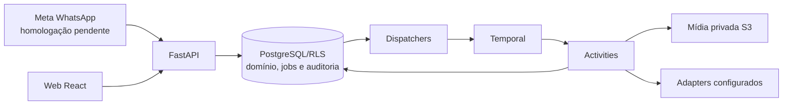

# SDD geral — Meu Braço Direito

Contrato vigente revisado em **29/10/2026**. Produto aceito em
[DECISIONS](DECISIONS.md), estado executivo em [PROJECT](PROJECT.md), sequência
em [fases](phases/README.md) e detalhamento na [fase BL04](phases/BL04-context-and-ai-production.md).
O [snapshot anterior](history/2026-10-28-pre-documentation-reconciliation/SDD.md)
preserva a redação substituída. Designs e evals têm estado e data próprios;
planejamento, teste simulado e homologação comercial são estados distintos.

## 1. Objetivo e fronteira do produto

Receber material/pedido por WhatsApp, recuperar contexto do próprio negócio,
produzir uma candidata privada, pedir aprovação específica e publicar nos canais
habilitados. A web complementa configuração e revisão. Proatividade sem mensagem
nova faz parte do resultado pretendido e será integrada na BL05.

Uma conta de cliente e uma organização por negócio (C02). A API e a migration
0057 garantem no máximo um negócio por organização; cobrança continua por
organização. Memberships e seleção legadas permanecem por compatibilidade.
Staff e convites administrativos não exigem cadastrar negócio.

Um número WhatsApp ativo de cliente por negócio (C03), distinto do número
oficial da plataforma. Material já associado continua processando durante troca
de número; a entrega simulada usa o vínculo ativo novo (C05). Meta real e envio
de candidata/aprovação pelo WhatsApp ainda precisam de integração/homologação.
Não atribuir retroativamente mensagens ainda não associadas sem prova de origem.

IA textual, visual, interpretação e transcrição integram um único aceite do
serviço por negócio, apresentado em Plano e acesso antes do checkout (C01).
Contas existentes aceitam a versão uma vez antes de usar as rotas de serviço.
O POST valida owner, versão/hash e ação explícita; grava ator/data e auditoria,
com replay idempotente. Cadastro, pagamento e redirect não substituem o aceite.
Registros legados são preservados; novos pedidos têm identidade contratual que
não reativa a fila editorial antiga. A web não oferece permissões por modelo,
fornecedor ou transcrição. O aviso atual ainda é para validação local.

Instagram é o primeiro destino pretendido. Vitrine de Facebook/TikTok não
integra essas redes. Foto/story são a oferta inicial; vídeo/franquia ainda não
foram definidos. Avatar/voz sintética ficam após o primeiro piloto (C12/C13).
Não prometer alcance, vendas, frequência ou canais sem evidência.

## 2. Arquitetura e execução

Monólito Python/FastAPI modular: `app/core`, `api/v1`, `schemas`, `services`,
`db`, `adapters`, `workflows`. Regras pertencem aos serviços. PostgreSQL guarda
domínio, permissões, identidades e filas persistentes; Temporal coordena a
execução e activities fazem IO. React fica em `local-spark-web`; mídia usa S3
compatível. Redis não é dependência ativa. Não usar Celery, RabbitMQ ou outro
runner concorrente para os mesmos processos.

API, correlação, dispatchers e workers têm processos separados. A task queue
Temporal não substitui o estado de domínio no banco. Não fazer rede sob row
lock nem IO em workflows determinísticos. Operações externas ambíguas não são
rollback SQL; exigem estado durável e reconciliação apropriada.

CRUD de negócio/kit tem auditoria transacional sem novo workflow de recibo.
Relay, tabelas e handlers legados são mantidos para compatibilidade, fora do
startup comum; removê-los exige avaliação do histórico e decisão específica.

## 3. Isolamento, identidade e permissões

- Tabelas compartilhadas com `tenant_id`, negócio e RLS. Header de tenant
  seleciona contexto; não concede autorização. Validar identidade e membership.
- Logins restritos por capacidade para app, identidade, cobrança, ingestão e
  correlação, sem superuser/BYPASSRLS no runtime. Migração usa conexão própria.
- Auth nativa com Argon2id, access JWT em memória na web, refresh HttpOnly,
  sessão revogável, Origin/CSRF e ações de e-mail de uso único.
- Staff exige MFA e é distinto de owner. Leitura administrativa é restrita e
  auditada; não entrega prompts, fotos ou material privado irrestrito.
- O aceite único é autoridade contratual, não autorização global de banco,
  concessão financeira, direito sobre qualquer imagem ou aprovação de publicação.

Desenvolvimento/teste aceitam localhost/127.0.0.1 na mesma porta/protocolo da
origem autorizada. Staging/produção exigem origem exata. Checkout congela a
origem; cookies continuam host-only. Contrato em [auth nativa](design/native-auth.md).

## 4. Jornada web e configuração do negócio

Cadastro/login → confirmação de e-mail → organização/negócio em setup → aceite
do serviço e plano/patrocínio conforme a contratação → telefone e vínculo.
Setup, acervo e kit podem ser preparados antes de pagar; geração/publicação
exigem acesso e orçamento aplicáveis. Checkout aberto ou retorno não ativa plano.

Menus: **Início, Plano e acesso, WhatsApp, Sobre meu negócio, Conteúdos, Kits
visuais**. Organização/negócio ativos são compartilhados em memória; a API/RLS
mantém a autorização. Onboarding captura atividade, descrição, cor HEX e
cidade/UF/código IBGE de snapshot local versionado. Município não é endereço
verificado nem geocodificação.

- `/app/content` acompanha propostas/prévias e revisões; publicação simulada é
  identificada. Não exige operar ideia, roteiro e renderer manualmente.
- `/app/ideas` redireciona para Conteúdos; `/app/guide` para Início.
  `/app/phone` é utilitária da configuração WhatsApp.
- `/app/editorial-lab` guarda os controles técnicos só no build DEV.
- Sobre meu negócio reúne fatos/preferências, Produtos e serviços e Meu espaço,
  sem fluxo de permissão de IA. `posts_per_week` histórico é preservado sem
  campo manual até cadência por formato/plano.

A consulta financeira continua visível antes do aceite. Contratos e estados da
interface ficam no [SDD web](../../local-spark-web/docs/SDD.md).

## 5. Fontes, contexto, kit e acervo

| Recurso | Contrato vigente | Estado local |
| --- | --- | --- |
| Envios WhatsApp | Texto, imagem, áudio e vídeo associados preservados como origem, sem exclusão pelo histórico. Não são fatos confirmados automaticamente. | Migration 0058 e leitores adaptados; limpeza técnica de não atribuídos/órfãos separada. |
| Contexto | Fatos confirmados, preferências e hipóteses distintos; fonte, validade e versão congeladas no pedido. | Implementado; fatos vencidos não autorizam nova afirmação. |
| Kit | Vitrine fictícia pública separada da seleção/overrides privados versionados. | BL01/BL02 locais; aplicação no modo simulado. Kit piloto ainda `public_demo`. |
| Acervo | Produtos/serviços/promoções e fotos de item/espaço, opcionais, privados e versionados. | BL03.1/BL03.2 locais; BL03.3 importará cardápio como rascunho. |
| Prévia gerada | Arquivo/versão privados preservados sem expiração automática enquanto a conta estiver ativa (C09). | Concluídas saem do purge por prazo; proposta/roteiro e snapshots referenciados são conservados. `expires_at` continua delimitando criação/aprovação, não retenção. |

A remoção de fotos desatualizadas do acervo permanece disponível. Promover foto
WhatsApp cria cópia com direitos declarados; não muda a finalidade nem a
identidade do envio original. Guardar um arquivo não cria produto, preço,
memória pesquisável ou skill. Aprovar peça não confirma seus fatos comerciais.

Kit usa `operation_id`, versão esperada/CAS, histórico imutável, logo privado e
URLs temporárias. Propostas congelam o documento confirmado. O editor guiado
não é editor livre de pixels. Catálogo público hoje está no build web; objetos
/CDN e novos nichos entram na BL06. Material privado nunca compõe a vitrine.

Preservação de arquivo não estende URL assinada, validade de fato ou janela de
aprovação. Os critérios de publicação permanecem atuais e específicos.

## 6. Conversa e inteligência editorial

Inbox valida assinatura e cifra; correlação atribui origem ao negócio. O
processamento usa vínculo, acesso, aceite aplicável e controles internos.
Transcrição tem adapter e teto diário próprios, sem checkbox separado.

O diálogo determinístico atual reconhece intenções delimitadas; o worker local
pode usar Jev com saída estruturada e reserva para interpretação/retrieval do
acervo em desenvolvimento/teste. É opcional, desligado por padrão, com fontes
revalidadas e tratamento de orçamento/resultado incerto. Não é chat geral nem
conversa completa com memória. A comparação sintética não homologa produção.

Texto editorial usa OpenAI Responses estruturada, `store: false`, sem tools,
limites e reservas. `gpt-5-mini` é default configurável, não escolha comercial
final; transcrição referencia `gpt-transcribe`. Trocar modelo não resolve sozinho
a qualidade: o grounding atual restringe parte da criatividade ao baseline.

Não existem pesquisa ampla automática, skills executáveis por cliente,
treinamento automático ou cadência proativa integrada. Retrieval usa somente
fontes pertinentes do negócio. Quando necessária, no máximo uma referência de
kit do formato escolhido, separada das fotos reais. Não enviar a galeria inteira.

## 7. Produção, revisão e publicação

Percurso pretendido: pedido → briefing congelado → geração/edição → prévia →
ajuste ou aprovação → publicação → resultado. Pillow/FFmpeg são baseline técnico;
nenhuma receita está aprovada comercialmente só por funcionar nos testes.

Há candidata, decisão explícita e publicação simulada locais; hash do arquivo,
legenda, destino e horário são revalidados. Ajuste ainda não regenera a peça.
Não há envio real de candidata WhatsApp nem Instagram homologado. Silêncio,
aceite contratual, escolha de kit ou confirmação de preço não aprovam publicação.

Para representar produto/local reais, partir de fontes reais com direito e
preservar sua identidade. Fonte insuficiente pede informação ou conceito
identificado; não inventar preço, agenda, embalagem ou ambiente documental.
Roteiro de gravação e receitas de vídeo real estão em
[vídeo e voz](design/video-real-and-voice.md); identidade sintética permanece F05.

### Alterações e continuidade aprovadas

- C06/C07: mudanças de kit/foto/contexto aguardam criações admitidas, cancelam
  fila ainda não iniciada e bloqueiam novas admissões até aplicar a mudança.
  A prévia anterior fica para revisão, identificada como anterior à alteração.
- C08: vencimento do plano não interrompe criação já iniciada nem impede revisar
  sua prévia; novas criações e publicação ficam bloqueadas até renovar.
- C09: preservar prévias enquanto a conta estiver ativa, incluindo proveniência
  suficiente para revisão. O prazo após encerramento da conta fica em P03.
- C10: só staff pode recuperar pendência cujo autor perdeu acesso, com ação
  registrada, sem assumir a identidade dele ou conceder acesso geral à mídia.
  Em 29/10, o proprietário adiou essa implementação para evolução de gestão de
  acesso/suporte; não bloqueia o fechamento da fatia simulada validada.

**Estado atual:** C06/C07 têm cobertura parcial no modo simulado. A admissão de
`visual_fake` revalida usuário/membership, fontes, aceite e plano na transação
owner antes do run durável, na ordem proposta → visual → comercial. C08 permite
conclusão e revisão privada de `visual_fake` admitida após o vencimento financeiro;
bloqueio explícito e revogação de patrocínio não são tratados como vencimento.
Novos inícios e publicação continuam exigindo plano vigente. O renderer local
legado ainda não recebe essa exceção de conclusão.

C09 preserva prévias concluídas e proveniência, com consulta histórica e download
privado para revisão mesmo após o prazo da proposta/prévia. A janela de aprovação
e a validade de fatos permanecem próprias. Tentativas visuais iniciadas sem
resultado resolvido não são apagadas pelo purge. C10 bloqueia a substituição ou
o descarte da pendência por outro owner. A recuperação restrita de staff, com
auditoria, fica adiada; até sua entrega, a exceção administrativa permanece
bloqueada. O adiamento não aprova novas permissões nem reabre a decisão C10.
Retirada de consentimento por fornecedor permanece somente como compatibilidade
legada para negócios sem o
contrato; não é um novo fluxo de produto a desenvolver para quem aceitou C01.

### Integração visual pendente

Preparação de fontes, normalização de cópias, adapter, reserva/fence, ledger e
acabamento existem; o fluxo do cliente gera apenas `visual_fake` privado e
identificado. Os ensaios reais foram isolados. `VisualGenerationWorkflow` tem
prazos e tentativa única testados, mas não está conectado ao dispatcher/worker
ou à guarda real. A API persistida só aceita modos `local` e `visual_fake`.

Fontes/aceite/plano e o run são validados na mesma transação owner; a reserva e o
fence continuam atômicos em outra transação correlator. Os dois commits não são
uma transação única: falha intermediária conserva a admissão bloqueante e não
autoriza nova submissão. A ordem adotada não prova a hierarquia global de locks;
outros escritores e recuperação ainda precisam de prova antes do efeito real.
Não manter locks durante IO.
Propostas antigas de grants/holds e exclusão WhatsApp são históricas, não
solução aprovada. Detalhes e testes da próxima fatia estão na
[BL04](phases/BL04-context-and-ai-production.md).

Gate BL04.3: titular avalia post/story novos no celular, com fontes consentidas,
texto/preço/CTA exatos, legibilidade, identidade e fidelidade a produto/local.
Contar rejeições, refações, todas as tentativas e custo por peça aceita. Uma
amostra fictícia isolada não encerra o gate comercial.

## 8. Consistência, falhas e rastreabilidade

Identidade durável por operação/evento, replay validado pelo payload, transações
curtas e auditoria; efeitos assíncronos exigem job/outbox do domínio na mesma
transação. CAS, lease e fence impedem confirmação por execução vencida.

Retries são limitados por efeito e fornecedor. Resposta perdida, timeout,
cancelamento ou lease expirada não provam que o efeito externo terminou e não
autorizam segunda cobrança/publicação. Manter estado incerto e reserva até uma
reconciliação segura. Auditoria/ledger são dados duráveis; logs usam eventos e
campos permitidos, sem segredos, prompts ou material privado.

`billing_jobs` e auditoria financeira permanecem. A migration 0038 retirou apenas
a outbox financeira sem consumidor, preservando evidência. Tabelas/handlers de
recibos genéricos seguem por compatibilidade. Não criar outro runner Temporal.

## 9. Custos, planos e recomendação

Reservar quota/custo atomicamente antes do envio pago, com identidade de
operação e orçamento configurado. Reserva, token observado, estimativa e custo
faturado são dados distintos. Há controles por capacidade, teto visual por
negócio/tenant e agregado OpenAI, com alcance limitado ao ledger que os usa.
Isso não limita toda a fatura externa nem cobre automaticamente outros adapters.

R$ 99/mês e teto desejado de R$ 50 de custo total por cliente/mês orientam a
medição, incluindo IA, mídia, mensageria, cobrança, tentativas, infraestrutura e
custos atribuídos. Faltam tarifas versionadas/COGS completo e franquias por
formato/revisão. Plano limita volume; recomendação de cadência deve ficar dentro
dele, com evidência e pausa. Não prometer posts ilimitados ou vendas causais.

## 10. Superfície de APIs e integrações

Prefixo de negócio: `/api/v1/organizations/{tenant_id}/businesses/{business_id}`.
Schemas/Swagger e SDD da fase detalham payloads; existência de rota não homologa
fornecedor ou torna todo controle uma etapa da interface.

| Grupo | Contratos existentes |
| --- | --- |
| Identidade | `/api/v1/auth/*`, sessão, perfil e onboarding; Origin/CSRF conforme a operação. |
| Negócios | Cadastro, referência de municípios/UF e administração auditada. |
| Contratação | `GET/POST service-agreement`; billing, checkout, webhook Stripe, patrocínio e reconciliação. |
| WhatsApp | Webhook assinado; vínculo, histórico, conversa e transcrição configurável. |
| Contexto/acervo/kit | Contexto versionado; catálogo, fotos privadas, draft/confirm/history de kit e logo. |
| Conteúdo | Propostas/roteiros, prévias, entregas e decisão da candidata. |
| Staff | Convites/MFA, cobrança e projeções operacionais limitadas e auditadas. |

Stripe tem adapter sandbox exercitado; produção/staging pendentes. SMTP/Mailpit
captura e-mails localmente. Twilio depende de configuração/homologação por
ambiente. Meta/Instagram reais e IA visual no worker ainda faltam. AWS/Redis/CDN
não são serviços comerciais ativos só por constarem no desenho.

## 11. Sequência e condições de liberação

BL01/BL02 e BL03.1/BL03.2 locais → BL04.2 coordenação restante e integração
visual → BL04.3 qualidade/custo → BL05 jornada, ajuste e proatividade → expansão.
BL03.3 importa cardápio depois; BL06 amplia nichos/CDN depois de provar reaplicação.

Piloto exige receitas aprovadas, material consentido, franquia/orçamento,
Meta oficial, staging, observabilidade, suporte e recuperação. Avatar/voz ficam
após o primeiro piloto. A meta de 200 mil clientes orienta testes graduais de
capacidade, não comprova escala. P03 foi adiado pelo proprietário; P05 depende
de medição. Não inventar prazo de exclusão pós-encerramento ou quantidade do plano.

## 12. Qualidade e governança

Backend: Ruff/formatação, mypy, unitários e integração PostgreSQL/Temporal, com
100% de linhas e branches, sem exclusões produtivas artificiais. Web: TypeScript,
formatação, testes/build e jornadas de navegador, com 100% nos quatro critérios.
Banco de teste dedicado termina em `_test`, com runtime restrito; nunca limpar
ou migrar o banco da aplicação para testes. Falta de serviço falha, não vira skip.

Evidência anterior de aplicação: 1.583 testes backend e complemento de 24 com sete
casos novos, cobertura final 100%; web com 360 testes/cobertura integral, build e
três jornadas Chromium. Ver [CHANGELOG](CHANGELOG.md). A fatia atual acrescenta
testes de admissão concorrente, continuidade, retenção/proveniência e autoria de
pendências. `make ci` passou com 1.642 testes, 100% de linhas e branches
(8.942 statements, 2.446 branches), Ruff/formatação e mypy. PostgreSQL `_test`
com roles restritas e Temporal locais; nenhum efeito pago ou nova homologação
externa. A web não mudou e suas suítes não foram repetidas nesta fatia.

Em cada entrega, atualizar PROJECT, SDD, fase e CHANGELOG. Decisões novas entram
em DECISIONS; distinguir decisão aceita, código implementado e homologação.
Registros datados e alternativas rejeitadas são preservados com seu contexto.
Não remover dados, tabelas, migrations ou proteções por inferência editorial.
