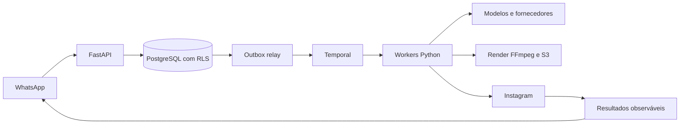

# SDD geral — Plataforma de conteúdo

22/10/2026 — Produto renomeado para **Meu Braço Direito**. Diretórios e remotos
Git permanecem `local-spark-platform`/`local-spark-web`; os pacotes, Compose,
variáveis `MEU_BRACO_DIREITO_`, bancos e roles usam os identificadores novos.
A migração `0015_product_brand` precede a correlação WhatsApp, preserva IDs,
senhas/MFA e permissões, atualiza as duas identidades de demonstração e congela
as chaves Stripe de checkouts anteriores. Contas existentes conservam suas senhas;
as senhas de exemplo abaixo valem para instalações novas. Instruções e exceções
de compatibilidade em [renomeação do produto](product-rename.md).

Versão 1.2, 23/10/2026. Resumo implementável e índice das especificações detalhadas.

F03.2b bloqueia geração quando nenhum fato válido foi confirmado, inclusive se
um material foi recebido; não consome quota nem chama o modelo nesse caso.
F03.2c iniciou uma projeção administrativa auditada por pedido editorial: estado,
IDs, versões, tokens e erro. A API nunca devolve rascunho, prompt ou material
nesse endpoint; custo em moeda é nulo até existir tarifa versionada. O percurso
completo, feedback e custo por etapa ainda estão no plano F03.2c.
Uma segunda fatia correlaciona novos eventos ao ID interno do pedido, preservando
o vínculo com o `operation_id` externo, e
mostra suas etapas reais ao operador; eventos legados podem estar incompletos.
O resultado da avaliação F03.2b é **no-go comercial**: título e ângulo são
derivados deterministicamente de fato confirmado; formato, hipóteses e perguntas
do modelo continuam apenas para revisão. Revalidação semântica e staging são
gates antes de clientes reais.

F03.2c planeja personalização com contexto/fatos/feedback isolados por negócio,
sem treino automático por tenant ou reutilização cruzada de mensagens. Antes do
piloto, admin precisa ver a cadeia operacional e o custo por etapa; conteúdo
integral requer acesso separado, limitado e auditado. Ver [F03](phases/F03-editorial-research.md).

F03.2b avaliou o provedor com casos sintéticos e decidiu não ativar coorte
comercial. O contrato factual foi endurecido; comparação e revisão por coorte
continuam como gates do piloto. Ver [F03](phases/F03-editorial-research.md).

F03.1 entrega o contexto editorial confirmado pelo proprietário: fatos com origem
declarada e validade, preferências separadas, versões imutáveis, CAS/idempotência,
histórico/restauração, auditoria e RLS por negócio. A área do cliente edita e
restaura versões. Hipóteses continuam vazias e não há LLM interpretando as
mensagens ou gerando conteúdo nesta fatia. Ver [F03](phases/F03-editorial-research.md).

F03.2a acrescenta sugestões editoriais sob pedido do proprietário: snapshot
versionado, material opcional, baseline local, provedor OpenAI opt-in com quota
reservada antes da chamada, estado incerto sem retry pago e revisão na área do
cliente. Hipóteses não alteram fatos; não há publicação, pesquisa externa ou
interpretação automática de todo WhatsApp. Contratos, pendências de avaliação
e ativação em [F03](phases/F03-editorial-research.md).

F02.2c3a acrescenta `group_id` determinístico por tenant, negócio, remetente e
janela fixa de dez minutos, persistido na fila e no asset. A biblioteca mostra
materiais relacionados sem unir negócios ou depender da ordem dos workers.
Itens antigos formam grupos unitários. F02.2c3b implementou transcrição de áudio
com provedor configurado, reserva de orçamento, ledger e estado incerto; F03
tratará interpretação semântica e confirmação de fatos. Não há LLM/Jev/harness
interpretando mensagens agora. Ver [F02](phases/F02-whatsapp-ingestion.md).

F02.2c3b implementa transcrição opcional com `gpt-transcribe`, WAV normalizado,
limite de 180 s, reserva diária por tenant antes da chamada, ledger de segundos,
texto cifrado e reconciliação de submissões incertas sem repetir cobrança.
O envio à OpenAI exige consentimento separado por negócio; aceite antigo de
material não autoriza transcrição.
Transcrição não confirma fatos nem interpreta intenção; isso permanece F03.

F02.2c2 registra a tentativa de mídia antes do upload S3. Uma chave exclusiva
por tentativa e uma intenção transacional permitem reconciliar arquivos quando o
commit do material falha; limpeza com lease/fencing e retry roda no dispatcher.
Não há exposição de tentativas incompletas ao cliente. Agrupamento/transcrição
ficam em F02.2c3; operação real aguarda WABA liberada e smoke em staging.
Ver [F02](phases/F02-whatsapp-ingestion.md).

F02.2c1 adiciona prazo inicial de 30 dias e pedido de exclusão por proprietário,
com limpeza periódica de inbox/fila vencidas e remoção S3 por lease/fencing. Links
novos são bloqueados após o pedido; os já assinados vencem em até dois minutos.
F02.2c2 cobre objetos órfãos após upload sem commit; agrupamento e transcrição
continuam pendentes.
Ver [F02](phases/F02-whatsapp-ingestion.md).

O app/WABA sandbox Meta agora existe, mas o smoke ponta a ponta continua pendente:
handshake HTTPS e POST sintético assinado passaram; envio de teste retornou status
`failed`/`131031` (`Business Account locked`) e a inbox local ainda não recebeu
eventos reais. O painel de Qualidade da Conta exige verificação da empresa para
essa WABA e informa restrição permanente a início/resposta de conversas e adição
de números. Após o processo Meta, confirmar a remoção da restrição e a inscrição
do app na WABA.
Não interpretar o check de configuração do webhook como entrega homologada.

F02.2b1 entregue localmente: processo de correlação com login exclusivo associa
mensagens posteriores ao vínculo ao tenant/negócio, grava ciphertext numa fila
durável com retenção de sete dias e audita em transação. F02.2b2 foi
validada localmente: dispatcher e Temporal consomem a fila com identidade durável,
retry e fencing, revalidam consentimento/vínculo/plano, guardam texto e mídia em
biblioteca S3 privada e expõem conexão/recibos ao proprietário na web. Meta real,
transcrição, respostas e geração seguem pendentes; a reconciliação de uploads
órfãos entrou em F02.2c2.
Ver [F02](phases/F02-whatsapp-ingestion.md).

CI da F02 usa login Meta restrito e URL explícita para o mesmo banco `_test` dos
demais papéis. No Actions a porta é 5432; o exemplo local usa 55432. Pytest em
CI rejeita configuração incompleta antes de executar testes. A próxima fatia
F02.2b correlaciona eventos ao vínculo e os encaminha com identidade durável;
o vínculo isolado de F02.2a ainda não processa conteúdo.

F02.2a entregue localmente: vínculo WhatsApp requer dono autenticado, telefone
verificado, acesso ativo e mensagem com código único recebida do mesmo número
via webhook assinado. Desafio expira e é de uso único; troca do telefone revoga
o vínculo. Ingestão, vínculo e processamento são fronteiras distintas: a inbox
continua em quarentena até F02.2b criar correlação, outbox e workflows. Ver
[F02](phases/F02-whatsapp-ingestion.md). UI e smoke Meta real pendentes.

F02.1 entregue localmente: webhook WhatsApp Cloud API com handshake, HMAC do corpo
bruto, limite de 256 KiB e inbox criptografada/deduplicada em login próprio com RLS.
Mensagens ainda ficam em quarentena sem vínculo verificado ao negócio; não há
download, transcrição, resposta ou workflow de conteúdo. Ver
[F02](phases/F02-whatsapp-ingestion.md). Configuração Meta permanece desabilitada
até existirem App/WABA/número/chaves; teste real e restante de F02.2 pendentes.

F01.6: o billing worker agenda reconciliação canônica periódica de checkouts abertos
sem acesso pago, com jobs duráveis e dedupe por janela de cinco minutos; o webhook
continua sendo o caminho imediato. Convites de operadores têm token de uso único,
expiração de 48 horas, e-mail criptografado na outbox, MFA próprio e revogação de
sessões. Verificação do telefone do negócio usa Twilio Verify configurável, limite
de solicitações/tentativas e só grava `phone_verified=true` após aprovação do
provedor. O envio está desativado localmente até haver conta; staging AWS ainda
não foi criado.

Nome adotado: Meu Braço Direito; repositórios `local-spark-platform`, `local-spark-web`
e `local-spark-infra`. Configuração Python utiliza `MEU_BRACO_DIREITO_`; PostgreSQL usa
identificadores com underscore (`meu_braco_direito_platform`, roles `meu_braco_direito_*`).
Credenciais de exemplo são exclusivas de desenvolvimento; tokens locais anteriores
à troca de nome/assinatura precisam ser reemitidos. Nenhuma credencial de produção
é provisionada pelo Compose. PostgreSQL e o histórico Temporal de desenvolvimento
possuem volumes nomeados próprios; isso não equivale a persistência/HA de produção.
Debug local da API via VS Code utiliza `.venv`, `.env` e Uvicorn factory sem reload;
prelaunch libera a porta 8000 parando a API Docker e inicia dependências locais.
Credenciais permanecem no `.env`, sem valores de conexão nos arquivos do editor.
No macOS, pré-tarefas resolvem Docker Desktop por caminho absoluto e incluem seu
diretório no PATH para plugins/helpers, independentemente do PATH herdado pelo editor.
Contrato de versionamento: incluir código/testes, migrations, `uv.lock`, exemplos
sem credenciais de produção, CI, documentação e debug compartilhado; excluir
segredos, dados locais e artefatos de execução por `.gitignore`.
Auth local aceita localhost/127.0.0.1 na mesma porta/protocolo da origem web
configurada, somente em development/testing. Staging/production mantêm origem
exata; links de e-mail continuam canônicos e cookies host-only.
Checkout congela o Origin do pedido somente se estiver nessa allowlist; sem header,
usa PUBLIC_WEB_URL. Migration 0006 persiste a origem antes do worker, preservando o
host da sessão no retorno externo. Checkouts existentes conservam parâmetros originais.

## Objetivo e arquitetura

Automatizar pesquisa, planejamento, produção, aprovação, publicação e avaliação de
conteúdo para pequenos negócios através do WhatsApp. Frontend complementar para
OAuth, consentimento e operação. Interface diária não exige editor ou conhecimento de IA.

Backend modular: `app/core`, `api/v1`, `schemas`, `services`, `db`, `workflows` e
adapters por integração quando implementados. Um repositório, múltiplos processos:
API, relay, workflow/IO/media workers e manutenção. Web tem repositório próprio `local-spark-web`; infraestrutura terá
repositório próprio quando começar. Dados, arquivos, cache e permissões são tenant-scoped.

## Contratos de qualidade

- Constraints únicas, transações curtas, compare-and-swap e fencing conforme recurso.
- Inbox/outbox para travessias confiáveis; APIs externas não recebem garantia falsa
  de exactly-once. Resultado ambíguo fica UNKNOWN até reconciliação.
- Retry, backpressure e circuit breaker por fornecedor/tarefa; quota em ledger no DB.
- Aprovação por hash/versão/conta, fatos válidos e consentimento ativo antes de publicar.
- Roles de runtime sem superuser/BYPASSRLS; migração e relay com funções separadas.
- Logs JSON, rastreabilidade e auditoria com redaction. Nenhum segredo em imagens/git.
- CI com lint, tipos, unitários, integração PostgreSQL/Temporal e coverage 100%
  de linhas e branches. Testes usam configuração exclusiva `TEST_*` com precedência
  do ambiente sobre `.env.test` e `.env.test.example`; integração não é opcional
  na suíte completa e indisponibilidade de serviço não vira skip silencioso.
- Deploy preparado com GitHub Actions/OIDC, mas depende de infraestrutura e revisão
  de migração; não existe deploy comercial ativo nesta fase.

## Integrações planejadas

Cobrança inicial implementada com Stripe, mesmo adapter em teste/live e credenciais
isoladas; disabled por padrão. [SDD de cobrança](design/billing.md): checkout
idempotente, webhook assinado/inbox, Temporal, lease/fencing, consulta canônica,
concessão/revogação patrocinada e interfaces. Login DB billing próprio, sem escrita
em identidade/memberships; app comum não confirma pagamento. Um pagamento sandbox
foi confirmado; demais cenários e staging continuam pendentes. Cadastro/redirect
não ativam acesso nem franquia.
F01.5 inclui projeção administrativa paginada de checkouts abertos ou expirados sem
acesso ativo, com contato cadastrado e auditoria. Sessão aberta não é assinatura;
fechar a aba não equivale a abandono confirmado. A lista não distribui links Stripe.
A reconciliação periódica busca a sessão/assinatura na Stripe mesmo sem webhook
entregue, com lease/fencing do processamento existente.

Meta WhatsApp/Instagram; OpenAI texto/imagem/transcrição; HeyGen avatar/voz; Runway
cenas; Tavily pesquisa; Google Places descoberta conforme política; Jev opcional após
eval. FFmpeg/ffprobe e compositor próprio para mídia determinística. Seleção inicial
não substitui benchmark de acesso, custo e qualidade nem contratos comerciais.

## Fases

Cada fase tem contratos, testes, dependências e condições de liberação em
[docs/phases](phases/README.md). Implementar fatias com testes e integração frequente;
não aguardar toda a v0 para revisar. F00 não inclui geração real ou publicação.

## Especificações detalhadas

As decisões completas estão em [docs/design](design/README.md): arquitetura,
APIs, saga/recovery, pesquisa/modelos, tenancy e consistência/observabilidade.
Históricos v0.1 ficam identificados e não reintroduzem Celery/schema por tenant.

## Governança de mudanças

Para cada feature: atualizar SDD da fase, `PROJECT.md` e `CHANGELOG.md`; registrar
decisão arquitetural relevante antes de mudar fronteira/contrato; indicar testes
executados e pendências. Novo modelo, fornecedor ou permissão requer atualização de
perfil e gate de qualidade, não troca silenciosa. Status significa evidência, não intenção.

## Contexto inicial do negócio

Atividade sugerida ou livre (até 60 caracteres), descrição e cor principal HEX
personalizada. A web exige município do catálogo oficial com UF/código IBGE/nome;
API valida a combinação. GET /reference/states e /reference/cities/{UF} servem
snapshot IBGE versionado, carregado/cacheado por processo, sem rede ou DB na requisição.
Perfis antigos mantêm cidade livre e códigos nulos, sem inferência por nome. Novos
campos opcionais na API preservam clientes antigos e o hash de replay legado.
UF/município não comprovam endereço ou coordenadas; geocodificação/raio ficam na F03.

**Decisão para F02–F07 (21/10):** preservar o onboarding curto. Preferências e
produtos opcionais entram progressivamente pela conversa; F03 cria um
`BusinessContext` versionado por negócio, com fatos confirmados, preferências
explícitas e hipóteses observadas em grupos distintos. Aprovação de publicação
não transforma preço/horário/promoção em fato confirmado. O proprietário vê e
corrige o contexto; geração fixa a versão utilizada. Custo/franquia com reserva
atômica entram antes de qualquer pesquisa ou geração paga, sem aguardar F07.
F04/F05 usam adapters por capacidade e avaliação controlada de fornecedores;
nenhum modelo listado está aprovado para produção por constar na especificação.
Contrato e gates: [contexto, geração e custo](design/business-context-and-generation.md).

## Jornada comercial e interfaces (decisão F01)

Landing → contratação → webhook confirmado → provisionamento/ativação idempotentes
→ identidade/canal verificados → onboarding pelo WhatsApp. Identidade e organização
em setup podem existir antes do pagamento; geração paga exige concessão ativa e
franquia. Patrocínio de seis meses é concessão explícita, separado de receita.

F01 inicia React com admin mínimo e telas essenciais do cliente. Admin acompanha
organizações, usuários e onboarding. Pagantes/custos/resultados aparecem após
suas integrações, nunca como dados fictícios. Cliente usa web para identidade,
OAuth, consentimentos e revisão; rotina e relatório semanal continuam no WhatsApp.
Métricas próprias e snapshots externos alimentam a base e os painéis; não atribuir
faturamento à plataforma sem dados e método de mensuração.

SDDs de interface em `local-spark-web/docs`: geral, admin e cliente. F01.5 antecipa
cobrança mínima da F07. Autenticação própria aceita em 20/10/2026 substitui a
escolha inicial de Keycloak. Contrato em [auth nativa](design/native-auth.md).
Senhas, sessões, tokens de ação e MFA são responsabilidade do módulo auth da API;
permissões e memberships permanecem no domínio/RLS. OIDC do GitHub Actions para
AWS é independente da autenticação dos usuários e continua válido.

## Estado de implementação

F00 concluída localmente. F01.1–F01.4 entregues e validadas localmente nos dois
repositórios: identidade nativa, contexto, primeiro negócio com consentimentos,
admin com contagens reais e base React com áreas distintas. O onboarding inicial
é transacional e idempotente por ator, sem ativação de plano. Backend: 103 testes,
100% de linhas/branches, lint/tipos, migration rollback/reaplicação e build Docker.
Web: 59 testes, 100% de cobertura e quatro jornadas Playwright com identidade/API reais.
F01.5 tem checkout/webhook e patrocínio implementados. Em 21/10, pagamento real de
sandbox do titular confirmou assinatura de teste; retorno entre aliases locais
expôs perda de cookie, corrigida pelo congelamento de origem autorizada. Demais
cenários restantes de sandbox e staging permanecem pendentes. F01.6 tem código local
para convites e telefone; envio real do código e homologação AWS ainda faltam.
F02–F08 permanecem planejadas; diagrama completo acima descreve o destino do produto.
Não houve execução remota de CI, push ou deploy nesta entrega.
