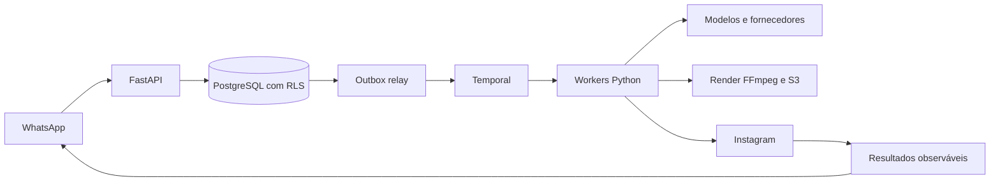

# SDD geral — Plataforma de conteúdo

Versão 0.4, 20/10/2026. Resumo implementável e índice das especificações detalhadas.

Nome adotado: Local Spark; repositórios `local-spark-platform`, `local-spark-web`
e `local-spark-infra`. Configuração Python utiliza `LOCAL_SPARK_`; PostgreSQL usa
identificadores com underscore (`local_spark_platform`, roles `local_spark_*`).
Credenciais de exemplo são exclusivas de desenvolvimento; tokens locais anteriores
à troca de nome/assinatura precisam ser reemitidos. Nenhuma credencial de produção
é provisionada pelo Compose. PostgreSQL e o histórico Temporal de desenvolvimento
possuem volumes nomeados próprios; isso não equivale a persistência/HA de produção.
Debug local da API via VS Code utiliza `.venv`, `.env` e Uvicorn factory sem reload;
prelaunch libera a porta 8000 parando a API Docker e inicia dependências locais.
Credenciais permanecem no `.env`, sem valores de conexão nos arquivos do editor.
No macOS, pré-tarefas resolvem Docker Desktop por caminho absoluto e incluem seu
diretório no PATH para plugins/helpers, independentemente do PATH herdado pelo editor.
Contrato de versionamento: incluir código/testes, migrations, `uv.lock`, exemplos
sem credenciais de produção, CI, documentação e debug compartilhado; excluir
segredos, dados locais e artefatos de execução por `.gitignore`.

## Objetivo e arquitetura

Automatizar pesquisa, planejamento, produção, aprovação, publicação e avaliação de
conteúdo para pequenos negócios através do WhatsApp. Frontend complementar para
OAuth, consentimento e operação. Interface diária não exige editor ou conhecimento de IA.

Backend modular: `app/core`, `api/v1`, `schemas`, `services`, `db`, `workflows` e
adapters por integração quando implementados. Um repositório, múltiplos processos:
API, relay, workflow/IO/media workers e manutenção. Web e infraestrutura terão
repositórios próprios quando começarem. Dados, arquivos, cache e permissões são tenant-scoped.

## Contratos de qualidade

- Constraints únicas, transações curtas, compare-and-swap e fencing conforme recurso.
- Inbox/outbox para travessias confiáveis; APIs externas não recebem garantia falsa
  de exactly-once. Resultado ambíguo fica UNKNOWN até reconciliação.
- Retry, backpressure e circuit breaker por fornecedor/tarefa; quota em ledger no DB.
- Aprovação por hash/versão/conta, fatos válidos e consentimento ativo antes de publicar.
- Roles de runtime sem superuser/BYPASSRLS; migração e relay com funções separadas.
- Logs JSON, rastreabilidade e auditoria com redaction. Nenhum segredo em imagens/git.
- CI com lint, tipos, unitários, integração PostgreSQL/Temporal e coverage 100%
  de linhas e branches. Testes usam configuração exclusiva `TEST_*` com precedência
  do ambiente sobre `.env.test` e `.env.test.example`; integração não é opcional
  na suíte completa e indisponibilidade de serviço não vira skip silencioso.
- Deploy preparado com GitHub Actions/OIDC, mas depende de infraestrutura e revisão
  de migração; não existe deploy comercial ativo nesta fase.

## Integrações planejadas

Meta WhatsApp/Instagram; OpenAI texto/imagem/transcrição; HeyGen avatar/voz; Runway
cenas; Tavily pesquisa; Google Places descoberta conforme política; Jev opcional após
eval. FFmpeg/ffprobe e compositor próprio para mídia determinística. Seleção inicial
não substitui benchmark de acesso, custo e qualidade nem contratos comerciais.

## Fases

Cada fase tem contratos, testes, dependências e condições de liberação em
[docs/phases](phases/README.md). Implementar fatias com testes e integração frequente;
não aguardar toda a v0 para revisar. F00 não inclui geração real ou publicação.

## Especificações detalhadas

As decisões completas estão em [docs/design](design/README.md): arquitetura,
APIs, saga/recovery, pesquisa/modelos, tenancy e consistência/observabilidade.
Históricos v0.1 ficam identificados e não reintroduzem Celery/schema por tenant.

## Governança de mudanças

Para cada feature: atualizar SDD da fase, `PROJECT.md` e `CHANGELOG.md`; registrar
decisão arquitetural relevante antes de mudar fronteira/contrato; indicar testes
executados e pendências. Novo modelo, fornecedor ou permissão requer atualização de
perfil e gate de qualidade, não troca silenciosa. Status significa evidência, não intenção.
