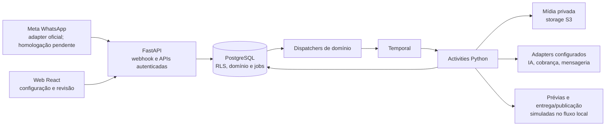

# SDD geral — Meu Braço Direito

Versão consolidada em **27/10/2026**. Define os contratos vigentes e distingue
capacidade local de planejamento. O estado executivo está no
[PROJECT](PROJECT.md); a sequência está em [fases](phases/README.md).
As versões anteriores destes documentos foram preservadas integralmente no
[histórico P13](history/2026-10-27-pre-consolidation/index.md). Designs de fase
e evals continuam válidos como detalhe, respeitando as decisões atuais.

## 1. Objetivo e fronteira do produto

Receber ideias e material pelo WhatsApp, recuperar contexto autorizado do
negócio, produzir conteúdo com qualidade, pedir aprovação específica, publicar
nos canais habilitados e medir sinais observáveis. O cliente não opera um
pipeline de edição. A web complementa identidade, configuração, kit, acervo e
revisão. Sem mensagem nova, a plataforma deve propor conteúdo dentro de uma
cadência aceita e de um orçamento; esta proatividade ainda não está implementada.

Instagram é o primeiro destino pretendido. Simuladores de Instagram, Facebook
e TikTok na vitrine não são integrações com essas redes. Avatar/voz do cliente
(F05) ficam **após o primeiro piloto comercial** e a validação de imagens/vídeos
com material real e custo (P15), com gates próprios. Não prometer vendas,
frequência ou canais sem validação. Acesso patrocinado é concessão separada de
receita; cadastro, redirect de checkout e seleção de kit não ativam plano pago.

## 2. Arquitetura e execução

Python/FastAPI modular segue `app/core`, `api/v1`, `schemas`, `services`, `db`,
`adapters` e `workflows`. Regras de negócio ficam nos serviços; rotas/adapters
não mantêm regras concorrentes. PostgreSQL guarda domínio, permissões e filas
persistentes; Temporal coordena execução durável; activities fazem IO. A web
React está em `local-spark-web`. Armazenamento de mídia é compatível com S3;
o Compose usa storage local. Redis não é dependência ativa. Não adicionar
Celery, RabbitMQ, Make ou n8n para executar os mesmos processos.

API, correlator, dispatchers e pools de workers são processos separados.
`billing_jobs`, eventos de materiais, propostas, prévias e entregas têm identidade
persistente e regras próprias de claim/recovery. A task queue do Temporal não
substitui o domínio no PostgreSQL; o worker busca tarefas e executa activities.
Não fazer rede enquanto se mantém row lock nem IO em funções determinísticas
de workflow. Compensação depende do efeito: recurso já publicado ou chamada
ambígua não pode ser desfeito como simples rollback SQL.

**P14:** criação de negócio e alteração do kit usam auditoria na mesma
transação, sem novos workflows/eventos apenas de recibo. O relay genérico sai
do startup comum; suas tabelas, serviço manual e handlers antigos permanecem
para compatibilidade. Não remover Temporal dos workflows de integração/geração.
A retirada futura de tabelas/handlers exige decisão e avaliação de históricos.

## 3. Isolamento, identidade e permissões

- Tabelas compartilhadas com `tenant_id`, contexto de negócio e RLS; não usar
  schema por cliente como padrão. Header `X-Tenant-ID` seleciona contexto,
  nunca concede autorização. Toda leitura/mutação valida ator e membership.
- Logins restritos por capacidade para runtime, auth, cobrança, ingestão e
  correlação; sem superuser/BYPASSRLS. Migração usa credencial própria.
  O acesso legado de relay continua isolado enquanto for necessário.
- Auth nativa: Argon2id, access JWT, sessão revogável e refresh token em cookie
  HttpOnly. A web mantém access token em memória. Origin/CSRF protegem as
  operações de identidade; ações de e-mail têm token de uso único e prazo.
- Staff é distinto de owner. Convite/revogação exigem operador autorizado com
  MFA; o convidado verifica e-mail e configura seu TOTP sem cadastrar negócio.
  Revogar staff encerra acesso administrativo e sessões correspondentes.
- Leitura administrativa é auditada e limitada. Não expor material bruto,
  prompts/respostas ou conteúdo privado irrestrito como efeito de um painel.

Em development/testing, localhost e 127.0.0.1 podem ser aliases da origem web
configurada, somente na mesma porta/protocolo. Staging/produção exigem origem
exata. Checkout congela a origem autorizada do pedido para preservar cookies no
retorno; links de e-mail continuam canônicos e cookies são host-only.
Contrato detalhado: [auth nativa](design/native-auth.md).

## 4. Jornada web e configuração do negócio

Cadastro/login → confirmação de e-mail → organização/negócio em setup → plano
ou patrocínio confirmado → canal verificado/vinculado. Setup pode existir antes
do pagamento; operações pagas exigem concessão e quota na API. Onboarding curto
inclui atividade sugerida/livre, descrição, cor HEX e cidade/UF/código IBGE do
snapshot versionado. APIs de referência não consultam rede durante o cadastro;
perfis antigos com cidade livre permanecem compatíveis. Município não comprova
endereço nem coordenadas para pesquisa por raio.

Menus vigentes: **Início, WhatsApp, Sobre meu negócio, Conteúdos, Kits visuais,
Plano e acesso**. Início orienta com estados reais; a página estática Primeiros
passos foi retirada. O provider web compartilha organização/negócio ativos em
memória; trocar seleção não altera permissões nem mistura dados de negócios.

- `/app/content`: lista propostas, prévias e revisões disponíveis. Não exige
  gerar ideia, aceitar roteiro e pedir render manualmente. A publicação atual
  é identificada como simulada; só oferecer decisões existentes no backend.
- `/app/ideas` redireciona para Conteúdos; `/app/guide` para Início.
  `/app/phone` é utilitária, acessível pela configuração WhatsApp.
- `/app/editorial-lab` existe somente no build DEV. Guarda geração manual,
  edição/aceite de roteiro e controles técnicos do renderer para ensaio.
  APIs e dados editoriais permanecem compartilhados com a jornada automática.
- Sobre meu negócio concentra fatos/preferências e autorização/retirada de IA.
  Frequência semanal manual não é exibida; preservar `posts_per_week` histórico
  ao salvar outras preferências até cadência por formato/plano.

Contratos de interface estão no [SDD web](../../local-spark-web/docs/SDD.md).

## 5. Fontes, contexto, kit e acervo

Quatro conceitos permanecem distintos:

| Conceito | Contrato | Estado |
| --- | --- | --- |
| Material WhatsApp | Entrada temporária, consentida, com retenção/exclusão e origem | Implementado localmente. |
| Contexto do negócio | Fatos confirmados, preferências e hipóteses separados; versão fixada na geração | Implementado localmente. |
| Kit fictício/aplicado | Vitrine pública imutável; seleção/overrides privados e versionados por negócio | BL01/BL02 locais. |
| Acervo durável | Produtos/serviços, promoções e fotos reais de item/espaço, opcionais e confirmados | BL03.1/BL03.2 implementadas localmente; BL03.3 importação posterior. |

Aprovar uma publicação não confirma automaticamente preço, horário ou promoção
como fato. Fatos temporários exigem validade; fonte vencida não autoriza nova
peça. Mudanças posteriores não reescrevem snapshots ou aprovações antigas.
Autorização de dados/IA, autorização de gasto, confirmação de fato, escolha de
kit e aprovação de peça são decisões distintas.

**Kit BL02:** catálogo, estado, rascunho, confirmação e histórico por owner;
`operation_id` e `expected_version` para replay/CAS, versões imutáveis e audit
transacional. O editor guiado altera cores, fontes permitidas, logo, textos e
composição de feed/story/capa de reel, sem editor livre de pixels. Logo privado
usa intent de upload, validação de formato/dimensões/direitos e URL temporária;
reconciliação owner-only trata pendências de upload. F03 congela o documento do
kit confirmado no pedido, sem resolver a versão atual durante execução tardia.
F04 ainda não aplica esse kit à produção real.

`cafe-pausas/v1` continua `public_demo`: dez posts, dois stories, reel silencioso
e seis cenários fictícios. É selecionável em desenvolvimento/teste; uso comercial
exige revisão de direitos e qualidade. Os arquivos públicos ainda são locais,
versionados e servidos no build web. Fotos reais do cliente ficam privadas;
catálogo em objetos/CDN entra na BL06.

**BL03.1/BL03.2 locais:** seções Produtos e serviços e Meu espaço dentro de Sobre meu
negócio. Cadastro opcional/progressivo, preço com validade, sinônimos confirmados,
fotos e direitos versionados. Promoção consentida de material WhatsApp não muda
silenciosamente sua finalidade/retentiva. Não exigir seleção de item por pedido:
BL04 deve recuperar automaticamente fontes pertinentes do mesmo negócio.
Contrato: [biblioteca visual](design/brand-library.md) e
[contexto e geração](design/business-context-and-generation.md). O [SDD BL03](phases/BL03-business-collection.md)
detalha catálogo, fotos e imports. Cadastro manual/fotos são a entrega atual;
BL03.3 extrairá dados de fotos de cardápio/tabela de serviços para preencher
rascunhos automaticamente e confirmar ambiguidades sem redigitação. Esta
extensão foi explicitamente registrada pelo proprietário, não implementada agora.
A [sequência completa](design/delivery-roadmap-2026-10-27.md) diferencia piloto,
produção e expansão; JEV/Motion permanecem candidatos de avaliação na camada IA.

## 6. Conversa e inteligência editorial

F02 valida assinatura/cifra inbox, vincula remetente, aplica consentimento/plano
e processa texto/foto/áudio/vídeo. Áudio tem consentimento, limite e adapter de
transcrição separado. O diálogo atual reconhece intenções delimitadas por regras;
texto desconhecido precisa revisão. A presença de LLM no pipeline não significa
que todas as mensagens já sejam interpretadas semanticamente.

O adapter editorial integrado chama OpenAI Responses com JSON Schema,
`store: false`, `tools: []`, teto de saída e baixo esforço de raciocínio.
`gpt-5-mini` é o default configurável atual; o adapter de transcrição referencia
`gpt-transcribe`. Isso descreve código, não modelo vencedor de benchmark ou
aprovação comercial. A revisão P1–P14 não troca fornecedor/modelos.

O retrieval experimental do acervo está integrado ao worker local. Não estão implementadas tools de pesquisa externa do negócio,
skills executáveis por cliente, treinamento automático, pesquisa ampla de
concorrentes ou schedules de proatividade. Hoje o pós-processamento restringe
parte da direção criativa a fatos/estrutura baseline; melhorar criatividade
com validação factual faz parte da integração BL04/BL05. Trocar de modelo
isoladamente não encerra esse trabalho. Pesquisa futura usa fontes permitidas,
proveniência e escopos; não inventa alcance ou faturamento de concorrentes.

Memória/contexto versionado deve alimentar evals mediante política e autorização.
Guardar conversa não treina um modelo automaticamente; economizar tokens exige
retrieval/briefing compacto, cache ou outra técnica medida. A geração envia só
fontes pertinentes e no máximo uma referência do kit do formato escolhido,
além das fotos reais necessárias. Não enviar toda a galeria.

## 7. Produção, revisão e publicação

O percurso pretendido é pedido → briefing congelado → geração/edição → prévia
→ ajuste ou aprovação específica → publicação → resultado. Nova peça deve usar
IA visual/receita aprovada, com composição local como acabamento ou alternativa
quando atingir o mesmo gate. O produto atual usa Pillow/FFmpeg para prévias
estáticas/vídeo técnicas; IA visual só foi exercitada em ensaios isolados.
Nenhuma receita atual está aprovada comercialmente por esses ensaios.

O fluxo local F04.3/F06 já pode pedir proposta/prévia candidata após material,
registrar entrega simulada e receber decisão explícita. O aceite guarda hash da
arte, legenda, destino e horário; tudo é revalidado antes de publicação falsa.
Silêncio não autoriza. Falta de fato confirmado pede esclarecimento; pedido de
ajuste ainda não cria nova versão automaticamente. Não há envio real de
candidata WhatsApp ou publicação Instagram homologados.

**Fidelidade:** para representar ambiente real, partir de foto real do local;
para representar produto real, preservar características/fontes autorizadas.
Sem evidência, pedir material ou oferecer conceito identificado. Não inventar
local, preço, cardápio, agenda, resultado ou imagem documental. Kit não substitui
fontes do cliente. Avatar/voz exigem consentimento específico e orçamento.

**Vídeo real e roteiro:** o cliente poderá solicitar orientação de gravação por
WhatsApp ou receber sugestão proativa dentro da cadência aceita. Captar mãos,
produto e ambiente reais; após o envio, oferecer original, edição leve ou motion
como receitas separadas e submeter a versão final à aprovação. Permissões, limites,
custos e canal determinam elegibilidade. Voz sintética é uma hipótese distinta,
com consentimento específico e liberação comercial somente na F05 posterior ao
piloto. Ver [plano de vídeo real e voz](design/video-real-and-voice.md).
Para motion com mídia real, HyperFrames e Remotion são candidatos a comparação
posterior; a [avaliação de licenças e POC](design/video-tool-candidates-2026-10-27.md)
não implica implementação. A licença dos pesos do VoiceStudio precisa ser
validada para uso comercial, e voz continua após o piloto.

A execução e os limites da fase ativa estão no [SDD BL04](phases/BL04-context-and-ai-production.md). Em desenvolvimento/teste, o worker pode usar Jev com consentimento TypeSafe separado, reserva financeira e snapshots revalidados; permanece desligado por padrão. Bloqueio de orçamento antes de submissão tem retomada segura e limitada; respostas incertas não são reenviadas. Esclarecimentos usam entrega local simulada; prévias com esse briefing são apenas simuladas e a geração real está bloqueada. A [comparação Jev/OpenAI](evals/intent-comparison-2026-10-27.md) não prova conversa com memória nem homologação comercial. A oferta inicial de R$ 99 admite foto e story, sem franquia de quantidade definida; vídeo e planos adicionais ainda serão definidos. O nome versionado de um item ativo pode fundamentar o roteiro, sem converter preço ou oferta em fato nem criar registro artificial no contexto do negócio.

A retirada de autorização visual bloqueia novos inícios, cancela logicamente
trabalhos ainda na fila e aguarda os trabalhos já admitidos. O estado pendente
é apresentado ao cliente; prévias concluídas durante a pendência permanecem
visíveis. Processos com conclusão incerta exigem verificação. O gate está ligado
ao fluxo simulado; integração e garantias para o provedor real ainda faltam.

A BL04.2 tem consentimento visual independente e preparação de fontes com kit,
foto de WhatsApp e fotos do acervo, com verificações e minimização de metadados.
Um caminho de teste gera apenas uma imagem marcada como simulação e exercita
reserva, fence, prévia privada e decisão. A reserva e o fence estão ligados na
mesma transação, mas a validação das fontes usa outra sessão; isso ainda não
autoriza uma chamada real. A [proposta de atomicidade](design/BL04-atomicity-proposal.md)
registra a alteração de segurança pendente. A geração visual continua desligada
por padrão e sem qualidade ou custo comercial comprovados.

O [ensaio sintético isolado](evals/bl042-guarded-synthetic-feed-2026-10-27.md)
fez uma chamada real com fixture fictícia, foto CC0 e hold local; não usa o
worker de clientes. O acabamento de marca e o executor de provedor são componentes
experimentais isolados; não autorizam envio real nem demonstram margem ou qualidade.
Kit/foto podem ser alterados imediatamente durante uma criação; o resultado
antigo deve ser descartado. A regra foi testada em concorrência no fluxo simulado;
o efeito externo real continua condicionado ao protocolo de fontes.

**Gate BL04 por receita:** fontes/direitos válidos, texto/preço/CTA corretos,
fidelidade a produto/local, acabamento e legibilidade no celular, avaliação
consentida do titular e custo por peça aceita incluindo rejeições/refações.
Só depois automatizar comercialmente a receita. Revisão de exemplo sintético
não é aceite de um negócio real. Ver [qualidade criativa](design/creative-production-quality.md).

## 8. Consistência, falhas e rastreabilidade

- Chave durável por operação/evento, unicidade e replay validado por payload.
  Transações curtas com auditoria; quando existe efeito assíncrono, job/outbox
  persistente apropriado ao domínio na mesma transação. Não criar recibos
  assíncronos sem consumidor de negócio.
- CAS/versão e lease/fencing conforme recurso impedem gravação por execução
  vencida; locks não são usados para manter chamada externa aberta.
- Retry limitado por erro e fornecedor. Resultado externo ambíguo permanece
  incerto até consulta/reconciliação, sem prometer exactly-once entre sistemas.
- Consentimento, acesso, fontes e aprovação são revalidados antes do efeito.
  Cancelamento/revogação não apagam o histórico nem autorizam efeito tardio.
- Logs JSON usam eventos e campos permitidos, correlação por IDs e redaction.
  Audit e ledger são dados duráveis; segredos e material privado não entram
  em stdout, git, imagem Docker ou relatório de teste.
- `billing_outbox` é retirado pela migração nova `0038`, com preservação de
  eventos faltantes em `billing_audit`. `billing_jobs` e reconciliação ficam.
  As tabelas de outbox/processed genéricas e handlers legados ficam em P14;
  nenhum histórico é apagado nesta simplificação.

Regras específicas de cada recurso prevalecem sobre uma garantia genérica de
saga/compensação. Contratos detalhados em [consistência](design/v0-consistency-observability.md)
e [resiliência](design/v0-reliability.md).

## 9. Custos, planos e recomendação

Reservar quota/custo atomicamente antes da primeira chamada paga; idempotência
protege a reserva e o lançamento. O que existe hoje cobre limites, reservas e
tokens editoriais, além de controles por capacidade. Reserva não é custo
monetário. Faltam tarifas versionadas, todos os efeitos do percurso e COGS
operacional medido para demonstrar margem do plano.

R$ 99/mês é hipótese; R$ 50 é teto mensal total pretendido por cliente, incluindo
IA, mídia, mensageria, cobrança, infraestrutura, tentativas e custos atribuídos.
Avaliar por **peça aceita**, não só preço nominal da chamada. Referência visual
pode reduzir erro/refação; não implica tarifa menor por chamada. Modelos, kits e
rotas só mudam com benchmark e perfis/contratos atualizados.

O plano limita volume por formato/canal. A plataforma recomenda cadência dentro
desse limite, explica evidência e permite aceitar, reduzir ou pausar. Não
configurar hoje uma promessa ilimitada de posts por dia. Cadência automática,
franquia comercial e relatórios semanais ainda precisam de implementação.
Ver [cadência e planos](design/editorial-planning-and-evidence.md).

## 10. Superfície de APIs e integrações

Contratos detalhados e schemas ficam na API/Swagger e no SDD da fase. Os grupos
abaixo já existem localmente; isso não homologa o fornecedor externo.

| Grupo | Rotas/contrato |
| --- | --- |
| Identidade | `/api/v1/auth/*`, `/session`, `/me`, `/onboarding`; Origin e CSRF conforme operação; onboarding transacional/idempotente, sem ativação paga. |
| Negócios | `/api/v1/businesses`, referência de estados/cidades, administração auditada; Bearer, tenant e membership. |
| WhatsApp | `/api/v1/webhooks/whatsapp`; por negócio `whatsapp-link`, `whatsapp-materials`, `editorial-conversation`. |
| Contexto | Por negócio `editorial-context`, histórico/restauração e consentimento de IA. |
| Acervo | Por negócio `catalog`, histórico/versionamento e `collection/photos`, owner-only; cópia autorizada de foto WhatsApp e URL temporária. |
| Kit | Por negócio `brand-kit`, draft/confirm/history e logo privado, owner-only. |
| Conteúdo | Por negócio `editorial-proposals`, versões/roteiro, `media-previews`, `content-deliveries` e decisão. |
| Cobrança/operadores | Stripe webhook/jobs/reconciliação, assinatura/patrocínio, oportunidades admin e convites staff/MFA. |

O prefixo por negócio é
`/api/v1/organizations/{tenant_id}/businesses/{business_id}`.
A preservação dessas APIs não as torna todas etapas visíveis para o cliente.

| Integração | Situação |
| --- | --- |
| Stripe | Adapter implementado, disabled/test/live separados; sandbox local exercitado, produção/staging pendentes. |
| SMTP/Mailpit | E-mail HTML com alternativa texto; captura local. Operação real precisa configuração. |
| Twilio Verify | Adapter de verificação implementado, SMS padrão; credenciais/homologação por ambiente. |
| Meta WhatsApp | Adapters de entrada/envio implementados em fatias; conta real e percurso completo não homologados. |
| OpenAI texto/áudio | Adapters integrados com gates de consentimento/quota; não inclui IA visual no produto. |
| IA imagem/vídeo, avatar, pesquisa/Places | Planejados/candidatos com eval; não integrados por constarem nos designs. |
| Instagram | Aprovação/publicação falsa local; OAuth/publicação/métricas reais pendentes. |
| AWS/Redis/CDN | Destino de infraestrutura/evolução; não serviços de produção ativos nesta entrega. |

## 11. Sequência e condições de liberação

**BL02/BL03.1–BL03.2 locais → BL04 recuperação + peça nova aprovada → BL05 jornada
local e proatividade → BL06 expansão.** Não ampliar catálogo antes de provar a
reaplicação do primeiro kit. F00–F08 continuam organizando contratos transversais;
a trilha BL define a prioridade de produto vigente.

O piloto real exige receita com qualidade/custo aceitos, material consentido,
franquia/orçamento, Meta oficial homologada, staging, observabilidade, suporte e
recuperação. A Meta pendente não bloqueia implementar/testar localmente com
mocks; bloqueia afirmar uso real homologado. Escala de 200 mil clientes exige
capacidade gradual e teste, não mais features sem validação.

## 12. Qualidade e governança

Gate backend: Ruff/formatação, mypy, unitários e integração PostgreSQL/Temporal,
**100% de linhas e branches**, sem excluir módulos produtivos para elevar
cobertura. Integração indisponível falha; não vira skip silencioso. Banco de
testes é dedicado e termina em `_test`, com logins restritos; nunca limpar banco
da aplicação. Testes usam `TEST_*` com precedência do processo sobre `.env.test`
e `.env.test.example`. A web mantém gates próprios de teste/build/navegador.

GitHub Actions configura CI e deploy manual por OIDC/ECR/ECS; isso não provisiona
AWS nem comprova deploy comercial. OIDC do CI é independente da auth dos usuários.
P10–P12 retiram apenas helper/seed/volume sem uso aprovados, preservando dados;
P13 consolida documentos; P14 mantém compatibilidade dos recibos históricos;
P15 posiciona F05 depois do primeiro piloto comercial, sem executá-la.

QA local progressivo, os três cenários fictícios e os passos ainda não disponíveis
estão no [guia de QA](evals/manual-qa-negocios-ficticios.md). OpenCode é candidato
para investigação, sem substituir telemetria do produto ou autorização de efeitos.

Em cada entrega: atualizar PROJECT, este SDD, fase e CHANGELOG com decisão,
validação e pendências. Nova dúvida de produto/remoção/modelo exige decisão
explícita antes de implementar. Registrar evidência datada em eval/changelog,
sem repetir estados antigos no resumo vigente.

Leitura detalhada: [fases](phases/README.md), [biblioteca visual](design/brand-library.md),
[contexto/geração](design/business-context-and-generation.md),
[qualidade criativa](design/creative-production-quality.md),
[auth](design/native-auth.md), [cobrança](design/billing.md),
[tenancy](design/v0-tenancy.md), [operações](operations.md) e
[auditoria aprovada](audits/product-flow-and-ai-2026-10-27.md).
Rascunhos de arquitetura mais antigos permanecem como contexto histórico;
este documento e a fase ativa prevalecem em conflito.
