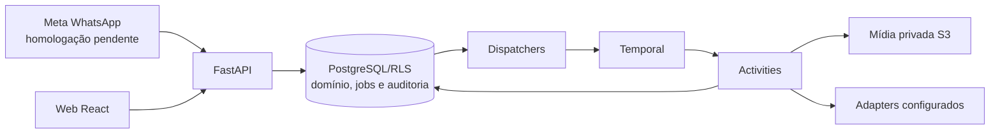

# SDD geral — Meu Braço Direito

Contrato vigente revisado em **29/10/2026**. Produto aceito em
[DECISIONS](DECISIONS.md), estado executivo em [PROJECT](PROJECT.md), sequência
em [fases](phases/README.md) e detalhamento na [fase BL04](phases/BL04-context-and-ai-production.md).
O [snapshot anterior](history/2026-10-28-pre-documentation-reconciliation/SDD.md)
preserva a redação substituída. Designs e evals têm estado e data próprios;
planejamento, teste simulado e homologação comercial são estados distintos.

## Atualização de 30/10 — copy e canal comercial

O contexto versionado admite `preferences.cta_destination` opcional, informado
pelo titular, distinto do telefone de identificação. Canal e valor devem ser
compatíveis com a chamada gerada; na ausência, o modelo recebe orientação para
uma chamada neutra. A solicitação editorial distingue texto público de direção
visual e dúvidas; a pré-checagem rejeita identificadores internos em copy e
interação de clique presumida. A conferência factual ignora apenas notações
técnicas reconhecidas na direção, sem autorizá-las como valores comerciais.
As mesmas regras são reaplicadas antes do efeito visual. Essa verificação é
parcial, não inspeciona a imagem e não comprova verdade semântica ou destino
ativo. Contexto e rastros mantêm os controles e versões existentes.

O percurso futuro de referências deve combinar perfis indicados pelo cliente
com candidatos descobertos por fonte a avaliar, apresentar até três sugestões
com motivo e evidência disponíveis e permitir aceitar/rejeitar cada uma. A
origem, os direitos e a atualidade limitam seu uso. Jev pode ajudar na avaliação
de candidatos já obtidos, mas a integração atual não é uma fonte de pesquisa.

## 1. Objetivo e fronteira do produto

Receber material/pedido por WhatsApp, recuperar contexto do próprio negócio,
produzir uma candidata privada, pedir aprovação específica e publicar nos canais
habilitados. A web complementa configuração e revisão. Proatividade sem mensagem
nova faz parte do resultado pretendido e será integrada na BL05.

Uma conta de cliente e uma organização por negócio (C02). A API e a migration
0057 garantem no máximo um negócio por organização; cobrança continua por
organização. Memberships e seleção legadas permanecem por compatibilidade.
Staff e convites administrativos não exigem cadastrar negócio.

Um número WhatsApp ativo de cliente por negócio (C03), distinto do número
oficial da plataforma. Material já associado continua processando durante troca
de número; a entrega simulada usa o vínculo ativo novo (C05). Meta real e envio
de candidata/aprovação pelo WhatsApp ainda precisam de integração/homologação.
Não atribuir retroativamente mensagens ainda não associadas sem prova de origem.

IA textual, visual, interpretação e transcrição integram um único aceite do
serviço por negócio, apresentado em Plano e acesso antes do checkout (C01).
Contas existentes aceitam a versão uma vez antes de usar as rotas de serviço.
O POST valida owner, versão/hash e ação explícita; grava ator/data e auditoria,
com replay idempotente. Cadastro, pagamento e redirect não substituem o aceite.
Registros legados são preservados; novos pedidos têm identidade contratual que
não reativa a fila editorial antiga. A web não oferece permissões por modelo,
fornecedor ou transcrição. O aviso atual ainda é para validação local.

Instagram é o primeiro destino pretendido. Vitrine de Facebook/TikTok não
integra essas redes. Foto/story são a oferta inicial; vídeo/franquia ainda não
foram definidos. Avatar/voz sintética ficam após o primeiro piloto (C12/C13).
Não prometer alcance, vendas, frequência ou canais sem evidência.

## 2. Arquitetura e execução

Monólito Python/FastAPI modular: `app/core`, `api/v1`, `schemas`, `services`,
`db`, `adapters`, `workflows`. Regras pertencem aos serviços. PostgreSQL guarda
domínio, permissões, identidades e filas persistentes; Temporal coordena a
execução e activities fazem IO. React fica em `local-spark-web`; mídia usa S3
compatível. Redis não é dependência ativa. Não usar Celery, RabbitMQ ou outro
runner concorrente para os mesmos processos.

API, correlação, dispatchers e workers têm processos separados. A task queue
Temporal não substitui o estado de domínio no banco. Não fazer rede sob row
lock nem IO em workflows determinísticos. Operações externas ambíguas não são
rollback SQL; exigem estado durável e reconciliação apropriada.

CRUD de negócio/kit tem auditoria transacional sem novo workflow de recibo.
Relay, tabelas e handlers legados são mantidos para compatibilidade, fora do
startup comum; removê-los exige avaliação do histórico e decisão específica.

## 3. Isolamento, identidade e permissões

- Tabelas compartilhadas com `tenant_id`, negócio e RLS. Header de tenant
  seleciona contexto; não concede autorização. Validar identidade e membership.
- Logins restritos por capacidade para app, identidade, cobrança, ingestão e
  correlação, sem superuser/BYPASSRLS no runtime. Migração usa conexão própria.
- Auth nativa com Argon2id, access JWT em memória na web, refresh HttpOnly,
  sessão revogável, Origin/CSRF e ações de e-mail de uso único.
- Staff exige MFA e é distinto de owner. Leitura administrativa é restrita e
  auditada; não entrega prompts, fotos ou material privado irrestrito.
- O aceite único é autoridade contratual, não autorização global de banco,
  concessão financeira, direito sobre qualquer imagem ou aprovação de publicação.

Desenvolvimento/teste aceitam localhost/127.0.0.1 na mesma porta/protocolo da
origem autorizada. Staging/produção exigem origem exata. Checkout congela a
origem; cookies continuam host-only. Contrato em [auth nativa](design/native-auth.md).

## 4. Jornada web e configuração do negócio

Cadastro/login → confirmação de e-mail → organização/negócio em setup → aceite
do serviço e plano/patrocínio conforme a contratação → telefone e vínculo.
Setup, acervo e kit podem ser preparados antes de pagar; geração/publicação
exigem acesso e orçamento aplicáveis. Checkout aberto ou retorno não ativa plano.

Menus: **Início, Plano e acesso, WhatsApp, Sobre meu negócio, Conteúdos, Kits
visuais**. Organização/negócio ativos são compartilhados em memória; a API/RLS
mantém a autorização. Onboarding captura atividade, descrição, cor HEX e
cidade/UF/código IBGE de snapshot local versionado. Município não é endereço
verificado nem geocodificação.

- `/app/content` acompanha propostas/prévias e revisões; publicação simulada é
  identificada. Não exige operar ideia, roteiro e renderer manualmente.
- `/app/ideas` redireciona para Conteúdos; `/app/guide` para Início.
  `/app/phone` é utilitária da configuração WhatsApp.
- `/app/editorial-lab` guarda os controles técnicos só no build DEV.
- Sobre meu negócio reúne fatos/preferências, Produtos e serviços e Meu espaço,
  sem fluxo de permissão de IA. `posts_per_week` histórico é preservado sem
  campo manual até cadência por formato/plano.

A consulta financeira continua visível antes do aceite. Contratos e estados da
interface ficam no [SDD web](../../local-spark-web/docs/SDD.md).

## 5. Fontes, contexto, kit e acervo

| Recurso | Contrato vigente | Estado local |
| --- | --- | --- |
| Envios WhatsApp | Texto, imagem, áudio e vídeo associados preservados como origem, sem exclusão pelo histórico. Não são fatos confirmados automaticamente. | Migration 0058 e leitores adaptados; limpeza técnica de não atribuídos/órfãos separada. |
| Contexto | Fatos confirmados, preferências e hipóteses distintos; fonte, validade e versão congeladas no pedido. | Implementado; fatos vencidos não autorizam nova afirmação. |
| Kit | Vitrine fictícia pública separada da seleção/overrides privados versionados. | BL01/BL02 locais; aplicação no modo simulado. Kit piloto ainda `public_demo`. |
| Acervo | Produtos/serviços/promoções e fotos de item/espaço, opcionais, privados e versionados. | BL03.1/BL03.2 locais; BL03.3 importará cardápio como rascunho. |
| Prévia gerada | Arquivo/versão privados preservados sem expiração automática enquanto a conta estiver ativa (C09). | Concluídas saem do purge por prazo; proposta/roteiro e snapshots referenciados são conservados. `expires_at` continua delimitando criação/aprovação, não retenção. |

A remoção de fotos desatualizadas do acervo permanece disponível. Promover foto
WhatsApp cria cópia com direitos declarados; não muda a finalidade nem a
identidade do envio original. Guardar um arquivo não cria produto, preço,
memória pesquisável ou skill. Aprovar peça não confirma seus fatos comerciais.

Kit usa `operation_id`, versão esperada/CAS, histórico imutável, logo privado e
URLs temporárias. Propostas congelam o documento confirmado. O editor guiado
não é editor livre de pixels. Catálogo público hoje está no build web; objetos
/CDN e novos nichos entram na BL06. Material privado nunca compõe a vitrine.

Preservação de arquivo não estende URL assinada, validade de fato ou janela de
aprovação. Os critérios de publicação permanecem atuais e específicos.

## 6. Conversa e inteligência editorial

A direção de 30/10/2026 é gerar a peça completa com briefing que reúne pedido,
fatos vigentes, kit, acervo pertinente, skill de feed/story e referências aceitas
quando disponíveis. A conferência deve avaliar preço, grafia, identidade,
fidelidade e legibilidade do arquivo resultante; presença desses itens no prompt
não demonstra que a imagem os reproduziu. O trace deverá ser acessível apenas
a atores autorizados e preservar versão das fontes e configuração sem imprimir
mensagens, imagens ou credenciais em logs. A pesquisa e aceite de referências
externas seguem uma fase futura, sem dados inventados.
Se a mensagem pedir preço diferente do catálogo e não disser se o cadastro deve
ser atualizado, a decisão C18 exige perguntar antes de continuar. Interpretação
estruturada do valor, detecção do conflito e pergunta específica são trabalho
futuro de WhatsApp/Jev, fora do escopo desta fatia de geração.

Inbox valida assinatura e cifra; correlação atribui origem ao negócio. O
processamento usa vínculo, acesso, aceite aplicável e controles internos.
Transcrição tem adapter e teto diário próprios, sem checkbox separado.

O diálogo determinístico atual reconhece intenções delimitadas; o worker local
pode usar Jev com saída estruturada e reserva para interpretação/retrieval do
acervo em desenvolvimento/teste. É opcional, desligado por padrão, com fontes
revalidadas e tratamento de orçamento/resultado incerto. Não é chat geral nem
conversa completa com memória. A comparação sintética não homologa produção.

Texto editorial usa OpenAI Responses estruturada, `store: false`, sem tools,
limites e reservas. `gpt-5-mini` é default configurável, não escolha comercial
final; transcrição referencia `gpt-transcribe`. A resposta real deve incluir
texto da arte, legenda e CTA gerados pelo modelo, guardados na proposta
versionada e verificados antes do efeito visual. O preço válido e versionado do
catálogo pode ser citado; resposta incompleta ou fora das regras é rejeitada,
sem substituição por copy fixa no caminho real. Com provedor editorial desativado,
uma nova proposta é rejeitada em vez de produzir baseline. O briefing com skill
usa redação natural e verifica IDs, valores e expressões comerciais delimitadas;
essa checagem não comprova a verdade semântica e não substitui revisão humana.
O reconhecimento de que o pedido exige preço ainda não é estruturado; incluí-lo
entre os fatos e solicitá-lo no prompt não garante sua presença na peça.
A legenda gerada é devolvida como campo próprio na candidata e compõe a prova
de aprovação. Aprovação, agendamento e publicação simulada revalidam a validade
factual; o vencimento não impede o titular de pedir ajustes.
Para novos feed/story, o briefing inclui a skill versionada, pedido, kit,
foto de origem e acervo pertinente. A imagem do exemplo do kit demonstrativo do
formato, identificada por versão e hash, entra como referência visual separada,
assim como a logo autorizada quando houver. O modelo recebe a direção criativa
e gera a peça inteira; o serviço não aplica a faixa ou textos fixos anteriores.
Referências de concorrentes ainda não estão implementadas. O fato selecionado
tem comprovação e validade verificadas; fatos adicionais no pedido visual ficam
limitados aos confirmados sem vencimento até existir revalidação individual.
A conferência semântica automática e a detecção do conflito C18 não existem.

Novas prévias visuais usam `full_piece_v1`; local estático de feed/story,
receitas visuais anteriores e propostas de baseline com provedor desligado não
iniciam novos efeitos. Prévias antigas concluídas permanecem acessíveis, e jobs
legados pendentes não são despachados. A migration 0061 fixa a receita e grava
traces cifrados com RLS em tabelas próprias, sem conteúdo privado em logs. O
trace editorial guarda a requisição preparada; o visual inclui método, endpoint,
corpo sem bytes das imagens, referências/hash, skill e versões. O estado
`prepared` não prova envio de uma tentativa incerta; a reprodução exige
recuperar os arquivos autorizados. Endpoints do proprietário usam `no-store`.

A aprovação por API da peça integral exige confirmação humana vinculada ao SHA
da imagem de preço/condições, grafia, identidade, fidelidade e legibilidade;
a publicação simulada revalida a confirmação. Não há OCR/visão automática
comprovando os itens e o fluxo WhatsApp ainda não apresenta esse checklist, logo
o comando antigo de aprovação não completa a aprovação integral. A geração visual
real continua restrita a desenvolvimento/teste, desligada por padrão, com
orçamento e credenciais configurados; não é capacidade de produção homologada.
No ensaio isolado posterior, quatro das seis artes trazem o preço e duas o
omitem na imagem; duas propostas usam “apresente” como copy voltada ao público.
Os pares compartilham a copy e a skill só orienta a imagem; um único fato foi
pré-selecionado. A guarda aprovou as saídas e não demonstrou qualidade comercial.
[Evidência](evals/editorial-copy-visual-after-2026-10-29.md).

Não existem pesquisa automática de concorrentes, treinamento automático ou
cadência proativa integrada. O briefing de feed/story usa skill versionada;
a avaliação real do novo caminho ainda está pendente. Retrieval usa somente
fontes pertinentes do negócio. Quando necessária, no máximo uma referência de
kit do formato escolhido, separada das fotos reais. Não enviar a galeria inteira.

O repositório separado `meu-braco-direito-skills` contém instruções iniciais para
briefings de feed e story, casos fictícios e protocolo de comparação. Validação
do formato e dois exercícios independentes com fatos ausentes/vencidos foram
executados; isso não comprova ganho sobre baseline, imagem gerada ou integração
ao produto naquele ensaio. O novo caminho seleciona a skill do formato na proposta
e utiliza seu ID/hash no briefing e no pedido visual; a seleção completa pelo
WhatsApp e a avaliação com modelos reais continuam pendentes.
Um ensaio exploratório posterior comparou sonda isolada do baseline com saídas
de agentes em casos fictícios. Detectou falta de esclarecimento de ambiguidade em
story; o ajuste foi repetido uma vez com sucesso. Diferenças de entradas e métodos
impedem atribuir ganho às skills. Nenhum provedor pago ou renderer foi chamado.
O ensaio pareado real autorizado de texto foi iniciado posteriormente e parou na
primeira tentativa com resultado incerto, sem resposta completa; não existe
comparação de qualidade concluída. Preservar hold e identidade conforme a
[evidência](evals/skills-paired-attempt-2026-10-29.md), sem repetir o efeito.
Um ensaio visual independente posterior gerou duas peças fictícias com o mesmo
acervo/kit e acabamento, orientadas com e sem skill, usando o adapter visual;
não percorreu o worker e não prova ganho ou aprovação comercial. As imagens,
restrições ignoradas e custos estimados constam na [evidência visual](evals/skills-visual-comparison-2026-10-29.md).
Um ensaio anterior com três negócios e seis prévias percorreu Temporal e a
guarda local com Jev/imagem reais. Todas omitiram preços pedidos e confirmados:
naquele ensaio a copy seguia o primeiro fato do baseline e a skill atuava na
direção visual. A geração integral de 30/10 ainda não foi avaliada com modelo real.
Mensagem de origem entra já processada, segunda prévia é solicitada internamente
e acervo repete a foto; não há prova de webhook Meta, seleção automática da skill
ou ganho comercial. [Evidência](evals/three-business-visual-ab-2026-10-29.md).

A direção aprovada prioriza skills reutilizáveis para feed/story, alimentadas
por contexto, kit e acervo privados; depois, referências indicadas pelo cliente
e descoberta automática de negócios semelhantes em destaque. Resultados externos
são evidência com origem e limitações, não fatos do cliente nem instruções
confiáveis; padrões inspiram criação original, sem copiar mídia ou identidade.
Jev é hipótese a avaliar, sem decisão de fornecedor nem fonte de dados. A
[proposta por fases](design/skills-e-referencias-editoriais.md) descreve
integração, avaliações e decisões abertas; nenhuma capacidade nova está entregue.

## 7. Produção, revisão e publicação

Percurso pretendido: pedido → briefing congelado → geração/edição → prévia →
ajuste ou aprovação → publicação → resultado. Pillow prepara arquivos e FFmpeg
permanece no percurso de vídeo; o acabamento fixo de imagens foi descontinuado.
Nenhuma receita está aprovada comercialmente só por funcionar nos testes.

Há candidata, decisão explícita e publicação simulada locais; hash do arquivo,
legenda, destino e horário são revalidados. Ajuste ainda não regenera a peça.
Não há envio real de candidata WhatsApp nem Instagram homologado. Silêncio,
aceite contratual, escolha de kit ou confirmação de preço não aprovam publicação.

Para representar produto/local reais, partir de fontes reais com direito e
preservar sua identidade. Fonte insuficiente pede informação ou conceito
identificado; não inventar preço, agenda, embalagem ou ambiente documental.
Roteiro de gravação e receitas de vídeo real estão em
[vídeo e voz](design/video-real-and-voice.md); identidade sintética permanece F05.

### Alterações e continuidade aprovadas

- C06/C07: mudanças de kit/foto/contexto aguardam criações admitidas, cancelam
  fila ainda não iniciada e bloqueiam novas admissões até aplicar a mudança.
  A prévia anterior fica para revisão, identificada como anterior à alteração.
- C08: vencimento do plano não interrompe criação já iniciada nem impede revisar
  sua prévia; novas criações e publicação ficam bloqueadas até renovar.
- C09: preservar prévias enquanto a conta estiver ativa, incluindo proveniência
  suficiente para revisão. O prazo após encerramento da conta fica em P03.
- C10: só staff pode recuperar pendência cujo autor perdeu acesso, com ação
  registrada, sem assumir a identidade dele ou conceder acesso geral à mídia.
  Em 29/10, o proprietário adiou essa implementação para evolução de gestão de
  acesso/suporte; não bloqueia o fechamento da fatia simulada validada.

**Estado atual:** C06/C07 coordenam os escritores atuais nos modos `visual_fake`
e `visual_ai`. A admissão visual revalida usuário/membership, fontes, aceite e plano na transação
owner antes do run durável, na ordem proposta → visual → comercial. C08 permite
conclusão e revisão privada de criação visual admitida após o vencimento financeiro;
bloqueio explícito e revogação de patrocínio não são tratados como vencimento.
Novos inícios e publicação continuam exigindo plano vigente. O renderer local
legado ainda não recebe essa exceção de conclusão.

C09 preserva prévias concluídas e proveniência, com consulta histórica e download
privado para revisão mesmo após o prazo da proposta/prévia. A janela de aprovação
e a validade de fatos permanecem próprias. Tentativas visuais iniciadas sem
resultado resolvido não são apagadas pelo purge. Resultados concluídos de ambos
os modos visuais continuam revisáveis quando a execução visual for desligada;
permissão de revisão não reativa geração nem dispensa owner/direitos/prova durável.
C10 bloqueia a substituição ou
o descarte da pendência por outro owner. A recuperação restrita de staff, com
auditoria, fica adiada; até sua entrega, a exceção administrativa permanece
bloqueada. O adiamento não aprova novas permissões nem reabre a decisão C10.
Retirada de consentimento por fornecedor permanece somente como compatibilidade
legada para negócios sem o
contrato; não é um novo fluxo de produto a desenvolver para quem aceitou C01.

### Integração visual conectada e primeira chamada controlada concluída

Persistência/API aceitam `local`, `visual_fake` e `visual_ai`. A migration 0059
exige fingerprint para ambos os modos visuais e recusa downgrade que perderia
uma identidade `visual_ai`; não relabela simulações existentes nem acrescenta
grants. Foi validada no `_test` na parte 2 e aplicada ao banco local da aplicação
para a execução autorizada da parte 3.

`visual_ai` liga pedido, dispatcher, `VisualGenerationWorkflow`, activity e
`DatabaseVisualGenerationRunner` à preparação de fontes, guarda, adapter OpenAI,
acabamento e commit privado. O percurso é exercitado com PostgreSQL/Temporal
locais e transporte HTTP simulado do adapter real na parte 2. A parte 3 concluiu
uma chamada OpenAI real de feed para Café do Cedro, após autorização de fontes
CC0/logo e teto total de US$ 1. Jev, workflow/worker, guarda, adapter, acabamento
e leitura autenticada da prévia privada participaram; entrada/prova de canal Meta
foram sintéticas e a entrega da candidata foi simulada. Não houve publicação,
edição manual de roteiro ou homologação WhatsApp/Instagram. Evidência em
[primeira imagem pelo produto](evals/bl042-first-product-image-2026-10-29.md).

Ativação exige desenvolvimento/teste, `VISUAL_AI_MODE=openai`, flag
`VISUAL_AI_EXECUTION_ENABLED=true`, chaves não vazias de provedor e criptografia,
aceite único C01 exigido e reserva por tentativa positiva dentro dos tetos mensal
por tenant e agregado. Variáveis usam o prefixo `MEU_BRACO_DIREITO_`; a flag é
desligada e a reserva zero por padrão. O pedido da API usa apenas o pool owner;
o worker exige o pool correlator restrito separado. A seleção automática de
item/fontes usa Jev com configuração e orçamento existentes, sem substituir a
interpretação por correspondência lexical automática.

A parte 1 implementa `DatabaseVisualEffectGuard` e `GuardedVisualSubmissionClaims`
com roles existentes: prova owner renovada, reserva/fence por tenant/agregado,
claim durável única e commit privado. Roteiro coordena mudanças pendentes em
transação proposta → visual após finish; writers financeiros usam o comercial.
Material atribuído não muda de identidade quando o telefone é trocado. A parte 2
liga a guarda ao modo explícito `visual_ai`; a parte 3 exercitou essa conexão
com uma imagem paga autorizada. Flags persistentes seguem desligadas; a execução
delimitada não autoriza uso recorrente ou novo orçamento.
Detalhes no [protocolo da guarda](design/BL04-effect-guard.md).

Fontes/aceite/plano e o run são validados na mesma transação owner; a reserva e o
fence continuam atômicos em outra transação correlator. Os dois commits não são
uma transação única: falha intermediária conserva a admissão bloqueante e não
autoriza nova submissão. A recuperação de criação visual obsoleta/falhada sem
reserva torna a prévia terminal na transação correlator, provando ausência de
tentativa e reserva sob locks prévia → ledger tenant. Somente após confirmar
esse commit conclui o run original na sessão owner. Confirmação perdida permite
repetir a reconciliação, nunca a geração. Duplicata viva retorna sem falhar a
execução original; reserva existente, inclusive não vinculada, conserva o bloqueio.
O renderer simulado usa essa recuperação no redispatch; o runner real pode
recuperar somente uma admissão com ausência comprovada de tentativa e reserva.
Não há varredura automática para recuperar runs fora desses consumidores nesta fatia.
O inventário atual identifica fontes imutáveis e escritores coordenados; novos
writers de acesso devem participar do protocolo antes de ganhar capacidade runtime.
Não manter locks durante IO.
Propostas antigas de grants/holds e exclusão WhatsApp são históricas, não
solução aprovada. Detalhes e testes da entrega estão na
[BL04](phases/BL04-context-and-ai-production.md).

O dispatcher visual usa ID `visual-preview/<preview>`, rejeição de duplicata e
lease de 12 minutos. A activity tem até dez minutos, espera de agendamento de um
minuto e uma tentativa. Falha de confirmação do início não enfileira outro
efeito; lease vencida marca resultado incerto, conservando run/hold. Não há
redispatch automático do `visual_ai` já reclamado. O fluxo estático conserva
workflow/IDs e tempos históricos; a espera da candidata cresce por patch Temporal
`visual-preview-wait-v1`, preservando replay antigo.

Reserva e claim revalidam os prazos com `clock_timestamp()` em instrução posterior
à aquisição dos locks; reserva revalida também após esperar orçamento, revertendo
a transação se a lease/janela venceu. Os testes cobrem espera pela prévia, ledger
tenant e agregado OpenAI, concorrência da última reserva e custo tardio sem crédito
duplicado. Uma liquidação sem confirmação não conclui automaticamente o run.

Gate BL04.3: titular avalia post/story novos no celular, com fontes consentidas,
texto/preço/CTA exatos, legibilidade, identidade e fidelidade a produto/local.
Contar rejeições, refações, todas as tentativas e custo por peça aceita. Uma
amostra fictícia isolada não encerra o gate comercial.

## 8. Consistência, falhas e rastreabilidade

Identidade durável por operação/evento, replay validado pelo payload, transações
curtas e auditoria; efeitos assíncronos exigem job/outbox do domínio na mesma
transação. CAS, lease e fence impedem confirmação por execução vencida.

Retries são limitados por efeito e fornecedor. Resposta perdida, timeout,
cancelamento ou lease expirada não provam que o efeito externo terminou e não
autorizam segunda cobrança/publicação. Manter estado incerto e reserva até uma
reconciliação segura. Auditoria/ledger são dados duráveis; logs usam eventos e
campos permitidos, sem segredos, prompts ou material privado.

`billing_jobs` e auditoria financeira permanecem. A migration 0038 retirou apenas
a outbox financeira sem consumidor, preservando evidência. Tabelas/handlers de
recibos genéricos seguem por compatibilidade. Não criar outro runner Temporal.

## 9. Custos, planos e recomendação

Reservar quota/custo atomicamente antes do envio pago, com identidade de
operação e orçamento configurado. Reserva, token observado, estimativa e custo
faturado são dados distintos. Há controles por capacidade, teto visual por
negócio/tenant e agregado OpenAI, com alcance limitado ao ledger que os usa.
Isso não limita toda a fatura externa nem cobre automaticamente outros adapters.

R$ 99/mês e teto desejado de R$ 50 de custo total por cliente/mês orientam a
medição, incluindo IA, mídia, mensageria, cobrança, tentativas, infraestrutura e
custos atribuídos. Faltam tarifas versionadas/COGS completo e franquias por
formato/revisão. Plano limita volume; recomendação de cadência deve ficar dentro
dele, com evidência e pausa. Não prometer posts ilimitados ou vendas causais.

## 10. Superfície de APIs e integrações

Prefixo de negócio: `/api/v1/organizations/{tenant_id}/businesses/{business_id}`.
Schemas/Swagger e SDD da fase detalham payloads; existência de rota não homologa
fornecedor ou torna todo controle uma etapa da interface.

| Grupo | Contratos existentes |
| --- | --- |
| Identidade | `/api/v1/auth/*`, sessão, perfil e onboarding; Origin/CSRF conforme a operação. |
| Negócios | Cadastro, referência de municípios/UF e administração auditada. |
| Contratação | `GET/POST service-agreement`; billing, checkout, webhook Stripe, patrocínio e reconciliação. |
| WhatsApp | Webhook assinado; vínculo, histórico, conversa e transcrição configurável. |
| Contexto/acervo/kit | Contexto versionado; catálogo, fotos privadas, draft/confirm/history de kit e logo. |
| Conteúdo | Propostas/roteiros, prévias, entregas e decisão da candidata. |
| Staff | Convites/MFA, cobrança e projeções operacionais limitadas e auditadas. |

Stripe tem adapter sandbox exercitado; produção/staging pendentes. SMTP/Mailpit
captura e-mails localmente. Twilio depende de configuração/homologação por
ambiente. Meta/Instagram reais e avaliação comercial da imagem produzida ainda faltam. AWS/Redis/CDN
não são serviços comerciais ativos só por constarem no desenho.

## 11. Sequência e condições de liberação

BL01/BL02 e BL03.1/BL03.2 locais → BL04.2 guarda, conexão e primeira chamada
controlada concluídas (partes 1/2/3) → skills de feed/story e avaliação com
simulações → pesquisa de referências indicadas e descoberta automática → uso
controlado dos padrões na geração → gate BL04.3 de qualidade/custo com titular
→ BL05 jornada, ajuste e proatividade → expansão. A pesquisa não depende de
fechar antecipadamente o gate comercial; continua exigindo fontes permitidas.
BL03.3 importa cardápio depois; BL06 amplia nichos/CDN depois de provar reaplicação.

Piloto exige receitas aprovadas, material consentido, franquia/orçamento,
Meta oficial, staging, observabilidade, suporte e recuperação. Avatar/voz ficam
após o primeiro piloto. A meta de 200 mil clientes orienta testes graduais de
capacidade, não comprova escala. P03 foi adiado pelo proprietário; P05 depende
de medição. Não inventar prazo de exclusão pós-encerramento ou quantidade do plano.

## 12. Qualidade e governança

Backend: Ruff/formatação, mypy, unitários e integração PostgreSQL/Temporal, com
100% de linhas e branches, sem exclusões produtivas artificiais. Web: TypeScript,
formatação, testes/build e jornadas de navegador, com 100% nos quatro critérios.
Banco de teste dedicado termina em `_test`, com runtime restrito; nunca limpar
ou migrar o banco da aplicação para testes. Falta de serviço falha, não vira skip.

Evidência anterior de aplicação: 1.583 testes backend e complemento de 24 com sete
casos novos, cobertura final 100%; web com 360 testes/cobertura integral, build e
três jornadas Chromium. Ver [CHANGELOG](CHANGELOG.md). A parte 1 acrescenta
testes de admissão concorrente, continuidade, retenção/proveniência e autoria de
pendências. A entrega de recuperação acrescenta crash/confirmação perdida entre
commits, tentativa tardia, espera de locks até vencer prazo, tetos concorrentes
e mudança de kit/logo, guarda concreta, roteiro pendente, writers financeiros,
relink por outro owner e validade factual após locks. `make ci`: **1.829 testes**,
**100% de linhas e branches** (9.284 statements, 2.550 branches), Ruff/formatação e
mypy (149 módulos). PostgreSQL `_test`
com roles restritas e Temporal locais; nenhum efeito pago ou nova homologação
externa ou novos grants. Web: **365 testes**, 100% nas quatro métricas,
build/formatação e três jornadas Chromium. São evidências da parte 1.

Parte 2: `make ci` aprovado com **1.914 testes**, **100% de linhas e branches**
(9.394 statements, 2.582 branches), Ruff/formatação e mypy (151 módulos). Testes
novos cobrem modo/API, wiring Temporal, adapter real com HTTP simulado,
versão/hash, orçamento e resultado incerto sem nova submissão. Web: **375 testes**,
**100% nas quatro métricas**, build/formatação e **quatro jornadas Chromium** na
árvore final. Não houve chamada paga, novo grant ou migração do banco da aplicação
na parte 2.

Parte 3: uma imagem de feed `visual_ai` concluída e run `finished`, JPEG privado
obtido pela API/S3, candidata pendente e publicação nula. Estimativa de uso total
de **US$ 0,029701** (uma imagem e duas interpretações Jev); não é fatura e a
reserva visual de **US$ 0,99** conserva custo incerto. A tentativa anterior foi
interrompida no wrapper antes do HTTP de imagem, com zero submissões demonstradas;
reconciliação explícita em zero preservou tentativa, marcadores e auditoria.
Nova origem com formato esclarecido produziu o feed sob a mesma autorização,
sem reenvio de imagem incerta. `make lint types` e **94 testes unitários dirigidos**
aprovados, mypy em 151 módulos; código de produção inalterado, sem novos grants.
O último `make ci` é o da parte 2, não repetido nesta execução. Consulta/download
owner mantiveram o hash com modo `disabled`, flag desligada e limites zero;
acesso anônimo retornou 401 e os processos habilitados foram encerrados.
Essa peça não revalida nem substitui os testes C08/C09
ou o gate BL04.3 de post/story, revisão de titular e custo por peça aceita.

Em cada entrega, atualizar PROJECT, SDD, fase e CHANGELOG. Decisões novas entram
em DECISIONS; distinguir decisão aceita, código implementado e homologação.
Registros datados e alternativas rejeitadas são preservados com seu contexto.
Não remover dados, tabelas, migrations ou proteções por inferência editorial.
