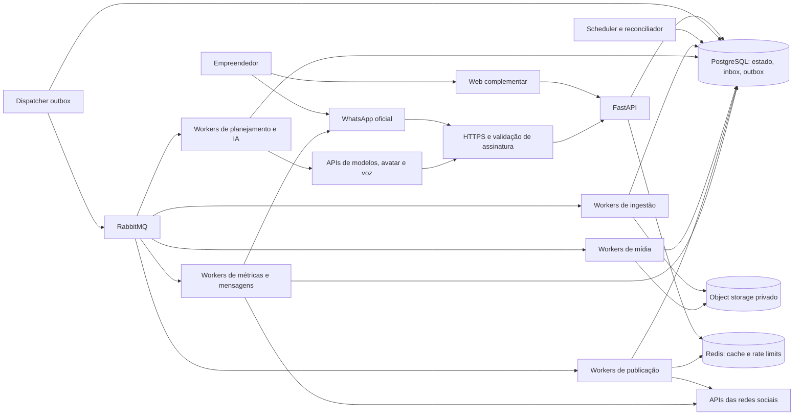
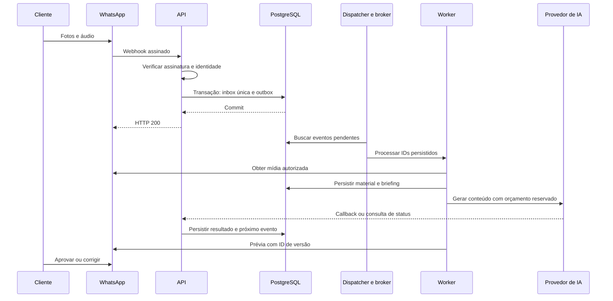
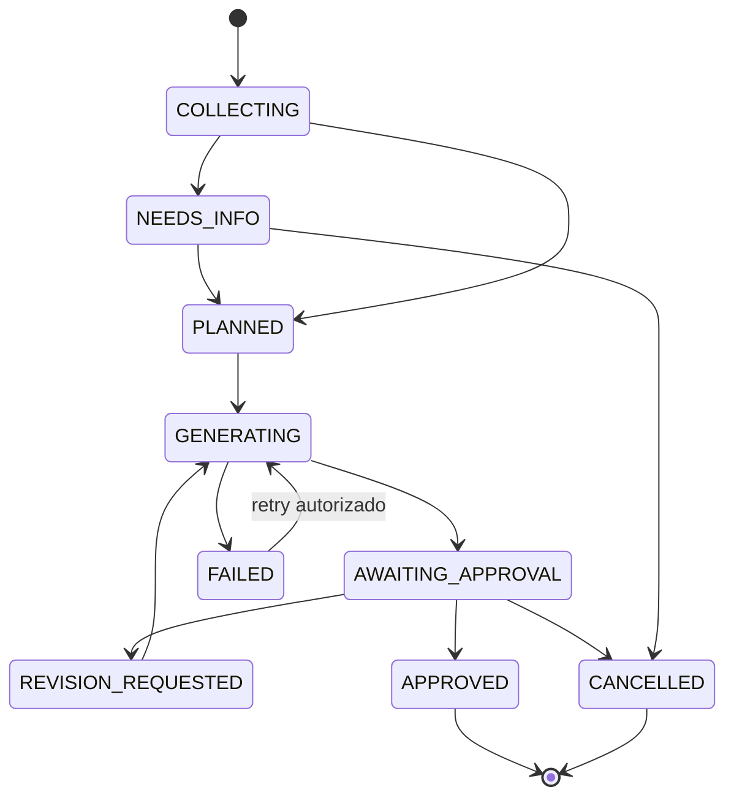
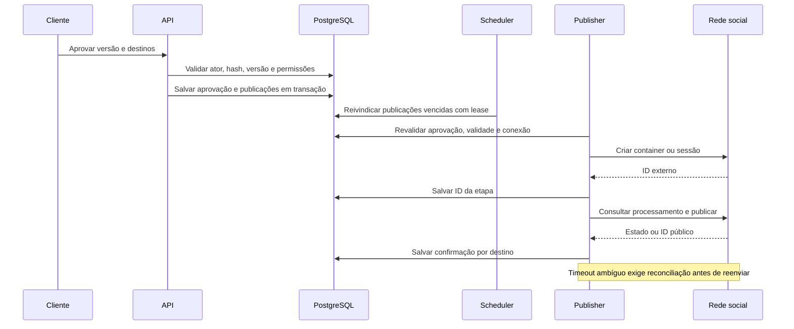
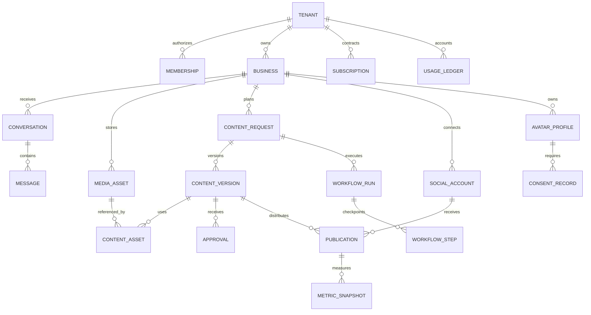

# SDD — Plataforma de conteúdo pelo WhatsApp

> HISTÓRICO v0.1: substituído pelo [SDD atual v0.2](v0-architecture.md) e seus
> documentos de integrações, resiliência e entrega. Celery/RabbitMQ e runner próprio
> descritos abaixo NÃO são a decisão atual; usar Temporal com SDK Python.
> O novo escopo inclui planejamento proativo e todas as receitas da matriz na v0.

Versão 0.1 · 20/10/2026 · Proposta para implementação.

## 1. Objetivo e premissas

Permitir que um pequeno empresário mantenha sua divulgação digital enviando fotos,
vídeos, áudios ou ideias pelo WhatsApp, sem precisar operar um editor ou conhecer IA.
O sistema ajuda a escolher o que divulgar e prepara materiais com a identidade do
negócio, incluindo vídeos com imagem e voz autorizadas do próprio empresário.

Premissas dadas pelo fundador:

- Aquisição por vídeos longos de entretenimento no YouTube, produzidos pelos sócios.
- Os negócios apresentados podem ser assinantes ou receber acesso por seis meses.
- WhatsApp é a interface principal do cliente; publicação em várias redes é a visão.
- R$ 99/mês é uma hipótese de plano de entrada, sem franquias de mídia definidas.
- 200 mil assinantes é um cenário de capacidade, usando a referência de 1% de
  20 milhões mencionada na conversa; não é previsão de adoção ou censo validado.
- Infraestrutura deve permitir crescimento horizontal desde a estrutura inicial.

Decisões propostas, ainda não obrigações já contratadas: broker RabbitMQ, execução
em containers gerenciados e fornecedores de avatar/voz externos. Não há garantia de
escala sem testes de carga, limites contratados e orçamento.

## 2. Entrega do produto

### 2.1 Capacidades

| ID | Capacidade | Primeira entrega |
| --- | --- | --- |
| RF01 | Cadastro guiado, negócio, contatos, timezone, marca e objetivos | Sim |
| RF02 | Receber texto, áudio, imagem e vídeo no WhatsApp | Sim |
| RF03 | Agrupar materiais, transcrever e pedir dados que faltam | Sim |
| RF04 | Gerar briefing, roteiro, legenda e chamada para ação | Sim |
| RF05 | Arte estática e vídeo vertical com materiais reais | Sim |
| RF06 | Revisar por texto/áudio, aprovar versão e agendar | Sim |
| RF07 | Conectar e publicar em Instagram profissional | Sim, após validação da API |
| RF08 | Avatar e voz do cliente com consentimento e prévia | Piloto inicial limitado |
| RF09 | Uso, franquia, assinatura e acesso promocional por seis meses | Sim |
| RF10 | Relatório semanal com dados disponíveis e indicação de limitações | Sim |
| RF11 | Sugestões proativas e reaproveitamento de materiais autorizados | Após fluxo principal |
| RF12 | Carrossel, Stories, Facebook, TikTok e YouTube Shorts | Expansão por conector |
| RF13 | Comparação de formatos e análise de referências públicas | Posterior |

O piloto de avatar deve acontecer cedo: qualidade em português, semelhança, tempo e
custo por segundo são riscos centrais do produto. Não adiar essa prova para o fim.
Redes não habilitadas têm entrega de arquivo, claramente identificada como manual.
Formatos e destinos disponíveis vêm de capabilities, não de promessas fixas da UI.

### 2.2 Experiência e limites

- A IA recomenda formato; o cliente pode escolher e corrigir.
- Não inventar preço, estoque, condição promocional, depoimento ou faturamento.
- Mostrar preço, validade, conta de destino e prévia antes de publicar.
- Materiais reais do produto devem preservar sua aparência; alterações significativas
  precisam ser identificadas e aprovadas. Avatar não é obrigatório em todo vídeo.
- Imagem sem qualidade suficiente gera orientação simples para reenviar.
- Uma solicitação pode produzir múltiplas variantes; cada destino tem publicação própria.
- Aprovação explícita por versão é o padrão inicial. Automação mais ampla é evolução
  separada e depende das regras de cada plataforma.
- O cliente pode pedir pausa, cancelar agendamento ou falar com suporte no chat.
- Relatórios distinguem alcance, cliques, conversas observadas e vendas confirmadas.
  Não atribuir aumento de faturamento automaticamente ao produto.

### 2.3 Exemplo de conversa

1. Cliente envia duas fotos e áudio: “Combo a R$ 25, amanhã até as dez”.
2. Sistema agrupa os itens e normaliza “amanhã” no timezone do negócio.
3. Confirma data, horário e dados ausentes; “até as dez” não define manhã/noite sozinho.
4. Sugere vídeo vertical de 15 segundos e Story com oferta e contato.
5. Se houver avatar habilitado, oferece abertura com o dono e imagens do lanche.
6. Envia prévia e ações: aprovar, ajustar, agendar, cancelar.
7. Publica somente a versão aprovada e devolve link ou status de processamento.
8. Apresenta resultados coletados no relatório, sem confundir postagem com venda.

## 3. Arquitetura

Monólito modular com processos independentes. Um código compartilhado e contratos
internos claros; API, dispatcher, scheduler e workers têm deployments separados.
Não executar renderização ou chamadas longas dentro da requisição HTTP.



| Componente | Responsabilidade |
| --- | --- |
| FastAPI + Pydantic | API, autenticação, webhooks, contratos e validação |
| SQLAlchemy + Alembic | Acesso ao banco e migrações versionadas |
| PostgreSQL | Fonte de verdade de tenants, conteúdo, jobs, quotas e auditoria |
| Celery | Distribuir execução de tarefas curtas, recuperáveis e idempotentes |
| RabbitMQ | Broker com filas duráveis, confirmações e replicação em produção |
| Redis | Cache, limites distribuídos e coordenação temporária; não guarda estado essencial |
| Object storage S3 | Originais, derivados, previews e arquivos finais |
| FFmpeg/ffprobe | Normalização, composição, áudio e legendas em sandbox |
| Provedores de IA | Transcrição, análise multimodal, planejamento, avatar e voz |
| Web React | OAuth, consentimento, revisão exigida por rede e operação interna |
| OpenTelemetry | Traces, métricas e correlação dos processos |

### 3.1 Módulos do backend

`identity`, `tenancy`, `businesses`, `conversations`, `media`, `content`, `avatars`,
`workflows`, `publishing`, `analytics`, `billing`, `notifications`, `support`.

Cada módulo expõe serviços de aplicação. Rotas e tasks chamam esses serviços;
não duplicam regras. Nenhum módulo de IA pode publicar diretamente ou aprovar
gastos. Ferramentas de IA recebem permissões mínimas e entradas externas são dados,
inclusive instruções presentes em áudios ou imagens.

### 3.2 WhatsApp: topologia inicial

Um número oficial da plataforma recebe mensagens dos clientes. O telefone do dono
é verificado e associado a uma identidade autorizada; tenant não vem do texto da
mensagem. O webhook também verifica a WABA e o número receptor cadastrados.
Quem administra várias empresas precisa escolher explicitamente o negócio ativo.

Não exigir que todo cliente migre o próprio WhatsApp para a API. Integrar depois o
WhatsApp de vendas de cada cliente é outro produto/escopo, com autorização própria.
Receber material no nosso número não dá acesso às conversas comerciais do cliente.

## 4. Fluxos e estados duráveis

### 4.1 Recepção e criação



Webhook responde após commit, antes do processamento. Duplicatas válidas retornam
sucesso sem repetir efeitos. Falha de persistência retorna erro recuperável; nunca
confirmar evento não salvo. Cada envelope pode conter vários eventos independentes.
Persistir tanto evento original com retenção curta quanto itens normalizados únicos.

Agrupamento proposto: janela móvel de 30 segundos, máximo de dois minutos, comando
“pronto” encerra; parâmetros ajustáveis após piloto. Persistir `ready_at` e versão do
grupo. Lock por conversa/negócio impede dois briefings para os mesmos itens. Material
recebido após fechamento exige associação explícita ou vira nova solicitação.

### 4.2 Estado de conteúdo



Conteúdo aprovado é imutável. Ajuste cria nova versão e novas aprovações; nunca
substituir o arquivo de uma versão já agendada. Estados `FAILED` têm etapa, causa,
tentativas e decisão recuperável/terminal. `WAITING_PROVIDER` pertence à etapa de
geração, sem ocupar worker enquanto espera.

### 4.3 Aprovação e publicação



Publicação tem estado próprio por rede/conta:
`SCHEDULED → PREPARING → SUBMITTED → PROCESSING → PUBLISHED`.
Alternativas: `RETRY_WAIT`, `UNKNOWN`, `NEEDS_REAUTH`, `ACTION_REQUIRED`, `FAILED`,
`CANCELLED`. Fluxo concreto varia por adapter e não exige todos os intermediários.

Regras críticas:

- Aprovação vincula hash da mídia, legenda, conta, destino, versão e janela de envio.
- Mudança de conteúdo, destino ou agendamento além da janela aprovada exige nova aprovação.
- Não interpretar um “sim” solto quando existem várias prévias pendentes. Usar ação
  assinada de uso único ou esclarecer qual item; correção não equivale a aprovação.
- Antes de cada efeito externo, verificar cancelamento, validade da oferta e revogação.
- Cancelar e reivindicar envio usam comparação atômica de estado/versionamento.
  Após envio iniciado, cancelamento pode não impedir publicação: avisar e reconciliar.
- Não reenviar cegamente em timeout após possível publicação; consultar ID externo,
  evidência disponível ou colocar em revisão manual. Não prometer exactly-once externo.
- Só notificar “publicado” quando houver confirmação suficiente; aceite da API pode
  significar apenas que o processamento começou.
- Falha em uma rede não repete postagem bem-sucedida em outra.

### 4.4 Avatar, voz e consentimento

`REQUESTED → CAPTURE_PENDING → VERIFYING → READY`, ou `REJECTED`, `REVOKED`.

Captura guiada por link autenticado temporário; imagem e amostra de voz conforme
exigências do fornecedor. Diferenciar avatar de foto de um clone treinado em vídeo.
Guardar titular, finalidade, versão dos termos, data, evidência e IDs do fornecedor.
Não assumir que uma foto e um áudio de WhatsApp bastam para todo fornecedor.

Revogação bloqueia novas gerações, invalida aprovações ainda não publicadas com aquele
avatar e cancela tarefas/agendamentos correspondentes. Exclusão no fornecedor exige
job rastreável. Conteúdo já publicado precisa de processo específico de remoção;
apagar arquivo local não apaga a rede social.

### 4.5 Proatividade e relatório

Scheduler seleciona negócios elegíveis por timezone, preferências, franquia e
disponibilidade de material. Sugere ações sem inventar fatos e sem repetir uma
promoção vencida. Mensagens respeitam consentimento, horários e regras do WhatsApp.

Coleta de métricas usa cursores, limites, períodos e data de captura. Relatório guarda
snapshot reproduzível. Dados ausentes aparecem como indisponíveis, não como zero.
Links próprios medem cliques; conversas/vendas só entram se houver integração ou
confirmação do comerciante. O cliente que só envia material ao nosso bot não fornece
automaticamente dados do próprio WhatsApp de vendas.

## 5. Processamento de mídia e IA

1. Baixar mídia usando ID e credenciais do provedor; salvar em bucket privado.
2. Verificar tamanho, assinatura de arquivo, MIME real, duração e autorização de uso.
3. Gerar metadados com ffprobe, transcrever áudio e analisar qualidade visual.
4. Extrair fatos com proveniência: produto, preço, condições, datas e contato.
5. Construir briefing estruturado; solicitar dados ambíguos antes de gerar.
6. Selecionar receita versionada: `static_offer`, `real_media_reel`, `owner_avatar`,
   `hybrid_avatar_broll`, futuramente `carousel` e `generated_scene`.
7. Gerar roteiro/legenda em JSON validado e plano de cenas limitado a assets autorizados.
8. Reservar orçamento e executar gerações externas necessárias.
9. Compor cenas, música licenciada, voz, legendas sincronizadas e identidade visual.
10. Verificar duração, áudio, textos críticos, área segura e requisitos do destino.
11. Persistir artefatos imutáveis e enviar prévia para revisão.

Render recipe é JSON de domínio, não comando shell gerado por LLM. Renderer escolhe
templates conhecidos e parâmetros validados. Texto renderizado por engine determinística
para preservar preço e tipografia. A IA não recebe acesso arbitrário a URLs ou arquivos.

FFmpeg roda sem privilégios, com limites de CPU/RAM/tempo/disco, protocolos permitidos
e acesso de rede restrito. Downloads validam redirects e destinos para impedir SSRF;
bloquear redes privadas, link-local e metadata de cloud. Transcodificar arquivos
não confiáveis em container separado do servidor web.

Interfaces internas mínimas, independentes de SDK:

```python
class GenerationProvider(Protocol):
    def capabilities(self) -> ProviderCapabilities: ...
    def estimate(self, request: GenerationRequest) -> CostEstimate: ...
    def submit(self, request: GenerationRequest, operation_id: str) -> ProviderJob: ...
    def get_status(self, external_id: str) -> ProviderJobStatus: ...

class SocialPublisher(Protocol):
    def capabilities(self, account: SocialAccount) -> PublishCapabilities: ...
    def validate(self, publication: Publication) -> ValidationResult: ...
    def submit(self, publication: Publication) -> SubmissionResult: ...
    def reconcile(self, publication: Publication) -> PublicationStatus: ...
```

São contratos propostos; parâmetros reais e suporte a idempotência dependem de cada API.
Persistir modelo, fornecedor, versão de template, inputs e custos para rastreabilidade.
Não trocar automaticamente o fornecedor de um avatar por outro sem nova configuração
de identidade, qualidade, consentimento e custo.

## 6. Modelo de dados

Tenant é a conta contratante; pode conter negócios e membros. Franquia é da assinatura,
com alocação por negócio. A primeira experiência pode limitar a um negócio por plano.
Datas são `timestamptz` UTC; timezone IANA fica no negócio. Dinheiro em centavos BRL
ou decimal na moeda original, nunca float; custos externos registram câmbio e data.



| Tabela | Campos e invariantes principais |
| --- | --- |
| tenants / memberships | tenant, user, papel, status; combinação única por membro |
| businesses / brand_profiles | timezone, endereço, contatos, cores, tom e fatos confirmados |
| channel_identities | telefone verificado, WABA/número receptor, usuário e contexto ativo |
| conversations / messages | autor, provider_message_id, tipo, grupo, received_at; deduplicação |
| webhook_inbox | provedor, conta, event_key, payload protegido, status; chave única |
| outbox_events | event_id, aggregate_id, schema_version, available_at, lease, published_at |
| media_assets | tenant, business, object_key, checksum, MIME, duração, origem e retenção |
| content_requests | objetivo, fatos, proveniência, dúvidas, estado, lock_version |
| content_versions / content_assets | versão imutável, manifesto de cenas, legenda, hashes e arquivos |
| approvals | ator, versão, hashes, destinos, janela, expires_at, revoked_at |
| social_accounts | rede, conta externa, scopes, secret_ref, expiração, capability snapshot |
| publications | versão/conta, scheduled_at, estado, external_id, próxima ação e lease |
| publication_attempts | tentativa/etapa, chave de operação, request fingerprint e resultado |
| avatar_profiles / consent_records | identidade, fornecedor, provas, finalidade, status e revogação |
| workflow_runs / workflow_steps | input_version, step_key, estado, lease, provider_job_id e erros |
| plans / subscriptions / entitlements | franquias, funcionalidades, status, ciclo e concessões |
| usage_ledger / usage_reservations | unidade, origem, reserva, consumo, custo estimado/real e reversão |
| metric_snapshots / weekly_reports | métrica, período, rede, captura, completude e snapshot |
| audit_events / support_cases | ator, ação, recurso, correlation_id e motivo operacional |

Concessão de seis meses é entitlement com início/fim e patrocinador/origem, sem
fingir pagamento. Dados comerciais distinguem cliente pagante e beneficiário.
Cartão e dados bancários permanecem no processador de pagamento.

### 6.1 Isolamento e índices

- Todas as tabelas de domínio levam `tenant_id`; vínculos também validam `business_id`.
- FKs compostas por tenant impedem referência cruzada mesmo com UUID válido.
- RLS para defesa adicional, role de execução sem BYPASSRLS e sem ser dona das tabelas.
  Contexto do tenant definido por transação com `SET LOCAL`; testar reuse de conexão.
- Dispatcher/scheduler usam role restrita de sistema para coordenação global, sem
  acesso indiscriminado a conteúdo. Jobs entram novamente em contexto do tenant.
- Unique: inbox `(provider, provider_account_id, event_key)`; mensagens por conta/ID;
  etapa `(run_id, step_key, input_version)`; publicação `(content_version_id, social_account_id)`.
- Índices parciais de trabalho por `(next_action_at, id)` e estados elegíveis;
  listagens por `(tenant_id, business_id, created_at, id)` e paginação por cursor.
- Particionar mensagens, eventos e métricas por data quando volume/planos de consulta
  justificarem; não particionar tudo no primeiro deploy.

## 7. Contratos HTTP e de eventos

REST `/v1`, JSON, UUID, paginação por cursor. APIs autenticadas derivam tenant da
sessão/membership. `X-Tenant-ID` pode selecionar contexto autorizado, nunca concede acesso.
Webhooks são exceções à sessão e usam autenticação específica do provedor.

| Método / rota proposta | Efeito |
| --- | --- |
| GET /health/live e /health/ready | Processo vivo; dependências essenciais prontas |
| GET /webhooks/whatsapp | Handshake do challenge com verify token |
| POST /webhooks/whatsapp | Validar assinatura, persistir inbox/outbox, confirmar |
| POST /webhooks/providers/{provider} | Callback autenticado de job externo |
| POST /webhooks/billing | Evento de pagamento autenticado e deduplicado |
| POST /v1/businesses | Criar negócio sob tenant autorizado |
| POST /v1/media/upload-sessions | URL temporária com limite e vínculo de arquivo |
| POST /v1/content-requests | Criar solicitação estruturada ou rascunho |
| GET /v1/content-requests/{id} | Estado, pendências, versões e publicações |
| POST /v1/content-requests/{id}/revisions | Nova versão com expected_version |
| POST /v1/content-versions/{id}/approvals | Aprovar hashes, destinos e janela |
| POST /v1/publications | Agendar versão aprovada por conta |
| POST /v1/publications/{id}/cancel | Cancelamento com controle de concorrência |
| POST /v1/connections/{network}/authorization | Iniciar OAuth com state e PKCE se suportado |
| GET /v1/connections/{network}/callback | Validar state e trocar código no backend |
| POST /v1/avatars/enrollments | Criar captura e consentimento de identidade |
| POST /v1/avatars/{id}/revoke | Bloquear uso e iniciar cancelamento/exclusão |
| GET /v1/usage e /v1/reports/weekly | Franquias e relatório disponível |
| POST /v1/subscriptions/cancellation | Encerrar renovação conforme contrato |
| POST /v1/support-cases | Escalar falha para atendimento |

Operações assíncronas retornam `202` com `operation_id` e `status_url`; validação
imediata usa 400/422, conflito de versão 409, sem permissão 403 e limite 429.
Recurso de outro tenant retorna 404. Erros incluem código estável e trace_id.

Mutations relevantes aceitam `Idempotency-Key`, associada a tenant/ator/rota/hash do
payload. Repetição devolve o resultado original; chave com payload diferente dá 409.
Retenção deve cobrir o horizonte de retry documentado. A operação externa tem uma
identidade persistente adicional, não depende só da expiração da chave HTTP.

```json
{
  "event_id": "uuid",
  "event_type": "content.generation.requested",
  "schema_version": 1,
  "tenant_id": "uuid",
  "aggregate_id": "uuid",
  "occurred_at": "2026-10-20T15:00:00Z",
  "correlation_id": "uuid",
  "causation_id": "uuid",
  "payload": {"content_version_id": "uuid"}
}
```

Broker transporta IDs e metadados pequenos, não arquivos, tokens ou áudios base64.
Eventos internos são versionados; consumidores validam schema e tenant do recurso.

## 8. Filas, agendamento e recuperação

Filas iniciais por tipo de recurso: `ingest`, `planning`, `generation`, `render`,
`publish`, `notifications`, `analytics`. Não criar fila por cliente. Separar grupos
de workers para render pesado não atrasar aprovação, mensagens e publicação.

Garantia interna é at-least-once com efeitos idempotentes, não exactly-once.

1. Transação grava mudança de domínio e outbox.
2. Dispatcher reivindica eventos com lease e `FOR UPDATE SKIP LOCKED`.
3. Publica com confirmação e checagem de roteamento; só então marca como enviado.
4. Crash após publicação e antes da marcação pode duplicar: consumer consulta etapa
   e operação únicas antes de executar.
5. Consumer confirma a mensagem após persistir resultado ou checkpoint recuperável.
6. Reconciliador recupera leases expirados, outbox atrasada e jobs sem callback.

Celery: confirmação tardia apenas em tasks preparadas para redelivery; configurar
prefetch, limites de tempo, rejeição em worker perdido e retries por tipo de tarefa.
Validar combinações no teste de caos para evitar loops em falhas determinísticas.
Produção usa filas duráveis/quorum, mensagens persistentes e publisher confirms;
verificar compatibilidade exata das versões de Celery/Kombu/RabbitMQ no bootstrap.

Scheduler consulta vencimentos no banco em lotes e registra despacho na outbox de
forma atômica. Agendamentos distantes e retries ficam no banco; não usar Celery ETA
para manter dias de tarefas em memória. Scheduler pode ter múltiplas instâncias
com leases/claims atômicos, sem duplicar efeitos.

Retry: backoff exponencial com jitter, limite de tentativas/tempo e `Retry-After`.
429 reduz concorrência do provedor; 401/403 de autorização leva a reautenticação ou
erro terminal; conteúdo inválido requer correção. Após limite, manter registro de
falha operacional/dead letter e permitir replay auditado da etapa, não de todo o fluxo.

Job externo: salvar operação e reserva antes de enviar; salvar external_id assim
que conhecido; aguardar callback ou polling com backoff fora do worker. Se o envio
teve timeout sem ID e não existe idempotência/consulta por referência, registrar
`UNKNOWN` e revisar antes de gastar novamente. Callback duplicado ou fora de ordem
não regride estado terminal.

Leases têm heartbeat e fencing token/versionamento: worker antigo não pode gravar
resultado após perda de posse. Locks não substituem idempotência de efeitos externos.

## 9. Integrações e restrições

| Integração | Decisão e validação necessária |
| --- | --- |
| WhatsApp Cloud API | Oficial; HTTPS, handshake e validação de assinatura no corpo bruto. Templates e custos conforme janela/categoria e regras vigentes; revisão de templates antes de produção. |
| Instagram | Contas profissionais; OAuth e permissões de publicação/insights. Validar caminho Instagram Login e tipos suportados. Não exigir Página Facebook sem necessidade do caminho escolhido. |
| Facebook | Adapter próprio para Pages, scopes e capacidades; não presumir equivalência com Instagram. |
| TikTok | Conector com fluxo de revisão específico, auditoria e consentimento por envio; sem prometer publicação invisível integral pelo chat. |
| YouTube Shorts | Upload autenticado e validação de quota, verificação/auditoria e classificação de Shorts em spike antes de habilitar. |
| Avatar/voz | Spike com fornecedor com API, consentimento, qualidade PT-BR, custos e capacidade contratada; HeyGen é candidato, não decisão fechada. |
| Cobrança | Adapter de assinatura, Pix/cartão conforme provedor, webhook e reconciliação; eventos de pagamento chegam duplicados ou fora de ordem. |

TikTok: documentação consultada exige prévia, controle de metadados, escolhas de
privacidade/interações e consentimento antes do envio; clientes não auditados têm
restrições de visibilidade. Um “pode postar em tudo” não substitui essas etapas.
Implementar tela complementar e manter destino desabilitado até aprovação do fluxo.

Acesso a métricas de concorrentes é limitado. Análise usa referências públicas e
dados acessíveis autorizadamente; não promete conhecer vendas, conversão ou alcance
privado de concorrentes. Treinar recomendações primeiro no histórico do próprio cliente.

## 10. Franquias e custo

Cada plano define formatos, contas, gerações, segundos de avatar/vídeo, armazenamento
e política de revisões. Não vender uso ilimitado antes de medir a distribuição de custo.
Reserva atômica impede duas tarefas simultâneas de ultrapassar saldo.

- Estimar custo, reservar franquia e orçamento antes de chamada paga.
- Consumir ao confirmar etapa faturável; liberar parte não utilizada quando seguro.
- Reserva é associada à operação e possui unique key; retry não debita novamente.
- Reservas com resultado externo desconhecido ficam em reconciliação, sem expiração
  cega que permita gasto duplicado. Falha do fornecedor pode ter custo real mesmo sem entrega.
- Reversões são lançamentos compensatórios; ledger não é editado para esconder custo.
- Separar consumo comercial do cliente de COGS real e contabilizar refações suportadas.
- Circuit breaker financeiro pausa gerações quando orçamento do tenant/provedor ou
  exposição global de custos desconhecidos é excedido. Redis indisponível não libera saldo.

COGS inclui modelos, segundos de avatar, transcrição, render, storage, tráfego,
mensageria, cobrança e suporte variável. Infra fixa é separada. Validar margem por
cliente e por formato no piloto. API e plano de uso do fornecedor podem ter preços
diferentes do aplicativo vendido ao consumidor final.

## 11. Capacidade e infraestrutura

Modelo ilustrativo, não benchmark: 200 mil negócios ativos, 12 publicações finais
por mês, um arquivo médio de 20 MB e mês de 30 dias.

| Métrica | Ordem de grandeza |
| --- | --- |
| Publicações/mês | 2,4 milhões |
| Publicações/dia | 80 mil |
| Média de publicações/s | 0,93 |
| Pico ilustrativo de 20 vezes a média | 18,5/s |
| Seis eventos/mensagens por publicação | 480 mil/dia; 5,6/s em média |
| Arquivos finais novos | 48 TB/mês, antes de originais, previews e réplicas |
| Render de 120 s por arquivo | Cerca de 111 slots ocupados continuamente na média |

Esses números não incluem mais destinos, refações, métricas, callbacks e conversas.
Um mesmo arquivo pode servir a mais de uma publicação, enquanto variantes exigem
outro render. Calcular capacidade por etapa: `concorrência = taxa × duração média`;
dimensionar p95, memória, pico e folga com medições. Avatar externo é limitado também
pelo contrato e concorrência do fornecedor, não pela quantidade de workers locais.

Infra inicial de produção proposta:

- API em duas ou mais réplicas atrás de load balancer HTTPS.
- PostgreSQL gerenciado com alta disponibilidade, PITR e pool de conexões.
- RabbitMQ gerenciado com três nós e quorum queues; Redis gerenciado separado.
- Buckets privados e URLs temporárias; domínio de mídia validado quando API exigir.
- Pools de workers IO e render com autoscaling independente, scratch disk limitado.
- Scheduler, dispatcher e reconciliador redundantes com coordenação persistente.
- Secrets manager, rede privada para banco/broker/cache e infraestrutura como código.

AWS ECS/Fargate é uma opção inicial para API/IO; render pode usar ECS sobre EC2 ou
AWS Batch quando medições justificarem. Serviços equivalentes são aceitáveis.
Cloud e região final dependem de custo, tráfego, contratos e requisitos dos dados.
Kubernetes não é requisito inicial. GPUs próprias não são requisito para usar APIs.

Autoscaling por idade da fila, taxa, duração e CPU/RAM; não apenas quantidade de
mensagens. Controle de admissão por tenant e capacidade externa evita que um cliente
ou pico de campanha monopolize todos os slots. Horários sugeridos podem distribuir
carga dentro da janela aprovada, sem alterar compromisso silenciosamente.

Evolução guiada por sinais: gargalo em consultas → índices/pool/query tuning;
analítica interferindo em escrita → réplica e depois warehouse; render atrasado →
pool dedicado maior; domínio com releases independentes → extração de serviço.
Sharding só após comprovar necessidade e definir chave, roteamento e migração.

### 11.1 SLOs propostos e recuperação

São objetivos iniciais para homologação, a confirmar com carga e fornecedores:

- API/webhooks: 99,9% de disponibilidade mensal; p95 de ingestão menor que 1 s.
- Arte/vídeo simples: p95 até 5 min após briefing completo e admissão na fila.
- Avatar: SLO separado após benchmark; informar prazo observado no produto.
- Publicação: p95 de início do envio até 2 min do agendamento elegível, separando
  atraso interno de indisponibilidade/rate limit/processamento da rede externa.
- RPO de até 5 min e RTO de até 1 h em desastre de banco, como metas sujeitas a
  exercício de restauração. HA não substitui backup e desastre pode causar perda.

Backups/PITR, versionamento de objetos e políticas de lifecycle; restore em ambiente
isolado com frequência definida pela operação. Após restore, pausar publicação/gasto
e reconciliar ledger, outbox e efeitos externos antes de retomar para evitar duplicação.

## 12. Segurança, retenção e operação

- Sessões web com cookies seguros e proteção CSRF quando aplicável; OAuth state de
  uso único, expiração e redirect allowlist. Links do WhatsApp não carregam tokens de rede.
- Credenciais externas criptografadas com KMS/secret manager; não em logs, broker ou frontend.
- Webhooks autenticados conforme cada fornecedor; callbacks sem assinatura disponível
  usam segredo dedicado e confirmação por consulta autenticada antes de aceitar resultado.
- RBAC de suporte e acesso excepcional auditado; não permitir impersonação irrestrita.
- Consentimento de imagem/voz e políticas de uso são parte da funcionalidade. Setores
  regulados exigem regras editoriais próprias antes de inclusão no catálogo.
- Música e imagens com licença compatível para uso comercial e distribuição nas redes.
- Política de retenção inicial proposta: payload bruto 30 dias, mídia original 90 dias,
  previews 30 dias; finais enquanto contratados mais prazo de exportação a definir.
  Contabilidade, consentimentos e auditoria têm política própria a validar antes do piloto.
- Exclusão propaga para arquivos, índices, fornecedores e backups conforme prazo
  documentado; manter tombstones para impedir reintrodução em restore e jobs antigos.
- Acesso promocional expirado não vira cobrança sem contratação. Avisar término e
  permitir exportação/continuidade conforme condições previamente aceitas.

Observabilidade: logs estruturados com trace_id, operation_id e códigos de erro,
sem conteúdo sensível. Métricas com labels de cardinalidade limitada; tenant/job
ficam nos logs/traces, não como labels ilimitados do Prometheus.

Alertas: idade da outbox/fila, leases expirados, taxa de erro/retry, publicações UNKNOWN,
falha de webhook, custo por entrega, saldo reservado, credencial vencida, saturação
de conexão/CPU/storage e atraso de métricas. Painel operacional permite replay seguro,
reautenticação assistida, inspeção de erro e pausa por tenant/provedor/global.

## 13. Validação e critérios de aceite

| Cenário | Resultado exigido |
| --- | --- |
| Mesmo webhook recebido várias vezes | Uma mensagem/solicitação efetiva, sem gasto repetido |
| Dois tenants e IDs conhecidos | Nenhum acesso cruzado, incluindo workers e URLs de mídia |
| Broker fora do ar após commit | Evento permanece na outbox e é recuperado |
| Worker cai antes/depois de efeito externo | Recuperação por checkpoint/reconciliação sem retry cego |
| Callback duplicado/atrasado | Sem regressão de estado ou novo débito |
| Duas reservas simultâneas no último saldo | Só a operação coberta é admitida |
| Versão revisada após aprovação | Nova versão não usa autorização antiga |
| Cancelamento compete com scheduler | Resultado consistente; envio iniciado explicado ao cliente |
| Publicação com timeout ambíguo | UNKNOWN e reconciliação, sem nova postagem automática |
| Token expira | NEEDS_REAUTH; outros tenants continuam funcionando |
| Oferta vence durante geração | Bloquear publicação e solicitar revisão |
| Avatar é revogado | Novas gerações e agendamentos afetados bloqueados |
| Redis perde dados | Cache refeito; estado/franquia preservados no banco |
| Provider limita concorrência | Backpressure; mensagens e aprovações continuam responsivas |
| Restore de backup | Fluxos retomados após reconciliação e checagem de tombstones |

Testes de contrato com fixtures de APIs e falhas simuladas; integração real em
contas de teste para provar publicação, OAuth e coleta. Testes de carga têm cenário
HTTP/webhooks e cenário separado com mídia/IA; mocks medem infraestrutura interna,
não comprovam capacidade dos fornecedores. Custos reais do piloto têm teto explícito.

## 14. Pendências de decisão

1. Marca e projeto/repositório de implementação; documentação aqui permanece isolada.
2. Cloud/região e orçamento inicial de infraestrutura e experimentos.
3. Fornecedor de avatar/voz após benchmark PT-BR e contrato para revenda/uso por cliente.
4. Franquias e preço por formato, após custo medido e política de revisões.
5. Scopes, app reviews, templates e formatos aprovados de cada rede.
6. Processador de pagamentos e condições de acesso patrocinado.
7. Retenção, termos e tratamento dos dados pessoais/identidade com validação apropriada.
8. Segmento inicial para templates e atendimento, sem limitar a visão multissegmento.

Essas decisões não impedem bootstrap, modelo de tenancy, inbox/outbox, máquina de
estados, adaptadores fake e testes de recuperação. Habilitar integrações reais exige
concluir os spikes correspondentes, credenciais seguras e aprovações das plataformas.

## 15. Fontes técnicas

Documentação consultada em 20/10/2026. Revalidar caminhos, versões, preços e políticas
na implementação. Alguns endpoints Meta não puderam ser lidos diretamente; a coleção
oficial mantida pela Meta no Postman foi usada como referência acessível.

- [WhatsApp — coleção oficial e webhook](https://www.postman.com/meta/whatsapp-business-platform/folder/tduohwq/webhook-payload-reference).
- [WhatsApp — preços e categorias](https://business.whatsapp.com/products/platform-pricing).
- [Instagram — coleção oficial Meta](https://www.postman.com/meta/instagram/documentation/6yqw8pt/instagram-api?entity=request-23987686-af579d08-121e-4897-8f45-5fd41ace49df).
- [Instagram Login — publicação, a revalidar no spike](https://developers.facebook.com/docs/instagram-platform/instagram-api-with-instagram-login/content-publishing/).
- [TikTok — Direct Post](https://developers.tiktok.com/docs/en/content-posting-api-get-started).
- [TikTok — requisitos de UX e consentimento](https://developers.tiktok.com/docs/en/content-sharing-guidelines).
- [Celery — idempotência, confirmações e tarefas](https://docs.celeryq.dev/en/stable/userguide/tasks.html).
- [Celery — limitações do broker Redis](https://docs.celeryq.dev/en/stable/getting-started/backends-and-brokers/redis.html).
- [RabbitMQ — confirmações e acknowledgements](https://www.rabbitmq.com/docs/confirms).
- [HeyGen — índice oficial de APIs, avatar e voz](https://developers.heygen.com/llms.txt).
- [HeyGen — webhooks](https://developers.heygen.com/reference/list-webhook-endpoints).
