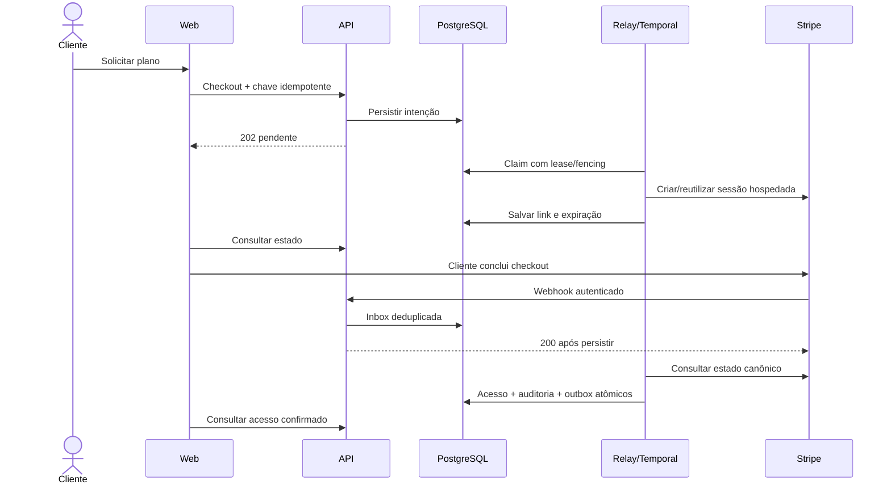

# SDD — F01.5: contratação e concessão de acesso

Versão 0.3, 21/10/2026. Código local validado; F01.5 aberta até sandbox/staging.

## Decisões

Stripe é o primeiro adapter, com o mesmo contrato em teste e produção e credenciais
separadas. Escolha técnica para SaaS/Checkout/assinaturas/webhooks, sem alegação de
liderança de mercado brasileiro ou menor tarifa. Asaas e Mercado Pago foram
considerados; novos adapters só entram com uma necessidade validada. Não armazenar
cartão nem renderizar campos de cartão em nossa web. Pix Automático e outros meios
dependem de disponibilidade/habilitação na conta e validação própria; primeira
integração usa cartão recorrente no Checkout hospedado.

Fontes consultadas em 20/10/2026:
- https://docs.stripe.com/api/checkout/sessions/create
- https://docs.stripe.com/billing/subscriptions/webhooks
- https://docs.stripe.com/webhooks
- https://github.com/stripe/stripe-python
- https://docs.asaas.com/docs/checkout-asaas
- https://www.mercadopago.com.br/developers/pt/docs/subscriptions/overview

R$99 é hipótese, não preço comercial aprovado. Preço mensal BRL deve ser configurado
explicitamente e coincidir com o Price do provedor. Sem credenciais/preço, checkout
permanece indisponível e nenhuma cobrança é inventada. Produção exige ativação
explícita, credencial live, HTTPS e configuração independente da sandbox.

## Jornada e fatias

1. Identidade verificada + negócio em setup vinculam o proprietário e a organização.
2. Proprietário solicita checkout; intenção durável/idempotente retorna pendente.
3. Worker Temporal cria/reutiliza sessão hospedada; web consulta estado e redireciona.
4. Retorno do navegador apenas informa que aguardamos confirmação.
5. Webhook autenticado é persistido antes do ACK, deduplicado e despachado pelo relay.
6. Activity consulta estado canônico no provedor fora da transação e aplica acesso,
   auditoria/outbox atomicamente. Evento reordenado não regride por payload antigo.

Primeira fatia mantém o negócio em setup antes do checkout, reaproveitando F01.4.
Uma jornada de aquisição que inicia pelo plano pode carregar a escolha até esse
rascunho; jamais provisionar propriedade apenas pelo e-mail do pagador/redirect.

Patrocínio: staff com MFA concede seis meses de calendário, com motivo e chave de
idempotência. Expira por comparação ao relógio do banco e pode ser revogado.
Não cria cobrança, cartão ou renovação paga e não entra em MRR/pagantes.

## Consistência e segurança

- Tabelas compartilhadas e FORCE RLS. Role billing isolada: sem escrita em usuários,
  memberships, perfis ou concessão de staff. App não escreve estados de pagamento.
- Checkout só para owner ativo com e-mail verificado; leitura de assinatura por membro.
- Inbox/job com identidade estável, deduplicação e lease/fencing na entrega ao Temporal.
- Operações por organização usam lease durável: nenhuma chamada externa sob row lock.
  Commit exige fencing token e lease válida. Timeout ambíguo repete a mesma intenção.
- Idempotency key do provedor deriva da intenção persistida; sem duplicação por retry.
- Webhook valida corpo bruto, assinatura com janela temporal e modo test/live. Não
  persistir corpo integral, segredos ou dados de cartão; guardar apenas referências.
- Acesso pago depende de assinatura ativa e período pago confirmado, sem hold financeiro.
  Trial, sessão concluída, redirect e promessa de pagamento não concedem acesso pago.
- Revogação/cancelamento/refund/disputa devem bloquear acesso conforme estado canônico;
  holds financeiros não são removidos por evento posterior de invoice sem conciliação.
- Concessão não é autorização de gasto: ledger/franquia e consentimentos continuam
  obrigatórios nas fases de geração/publicação. Nenhum recurso ainda não integrado
  aparece como disponível por existir plano ativo.

## Operação e critérios de aceite

Backend: migração reversível, unitários, PostgreSQL restrito, RLS/concorrência,
webhook inválido/duplicado/reordenado, lease vencida, retry, rollback, patrocínio e
gate 100%. Front: estados reais, sem dados fictícios, tratamento de erro, mobile,
testes 100% e jornada browser em banco _test. Preservar dados da base principal.

F01.5 só é validada no provedor após sandbox real com credenciais do titular.
Mocks/contratos locais não comprovam operação da conta. Checkout de produção fica
desabilitado até revisar plano/preço/franquias, termos definitivos, notificações,
reconciliação operacional e validação em staging. Nenhuma conta externa, cobrança
real, publicação, commit/push ou infraestrutura AWS é criada nesta implementação.

## Contratos implementados

Prefixo /api/v1:

| Rota | Contrato |
| --- | --- |
| GET /billing/{tenant_id} | Membro ativo: origem/validade do acesso; owner vê checkout |
| POST /billing/{tenant_id}/checkout | Owner verificado + Idempotency-Key; intenção persistida, 202 |
| POST /webhooks/stripe | Corpo bruto + Stripe-Signature; deduplica/grava antes do ACK |
| GET /admin/billing | Staff/MFA: pagantes live, testes, patrocinados, operações pendentes/falhas |
| GET /admin/billing/opportunities | Staff/MFA: checkouts abertos ou expirados sem acesso ativo, paginação recente e contato cadastrado |
| GET /admin/organizations/{tenant_id}/billing | Consulta de suporte auditada |
| POST /admin/organizations/{tenant_id}/sponsorship | Staff/MFA, motivo e Idempotency-Key; 201/200 replay |
| DELETE /admin/organizations/{tenant_id}/sponsorship | Revogação idempotente; 204 |

Plano único mensal BRL configurado no servidor. Não aceitar valor, Price, metadata
ou retorno URL arbitrário do navegador. O header Origin pode selecionar somente uma
origem já autorizada em settings.auth_origins; sem header, usar PUBLIC_WEB_URL.
Development/testing aceitam localhost e 127.0.0.1 com protocolo/porta idênticos;
staging/produção mantêm origem exata. Membership e RLS autorizam a organização, nunca o
e-mail do pagador. Ledger/franquias/upgrades/portal/receita/MRR continuam na F07.

Oportunidades de checkout: `state=open|expired`, `limit` de 1 a 50 e cursor por
UUID de job, ordenado por criação decrescente. A consulta usa somente o checkout
atual da conta no modo test/live do ambiente, exclui obrigação de assinatura vigente e
patrocínio vigente. "Aberto" exige prazo ainda válido; "expirado" exige estado
confirmado no banco pela reconciliação. Fechar a aba não é evento de abandono.
A projeção retorna nome do negócio, e-mail de quem iniciou a contratação e telefone
informado no perfil, com indicador de verificação; não retorna URL da sessão, cartão
ou dados do provedor. Leitura exige staff/MFA, RLS e auditoria. Contato comercial
é manual nesta fatia; automação/regras de abordagem ficam fora.

## Persistência e execução

Migration 0005: billing_jobs, billing_accounts, billing_checkouts,
billing_sponsorships, billing_audit, billing_outbox; todas com FORCE RLS. Login
local_spark_payments herda local_spark_billing, sem escrita em memberships,
usuários/perfis/staff, patrocínios ou alteração de auditoria. Runtime comum não
escreve estados de pagamento confirmados.

Job funciona como intenção de checkout ou inbox de webhook. Checkout congela
origem, preço, expiração e chave de idempotência antes da chamada externa. Retry
reutiliza intenção/sessão; outra compra só após expiração confirmada. Resultado
ambíguo não recebe chave nova automaticamente.

Migration 0006 adiciona billing_jobs.return_origin, nullable para jobs legados.
A origem validada é congelada ao aceitar a intenção HTTP; o worker a copia para
billing_checkouts.origin, usado nos retornos success/cancel. Isso preserva cookies
host-only no retorno do Stripe quando o usuário entrou pelo alias local. Não usar
Host/X-Forwarded-Host nem aceitar parâmetros de redirect. Replay conserva a origem
original; jobs legados sem origem usam a configuração do worker e checkouts já
criados conservam seus parâmetros. Não criar outra assinatura para corrigir retorno.

`python -m app.entrypoints.billing` executa relay + worker Temporal na task queue
`${temporal_task_queue}-billing`. Entrega usa SKIP LOCKED, lease/fencing de 90s,
workflow ID billing/{job_id}, RPC de 5s e até oito tentativas. Activity: timeout
60s, até oito tentativas e prazo de uma hora; falhas permanentes não repetem.
Erros do SDK são sanitizados antes do Temporal. Cinco activities concorrentes
por worker e limite de cinco starts/s por queue; capacidade para 200 mil clientes
não está comprovada. Workflow espera expiração por timer durável, sem segurar IO.

Atualização por organização exige lease/fencing válida; a leitura financeira
canônica ocorre depois da aquisição, fora de transação. Evento de assinatura
antiga não substitui a atual. Hold de refund/disputa não é limpo por invoice
posterior; resolução é operacional/futura. Expiração de acesso usa relógio DB.
Auditoria + billing_outbox são atômicas. Outbox permanece pendente para F02;
o relay business.created não recebe mensagens incompatíveis com seu contrato.

Modo disabled não cria cobrança nem consome jobs do provedor. Webhooks recebem
503 até configurar credenciais; jobs aceitos continuam duráveis. Pausas maiores
que o prazo do workflow exigem revisão/reprocessamento operacional.

SDK no lockfile: Stripe 14.4.1 / API 2026-02-25.clover. Webhook snapshot deve usar
a mesma versão. Só referências do evento são persistidas; valores financeiros
são relidos no provedor. Cliente nunca fornece dados de cartão à nossa API.

## Interfaces e continuidade

Cliente /app/billing: escolha do negócio, acesso/validade, estado e checkout.
Retorno success apenas mostra espera; mudança depende da API. Polling de 3s
limitado a 20 atualizações, refresh manual disponível. Testes identificados e
excluídos de pagantes. Sem configuração não há cobrança/preço comercial fictício.

Admin /admin/billing: busca limitada de organizações, contagens reais e patrocínio
com motivo/revogação. Uma concessão inicial por organização; replay não estende
seis meses, mesmo após expirar/revogar. Nova campanha exige contrato explícito.

Pendentes: credenciais do titular e validação de checkout/renovação/falha em
sandbox real; plano/franquias/termos definitivos; reconciliação periódica e
reprocesso operacional; resolução de holds; portal/upgrades/cancelamento
self-service; staging/AWS e carga. Mocks não comprovam operação do provedor.

Validação local: 206 testes backend/100% linhas e branches; 84 testes web/100%
em quatro critérios; cinco jornadas browser com API/SMTP reais. Builds locais
aprovados. A contratação é por organização; limites de negócios/consumo exigem
franquia futura. Preço pendente é preservado no pedido, mesmo se mudar configuração.
O worker serializa o início com concessão de patrocínio e revalida elegibilidade;
entrega tardia não cria checkout depois de conceder acesso patrocinado.

