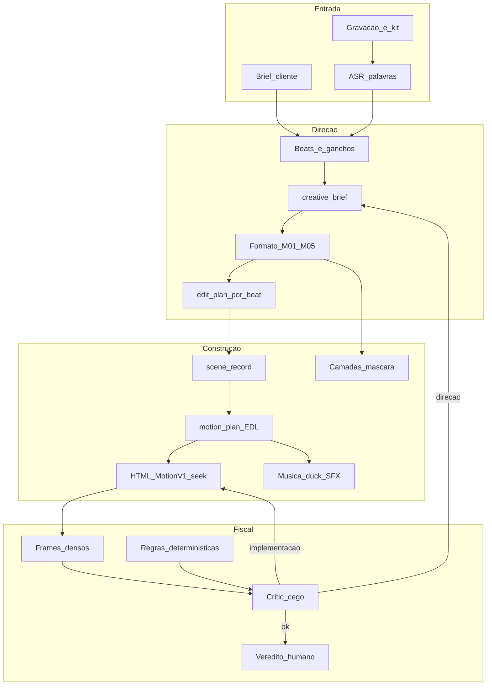

# Extração do fluxo Maestros da IA → lab HTML (inventário máximo)

**Data:** 25/11/2026  
**Estado:** documentação de extração; **não autoriza** implementação, chamada
paga, geração Café, Remotion, HeyGen/TTS/avatar, inventar assets nem colar 41
Shorts no prompt.  
**Objetivo:** listar **todos os elementos possíveis** do método Maestros que
devem entrar no produto (traduzidos ao runtime HTML + Temporal já existente),
para a implementação ficar **praticamente o mesmo fluxo** — não só um piso de
gates.

## Fontes (ler nesta ordem ao implementar)

| # | Fonte | Caminho / link |
| --- | --- | --- |
| 1 | Acervo local do titular | `/Users/israelsilva/Documents/Maestros da IA/` — `Agentes Prontos/`, `Skills Prontas/`, `Arsenal/` |
| 2 | Vídeo método público | [WuzMxEKJHkQ](../evals/analise-video-maestros-WuzMxEKJHkQ-2026-11-11.md) |
| 3 | Piso já no repo | [Programa A](motion-maestros-html-quality-program-a-2026-11-25.md) |
| 4 | Sequência B (ordem de fatias) | [sequencia-pos-programa-a](motion-maestros-html-sequencia-pos-programa-a-2026-11-25.md) |

**Pacotes âncora no acervo (não reinventar):**

- `Agentes Prontos/maestro-video-generator-v1.1.0.zip` — pipeline fases 0–12,
  `PIPELINE_DIRECTIVES.md`, motion section grammar, QC/QCR, sound, EDL de estilo
- `Agentes Prontos/Finalizador.zip` — formatos M01–M05, registro de cena,
  direção visual, code-motion seek, motion explicativo, skills de composite/máscara
- `Agentes Prontos/Gauntlet-Loop.zip` — loop builder↔critic cego + evidência
- `Agentes Prontos/Claquete.zip` — papéis (pauteiro, roteiro, diretor arte, produtor)
- `Agentes Prontos/clipador-viral.zip` — repurpose / cortes verticais
- `Skills Prontas/Veredito.zip` — aceite humano item a item
- `Skills Prontas/Capricho.zip` — disciplina de excelência (fundar / lapidar / provar)

**Skills do acervo que NÃO são motor de vídeo** (não misturar no pipeline motion):
Cadência (MRR), Pulso (NPS), Batuta (equipe), Arremate (funil), Crivo (code
review genérico), Vistoria (contratos), Trilha/Escuta (ensino IA).

**Runtime alvo do produto (fixo):** HTML + `window.seek` + Chromium/FFmpeg +
`MotionV1` + Temporal. **Não** portar Remotion/`remotion-agent` nem Resolve API
como executor principal (Finalizador usa Resolve; nós traduzimos invariantes).

---

## 1. Visão do fluxo completo (igual em espírito)

Hierarquia de autoridade (traduzir `PIPELINE_DIRECTIVES.md`):

1. **Processo pinado** (contratos, gates, Temporal) vence gosto do modelo.
2. **QC/review graduado** (quando ligado) vence adjetivo no brief.
3. **Brief criativo** orienta paleta/formato/estilo — não desculpa gate falho.
4. Aceite humano (Veredito) para paridade Maestros; gates não certificam.

---

## 2. Pipeline maestro-video (fases) → o que entra no lab

Fonte: `FULL_PIPELINE.md` + skills em `maestro-video-generator`.

| Fase Maestros | Artefato | No lab (entrar / adaptar / fora) |
| --- | --- | --- |
| 0 Preflight + fila | doctor, state, queue | **Adaptar:** health do lab/worker/renderer; estado por `run_id` (já Temporal). Sem fila IG/ManyChat no Café |
| 1 Source / tópico | seed + entidades | **Adaptar:** brief + attachment vídeo + kit/logo/fotos do negócio (já context). Discovery YouTube **fora** do Café |
| 2 Script PT-BR | `heygen_script.txt`, entities, CTA | **Adaptar:** beats/frases do plano a partir do brief + ASR; sem script longo tipo avatar. Regras úteis de `how-to-generate-video-scripts.md` (gancho, entidades nomeadas) |
| 2.5 Creative direction | `creative_brief.json` de galeria ACTIVE | **Entrar:** etapa explícita: escolher **um** identity pinado (skill/repertoire/kit), registrar brief consumido por motion/áudio; anti style-drift (`PIPELINE_DIRECTIVES` §1) |
| 3 HeyGen avatar + SRT | `_avatar_1080p.mp4` | **Fora** avatar/HeyGen. **Entrar:** ASR/SRT da **gravação do cliente** (já faster-whisper); legendas opcionais depois |
| 4 Visual sourcing | refs reais + imagens keyed + stock b-roll | **Adaptar:** prioridade kit/gravação/prints do negócio. **Stock Pexels (e similares) gated** — ver §7b: complemento quando o inventário é insuficiente; nunca como identidade do estabelecimento |
| 5 Motion graphics | Remotion merge | **Entrar como HTML seek + MotionV1** (nosso HyperFrames-like). Gramática de seções / edit styles → contrato B2 |
| 6 Merge checkpoint | validate | **Entrar:** validate_development + occupancy (A) + progressão (B2) |
| 7 Insert B-rolls | HITs only | **Adaptar:** inserts = kit primeiro; stock só sob §7b + formato M01/M03; graphic/PIP conforme M01–M05 |
| 8 Subtitles burn | ASS + suppress windows | **Opcional depois:** legendas; regra de não cobrir rosto; suppress quando caption cinética já é o texto |
| 9 Sound design | music + riser + drop + clicks | **Entrar:** ElevenLabs + duck + SFX CC0/acervo; riser/click só se pinados. Ver `add-music` SKILL |
| 10 QC Gemini | grade + iterate | **Adaptar:** review lab + regras determinísticas estilo QCR; Gemini QC opcional. Sem postar com grade baixa |
| 11 ManyChat CTA | comment→DM | **Fora** do motor Café |
| mark-ready / 12 post | IG Reels | **Fora** do motor Café (produto tem outros canais) |

**Suffix chain Maestros** (`_avatar` → `_motion` → `_broll` → `_final` → `_music`)  
→ no lab: estágios trace (preparation → generate → render → review) com
artefatos duráveis por estágio; resume só de estágio verificado (não resume de
run falho cosmético).

---

## 3. Gramática visual (Finalizador + SECTION / EDIT_STYLES)

### 3.1 Formatos de inserção M01–M05 (obrigatório no plan)

Fonte: `Finalizador/motion-formats/`.

| ID | Formato | Elementos | Lab |
| --- | --- | --- | --- |
| M01 | B-roll / vídeo tela cheia | cover full-bleed; apresentador fora | Abertura Café típica; occupancy A |
| M02 | Apresentador recortado sobre fundo | matte + mundo atrás; pessoa na frente | **B5** máscara |
| M03 | Elementos em área livre | grafismos fora do corpo; sem atravessar silhueta | Layers + região protegida |
| M04 | Canvas + janela estável | filmagem em janela; explicação no canvas | PIP/janela com fundo real (anti creme lavagem) |
| M05 | Conteúdo em superfície do cenário | tracking/homografia | **Programa C** (não bloqueia Café) |

Invariantes a pinar: preservar áudio/performance; não inventar gesto; M03 nada
atravessa o sujeito; M02 ordem de camadas; entrada/saída medidas na timeline.

### 3.2 Estilo ≠ formato

Fonte: `styles/defaults` (D01–D05) + famílias; `choose-creative-direction`.

- **Formato** = onde a imagem entra (M01–M05).
- **Estilo/receita** = aparência (material, luz, tipografia) — um identity por
  peça, de registry ACTIVE (kit Café / repertoire pinado), não improviso.
- Variar **relação/operação**, não só paleta (`visual-direction.md`).

### 3.3 Seções canônicas (maestro SECTION_PIPELINE) → beats lab

Traduzir componentes Remotion em **tipos de beat** HTML (não copiar TSX):

| § | Job Maestros | Beat lab equivalente |
| --- | --- | --- |
| 1 Headline hook | parar scroll &lt;2s | Abertura cover + frase curta cinética |
| 2 Evidence | prova (print/dado) | Só se houver evidência real do kit; senão pular |
| 3 Full-frame source | gravação cheia | M01 hold / remonte |
| 3b Kinetic caption | palavra a palavra | `MotionV1.stagger` / reveal; suppress legenda burn |
| 4 Full motion + text | diagrama/fluxo + texto | Graphic SVG / code-motion rules + labels |
| 5 Split graphics | avatar baixo + graphic cima | M04; graphic sem texto se subtítulo carrega |
| 5b Avatar + floating caption | zona livre | Requer análise de zona vazia; com máscara B5 |
| 6 Full graphics | só ícones/motion | Graphic full; texto só via ASR overlay se houver |

**Pacing Maestros:** tela nova ~2–2,5s; safe margins 9:16 (top/bottom/side).  
**Gap-free scheduling:** janelas sem furo de 1 frame (no lab: timeline contínua
sem “flash” de camada errada — já tem guards; reforçar em B2/B4).

### 3.4 Edit styles content-driven (EDIT_STYLES.md)

Palette: `opening | avatar | phrase | avatarcap | hero | split | full | evidence | flow | stat`.

- Eixo **edit_style** (canvas do beat) ≠ eixo **motion_idea** (objeto mostrado).
- Variety distance-4 está **desproven** como hard gate QC — usar como
  **heurística de riqueza**, não rejeitar peça boa só por isso.
- **Entrar:** `edit_plan` por beat + verify pré-render; profundidade **dentro**
  do estilo (variantes de animação) importa mais que rotação cega.

### 3.5 Motion explicativo + texto legível

Fontes: `explanatory-motion.md`, `readable-text-and-visual-progression.md`.

Elementos a pinar no lab:

- Relação → operação visual → formato → estilo (nessa ordem).
- Um foco por momento; rótulos curtos e grandes; **repouso de leitura** ≠ tempo
  de animação.
- Progressão com **estados distintos** (silhueta/composição/conteúdo); quase
  duplicatas ≠ progressão.
- Quatro estados / três deltas quando houver insert multi-frame.
- Texto faz parte da explicação; “pouca leitura” ≠ zero texto.
- Cadência ~1 oportunidade a cada 2–3 frases — busca, **não quota**.

### 3.6 Code-motion (HTML seek)

Fonte: `code-motion-styles` + `code-motion-graphics.md`.

- Cenas `seek(t)` determinísticas (alinha ao nosso renderer).
- Catálogo beat→estilo; cfg com texto **real**; QA antes de “inserir”.
- **Não** importar 70 estilos para o git: extrair **regras** (holds, evidência
  real, cfg separado da demo, leitura ≥0,4s/palavra).

### 3.7 AI motion keyframes / composite (Finalizador)

- Keyframes de imagem com deltas causais (`ai-motion-keyframes`) — no lab só se
  geração de imagem estiver autorizada/orçada; Café prioriza **gravação + kit**.
- `foreground-broll-composite` = M02 (máscara + fundo) → **B5**.
- `screen-fill-and-pip` = fill + PiP medido — traduzir para layout cover/PIP e
  anti barras (já próximo de full-bleed guards).

---

## 4. Registro de cena (scene-record) — contrato transversal

Fonte: `Finalizador/docs/scene-record.md`.

Cada insert/cena no plano lab deve poder carregar (campos mínimos):

| Campo | Uso |
| --- | --- |
| `scene_id` / `revision` | identidade; revisão invalida checks |
| `scope` | etapas autorizadas + limite de gasto |
| `source` | frase, timeline IN/OUT, FPS; âncoras ASR `estimated`/`verified` |
| `concept` | ganho, operação, formato M0x, receita, entrada/saída, região protegida, estados+deltas, strings exatas + repouso |
| `assets` | ids, paths, hashes — sem inventar |
| `jobs` | tentativas/custo reais |
| `checks` | `pass`/`fail`/`not_checked`/`not_applicable` por dimensão |
| `review` | Veredito separado do QA estrutural |
| `insertion` | só após “edição”/render autorizado |

Validador estrutural ≠ aprovação criativa (mesmo princípio Capricho: **provar**).

---

## 5. Loop fiscal (Gauntlet + Capricho + QCR + Veredito)

### 5.1 Gauntlet (`PROTOCOL.md`)

Elementos a espelhar no lab:

- Sempre há critic; tamanho S/M/L muda teto de rounds (2/4/8), não a existência.
- Declarar objective / bar / reference **melhor** que o alvo.
- Peças verificáveis; critic **cego** (sem raciocínio do builder).
- Evidência executável (abrir, medir, amostrar frames) — não “li o HTML”.
- REJECTED → corrigir gap #1 primeiro; plateau / ceiling / approval.
- Synthesis node quando várias peças → um todo.

→ **B1** (replan direção) + **B4** (correção por trecho + samples).

### 5.2 Capricho

Fundar (aguenta 10×) → Lapidar (físico / estético / cínico) → Provar (harness).  
→ Critério de done de cada Bi: teste + MP4/evidência, não só diff de skill.

### 5.3 QCR (amostra de regras a traduzir — ler índice completo no zip)

Determinísticas úteis ao lab (tags motion/subs/sound/broll):

- Safe margins / não cobrir rosto (QCR-001, 008, 5b).
- Holds numéricos ≥0,3s; easing explícito (QCR-005).
- Motion text não duplica subtítulo (≤3 palavras compartilhadas) (QCR-011).
- Sem AI-generated-video como fallback de b-roll faltante (diretiva pipeline).
- Gap-free sequences; avatar não “vaza” entre seções (QCR-109).
- Sound phase com trilha + risers/clicks pinados; duck na fala.
- Self-improve: fricção recorrente → regra permanente (nós: gate/QCR pinado).

### 5.4 Veredito

Aceite humano A/R/M por MP4/cena; agir sobre motivos — norte de paridade
Maestros. Não substituído por score automático.

---

## 6. Áudio e EDL

| Elemento Maestros | Lab |
| --- | --- |
| EDL / tomadas / respiros | edit-v5 + speech-safe + endurecer além `EDL_COSMETIC` (B3) |
| ASR + alinhamento | faster-whisper; âncoras `estimated` até verified |
| Música + duck | ElevenLabs + mixer v3 (já); validar ponta a ponta |
| SFX (riser, click, ação) | CC0 pour/cup + opcional pin de riser/click do maestro **só com licença/pin** |
| Loudness | report opcional; não copiar LUFS do vídeo YouTube como lei |
| Legendas ASS | fase opcional posterior |

---

## 7. Inventário checklist — “todos os elementos possíveis”

Marcar na implementação: **já** / **B#** / **fora** / **programa C**.

### Processo
- [ ] Preflight doctor (deps renderer, ffmpeg, keys, Temporal)
- [ ] Estado por run + resume só de estágio verificado
- [ ] Hierarquia processo > brief > modelo
- [ ] Creative brief de registry (1 identity / peça)
- [ ] Scene-record por insert
- [ ] Loop Gauntlet (critic cego + teto)
- [ ] Correção por trecho vs replano direção
- [ ] Veredito humano nos MP4s
- [ ] Capricho: prova executável por fatia

### Direção / edição
- [ ] Formato M01–M05 declarado
- [ ] Operação explicativa (relação) antes do estilo
- [ ] Edit plan por beat (palette EDIT_STYLES traduzida)
- [ ] Progressão temporal forçada (terços / estados)
- [ ] Beats prep / acento / repouso
- [ ] Pacing ~2–2,5s por tela (heurística)
- [ ] Safe margins 9:16
- [ ] Gap-free timeline / sem flash de camada
- [ ] Anti style-drift / anti-(21)

### Visual / camadas
- [ ] Cover full-bleed abertura (A)
- [ ] Anti fundo lavagem / collage (A)
- [ ] PIP/janela M04 com fundo real
- [ ] Stagger / kinetic caption
- [ ] Graphic SVG / layers com função
- [ ] Região protegida do sujeito (M03)
- [ ] Máscara pessoa M02 (B5)
- [ ] Evidence real only (sem print inventado como prova do cliente)
- [ ] Stock Pexels gated (§7b) quando kit insuficiente
- [ ] Code-motion rules (sem portar 70 estilos)

### Áudio / fala
- [ ] ASR palavras + confiança
- [ ] EDL speech-safe + remonte perceptível
- [ ] Música + duck
- [ ] SFX em acento declarado
- [ ] Suppress subtítulo quando caption cinética

### Fiscal
- [ ] Samples densos / adaptativos (B4)
- [ ] Issues com `t_ms`
- [ ] QCR determinísticos pinados
- [ ] QC graduado opcional (se budget)

### Explicitamente fora deste programa
- [ ] Remotion como renderer
- [ ] HeyGen / avatar / TTS / voice clone
- [ ] ManyChat / post IG pipeline
- [ ] Pexels / stock **passando por** produto, loja ou identidade do cliente
- [ ] 41 Shorts no prompt
- [ ] M05 tracking superfície (C)
- [ ] OCR tutorial (C)
- [ ] Three.js cinema completo
- [ ] Resolve como executor de prod Linux

---

## 7b. Stock Pexels (e similares) — complemento gated, não identidade

**Problema real:** cliente com poucas fotos → peça pobre em variedade visual.  
**Resposta:** permitir banco externo **relacionado** (Pexels / Pixabay / Coverr,
como no maestro-video Fase 4), sob contrato — **não** banir o adaptador.

| Pode | Não pode |
| --- | --- |
| Preencher beats de atmosfera / metáfora / escala quando o kit tem &lt;N fotos úteis | Aparecer como o café, a equipe, o produto ou o espaço do cliente |
| M01 (tela cheia atmosférica) ou M03 (elemento isolado) com query amarrada ao brief | Substituir logo, vitrine ou prato do negócio por stock “parecido” |
| Proveniência no `scene-record` / asset: provider, id, licença, query, `kind=stock_complement` | Misturar stock no inventário do negócio sem marca de origem |
| Ligar só com credencial + budget explícitos (como outras APIs pagas/quota) | Download livre sem pin de política / ledger de uso |
| Preferir kit sempre que houver foto elegível no tema do beat | Usar stock “porque ficou mais bonito” com kit suficiente |

**Heurística de ativação (a pinar na implementação):**  
`collection_photos` (ou inventário elegível) abaixo de limiar **ou** beat com
`relation` atmosférica sem match no kit → candidatar stock; senão kit-only.

**Disclaimer / QA:** review deve falhar se stock for tratado como evidência do
estabelecimento (anti “prova falsa”). Texto/CTA da marca continuam no kit.

**Ordem sugerida:** depois de B2/B3 estáveis (progressão + som); fatia própria
**B2.5 / B6 stock-complement** — não bloqueia máscara B5. Ler
`broll-pipeline/BROLL_INSTRUCTIONS.md` do maestro-video na implementação
(seleção determinística, anti rostos indesejados nas queries — QCR-033/036).

**Estado:** política documentada; **não autoriza** ligar Pexels nem gastar
quota nesta entrada.

---

## 8. Encaixe no produto (kit / acervo / estética do cliente) — inalterado na espinha

**Intenção do titular:** trazer o **fluxo e o processo de trabalho** Maestros
(etapas, formatos, fiscal, remonte, som, evidência) para **dentro** do produto
já existente — sem trocar a esteira (mensagem → kit/snapshot → lab/Temporal →
HTML seek → review) nem a **cara do negócio**.

| Camada | O que manda | O que o Maestros empresta |
| --- | --- | --- |
| Identidade visual | Kit do negócio (logo, cores, fontes, fotos, tom) + repertoire/skill **do vertical** | Processo, não a paleta marble/gold `premium-classic` |
| Materiais | Acervo / collection / gravação do cliente; stock só §7b | Sourcing disciplinado + proveniência |
| Orquestração | Temporal + creation lab + outbox (já) | Fases nomeadas, estado por estágio, anti style-drift |
| Direção | `creative_brief` resolvido **a partir do kit** (registry = kits/repertoires pinados, não STYLE_GALLERY deles) | Etapa 2.5 + um identity por peça |
| Estética Maestros no YouTube | Refs 41 / WuzMxEKJHkQ = **norte de método e acabamento** (finish_reference_only) | Não injetar no prompt; não copiar tipografia/frame gold |

Regra de ouro: **processo Maestros + pele do cliente**. Se o brief Maestros
brigar com o kit, o kit vence; o processo (formato, progressão, fiscal) permanece.

Mapa grosso produto ↔ fases Maestros:

1. Brief / WhatsApp / Jev → Fase 1–2 (tópico + beats; sem HeyGen script longo).
2. Snapshot kit + attachments → Fase 4 sourcing (kit first, stock §7b).
3. Prepare / context / contracts → scene-record + creative_brief(kit).
4. Generate plan+HTML → Fases 5–7 (motion/EDL/inserts) em HTML/MotionV1.
5. Render → Chromium/FFmpeg (já).
6. Review / corrections → Fases 10 + Gauntlet (B1/B4); Veredito humano opcional.
7. Entrega canal (WhatsApp etc.) → **não** ManyChat/IG pipeline deles.

---

## 8b. Kit + repertoire/skill vs galeria premium — hoje incompleto; dá para completar

**Resposta curta:** não, hoje **não** são tão completos quanto a galeria premium.
Dá para deixar o envelope **igual em disciplina** (campos travados por peça), com
a **pele do cliente** — sem copiar marble/gold/Cormorant.

### O que a galeria Maestros trava por `style_id` (envelope)

Fonte: `STYLE_GALLERY.md` / `choose-creative-direction`.

| Campo do envelope | Exemplo premium-classic |
| --- | --- |
| `style_id` + status ACTIVE | `premium-classic` (default forçado) |
| `palette` / variantes tema | marble-gold, charcoal-gold, … |
| Tipografia | Cormorant serif / Proxima caps (por style) |
| Moldura / toolkit de UI | `PremiumFrame`, double-rule gold, paper base |
| `motion_intensity` | `low\|med\|high` → dials (snap, blur, parallax, accents) |
| `headline_formula` | calm bold-claim / curiosity-gap |
| `pacing` | slow-balanced, … |
| `subtitle_personality` / music mood | packs do registry |
| Toolkit de componentes | Headline, Evidence, Flow, KineticCaption, … |

Improviso fora do envelope é style-drift (proibido).

### O que o produto trava hoje (Café / brand-kit-v1 + motion)

Ex.: `catalog/kits/cafe-pausas/v1/manifest.json` + repertoire-v7 + skill-v24 +
`creative_contract` no context:

| Campo | Hoje |
| --- | --- |
| Palette (cores nomeadas) | Sim (forest/cream/caramel) |
| Fontes heading/body + arquivos | Sim (DejaVu Serif/Sans no kit demo) |
| Logo / fotos / recipes de editor | Sim (acervo) |
| `identity_source: business_kit` no exemplo | Teaching |
| `motion_intensity` dial formal | **Não** (MotionV1 livre demais) |
| Moldura / chrome de peça (frame rule, paper base) | **Não** como contrato de style |
| `headline_formula` / `pacing` / music mood no brief | **Não** (só skill prose + preferências soltas) |
| Registry de vários `style_id` ACTIVE por vertical | **Fraco** — um kit + skill; não galeria com fallbacks |
| Toolkit de seções (hook/evidence/kinetic/…) | Parcial via plan/HTML do modelo, sem componentes pinados |

Repertoire/skill ensinam direção e anti-exemplos; **não** expandem sozinhos o
envelope numérico como a galeria.

### Como deixar o nosso “tão completo” quanto (pele do cliente)

Especificação completa do envelope (intensity→dials, chrome, headline/pacing,
music mood, subtitle pack, brief obrigatório, registry Café):

→ **[motion-creative-gallery-kit-envelope-2026-11-25.md](motion-creative-gallery-kit-envelope-2026-11-25.md)**

Skill/repertoire = teaching; o **brief resolvido** = galeria. Sem copiar
marble/gold. **Não autoriza** schema nesta entrada; implementar **antes de B2**.

---

## 9. Documentação de processo — estado

### Spec completa (pronta para implementar quando autorizado)

| Bloco | Doc |
| --- | --- |
| Piso anti-colagem | Programa A |
| Fases→lab, M01–M05, Gauntlet, áudio base, §7b stock | Este arquivo |
| Galeria / `creative_brief` | [gallery-kit-envelope](motion-creative-gallery-kit-envelope-2026-11-25.md) |
| **D1–D7** (design bar, archetypes, som layers, QCR subset, edit_plan verify, scene-record schema, learning) | [processo-paridade-d1-d7](motion-maestros-processo-paridade-d1-d7-2026-11-25.md) |
| Ordem B1–B5 | [sequencia-pos-a](motion-maestros-html-sequencia-pos-programa-a-2026-11-25.md) |

**Havia informação no acervo** para D1–D7 — fechados em 25/11/2026. Não há
bloqueio de “não sei o que documentar” para a paridade de edição do reel.

### Ainda opcional / não bloqueia paridade de edição

| Item | Nota |
| --- | --- |
| Subtitle ASS burn completo | Pack kinetic-only cobre Café |
| Image-gen keyed | Opcional; kit+§7b |
| Arsenal Módulo 4 | Varredura futura |
| Photo-reel mirror | Depois do video path |
| Claquete multi-agente | Etapas bastam |
| VIRAL techniques integrais | Spine/archetypes em D2 |
| RENDER-WAIT parallelism | Ops |
| Gemini QC graduado | D4 determinístico primeiro |

### Critério “quase tudo parecido” (edição)

1. Brief galeria obrigatório · 2. M01–M05 + edit_plan · 3. D1+D2 · 4. EDL+D3
som · 5. B1/B4 + D4/D7 · 6. B5 máscara · 7. Stock §7b · kit/acervo/skills na pele.

---

## 10. Ordem de implementação sugerida (refina B1–B5)

0. **Docs:** gallery + **D1–D7** (feitos) → código sob autorização.
1. **Código galeria:** emit/validate/enforce `creative_brief` (kit envelope).
2. **B1** — Gauntlet-lite: review→replan + evidência + teto.
3. **B2** — M01/M03/M04 + progressão + stagger + edit_plan (D5) + scene-record (D6).
4. **B2.5 / B6** — stock §7b.
5. **B3** — EDL + add-music layers (D3) honrando `music_mood`.
6. **B4** — samples + QCR subset (D4) + Veredito + learning (D7).
7. **B5** — M02 máscara após OK.
8. **Opcional:** ASS burn; image-gen; Arsenal M4; photo-reel.

Cada Bi: ler zip âncora → traduzir para **contratos do produto** (kit manda na
pele) → testes → geração Café só com autorização explícita.

---

## 11. Relação com docs anteriores

- Programa A = **piso** (rejeitar colagem).
- Sequência B = **ordem** das fatias de acabamento.
- **Este doc** = inventário do fluxo Maestros + encaixe no produto (kit/estética)
  + lacunas ainda por extrair (§9).

Atualizar quando um Bi fechar, quando §9 for preenchido, ou quando o titular
autorizar incluir/excluir um elemento do acervo.
