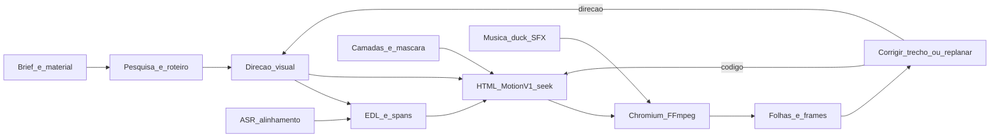

# Sequência pós–Programa A — fluxo tipo Maestros no lab HTML

**Data:** 25/11/2026 (detalhamento do inventário no mesmo dia)  
**Estado:** backlog + inventário exato; **não autoriza** implementação, chamada
paga, B5 nem declarar paridade automática às refs.  
**Norte:** [fluxo-completo](motion-maestros-fluxo-completo-extracao-2026-11-25.md),
[galeria](motion-creative-gallery-kit-envelope-2026-11-25.md),
[D1–D7](motion-maestros-processo-paridade-d1-d7-2026-11-25.md).
Café suspenso até autorizar código. Docs de processo para edição ≈ Maestros
fechados; falta implementar.

**O que “praticamente igual ao fluxo” significa aqui:** o **mesmo ciclo de
produção** que o acervo + o vídeo Maestros demonstram (direção → plano/EDL →
cena em código/`seek` → render → evidência → correção por trecho ou replano),
no runtime HTML que já temos. **Não** significa copiar Remotion/HeyGen/Three.js
do maestro-video-generator, nem 3h48 artesanais, nem o MP4 didático pixel a pixel.
**Ler o acervo antes de implementar cada Bi** — não reinventar o que já está
nos zips; traduzir para contratos/gates do lab.

**Runtime fixo:** HTML + `window.seek` + Chromium/FFmpeg isolado + `MotionV1`
(movement-v3). Temporal dono do workflow.  
**Fora permanente deste programa:** Remotion como renderer; Higgsfield;
injetar 41 Shorts no prompt; TTS/avatar/HeyGen; inventar assets do cliente;
segundo runner; afrouxar `CROP_UNSAFE` / `FULL_BLEED_REQUIRED`.

---

## 1. Fluxo Maestros (o que o vídeo mostra) → nosso equivalente



| Etapa no Maestros (trecho) | Já no lab hoje | O que **entra** na sequência B |
| --- | --- | --- |
| Pedido estruturado → muitas ações (06:02) | Lab flow v2: draft→prepare→generate→render→review | **B1:** tornar o ramo *review→replan direction* comum e observável; não um generate único “passa ou morre” |
| Prep / ação / repouso do movimento (00:38) | `MotionV1.timeline` / easing existem | **B2:** contrato + validate que beats usem prep/acento/repouso; rejeitar só fade de placa |
| HTML + seek + Chrome + FFmpeg (01:42) | Já (HyperFrames-like) | Nada de runtime novo |
| GSAP-like (01:42) | `MotionV1` + `stagger` no movement-v3 | **B2:** teaching **e** gate/decode: frases multi-token usam stagger (ou cinética pinada); hold estático de placa inteira na abertura rejeitado quando skill exige cinética |
| Remotion / Three.js cinema (01:42, 02:38) | Fora de escopo | **Não entra** |
| Cameras/luz/sombra/5 camadas + pessoa recortada (02:38) | design layers / SVG / PIP | **B2:** progressão de planos (cover→detalhe→CTA) forçada; **B5:** máscara real para oclusão texto↔pessoa |
| ASR + alinhamento de palavras (02:56) | faster-whisper local (palavras+tempos) | **B3:** EDL/spans e duck amarrados a janelas de fala/ação quando houver ASR; realinhamento só se texto revisado (opcional, depois) |
| EDL com tomadas e respiros (03:13) | edit-v5 + speech-safe + `EDL_COSMETIC` (≥2 crops) | **B3:** EDL editorial: mudança de enquadramento alinhada a beats; rejeitar `purpose` cosmética |
| Máscara pessoa / texto atrás (03:24) | Moldura ≠ máscara | **B5:** adapter segmentação versionado + matte + prova Chromium |
| Rastreamento objeto / homografia (03:40) | Ausente | **Fora do B1–B5** (programa C futuro); Café não depende disso |
| OCR em print (04:01) | Ausente | **Fora** (não prioridade Café) |
| Banco Pexels + harmonia (04:13) | Kit primeiro; stock **gated** se poucas fotos | Complemento atmosférico com proveniência — ver §7b em [fluxo-completo](motion-maestros-fluxo-completo-extracao-2026-11-25.md); nunca como identidade do cliente |
| ElevenLabs voz/SFX/música + duck + LUFS (04:43) | Music ElevenLabs + mixer v3 + duck pinados; SFX CC0 pour/cup | **B3:** validar ponta a ponta no Café (escuta); SFX só em acento declarado; sem TTS/clone |
| HeyGen avatar | Fora | **Não entra** |
| Folhas de contato + correção do trecho (05:25) | Review + `sample_times` ≤64 | **B4:** issues por janela temporal; correção de *implementação* só no trecho; direção → B1; amostragem adaptativa se 64 não bastar |
| Números 3h48 / 89 arquivos / milhares de frames (05:47) | Orçamento e teto de samples | **Não reproduzir escala artesanal**; aproximar o *método* (evidência + correção), não o volume |

---

## 1b. Mapa acervo Maestros → fatias B (fonte canônica de método)

Caminho raiz: `/Users/israelsilva/Documents/Maestros da IA/`.

| Pacote no acervo | O que carrega (útil ao lab) | Fatia |
| --- | --- | --- |
| `Agentes Prontos/Finalizador.zip` → `motion-formats/` | **M01–M05**: B-roll tela cheia; apresentador recortado sobre fundo; elementos em área livre; canvas+janela; conteúdo em superfície; invariantes de oclusão/áudio | **B2** (progressão/formato) + **B5** (M02 máscara) |
| `Finalizador` → `code-motion-styles` | Catálogo de estilos HTML `seek(t)` determinísticos; beat→estilo; QA antes de inserir | **B2** / **B4** (método; não importar 70 estilos de uma vez — traduzir regras) |
| `Agentes Prontos/Gauntlet-Loop.zip` | Loop builder↔critic↔polish com barra; rejeitar e refazer | **B1** / **B4** |
| `Skills Prontas/Veredito.zip` | Painel A/R/M item a item; agir sobre motivos | Aceite humano dos MP4s (processo lab, não gate automático) |
| `Agentes Prontos/Claquete.zip` | Pauteiro / roteirista / diretor de arte / produtor | **B1** (separar direção de implementação) |
| `Agentes Prontos/maestro-video-generator-v1.1.0.zip` → `PIPELINE_DIRECTIVES.md` | Hierarquia de autoridade; processo > gosto; fases; QC opcional; anti style-drift | **B1–B4** (disciplina de pipeline); **não** adotar Remotion/HeyGen/Pexels como runtime |
| `Agentes Prontos/clipador-viral.zip` → `shorts-repurpose` | Repurpose vertical / cortes | **B3** (EDL/remonte) com cuidado: Café usa **gravação do cliente**, não stock |
| `Skills Prontas/Trilha.zip` / `Escuta.zip` | Ensino / escuta — fora do motor de render | Fora do runtime; só se UX do lab pedir |

Regra: em conflito entre gosto do modelo e processo pinado, **processo ganha**
(como `PIPELINE_DIRECTIVES.md` no maestro-video). No nosso produto isso vira
contrato + Temporal + gates — não um segundo orquestrador Claude solto.

---

## 2. Inventário exato do que vai entrar (por fatia)

Cada fatia: **ler o pacote Maestros correspondente** → traduzir para
serviço/capability/skill pinados do repo → testes + pins/docs + **nova**
captura Café + MP4 para o titular. Sem marcar complete só com unit test.
Sem copiar zip inteiro para dentro do git do produto.

### B1 — Ciclo montar → olhar → refazer direção

**Espelha:** fiscal + correção de direção do Maestros (05:25), não “mais adjetivo no prompt”.

**Entra:**

1. **Rota lab fechada:** `adequate` revalida piso A; se `repair_kind` ∈
   `{direction, material}` → `MOTION_PLAN_REVISION_REQUIRED` → outbox lab_only
   devolve ao **plan** (não só ao implement). Provar com teste de integração
   (ou run Café instrumentado) que o ramo dispara.
2. **Orçamento:** `max_corrections` / uma refação de direção por operação
   honrada; segundo fracasso de direção → estado terminal explícito (não
   hang/`UNCERTAIN` opaco).
3. **Review com evidência:** quando abertura≈miolo (sem mudança perceptível do
   que se vê), `visual_development` / `narrative_progression` → `not_met` +
   issues `direction` major **citando** `sample_times` (ms).
4. **Anti-(21)** já no skill-v24: manter; B1 garante que isso **gera replano**,
   não só falha seca sem ciclo.
5. **Done:** run Café que (a) replaneje ≥1× e complete, ou (b) termine com
   código de direção legível — não só `CROP_UNSAFE` / `FULL_BLEED` cedo.
6. **MP4 / artefato** para análise humana.

**Não entra em B1:** afrouxar crop/full-bleed; mudar modelo; Remotion.

### B2 — Progressão visual e motion com intenção (contrato, não teaching)

**Espelha:** movimento com ideia (00:38); Finalizador **M01–M05** (formato ≠
estilo); `code-motion-styles` (cena HTML seek por beat).

**Entra:**

1. **Formato de inserção no plan (tradução M01–M05 → allowlist lab):** declarar
   formato por cena/beat (ex.: cover full-bleed ≈ M01; PIP/janela estável ≈ M04;
   elementos fora do corpo ≈ M03). Café típico: M01/M03/M04 antes de M02.
2. **Validate de progressão:** entre terços do runtime, mudança perceptível de
   `layout` / crop / span / plano dominante. PIP+texto estático sozinho **não**
   satisfaz (anti colagem A + anti “um formato só o tempo todo”).
3. **Beats allowlist:** preparação / acento / repouso de fato no plan + curva
   MotionV1; rejeitar label sem motion.
4. **Tipografia:** frase multi-token + skill cinética → `MotionV1.stagger` (ou
   primitiva pinada); hold de placa inteira na abertura → direction/impl fail.
5. **Handoff:** dissolve/fade só com full-bleed; violação → B1, não bypass DOM.
6. **Code-motion:** **não** portar 70 estilos de uma vez. Extrair do
   Finalizador só regras reutilizáveis (seek determinístico, holds ≥ leitura,
   evidência real, cfg separado da demo) para skill/repertoire pinados.
7. **Repertoire/skill** depois do contrato (exemplo v7 sozinho ≠ B2 done).
8. **MP4 Café.**

**Não entra em B2:** Three.js; câmera 3D; inventar foto/logo; importar galeria
inteira `styles-opus55` para o git do produto.

### B3 — EDL editorial + som com função

**Espelha:** EDL (03:13); música/SFX/duck (04:43); “uma ação explica a fala”.

**Entra:**

1. **EDL além do cosmético:** além de ≥2 mudanças de crop (`EDL_COSMETIC`),
   exigir que mudanças de span/crop coincidam com beats de ação **ou** janelas
   ASR (quando houver palavras). `edit.purpose` sem delta de enquadramento →
   inválido.
2. **Speech-safe preservado:** não cortar no meio da palavra; respiro alinhado
   ao ASR existente (`motion_local_speech_worker` / tempos no context).
3. **Mix ponta a ponta no Café:**
   - trilha ElevenLabs (já pinada) presente no MP4;
   - duck durante fala/overlay quando o contrato de áudio pedir;
   - SFX CC0 (`coffee-pour`, `cup-contact`) **só** se o plan declarar acento
     na ação correspondente — zero SFX por palavra.
4. **Verificação:** ffprobe (stream áudio) + escuta humana; opcional loudness
   report (não copiar LUFS do vídeo Maestros como regra de plataforma).
5. **MP4 Café com áudio.**

**Não entra em B3:** TTS; clonagem de voz; HeyGen; nova biblioteca SFX sem pin;
Pexels.

### B4 — Inspeção densa + correção por trecho

**Espelha:** folhas de contato, conferência, consertar só o defeito (05:25).

**Entra:**

1. **Amostragem:** manter ≤64 como default; se review `not_met` em janela,
   **densificar só essa janela** (adaptativo) sem explodir custo global —
   documentar teto e budget.
2. **Issues localizadas:** cada issue major traz `t_ms` (ou intervalo) + o que
   falhou (ocupancy, readable, progression, EDL, audio).
3. **Dois ramos de correção (contrato explícito):**
   - defeito de **código**/`scene_init`/HTML → correção de implementação
     limitada ao trecho/cena (quando o orquestrador já separar; senão, fatia
     mínima que restauro o plan intacto);
   - defeito de **direção** → sempre B1 (replan), nunca “mais CSS”.
4. **Áudio final (leve):** se houver fala no source, checar presença de trilha
   e duck declarado vs evidência de mix (não exige ASR do MP4 final nesta
   fatia).
5. **MP4 Café.**

**Não entra em B4:** conferir 13k frames; OCR; glossário Maestros.

### B5 — Máscara de pessoa / integração espacial

**Espelha:** Apple Vision matte (03:24); Finalizador **M02** (apresentador
recortado sobre fundo) + invariantes M03 (nada atravessa o corpo). Moldura
arredondada **não** conta.

**Entra (só com OK humano pós MP4s B1–B4 ou A; Veredito/A/R nos MP4s):**

1. **Adapter versionado** de segmentação (local no worker Linux **ou**
   provedor gated com budget/credencial explícitos) → matte por frame-chave
   ou chave estável + política de temporalidade.
2. **Contrato M02 no lab:** layer de sujeito com alpha na frente; fundo/mundo
   atrás; texto/grafismo atrás ou ao lado com prova de oclusão no Chromium.
3. **Invariante M03:** elementos/scrim/partículas não atravessam o sujeito.
4. **Reenquadramento protegido:** crop não come face/sujeito quando matte
   existir (integra com `CROP_UNSAFE`, não o substitui).
5. **Sem** inventar identidade; sem avatar/HeyGen; sem TTS.
6. **MP4 Café opcional** com máscara.

**Não entra em B5:** rastreamento de objeto genérico; homografia de chão;
Vision-only Apple no Mac do titular como runtime de prod; M05 tracking de
superfície (programa C).

---

## 3. O que já está pronto (não reimplementar)

- Renderer HTML seek + FFmpeg + assets isolados.
- `MotionV1` movement-v3 (timeline, stagger disponível).
- Programa A: occupancy, anti-(21), `EDL_COSMETIC`, samples ≤64, teaching
  cover→detalhe→CTA.
- ASR local faster-whisper; music ElevenLabs + audio-v3 (+ `audio-video.cjs`
  na imagem); SFX CC0 pour/cup.
- Temporal + creation lab flow v2; review/orchestrator com correções limitadas
  (B1 **fecha** o ramo direção de verdade).

---

## 4. Explicitamente fora (mesmo no “fluxo igual”)

| Item Maestros | Motivo de exclusão |
| --- | --- |
| Remotion | Decisão Programa A; HTML seek basta como executor |
| Three.js / cinema 3D completo | Escopo e sandbox; não necessário ao reel Café |
| HeyGen / avatar / TTS | Fora de produto |
| Pexels **como** produto/loja do cliente | Inventar identidade; stock gated (§7b fluxo-completo) continua permitido como complemento |
| 41 Shorts no prompt | Norte humano; `finish_reference_only` |
| OCR / tracking objeto / homografia | Programa C; Café não bloqueia |
| Ignorar custo / 3h48 / 89 arquivos | Orçamento e Temporal; método ≠ volume |
| Paridade automática por gate | Aceite continua humano |

---

## 5. Critério de “praticamente igual ao fluxo”

Checklist humano + evidência de lab (não score automático):

1. Há **ciclo** evidência → replano ou correção de trecho (B1/B4), não um shot.
2. A peça **muda o que se vê** no tempo (B2) e o remonte **não é cosmético** (B3).
3. Som tem **função** (trilha + duck + SFX de ação) (B3).
4. Com B5: pessoa **no espaço** (oclusão), não vídeo em caixa arredondada.
5. Comparação visual/auditiva do titular às refs 41 / WuzMxEKJHkQ — gates só
   barram colagem; **não** certificam Maestros.

---

## 6. Ordem e dependências

```
B1 (loop direção) ──┬──► B2 (progressão/motion)
                    ├──► B3 (EDL/som)     [pode paralelizar com B2 após B1 estável]
                    └──► B4 (inspeção/trecho; reforça B1)
                         └──► B5 (máscara; só com OK)
```

Começar B1. Não abrir B5 sem MP4s analisáveis. Não marcar Bi complete sem
captura Café daquela fatia.
