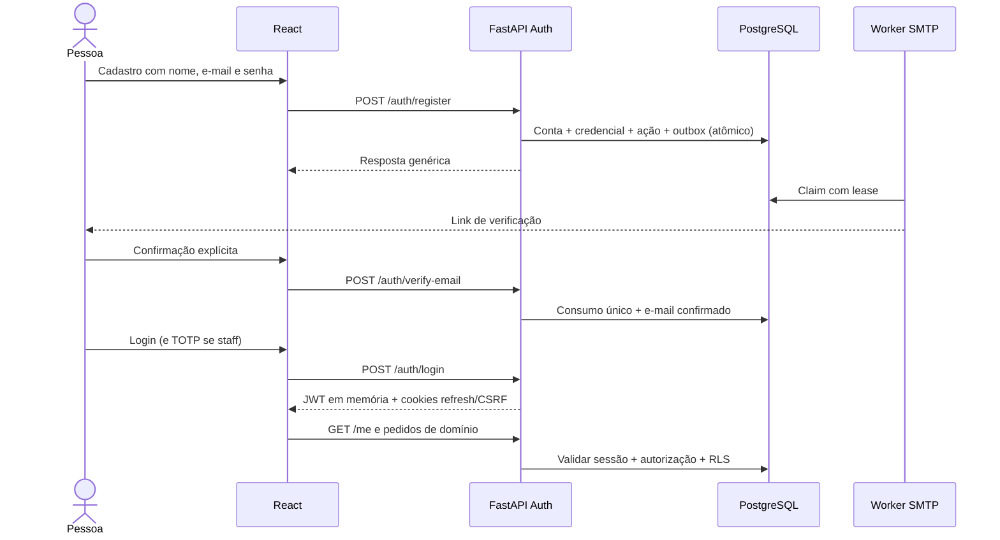

# ADR / SDD — Autenticação própria

Decisão aceita em 20/10/2026. Substitui a escolha de Keycloak/OIDC da F01.
Estado: implementada localmente. Evidência histórica da fatia de 20/10:
117 testes backend, 59 frontend,
100% de cobertura em ambos e quatro jornadas browser. PRD/staging pendentes.

## Fronteiras

Autenticação é módulo da FastAPI, sem servidor OIDC próprio, Keycloak ou Cognito.
Identidade, credenciais e sessões são globais; membership, permissões e dados de
negócio continuam sujeitos a RLS. Credenciais usam login PostgreSQL separado,
sem privilégios sobre empresas, memberships ou concessão de staff.
IDs existentes permanecem estáveis. Migration cria credenciais sem senha para
identidades antigas com e-mail não ambíguo; recuperação comprova posse e define
senha. Nunca associar uma nova inscrição automaticamente a um tenant pelo e-mail.
Contas com e-mails ambíguos exigem conciliação administrativa, sem merge automático.

## Contrato de segurança

- Senhas de 12–128 caracteres, Argon2id (19 MiB, duas iterações, paralelismo 1).
  Hash/verificação fora do event loop, com concorrência limitada por processo.
- Access JWT HS256 de cinco minutos, issuer/audience/tipo/sub/sid obrigatórios.
  UUID do ator estável; nenhuma senha ou permissão de tenant dentro do token.
- Refresh aleatório de 256 bits em cookie HttpOnly, Secure em HTTPS, SameSite=Lax,
  host-only com prefixo __Host- em HTTPS e path /. Somente digest persistido. Rotação atômica e
  validade absoluta de 30 dias, sem extensão infinita; sessão revogável no banco.
- Janela de dez segundos retorna conflito para renovação concorrente, sem emitir
  outro token. Reutilização posterior revoga toda a sessão. Frontend serializa
  refresh entre abas com Web Locks; fallback recupera por nova autenticação.
- API valida sessão/conta ativa em cada pedido: logout, reset e revogação têm efeito
  imediato nas réplicas. Nenhuma sessão ou rate limit depende de memória de réplica.
- POSTs de auth exigem Origin permitido; operações com refresh exigem também
  double-submit CSRF com cookie vinculado à sessão. Cookies nunca entram em URLs.
  Em development/testing, uma origem configurada em localhost/127.0.0.1 admite
  também o outro nome, preservando protocolo e porta. Outras origens e Origin
  ausente/null são rejeitados. Staging/production exigem a origem exata configurada.
  Links de e-mail permanecem na URL canônica; cookies continuam host-only.
- Registro e pedidos de recuperação/verificação têm respostas públicas genéricas.
  Rate limits por origem de rede e identificador, persistidos atomicamente no DB;
  hashes dos identificadores, sem e-mails/IPs em texto na tabela de limites.
- Tokens de e-mail de uso único, digest no DB, expiração (verificação 24h/reset 30m).
  Links com fragmento; frontend limpa endereço e só consome após ação explícita.
- E-mails usam outbox transacional criptografada e worker SMTP, com lease/fencing,
  retry limitado e entrega pelo menos uma vez. Nenhum envio externo na transação.
- Staff exige TOTP, com segredo criptografado, desafio curto após senha e códigos de
  recuperação de uso único. Reset de senha não remove MFA. Cadastro público nunca
  concede staff; MFA não substitui autorização administrativa.
- Nenhum token, senha, código, seed MFA ou link de recuperação em logs ou analytics.
  Cookies com CSRF e autenticação pela mesma origem em PRD. Proteções de cache e
  Referrer-Policy nos fluxos sensíveis. TLS obrigatório em staging/produção.

## Fluxo

## AWS e operação

API/worker SMTP em serviços ECS separados; RDS privado com roles distintas;
SMTP autenticado/TLS (por exemplo SES), Secrets Manager para assinatura e chave
Fernet, origem web HTTPS explícita, proxy confiável e limites na borda. Mailpit
somente local. Não exige Redis para funcionar; adicionar cache/limitador distribuído
apenas após medição. Implementação não comprova capacidade para 200 mil clientes.
Rotação da chave de assinatura expira acessos; rotação da chave de criptografia
exige drenar/recriptografar outbox e segredos MFA antes da troca. Nunca trocar a
chave de criptografia sem migração. Não há credenciais AWS ou deploy nesta mudança.

## Validação

Unitários, PostgreSQL com roles restritas, concorrência real de refresh/ações,
rollback, limites, CSRF/Origin, revogação, MFA e recuperação, preservação de IDs e
RLS. Frontend testa bootstrap, renovação, múltiplas abas, formulários/erros e navegação.
Browser real com Mailpit e API, sem Keycloak. Gate de cobertura 100% mantido nos dois
projetos. Migration e rollback validados no banco exclusivo _test.

Versão anterior à reconciliação: [snapshot integral de 28/10/2026](../history/2026-10-28-pre-documentation-reconciliation/design/native-auth.md).
