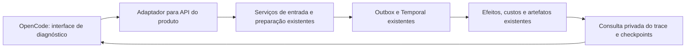

# OpenCode, rastreamento e avaliação do produto

Proposta após a pergunta do titular em 12/11/2026 sobre cobertura alta, regressões
visuais e dificuldade para testar a geração completa. Ferramenta identificada
pelo titular: OpenCode/Web/ChatUI. Nenhum pacote foi instalado, nenhum agente foi
acionado e nenhum serviço foi iniciado. `opencode` não foi encontrado no PATH
consultado. Esta proposta não amplia o orçamento nem autoriza nova geração.

## Por que os testes não impediram a piora

Cobertura informa quais linhas/branches foram executados; não informa se os
asserts representam o que torna uma peça boa. Muitos testes usam respostas e
pixels sintéticos para provar contratos, persistência, segurança, execução e
custos. Podem detectar áudio alterado, plano inconsistente ou repetição de chamada
sem detectar uma direção artisticamente fraca que respeite todos os contratos.

A auditoria histórica identificou uma direção reduzida antes da implementação,
referências com foco diferente do acabamento desejado, ausência de som adicional
e uma rodada que não percorreu a interpretação da mensagem natural nem a crítica
normal. Esses são limites dos cenários e do caminho avaliado; executar mais
branches do mesmo teste não os resolve. Também não há CI global aprovado nesta
entrega: 100% foi demonstrado nos quatro módulos novos, separadamente.

Três evidências precisam acompanhar cada mudança:

| Evidência | Pergunta que responde | O que não prova |
| --- | --- | --- |
| Teste técnico | O controle e a transformação de dados funcionam nas condições testadas? | Qualidade artística |
| Trace do produto | Qual entrada, decisão, anexo, chamada e resposta ocorreram de fato? | Que a decisão foi boa |
| Avaliação comparativa | O resultado preserva as funções da base e melhora o objetivo da rodada? | Ausência de toda regressão em futuros negócios |

## O que foi confirmado sobre OpenCode

OpenCode é um agente de código com interface terminal, desktop e web. A
documentação atual apresenta `opencode pair`; as páginas V1 ainda documentam
`opencode web --port 4096` e o servidor HTTP. São versões distintas: a prova
de compatibilidade precisa fixar versão antes de copiar comandos ou integrar
um frontend comunitário. [Introdução oficial](https://opencode.ai/docs/),
[Web V1](https://opencode.ai/v1/docs/web/).

O ChatUI citado apresenta chamadas de ferramenta, diffs, leitura de arquivos,
entrada/saída de comandos, tokens/custos e exportação de sessão. Isso é a sessão
do agente OpenCode. Por exemplo, exibir que ele executou um comando para criar um
Reel não expõe automaticamente todas as consultas, decisões e chamadas internas
da nossa geração. Essa distinção é uma inferência sobre a integração necessária
com o código do produto. [README do ChatUI](https://github.com/redentordev/opencode-chatui).

O endereço `kcrommett/opencode-web` redireciona para `shuv1337/oc-web`, cujo README
declara o projeto descontinuado e indica um sucessor. Para uma primeira prova,
a recomendação é avaliar a interface oficial, reduzindo a dependência de um
frontend antigo; não foi homologada sua compatibilidade neste workspace.
[Estado do OC Web](https://github.com/shuv1337/oc-web).

OpenCode oferece ferramentas e conexão MCP. Isso permite propor um adaptador
para consultar e operar nossos serviços, sujeito a teste de compatibilidade.
Não significa que o trace completo da aplicação seja adquirido automaticamente.
[Ferramentas oficiais](https://opencode.ai/docs/tools/),
[MCP oficial](https://opencode.ai/docs/mcp-servers/).

Não se promete acesso ao raciocínio interno completo dos modelos. O material
auditável é mensagem/prompt efetivo, contexto, chamada de ferramenta, estado,
resposta observável, código, artefato, tempos e custos registrados.

## Integração proposta, ainda não implementada

O adaptador precisa encaminhar a mensagem simulada literalmente, com origem
identificada, e chamar o mesmo serviço que processa a entrada do produto depois
da autenticação/adaptação do canal. Deve mostrar a diferença entre mensagem do
cliente e brief preparado. Entrar diretamente em `MotionRequest` com direção
escrita pelo agente continua sendo teste somente da produção motion; não é prova
do fluxo completo de cliente. A junção da entrada natural com esse percurso
ainda precisa ser identificada/testada antes de chamar a integração de ponta a
ponta. Ver [jornada atual](arquitetura-jornada-whatsapp.md).

Ferramentas propostas para a interface, com autorização da sessão existente:

1. Enviar mensagem literal de cliente simulado e recuperar IDs de correlação.
2. Consultar etapas da operação: entrada, resultado, estado, duração e erro.
3. Abrir contexto/manifesto: skill, kit, acervo, referências, base, áudio,
   selecionados/ausentes e razões declaradas, sem inventar inventário disponível.
4. Abrir chamada/retorno reais e comparar com a etapa anterior.
5. Inspecionar plano e código nos checkpoints implementados; decisão por pacote
   exato permanece no serviço do produto. Conversa do agente não substitui a
   aprovação persistida nem cria orçamento.

Cada etapa deveria mostrar: esperado, recebido, transformações, itens sem
destino, pendências e impacto provável na próxima etapa. Observação da evidência
deve ficar separada de inferência do agente. Relações entre request, operation,
event, workflow/activity e efeito precisam ser expostas; hoje não existe uma
consulta unificada de todo esse percurso. Usar primeiro efeitos/audit/outbox e
histórico Temporal existentes; demonstrar necessidade antes de criar tabela ou
serviço de observabilidade. Não transferir a execução para OpenCode.

## Como reduzir o custo de testar e aumentar a utilidade

- **Inspeção sem geração:** abrir uma operação existente e reconstruir sua linha
  do tempo a partir dos recibos. Nenhum modelo novo para navegar nos dados.
- **Reprodução técnica:** usar casos sintéticos e respostas gravadas para testar
  encaminhamento, transformações e pausas rapidamente, sempre identificando que
  não se avaliou uma nova resposta criativa. Uma entrada diferente não pode ser
  apresentada como qualificada por um replay da entrada antiga.
- **Prévia da entrada:** revisar o pacote compilado pelo builder antes de qualquer
  chamada paga; referências e materiais precisam aparecer efetivamente no pacote.
- **Rodada real acompanhada:** uma execução com orçamento novo, pausando depois
  do plano e depois do código. Retomar o mesmo pedido aprovado sem repetir efeitos.
- **Regressão artística:** manter casos versionados com bases aceitas, funções a
  preservar e objetivo localizado. Comparar continuidade, hierarquia, informação,
  ações coordenadas e som quando houver evidência audiovisual. Sem evidência,
  marcar como não validado; não aprovar por quantidade de elementos ou testes.

Exemplo específico de caso, sem virar receita global: se uma base usava um objeto
para conectar duas cenas, a candidata deve preservar essa função ou declarar e
demonstrar a substituição. JSON válido, mais elementos e voz íntegra não bastam
para comprovar essa continuidade. Revisão automática pode ajudar a apontar
problemas, mas precisa ser calibrada contra julgamentos do titular e manter
incerteza explícita.

## Primeiro aceite recomendado

Prova pequena com uma mensagem sintética: a UI deve mostrar exatamente a mesma
mensagem no serviço de entrada, o contexto efetivo do modelo, o retorno persistido
e a pausa correspondente. Um anexo removido de propósito precisa aparecer como
falha, e duplicar uma decisão não pode repetir uma chamada. A prova começa com
recibos/simulações, sem nova geração ou render, e reutiliza as fases 1–3 entregues.
Somente depois desse aceite é possível qualificar geração real e comparação
visual. A instalação do OpenCode sozinha não atende a esses critérios.
