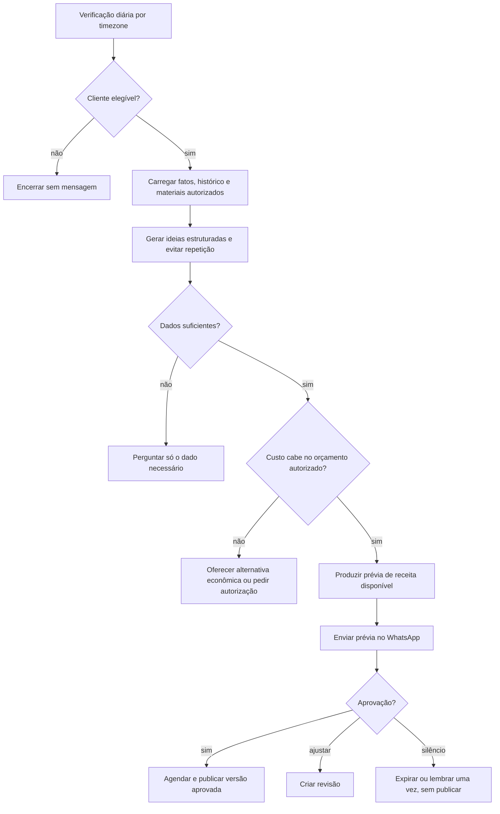
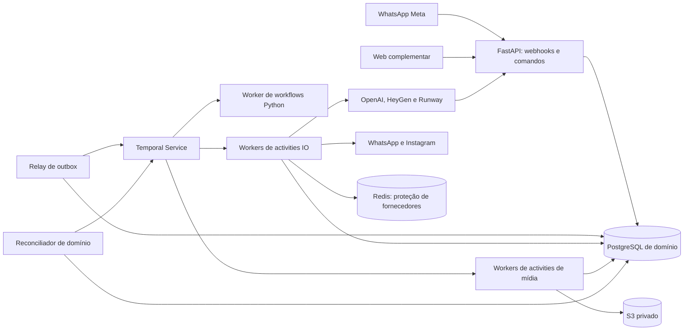

# SDD v0.2 — Arquitetura da primeira versão comercial

**Decisão P15 — 27/10/2026:** avatar/voz do próprio cliente permanecem no
produto, na F05 **após o primeiro piloto comercial**, com consentimento,
qualidade PT-BR e orçamento próprios. Não são requisito de aceite desse piloto,
que primeiro valida imagens, vídeos com material real, aprovação/publicação e
custo. As receitas e contratos de avatar abaixo descrevem a evolução completa,
não uma integração já entregue nem obrigação do primeiro piloto.

Data: 20/10/2026. Status: especificação para implementação, sem serviços provisionados.

Atualização de 21/10: fornecedores de avatar/cena listados abaixo são candidatos,
não escolhas aprovadas. Portas por capacidade, contexto versionado e ledger antes
do primeiro gasto seguem a [decisão atual](business-context-and-generation.md).

Este documento e os documentos `v0-*` vinculados abaixo substituem as decisões
de stack e sequência dos documentos v0.1. Nova decisão: **Temporal com SDK Python
substitui Celery, RabbitMQ e o runner de workflows próprio**. Não operar dois
orquestradores para a mesma jornada.

- [Integrações e catálogo de APIs](v0-integrations.md).
- [Workflows, sagas e políticas de resiliência](v0-reliability.md).
- [Repositórios, deploy e plano de entrega](v0-delivery.md).
- [Pesquisa, referências locais e roteamento de modelos](v0-intelligence.md).
- [Idempotência, concorrência, transações e observabilidade](v0-consistency-observability.md).
- [Multi-tenancy, RLS e opções de isolamento](v0-tenancy.md).

## 1. Decisões e abrangência

Backend e workflows em Python. WhatsApp como interface diária. Instagram como rede
de publicação da v0, com imagem, carrossel, Stories elegíveis e vários tipos de Reel.
Pesquisa, seleção de temas, roteirização, sugestões proativas e avatar do dono
são funcionalidades da v0, não incrementos
indefinidos. A entrega pode ser implementada em fatias, mas só será considerada v0
completa quando cumprir todos os critérios definidos nestes documentos.

Nome adotado: Meu Braço Direito. Disponibilidade de marca/domínio ainda não validada.
Repositórios: `local-spark-platform`, `local-spark-web` e `local-spark-infra`.
O backend já possui remoto Git configurado; web e infra permanecem planejados.

### Stack proposta

| Camada | Escolha |
| --- | --- |
| API | FastAPI, Pydantic, HTTPX, OpenAPI |
| Domínio e persistência | Python, SQLAlchemy, Alembic, PostgreSQL |
| Orquestração durável | Temporal, SDK Python, workflows/activities, timers e signals |
| Coordenação temporária | Redis para rate limits, bulkheads e circuit breakers |
| Mídia | S3 privado, FFmpeg/ffprobe, compositor determinístico |
| IA | OpenAI para interpretação/texto/imagem/transcrição, por adapters |
| Pesquisa | Tavily; Google Places para descoberta local conforme política da fonte |
| Decisão semântica | Porta DecisionProvider; Jev candidato após avaliação em português |
| Identidade audiovisual | HeyGen para avatar; voz própria do cliente ou voz autorizada |
| Cenas sintéticas | Runway, uso limitado e contabilizado |
| Mensagens e publicação | WhatsApp Cloud API e Instagram Platform, oficiais da Meta |
| Web complementar | React/TypeScript para OAuth, consentimento, prévia e console |
| Operação | OpenTelemetry, logs estruturados, dashboards e error tracking |
| Infra | AWS ECS, RDS PostgreSQL, ElastiCache Redis, S3, KMS, Secrets Manager |
| Workflow service | Temporal Cloud em produção, Temporal local em desenvolvimento |
| Infra como código | Terraform/OpenTofu; escolher uma ferramenta e fixar versão |

“Backend em Python” não significa reimplementar banco, codecs ou servidor Temporal
em Python. A web complementar tem runtime próprio; não executa workflows ou acessa
credenciais dos fornecedores. A aplicação roda na AWS e chama APIs externas.

Temporal Cloud reduz a operação do cluster de workflows. É um serviço externo,
cujo custo e limites entram no orçamento. Se for obrigatório hospedar também o
control plane na nossa AWS, dimensionar Temporal self-hosted em ADR específica antes
do deploy; não apresentar um container de desenvolvimento como produção HA.

## 2. Escopo funcional fechado da v0

| Receita | Entrada e entrega | Sem material novo no dia |
| --- | --- | --- |
| `photo_post` | Foto real, composição de marca e legenda de publicação | Reaproveita foto autorizada e ainda válida |
| `generated_art` | Ilustração/fundo gerado, texto determinístico e marca | Sim, sem inventar produto, resultado ou cliente |
| `carousel` | Sequência de cards informativos ou comerciais | Sim, baseada em fatos confirmados do negócio |
| `photo_motion_reel` | Fotos com movimento, transições, música/voz e legendas | Usa biblioteca aprovada |
| `edited_video_reel` | Vídeo real, cortes, enquadramento, limpeza de áudio e legendas | Usa gravações previamente autorizadas |
| `owner_avatar_reel` | Avatar e voz do dono, com roteiro | Sim, com identidade pronta e fatos suficientes |
| `hybrid_reel` | Avatar intercalado com fotos/vídeos reais | Usa biblioteca; não exige nova gravação |
| `generated_scene_reel` | Cena curta gerada, composição, áudio e marca | Sim para cenas ilustrativas; orçamento específico |
| `story_variant` | Variante vertical de oferta, arte ou vídeo compatível | Sim, conforme receita original e conta elegível |

Carrossel é formato próprio; Story é também destino/variante. Compartilhar conteúdo
entre formatos não significa reaproveitar cegamente crop, área segura ou texto.
As receitas possuem limites de duração, revisão e custo por plano. Começar com
vídeos de 15–30 segundos e cenas sintéticas curtas; limites são configuração versionada.
Não prometer efeitos interativos, músicas do catálogo do Instagram ou stickers que
a API não suportar. O próprio produto deve explicar indisponibilidade por conta.

Todos os formatos fazem parte do backlog da v0; disponibilidade comercial exige
smoke test real e permissões. Não substituir integração ausente por mock sem avisar.
TikTok/Facebook/Shorts têm portas de extensão, mas ficam fora da publicação da v0.

## 3. Contratos do produto

1. O cliente conecta Instagram profissional pelo OAuth oficial, sem fornecer senha.
2. Cadastro reúne negócio, marca, objetivos, preferências de frequência, fatos e biblioteca.
3. Captura de avatar/voz é guiada e registra autorização e exigências do fornecedor.
4. Texto, áudio, foto ou vídeo abrem uma solicitação; o sistema agrupa entradas.
5. Datas e valores ambíguos geram perguntas simples, nunca suposições publicadas.
6. Receitas são recomendadas por objetivo, material disponível, preferência e franquia.
7. Prévia corresponde ao arquivo e legenda que serão enviados à conta identificada.
8. “OK” aprova uma prévia identificável, não uma geração futura ainda desconhecida.
9. Ajustes criam versões; autorização antiga não vale para arquivo novo.
10. Relatório semanal separa trabalho entregue, alcance e resultados comerciais observados.
11. Concessão de seis meses é entitlement com validade, sem cobrança automática implícita.
12. Suporte acompanha etapas e falhas por IDs, sem depender de acesso direto ao banco.

### 3.1 Proatividade quando não há material novo

Não depender do comerciante lembrar de pedir. No cadastro, ele escolhe frequência,
horários, objetivos, orçamento de geração automática e permissão para reuso.

Exemplos seguros: dica de conservação confirmada pelo dono; apresentação de serviço
já cadastrado; convite para conhecer o estabelecimento; Reel com portfólio autorizado.
Disponibilidade de agenda, desconto, preço novo e estoque exigem confirmação atual.
Sem fotos autorizadas, escolher arte ilustrativa ou avatar; não simular um serviço
prestado ou cliente real. Reaproveitar promoção exige checar validade e condições.

Política inicial ajustável: até três sugestões por semana, uma prévia proativa pendente
por negócio, um lembrete após 24 horas e expiração em 48 horas ou antes da oferta
vencer. Evitar geração diária de avatar caro antes de medir aceitação. O orçamento
proativo pode escolher uma prévia de baixo custo; formato premium exige permissão
de geração compatível, além da aprovação final para publicar.

São três permissões distintas: receber lembretes, autorizar gasto/geração dentro da
franquia e aprovar publicação. Todas precisam de estado e revogação próprios.
Mensagens fora da janela do WhatsApp usam templates aprovados quando exigidos.

## 4. Componentes e processos

Deployments do mesmo repositório backend:

- `meu-braco-direito-api`: sessões, webhooks, OAuth e comandos rápidos.
- `meu-braco-direito-event-relay`: entrega outbox ao Temporal com IDs determinísticos.
- `meu-braco-direito-workflow-worker`: executa decisões determinísticas dos workflows.
- `meu-braco-direito-io-worker`: activities de banco e integrações, isoladas por task queue quando necessário.
- `meu-braco-direito-media-worker`: activities CPU/IO de áudio, imagem e vídeo em sandbox.
- `meu-braco-direito-maintenance`: reconciliação, saúde, limpeza e retomada de comandos pendentes.

Scheduler de datas da jornada é o Temporal. `maintenance` não é segundo runner:
identifica inconsistências de domínio e envia comandos para o workflow responsável.
Workflows usam task queues, não precisam de RabbitMQ. Redis não guarda histórico.

## 5. Padrões de projeto utilizados e propósito

| Padrão | Aplicação concreta |
| --- | --- |
| Domínios delimitados e monólito modular | Tenancy, conteúdo, publicação, billing e analytics com ownership explícito |
| Arquitetura hexagonal | Portas de domínio; adapters Meta, IA, storage, pagamento e Temporal |
| Application services e Unit of Work | Regras e transações compartilhadas entre API e activities |
| Workflow durável | Timers, aprovação humana, retries e retomada no Temporal |
| Saga orquestrada | Compensações explícitas para reservas e recursos realmente reversíveis |
| Inbox/outbox transacional | Receber e encaminhar comandos sem janela de perda entre DB e Temporal |
| Idempotent consumer e operation ledger | Duplicata interna não repete efeitos pagos/publicação |
| Bulkhead, rate limiter, circuit breaker | Proteger capacidade e isolar falhas de fornecedores |
| Versionamento otimista | Concorrência em revisão, aprovação e cancelamento |
| CQRS leve | Comandos de domínio separados das projeções de consulta; mesmo banco inicialmente |
| Strategy/registry | Receitas de mídia e capacidades por plataforma |

Não adotar event sourcing de todo o domínio, Kubernetes, Kafka, banco vetorial ou
microserviço por etapa sem requisito medido. O histórico do Temporal não transforma
o banco de negócio em event sourcing. Biblioteca de agentes não é necessária para
chamar modelos e validar JSON; só adicionar se melhorar um caso medido.

## 6. Estado, dados e consistência

- **Temporal:** fonte do controle de execução, timers, mensagens e histórico do workflow.
- **PostgreSQL:** fonte de conteúdo, fatos, versões, consentimentos, aprovações,
  publicações, operações externas, reservas, custos e auditoria do produto.
- **S3:** arquivos imutáveis; identificados por tenant e checksum.
- **Redis:** candidato futuro para coordenação/limites quando houver necessidade
  medida; não há cliente/dependência/serviço Redis no runtime atual. PostgreSQL e
  Temporal sustentam os estados atuais; Redis não é requisito do ambiente local.

Não existe transação ACID entre PostgreSQL e Temporal. Toda activity que grava no
DB é idempotente por operação. Toda transação HTTP que precisa iniciar/avisar workflow
inclui uma intenção durável/outbox com consumidor real. P14 retira os recibos
assíncronos de CRUD que só repetiam auditoria; criar negócio ou alterar kit
continua atômico/idempotente e auditado, sem iniciar workflow sem efeito.
Projeções podem atrasar; API apresenta estado em processamento,
sem inferir sucesso de uma fila. Não habilitar caminhos de execução independentes.

Entidades adicionais à v0.1: `external_operations`, `operation_attempts`,
`compensation_actions`, `workflow_bindings`, `command_inbox`, `business_facts`,
`proactive_preferences`, `content_ideas`, `provider_capability_profiles`,
`provider_budget_accounts` e `generation_authorizations`.

`external_operations` contém tenant, operation_key, fingerprint, provider, status,
external_id, request/response refs protegidas, custo estimado/real, consentimento,
versão, janela e último erro. Unique por `(tenant_id, operation_key)`; ID externo
único no escopo correto da conta provedora. `UNKNOWN` não é tratado como `FAILED`.

`business_facts` contém valor, origem, confirmed_at, valid_until e escopo. Ideias e
roteiros referenciam fatos; recomendações não tornam fatos verdadeiros.

Manter RLS, FKs compostas por tenant, autorização no storage e ledger financeiro
imutável definidos no SDD anterior. RLS exige role sem bypass/dona; contexto local
por transação, inclusive no worker. Credenciais ficam em Secrets Manager/KMS.

## 7. Escalabilidade e segurança operacional

Escalar API, workflow worker, IO e render independentemente. Limitar slots por
tenant e provedor antes de admitir geração. API e mensagens não compartilham pool
pesado de render. Limites de plano ficam no banco e nunca só em cache.

Não criar workflow por mensagem recebida: agregação por conversa/solicitação e
workflows por unidade de negócio. Não criar fila por tenant. Workflows proativos e
relatórios rodam por dia/semana e encerram; não acumular histórico infinito.
Configurar versionamento de workers e testar replay antes de mudar lógica ativa.

Capacidade de 200 mil assinantes permanece hipótese de dimensionamento. Medir ações
Temporal, crescimento de histórico, RDS, bytes S3/egress, render e quotas externas,
além de HTTP. Em 12 entregas por mês por cliente são 2,4 milhões de entregas mensais;
quantidade de activities e callbacks pode ser muito maior que a de vídeos.

Metas iniciais: API 99,9%, ingestão p95 menor que 1 s; arte/vídeo simples p95 até
5 min após admissão; avatar e vídeo sintético têm metas definidas pelo benchmark.
RPO/RTO incluem PostgreSQL, objetos e estado do Temporal, não só banco da aplicação.
Procedimento de restore pausa efeitos pagos/publicação até reconciliar os dois lados.

Observabilidade inclui workflow_id, run_id, operation_id, tenant_id em logs/traces;
labels de métricas têm cardinalidade limitada. Alertar etapas UNKNOWN, outbox atrasada,
falhas em compensação, aprovação parada, custo, 429 e circuitos abertos. Payloads e
histórico do Temporal recebem IDs e referências, evitando áudio, tokens e PII em claro.

## 8. Decisão sobre a orquestração

O novo escopo exige esperas humanas e externas, compensação e evolução de processos.
Escolher Temporal desde a v0 reduz a necessidade de escrever um orquestrador próprio.
Isso não elimina idempotência, circuit breakers HTTP, segurança ou reconciliação de
efeitos: essas responsabilidades continuam explicitamente na aplicação.

Documentação: [SDK Python](https://python.temporal.io/),
[mensagens para workflows](https://docs.temporal.io/develop/python/workflows/message-passing),
[activities e histórico](https://docs.temporal.io/tasks).
