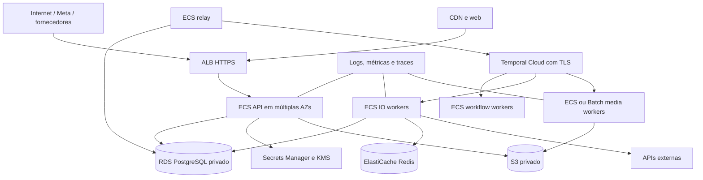

# v0 — Repositórios, infraestrutura e execução

Data: 20/10/2026. Nome adotado: Meu Braço Direito; repositórios com prefixo `meu-braco-direito-`.
Documentação de [arquitetura](v0-architecture.md), [APIs](v0-integrations.md) e
[resiliência](v0-reliability.md) define o contrato da v0.
O complemento de [inteligência editorial](v0-intelligence.md) acrescenta pesquisa,
referências locais e avaliação de Jev ao escopo e aos critérios abaixo.
O contrato de [consistência e observabilidade](v0-consistency-observability.md)
define as garantias transacionais e os testes de concorrência exigidos desde M0.

## 1. Repositórios propostos

| Repositório | Responsabilidade | Deploys |
| --- | --- | --- |
| `local-spark-platform` | Domínio, API, workers Python, workflows, integrações, templates e migrações | API, relay, workflow worker, IO worker, media worker e maintenance |
| `local-spark-web` | Cadastro complementar, OAuth/consentimento, revisão e console operacional | Web React/TypeScript, possivelmente dois entrypoints |
| `local-spark-infra` | Rede, IAM, serviços gerenciados, ECS, observabilidade, secrets refs, pipelines e ambientes | Infraestrutura de dev/staging/prod |

Não criar repositório por função técnica como “transcrição” ou “legenda”: são etapas
do mesmo domínio de produção. Código de render pode ter imagem própria no mesmo
repo. Separar repository, deployment e serviço de domínio são decisões diferentes.
Não criar dezenas de serviços com contratos de rede antes de precisar dessa fronteira.

Documentação e ADRs são do `local-spark-platform`; infra mantém runbooks operacionais e
web mantém decisões de UX. Exportar OpenAPI do backend no CI e gerar cliente tipado
no frontend, sem copiar DTOs manualmente. Não é necessário repo de shared contracts
no início. Release do cliente gerado usa artefato versionado e teste de compatibilidade.

### Estrutura do backend

```text
local-spark-platform/
  pyproject.toml
  uv.lock
  compose.yaml
  docker/
    api.Dockerfile
    worker.Dockerfile
    media.Dockerfile
  src/meu_braco_direito/
    entrypoints/
      api/
      event_relay/
      workflow_worker/
      io_worker/
      media_worker/
      maintenance/
    domains/
      identity/
      tenancy/
      businesses/
      conversations/
      content/
      avatars/
      publishing/
      proactive/
      research/
      competitive_intelligence/
      analytics/
      billing/
      support/
    application/
      commands/
      queries/
      ports/
    workflows/
      ingestion.py
      production.py
      publication.py
      enrollment.py
      proactive.py
      reports.py
      research.py
      editorial_planning.py
      deletion.py
      activities/
    adapters/
      persistence/
      meta/
      openai/
      heygen/
      runway/
      tavily/
      places/
      typesafe/          # candidato, ativado após avaliação
      stripe/
      storage/
      provider_protection/
    media/
      recipes/
      renderer/
      subtitles/
      templates/
    contracts/
    observability/
  migrations/
  tests/
    unit/
    integration/
    contracts/
    workflows/
    replay/
    failure_recovery/
    load/
  evals/
  docs/
```

Diretórios são fronteiras propostas; no bootstrap criar apenas arquivos usados.
Domínio não importa FastAPI, SDK de IA ou boto3. Entry points não contêm regra de
saldo/aprovação. Workflows invocam activities; activities chamam application services
e adapters. Teste automatizado de import boundaries evita acoplamento acidental.

## 2. Infraestrutura e ambientes

Dev local: Compose com PostgreSQL, Redis, Temporal de desenvolvimento, API e workers;
storage S3 compatível local e adapters fake. Mock é padrão sem chave; teste real
usa ambiente explícito e teto financeiro. Não incluir RabbitMQ ou Celery.

Staging: credenciais/apps de teste, dados sintéticos ou autorizados, contas sociais
separadas, serviços parecidos com produção. Sem publicar por engano em conta real
de cliente. Produção: domínios e apps aprovados, segredos e dados isolados.



Temporal workers iniciam conexões de polling ao serviço; setas representam dependência
lógica, não abertura de porta de entrada nos workers. Segurança de rede deve refletir isso.

Produção começa com capacidade adequada ao piloto e HA para o SLA assumido:

- API e workers de workflow/IO com réplicas em mais de uma AZ.
- RDS Multi-AZ, backups/PITR e pool de conexões; roles sem bypass de tenant.
- Redis privado com HA quando exigido pelo SLA; plano de reconstrução após perda.
- S3 com criptografia, lifecycle e acesso por IAM de tarefa, sem credencial estática.
- URLs para mídia de fornecedores com validade suficiente e acesso mínimo necessário.
- Egress previsível, NAT/endpoints S3 e custos de transferência explicitamente modelados.
- Render isolado, limites de recursos e sem acesso a secrets do publish worker.
- Tokens de fornecedores acessíveis apenas ao pool que precisa deles.
- Temporal namespace/certificados ou API auth por ambiente, permissões mínimas e codec
  de payload quando aplicável. Conferir região, retenção, quotas e custo contratado.

AWS Batch é alternativa para render pesado; se adotado, a activity submete job, salva
job ID e consulta com timers/heartbeats adequados. Não lançar subprocesso pesado sem
limites dentro de container web. Definir ECS vs Batch no benchmark de render.

## 3. Contratos de backend adicionais

Manter rotas de negócio da v0.1, atualizando o executor para Temporal e adicionando:

| Rota proposta | Comportamento |
| --- | --- |
| GET/PATCH /v1/businesses/{id}/proactive-preferences | Frequência, horários, reuso, orçamento e consentimento de mensagens |
| GET /v1/content-ideas | Ideias, fatos usados e status de cada prévia |
| POST /v1/content-ideas/{id}/dismiss | Rejeitar sugestão e motivo opcional |
| GET /v1/operations/{id} | Etapa, estado de negócio e erro sanitizado |
| POST /v1/operations/{id}/reconcile | Comando operacional autorizado, sem retry cego |
| GET /v1/provider-capabilities | Formatos disponíveis para conta/plano, com motivos |
| POST /v1/support/operations/{id}/retry | Retry de etapa elegível e auditada |
| POST /v1/support/providers/{id}/pause | Pausa operacional autorizada por escopo |

No HTTP, `202` significa aceito, não publicado. Retornar operation_id e status_url.
Suporte só vê tenants autorizados e recebe payloads sanitizados. OAuth state, links
de aprovação e callbacks são autenticados e deduplicados. Idempotency-Key vincula
ator, tenant, rota e hash; payload diferente com mesma chave gera conflito.

## 4. CI/CD e qualidade

Backend: Ruff, type checking, pytest, testes reais de DB/RLS, contratos de adapters,
workflows com timers acelerados, replay e testes de falha. Lock de dependências,
SBOM/scan de imagem e segredos. Modelos/templates têm versão, evals e rollback.
Não rodar geração paga em todo PR; reservar suíte explícita com limites e assets consentidos.

Migrações expand/contract para compatibilidade entre API e workers. Uma pipeline
de migração com role específica; não cada réplica rodando Alembic no startup.
Release identifica SHA, schema, versão de workflow, SDKs e template/model profiles.
Retirar workers antigos só quando os workflows compatíveis puderem continuar.

Web: tipos, lint, testes das jornadas críticas de conexão/aprovação/consentimento
e smoke de acessibilidade. Infra: format/validate/plan, análise de IAM e detecção
de drift. Publicação de infraestrutura paga é uma etapa concreta posterior ao review.

## 5. Plano de entrega da v0 completa

| Marco | Entrega | Critério verificável |
| --- | --- | --- |
| M0 | Repos, Compose, auth, tenancy/RLS, inbox/outbox e Temporal | Queda/restart não perde comando nem cruza tenant |
| M1 | WhatsApp, biblioteca, áudio/texto e briefing | Material agrupado, fatos ambíguos confirmados e trace por operação |
| M2 | Imagem, carrossel, motion e edição de vídeo | Receitas reais, previews imutáveis, legendas sincronizadas e custo registrado |
| M3 | Avatar/voz do cliente e cenas geradas | Consentimento, revogação, identidade validada e orçamento funcional |
| M4 | Instagram: imagem/carrossel/Reels/Stories elegíveis | Permissões reais, publicação confirmada, timeout e reauth tratados |
| M5 | Pesquisa, referências locais e planejamento proativo sem material novo | Fontes e políticas, raio, temas, prévia contextual, opt-in, aprovação e expiração sem publicar |
| M6 | Franquias, assinatura, concessão e relatório | Saldo concorrente correto, custo real, término transparente e métricas reproduzíveis |
| M7 | Console, segurança, recovery, carga e replay | Equipe resolve falhas sem editar DB; SLO comprovado na carga declarada |

Spikes de API/qualidade acontecem durante M0/M1, não depois de implementar todo o
produto. Os marcos são sequência de engenharia, não proposta de cortar o escopo
da v0. Só declarar v0 completa após M0–M7, ou registrar explicitamente alteração de escopo.

## 6. Definition of Done da v0

- Cada receita da matriz tem teste real de geração, prévia, alteração e publicação
  no Instagram quando elegível, além de limites/franquia/custo conhecidos.
- Cliente sem material novo recebe sugestão contextual que pode aprovar, corrigir,
  pausar ou ignorar; silêncio nunca autoriza postagem.
- Pesquisa, escolha de temas e análise local têm evidência, atualidade, cobertura e
  permissões rastreáveis. Não inventar dados privados da concorrência.
- Decisão semântica tem baseline testado; Jev entra só se demonstrar ganho e qualidade
  adequada em PT-BR, com fallback e kill switch por tarefa.
- Avatar pronto e consentido permite vídeo com o próprio dono sem nova gravação.
- Uma falha não repete gerações pagas ou publicações indiscriminadamente.
- Circuit breaker, rate limiting, retry, UNKNOWN e compensação têm cenários de teste.
- Saúde e trilha de execução visíveis, alertas acionáveis e acesso de suporte auditado.
- Restore de banco/objetos e recuperação do workflow têm runbook ensaiado.
- Carga mede o stack interno e capacidade externa separadamente; relatório diz qual
  volume foi provado, em qual infraestrutura e por qual custo.
- Cobrança/cancelamento e acesso patrocinado não dependem de intervenção manual de engenheiro.
- Evidência de app review e acesso comercial das APIs registrada; mocks não contam.

## 7. Pendências que exigem evidência externa

Modelo/API e marca foram escolhidos como proposta técnica; ainda faltam acesso às
contas de API, orçamento, contratos de identidade e publicação, app review Meta,
matriz de scopes/formato na versão Graph selecionada, avaliação PT-BR e preço dos
planos. Não é possível tornar essas aprovações e resultados prontos só escrevendo SDD.

Nenhum requisito externo impede iniciar código de tenancy, contratos, Temporal,
ledger, render e adapters fake. A escolha de fornecedor define onde começar o spike;
não deve esconder risco de disponibilidade ou margem para uma mensalidade de R$ 99.
