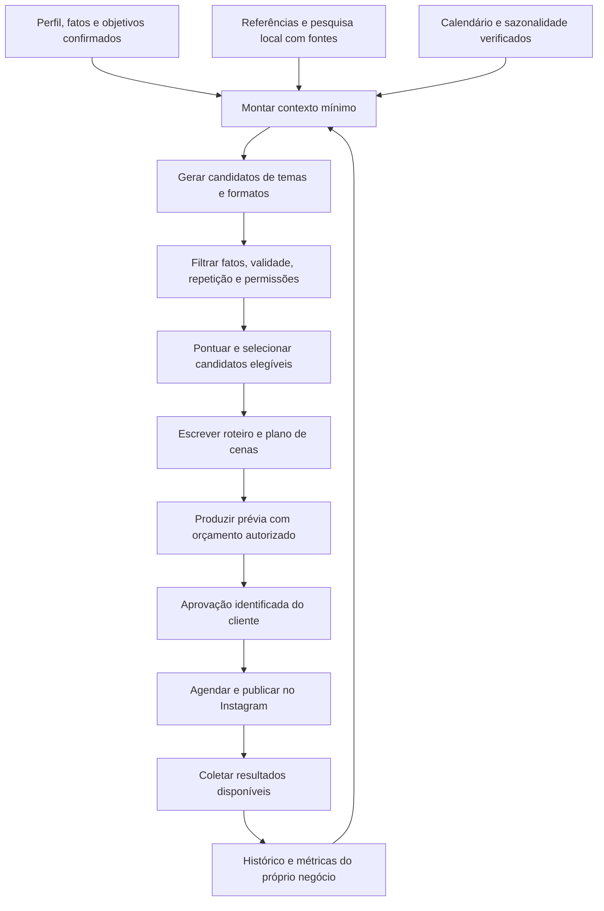

# v0 — Pesquisa, inteligência local e roteamento de modelos

Data: 20/10/2026. Complemento normativo do SDD v0.2. Backend e orquestração continuam
em Python/Temporal; não há mudança dos três repositórios ou criação de microserviços
adicionais por agente. APIs e capacidade aqui descritas ainda não foram executadas.

## 1. Responsabilidade editorial completa

A plataforma deve pesquisar, propor temas, escolher entre alternativas, planejar
calendário, escrever roteiro/legenda, produzir mídia, solicitar aprovação, publicar
e aprender com dados observados. Receber material do cliente é uma entrada, não
pré-condição diária para o sistema funcionar.

Pesquisa é uma etapa limitada por escopo, fontes, atualidade e custo. Não executar
busca aberta antes de cada mensagem ou postagem. O cliente controla posicionamento,
assuntos proibidos, objetivo, produtos/serviços, frequência e referências preferidas.
O sistema recomenda e executa tarefas, mas aprovação continua obrigatória na v0.

### Etapas editoriais

| Etapa | Comportamento exigido |
| --- | --- |
| Conhecer o negócio | Catálogo, público, região atendida, diferenciais e fatos confirmados |
| Pesquisar | Fontes externas apropriadas, datas, ofertas públicas e referências permitidas |
| Idear | Candidatos com objetivo comercial, público, hook e evidências |
| Selecionar | Elegibilidade e custo em código; relevância semântica por modelo se necessário |
| Planejar | Alternar temas/formatos e horários; evitar repetição e conflitos de oferta |
| Roteirizar | Abertura, cenas, fala, textos na tela, CTA e legenda da publicação |
| Produzir | Receitas existentes, autorização de geração, orçamento e controle de qualidade |
| Publicar | Versão e conta aprovadas, com revalidação de fatos/consentimento |
| Avaliar | Dados comparáveis, incerteza explícita e hipóteses para o próximo ciclo |

Não alegar que um tema vende mais apenas por ter mais curtidas. Métricas do próprio
cliente têm origem, janela e comparabilidade; concorrentes normalmente oferecem
somente observações parciais. “Tendência observada nas fontes” não equivale a tendência
nacional comprovada nem a resultado causal. Cold start usa templates de segmento,
preferências e pesquisa autorizada, sem inventar histórico de sucesso.

## 2. Referências num raio configurável

Cadastro pergunta localização do estabelecimento e área atendida. Negócio móvel
pode configurar ponto de operação ou área; profissional remoto pode preferir referências
por segmento/cidade sem raio. Não inferir localização por DDD ou IP como endereço certo.

Política inicial proposta: raio de 3 km, ajustável de 500 m a 20 km; até cinco
referências acompanhadas por negócio. Ampliar raio exige configuração explícita
quando não houver opções suficientes. Valores são limites do produto, não da API.

Descoberta retorna candidatos, nunca todos os concorrentes garantidamente. Proximidade
não basta: comparar categoria, serviço/produto, público, posicionamento e região.
Separar `direct_competitor`, `local_reference`, `aspirational_reference` e `unverified`.
O dono pode adicionar, corrigir ou excluir referências, inclusive fora do raio.

### Conectores selecionados

| Uso | Seleção | Limitação importante |
| --- | --- | --- |
| Descobrir estabelecimentos próximos | Google Places Nearby Search (New), acesso direto | Retorno ranqueado/limitado, campos e termos específicos |
| Pesquisar temas, sites e notícias públicas | Tavily Search | Busca não concede automaticamente direito a armazenar/republicar conteúdo |
| Extrair fonte autorizada selecionada | Tavily Extract, quando necessário | Limites, permissões e custo por documento |
| Referências informadas pelo dono | URLs, nomes e identidade verificada | URL não prova propriedade nem acesso à API social |
| Histórico e resultados do próprio cliente | Instagram Insights autorizado | Não contém insights privados de concorrentes |
| Dados públicos Instagram de terceiros | Business Discovery, se caminho/scopes aprovados permitirem | Gate específico; não assumir disponibilidade no Instagram Login escolhido |

Google Places usa `POST https://places.googleapis.com/v1/places:searchNearby`,
centro/raio, tipos e FieldMask explícito. Sem wildcard em produção; validar SKUs por
campo. Apresentar atribuições e contexto de cobertura. Falta de resultados não prova
ausência de concorrência. Custo e acesso comercial são verificados no spike.

Tavily usa `POST https://api.tavily.com/search` e, quando necessário, `/extract`;
enviar consulta específica de segmento/localidade, limite de fontes e recência.
Capturar URL, publicação quando disponível, fetched_at, qualidade de evidência e
restrições do conteúdo. Não usar uma resposta sintetizada pelo buscador como única
prova sem a fonte correspondente.

### Termos dos dados fazem parte da arquitetura

Não construir um banco compartilhado irrestrito de conteúdo Google Places. O Google
impõe restrições de armazenamento/cache, com exceções como place IDs, e regras de
atribuição. A licença também restringe uso para melhorar/treinar/testar modelos.
Isso não deve ser reinterpretado como autorização automática para todo uso de inferência.

O adapter carrega `source_policy_id`, permissões de armazenamento/compartilhamento,
expiração e uso analítico. Conteúdo Google é usado na experiência de descoberta
compatível com os termos; não entra no LLM, warehouse, índice vetorial ou dataset
de eval sem verificar que o uso é permitido. Não esconder a origem via resumo derivado.

Pesquisa editorial usa fontes próprias, abertas ou licenciadas para essa finalidade.
Dados com restrição ficam separados. Quando uma fonte não permitir análise/reuso
pretendido, usar fonte alternativa autorizada ou limitar a funcionalidade claramente.
Publicar “análise de concorrente” sem evidência suficiente não é fallback aceitável.

Fontes: [Nearby Search](https://developers.google.com/maps/documentation/places/web-service/nearby-search),
[billing/campos](https://developers.google.com/maps/documentation/places/web-service/usage-and-billing),
[políticas Places](https://developers.google.com/maps/documentation/places/web-service/policies),
[termos Maps](https://cloud.google.com/maps-platform/terms),
[Tavily Search](https://docs.tavily.com/documentation/api-reference/endpoint/search),
[custos Tavily](https://docs.tavily.com/documentation/api-credits).

## 3. Saída da análise de concorrentes

Relatório rastreável, com fatos separados de interpretações:

- Referências selecionadas, critérios de comparação, raio e data da observação.
- Posicionamento, serviços anunciados, assuntos/formatos observados e CTAs públicos.
- Frequência/engajamento somente para amostra acessível e período identificados.
- Oportunidades para o nosso cliente, baseadas nos seus diferenciais reais.
- Temas candidatos originais, sem copiar textos, imagens, identidade ou roteiro de terceiros.
- Fontes de cada observação e cobertura: completa para o conjunto coletado, parcial,
  indisponível ou desatualizada. Não transformar ausência de dado em zero.

Exemplo de conclusão aceitável: “Nas quatro referências consultadas, encontramos
conteúdo sobre cores e acabamento; você informou que atende à noite. Podemos testar
uma publicação sobre atendimento após o expediente.” Não afirmar que a concorrente
não atende à noite apenas porque não achamos anúncio disso.

Não fornecer faturamento, conversão, alcance privado ou afirmação de que a ferramenta
sabe qual postagem gera mais vendas para terceiros. Isso exige dados que a descoberta
local e as páginas públicas não fornecem. Toda recomendação é hipótese a medir.

## 4. Jev: papel proposto

Foi identificado o modelo Jev, da TypeSafe AI, compatível com a descrição do curso.
Confirmar a referência do usuário quando chegar; não confundir com JEPA ou modelos
generativos de nome parecido. A adoção proposta é experimental para decisões delimitadas.

A documentação descreve perguntas tipadas: `Choice` seleciona opção, `Score` avalia
critério e `Noul` retorna probabilidade de uma afirmação. Jev não substitui escrita
de roteiros, transcrição, geração de imagem ou edição de vídeo. Consultas devem ser
estreitas e usar estado suficiente; outputs tipados não garantem decisão correta.
Fonte: [introdução oficial](https://docs.typesafe.ai/introduction).

### Camadas de decisão

| Camada | Tarefas | Implementação |
| --- | --- | --- |
| Determinística | Saldo, consentimento, datas, limites, raio e autorização | Python/SQL |
| Semântica delimitada | Classificar intenção, pontuar candidatos e selecionar receita elegível | Jev candidato, comparado ao baseline |
| Generativa | Criar temas, roteiro, cenas e legenda | Modelo de texto existente |
| Especializada | Imagem, fala, avatar e vídeo | Provedores selecionados |

Não chamar Jev só para responder algo que o banco ou um `if` resolvem. Não usar
decisão probabilística como aprovação, autorização, isolamento de tenant ou validação
financeira. A IA pode sugerir “parece aprovação”; o domínio valida ator, prévia e ação.

Integração proposta: porta `DecisionProvider`, adapter TypeSafe no `local-spark-platform`,
SDK Python `typesafe-sdk` ou `POST https://api.typesafe.ai/v1/systemone`.
Credenciais em Secret Manager, chamadas por activity, request/response protegidos,
modelo versionado e circuit breaker/rate limit separados. Não instalar skills ou
SDK no projeto apenas para documentar; isso ocorre no bootstrap autorizado.
Fonte do contrato: [quickstart oficial](https://docs.typesafe.ai/introduction/quickstart).

Modelo inicial de avaliação: `jev-1.13.0` estável pinado, comparado a `jev-1.14.0`
em avaliação separada. A página oficial consultada aponta o segundo como release
mais novo e `jev-preview`, enquanto `jev-latest` aponta o primeiro; não usar alias
móvel em produção. Preço publicado: US$ 0,042 por milhão de tokens de entrada, saída
gratuita. Limites dependem da organização. Português exige avaliação própria.
Fonte: [modelos e preços oficiais](https://docs.typesafe.ai/models).

Confiança não é taxa de acerto medida da nossa aplicação. Ajustar thresholds por
tarefa/versão em corpus PT-BR; resultado incerto pede esclarecimento ou modelo
generativo conforme orçamento e risco. Falha não pode aprovar/publicar silenciosamente.
Fonte: [confiança e limiares](https://docs.typesafe.ai/confidence).

A versão 1.13 tem limitações documentadas em números/datas, instruções adversariais,
contexto irrelevante e outras tarefas. Manter cálculos em código e fontes externas
como dados não confiáveis. Nenhum modelo é árbitro único de segurança ou factualidade.
Fonte: [limitações oficiais 1.13](https://docs.typesafe.ai/model-jaggedness/jev-1.13).

### Critério para ativação

Começar em modo shadow: baseline decide, Jev avalia amostra sem acionar efeitos.
Conjunto inicial de pelo menos mil casos rotulados PT-BR, diversificado por segmento,
áudio transcrito, gírias, negação, mensagens incompletas e conteúdo adversarial.
Separa treino de thresholds/validação de um conjunto final que não foi usado para ajustar.

Medir precisão/recall por intenção, erros graves, abstention rate, cobertura, calibração,
p50/p95, disponibilidade e custo total com fallback. Tamanho inicial não prova taxas
raras de erro: exigir limite estatístico adequado ao risco antes de automatizar ação.
Sem ganho de custo com qualidade suficiente, manter baseline e não adicionar fornecedor
ao caminho crítico. Kill switch por tarefa e rollout incremental auditável.

## 5. Escala de 200 mil clientes

Executar 200 mil pesquisas profundas iguais diariamente é um desenho caro. Separar
pesquisa compartilhável, contexto próprio do cliente e geração individual:

1. Pesquisa por segmento/região/idioma/objetivo quando os direitos permitirem reuso.
2. Atualização incremental das referências autorizadas; não baixar histórico completo.
3. Contexto mínimo por cliente: fatos, diferenciais, preferências e métricas próprias.
4. Geração de ideias personalizadas em lote limitado, com seleção/reuso do contexto.
5. Produção de mídia só dentro do orçamento e autorização, com aprovação para publicar.

Compartilhar tendências públicas/licenciadas não significa compartilhar catálogo,
faturamento, áudios, métricas, prompts ou estratégias privadas de clientes. Chaves
de cache incluem tenant quando houver qualquer dado privado. Evidência de origem
restrita não vira dataset multi-tenant. Shared cache depende de permissão explícita
e chave de versão/fonte/política, sem cache indiscriminado de Places.

### Capacidade ilustrativa, mês de 30 dias

| Perfil | Volume calculado | Implicação |
| --- | --- | --- |
| 200 mil negócios, três sugestões/semana | 600 mil/semana, cerca de 2,57 milhões/mês | Espalhar por timezone, horário e capacidade |
| Oito decisões/dia/negócio | 48 milhões de decisões/mês | Não usar LLM grande indiscriminadamente |
| Uma pesquisa semanal por negócio | Cerca de 857 mil pesquisas/mês | Volume externo relevante, custo e contrato próprios |
| 200 mil ideias em janela de 6 h | 9,26 ideias/s em média | Pico e fan-out de APIs precisam de limites |
| Três consultas externas por pesquisa | Cerca de 2,57 milhões de chamadas/mês | Orçamento antes de ativar para todos |

Uma decisão lógica não equivale a uma chamada: várias perguntas independentes podem
usar uma requisição com contexto comum, respeitando schema, limites e política de dados.
Para comparação conservadora de custo, 48 milhões de chamadas com 1.500 tokens cada
seriam 72 bilhões de tokens, cerca de US$ 3.024 ao preço publicado do Jev. É simulação
aritmética; não inclui rede, IA generativa, busca, mídia, retries ou capacidade contratada.

Não assumir que preço baixo por token concede throughput ilimitado. Negociar quotas
por fornecedor antes de ativar coorte. Histórico Temporal, chamadas e armazenamento
também entram no custo. Autoscaling sem controle de admissão multiplica gasto e 429.

## 6. Implementação de escala

- `ResearchRefreshWorkflow`: por conjunto de fontes/escopo permitido e janela temporal,
  não por mensagem; chave idempotente com consulta, fonte e versão de política.
- `LocalReferenceDiscoveryWorkflow`: por negócio/consulta autorizada, com orçamento,
  fonte, completude e expiração apropriados; não pressupor resultado compartilhável.
- `EditorialPlanningWorkflow`: por negócio/período, carrega contexto e gera candidatos.
- Workflows existentes de produção/publicação recebem o candidato escolhido e fontes.
- Timers com jitter distribuem trabalho; sem um cron disparar 200 mil chamadas às 08h.
- Task queues IO/pesquisa separáveis das de mídia/mensagens conforme gargalo medido.
- Admission control global, por tenant, fornecedor e custo; fairness entre clientes.
- Single-flight/coalescing só para consultas equivalentes com dados e direitos compatíveis.
- TTL de fonte e staleness budget explícitos; recusa fonte expirada em decisão crítica.
- Cache de resultados permitidos; respostas privadas e inferências por cliente isoladas.
- Banco PostgreSQL com índice geográfico/PostGIS apenas para coordenadas próprias ou
  fontes com direitos de armazenamento/uso adequados. Não importar dados Google para
  índice geográfico próprio assumindo que toda API permite isso.
- Evals/versionamento de prompts, modelos, recipes e rubricas. Deploy canário e rollback.
- Métricas: custo de pesquisa/ideia/entrega, taxa de aprovação, qualidade, atraso da fila,
  freshness, cobertura, fallback e erro por tarefa. Conversão só com origem verificável.

## 7. Dados e contratos adicionais

Entidades: `research_scope`, `research_run`, `source_document`, `source_policy`,
`evidence_claim`, `reference_candidate`, `reference_subscription`, `reference_snapshot`,
`editorial_plan`, `topic_candidate`, `decision_evaluation` e `model_profile`.
Separar esquema/roles de pesquisa compartilhada permitida e entidades privadas tenant.
Toda observação referencia origem, captura, validade e limitações; exclusão de origem
propaga invalidação de derivados quando exigida pela política.

Rotas propostas:

- `PATCH /v1/businesses/{id}/research-preferences`: raio, segmento, frequência e orçamento.
- `GET /v1/businesses/{id}/reference-candidates`: candidatos, razão, cobertura e atribuição.
- `POST /v1/businesses/{id}/references`: acompanhar/adicionar referência.
- `DELETE /v1/businesses/{id}/references/{reference_id}`: interromper acompanhamento.
- `GET /v1/businesses/{id}/competitive-briefs`: análise, fontes e data.
- `GET /v1/businesses/{id}/editorial-plans`: temas, objetivos e progresso.

Excluir acompanhamento não revoga automaticamente aprovação de post já finalizado;
política de fonte/consentimento determina invalidação necessária. Revisões de evidência
que alteram fato crítico antes da publicação exigem novo roteiro/prévia/aprovação.

## 8. Critérios de aceite e pendências

- Raio/configuração corretos e resultado parcial identificado; comerciante corrige referências.
- Análise mostra fontes e incertezas; não inventa métricas privadas/vendas.
- Pesquisa realmente influencia candidatos e roteiro sem copiar concorrente.
- Negócio sem material recebe prévia contextual e publica após aprovação.
- Dados sem permissão de reuso não vazam para cache compartilhado, LLM ou eval.
- Jev só é ativado após comparação PT-BR, custo total e disponibilidade comprovados.
- Demonstração de carga cobre 200 mil identidades sintéticas, fairness, atrasos e
  quotas emuladas; resultados internos não provam capacidade de APIs externas.
- Relatório mede escalabilidade/custo para etapas reais em coorte consentida e informa
  limitações contratuais. Não declarar “suporta 200 mil” apenas por este dimensionamento.

Pesquisa/planejamento editorial são escopo da v0. Descoberta geográfica e análise
local são acrescentadas ao escopo funcional com gate de fonte/licença/acesso; não
rotular um rascunho sem dados como análise pronta. Jev é otimização candidata, não
dependência obrigatória para disponibilizar a jornada principal.
