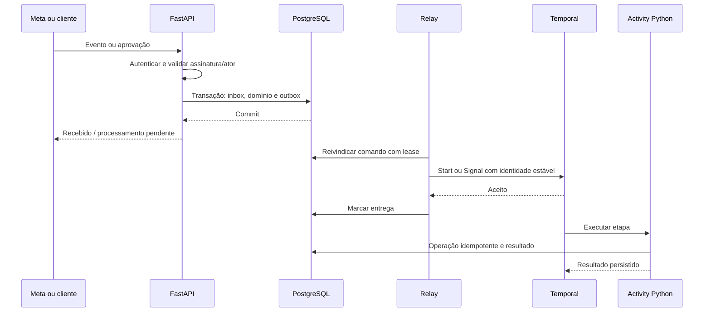
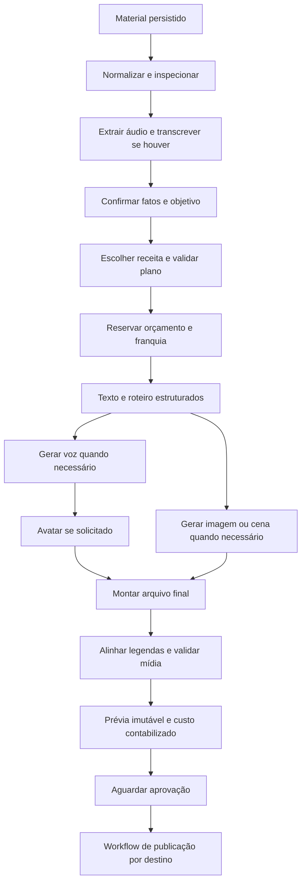
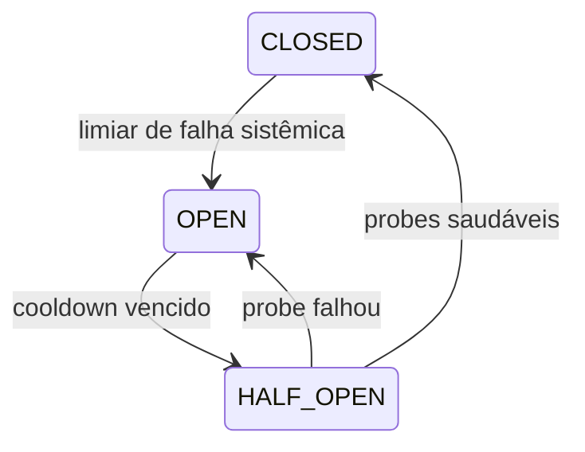

# v0 — Workflows, sagas e recuperação de falhas

Decisão: Temporal com SDK Python. Este documento substitui o runner Celery/DB
descrito na proposta v0.1. Reconciliado em 28/10/2026. Políticas abaixo são desenho/invariantes; parâmetros
ilustrativos precisam de validação por fluxo e não descrevem configuração atual
de todos os serviços ou limites universais dos fornecedores. O [SDD](../SDD.md),
a [fase ativa](../phases/BL04-context-and-ai-production.md) e as
[decisões](../DECISIONS.md) prevalecem.

Contrato obrigatório complementar: [idempotência, atomicidade, concorrência e logs](v0-consistency-observability.md).

## 1. Autoridade de execução e identidade

Temporal coordena; activities executam IO e efeitos. Código de workflow não consulta
banco, API, relógio externo ou random não determinístico diretamente. Chamadas a IA
são activities; replay lê resultados registrados, não gera novo roteiro.

A tabela seguinte é conceitual para a evolução; esses nomes não são uma lista
de workflows registrados no runtime. Os workflows locais efetivos e o visual
separado/desconectado são descritos na fase ativa e nos entrypoints. Avatar,
proatividade, relatório e encerramento ainda são entregas futuras.

| Workflow conceitual | Identidade lógica proposta | Escopo futuro |
| --- | --- | --- |
| `IngestRequestWorkflow` | `ingest/{tenant}/{request_id}` | Agrupar material, normalizar e montar briefing |
| `ContentProductionWorkflow` | `content/{tenant}/{version_id}` | Planejar, reservar, gerar, montar e apresentar prévia |
| `PublicationWorkflow` | `publish/{tenant}/{publication_id}` | Esperar aprovação/horário, publicar e reconciliar |
| `AvatarEnrollmentWorkflow` | `avatar/{tenant}/{enrollment_id}` | Captura, consentimento, treino e prontidão |
| `ProactivePlanningWorkflow` | `ideas/{tenant}/{business}/{local_date}` | Encontrar lacuna e propor conteúdo |
| `WeeklyReportWorkflow` | `report/{tenant}/{business}/{week_start}` | Coletar e enviar relatório reproduzível |
| `PrivacyDeletionWorkflow` | `delete/{tenant}/{request_id}` | Revogar, excluir e registrar resultados por fornecedor |
| `BillingReconciliationWorkflow` | `billing/{tenant}/{period}` | Conciliar eventos, concessões e saldo |

Revisão produz novo version_id e novo workflow, sem resetar o histórico aprovado.
Não reusar workflow_id de operação concluída para fingir retry novo. Configurar
política de conflito/reuso conforme SDK e testar duplicação de starts. Reinício de
worker preserva a execução; restart do workflow não é o mecanismo usual de retry.

Estado de negócio projetado inclui workflow_id, run_id, última etapa e timestamps;
console consulta essa projeção e links autorizados para diagnóstico. Tokens e mídia
não entram nos argumentos/histórico; payload converter/codec protegido para dados
sensíveis inevitáveis. Histórico possui retenção e não é arquivo eterno de auditoria.

## 2. Travessia confiável HTTP → PostgreSQL → Temporal

Se relay cai após Signal e antes de marcar entrega, pode reenviar. Signal contém
command_id; workflow deduplica, e activity de domínio revalida operação única. Não
guardar lista ilimitada de IDs num workflow eterno. Fluxos são limitados e IDs
relevantes também ficam no DB. Start repetido com mesmo ID não abre segunda execução.

Callback recebido antes do ID externo ser associado fica na inbox não correlacionada
para reconciliação posterior. Webhook confirma somente depois de persistência. Se
workflow já terminou, reconciliador trata evento tardio sem reiniciar geração/publicação.
Mapeamento de callback sempre verifica provider_account e operação do tenant; ID
externo vindo do payload não é autorização de acesso.

## 3. DAG conceitual da produção futura

Esse desenho não descreve a integração atual: imagem real não está conectada e
avatar/voz ficam após o piloto. Foto/story iniciais não habilitam todas as receitas.

É um DAG, não obrigatoriamente uma sequência linear. Arte não exige transcrição;
vídeo real não exige avatar; imagem/cena e voz podem executar em paralelo. Publicação
não precisa esperar relatório. Dependências são declaradas pela receita validada.
No DAG, legenda pode exigir render intermediário só de fala e depois mux final;
implementar pipeline sem transcrever repetidamente o mesmo áudio final.

## 4. Matriz de etapas, retry e compensação

| Etapa | Idempotência/checkpoint | Recuperação | Compensação verdadeira |
| --- | --- | --- | --- |
| Persistir entrada | inbox e ID da mensagem únicos | Reprocessar evento salvo | Nenhuma; manter entrada |
| Download/extração | asset_id, checksum e output_key | Retomar ou refazer conversão | Limpar temporários órfãos |
| Transcrição | operation_key por áudio/modelo | Reusar resultado; repetir com orçamento se status conhecido | Não há estorno garantido da API |
| Planejamento e texto | versão, fatos, prompt e modelo registrados | Corrigir fatos ou reexecutar etapa falha | Não apagar fatos confirmados |
| Reservar franquia/custo | reserva única e débito transacional | Conciliar reserva/consumo | Liberar só parte não consumida e sem resultado incerto |
| Gerar voz/imagem | registro de operação antes do envio | Reusar arquivo; timeout incerto tem política financeira | Não desfaz gasto já realizado |
| Submit avatar/cena | operation_id e external_id quando conhecido | Consultar job; UNKNOWN sem ID exige reconciliação | Cancelar job só se API provar suporte; não presumir reembolso |
| Render | render_key e escrita temporária | Reutilizar saída íntegra ou refazer | Excluir temporário, não original do cliente |
| Enviar prévia | notification_id e recibos | Atualizar/reconciliar status; evitar repetição cega | Expirar ação/token, sem apagar conteúdo aprovado |
| Aprovar/agendar | ator, hash, versão, conta, janela e row_version | Pedir nova aprovação para alterações | Revogar aprovação e cancelar antes do envio |
| Publicar | publication_id, container externo e attempts | Consultar estado em timeout | Não apagar post automaticamente; não há rollback universal |
| Coletar métrica | conta/métrica/período/captura | Retry incremental | Nenhuma; marcar coleta incompleta |
| Enviar relatório | business/week/version | Retry da mensagem, não da geração/publicação | Nenhuma |

Falha em métrica não desfaz publicação. Falha em avatar não precisa apagar transcrição
ou fotos. Saga escolhe forward recovery sempre que possível. Compensações representam
ações de negócio, não transação distribuída ilusória que apaga todos os passos anteriores.

Registrar intenção da compensação antes do efeito reversível quando aplicável,
pois efeito pode ocorrer antes de a activity retornar. Compensação precisa tolerar
“efeito nunca ocorreu” e ser idempotente. Em falha, compensar dependências em ordem
segura; LIFO serve para sequência simples, não substitui análise do DAG.

Cada compensação tem chave, motivo, estado, attempts e next_action. O workflow captura
falha de uma compensação e continua outras independentes. Falhas persistentes geram
caso de suporte `COMPENSATION_PENDING`. Cancellation solicitada executa limpeza em
escopo protegido de cancelamento quando necessário. Encerrar à força um workflow
pode impedir esse código: não usar terminate como botão normal de cancelar cliente.

## 5. Taxonomia de erros

| Classe | Exemplos | Ação |
| --- | --- | --- |
| `TransientReadError` | Timeout/502 de consulta sem efeito | Retry com backoff |
| `RateLimited` | 429 | Respeitar Retry-After, reduzir admissão e aguardar |
| `ProviderUnavailable` | 5xx em chamadas seguras | Retry limitado + breaker |
| `AuthenticationExpired` | Token de cliente expirado | NEEDS_REAUTH; não abrir breaker global |
| `InvalidInput` | Arquivo inválido, schema ou duração | Corrigir entrada; sem retry automático |
| `PolicyRejected` | Conteúdo recusado pelo fornecedor | Pedir ajuste; não contornar trocando fornecedor |
| `BudgetExceeded` | Sem franquia/orçamento | Oferecer alternativa ou aguardar autorização |
| `ExternalOutcomeUnknown` | Timeout após possível geração/publicação | Reconciliar; proibir nova operação cega |
| `ConsentRevoked` | Avatar revogado | Bloquear etapas e cancelar pendentes |
| `ApprovalExpired` | Janela/fato/oferta vencidos | Nova prévia/aprovação |

SDK pode fazer retry sozinho: configurar uma camada responsável. Cliente HTTP/SDK
não pode multiplicar tentativas em cascata com Temporal. Circuito aberto devolve
próximo horário elegível ao workflow, que usa timer; não consome tentativas de gasto.

## 6. Timeouts e retry por atividade

Valores ilustrativos do estudo original, ajustados por integração/medição; para
BL04 visual prevalece o [contrato específico](BL04-visual-temporal-execution.md).
Janela de aprovação/oferta não é retenção do arquivo: prévias devem ser preservadas
enquanto conta ativa, ainda com implementação pendente de TTL/acesso.

| Categoria | Limite da tentativa | Janela de recuperação | Política inicial |
| --- | --- | --- | --- |
| Consulta curta externa | HTTP connect 5 s, leitura até 30 s | Até 15 min | Até 5 tentativas, backoff 2–60 s com jitter |
| Submit pago | HTTP até 60 s ou limite validado do endpoint | Reconciliação até 24 h | Uma tentativa automática se idempotência não for comprovada |
| Geração síncrona longa | HTTP e activity até 180 s inicialmente | Até 24 h se ambígua | Perfil específico, orçamento e sem retry cego |
| Espera de job externo | Poll curto separado | Até 60 min inicialmente | Timer 10–60 s, limitado; expiração não prova cancelamento externo |
| Render | Até 10 min por tentativa | Até 30 min | Até 3 tentativas recuperáveis com heartbeat |
| Espera de aprovação | Sem worker bloqueado | Até 48 h ou fim da oferta | Timer durável; sem aprovação não publica |
| Publicação agendada | Steps curtos por API | Até janela aprovada | Nunca repetir submit ambíguo sem reconciliar |

Usar StartToClose, ScheduleToClose e HeartbeatTimeout conforme a activity, além dos
timeouts HTTP. Uma activity expirada pode continuar executando em processo antigo;
fencing/versionamento bloqueia commit tardio e operações externas exigem identidade
estável. Heartbeat não significa rollback remoto nem cancelamento instantâneo de FFmpeg.

Não depender de retries infinitos padrão. Configurar non-retryable error types e
políticas explícitas, especialmente em POST pago. Jitter efetivo e `Retry-After`
podem exigir timer controlado pelo workflow; não presumir suporte automático idêntico
em todas as camadas do SDK.

## 7. Circuit breaker e bulkheads

Desenho futuro de breaker no adapter/provider gateway, compartilhado entre workers,
por fornecedor +
credencial de serviço + família de operação. Erro de uma conta Instagram fica isolado
naquela conexão; não interrompe todos os clientes. Falhas comuns da API podem ter
breaker adicional da família global. Não confundir com circuit breaker interno do Temporal.

Política inicial: janela móvel de 60 s, mínimo de 20 chamadas e 50% de falhas sistêmicas,
ou cinco falhas sistêmicas consecutivas; abrir 30 s. Um lease atômico permite um probe
por breaker; fechar após dois probes saudáveis. Falha dobra cooldown até 5 min.
Esses parâmetros são nossos e precisam de teste, não são defaults garantidos de biblioteca.

Contar timeout/5xx apropriados; 400 de conteúdo não sinaliza indisponibilidade.
429 usa rate limiter/cooldown, sem poluir o mesmo indicador de falha sistêmica.
Bulkhead é limite de operações simultâneas por provedor/família/tenant, independente
do breaker. Timeouts/retries têm orçamento agregado para evitar tempestade.

Redis não é dependência atual. Se for adotado, usar operações atômicas e leases.
TTL de slot deve cobrir job e renovação;
slot local não representa cancelamento remoto. No recovery após perda de Redis,
reconstruir operações em voo do ledger antes de liberar concorrência paga. Enquanto
não houver coordenação confiável, pausar novos submits pagos e publicações, permitindo
recepção e consulta com limites conservadores. Escopo financeiro é validado no DB.

## 8. Operações externas e dinheiro

Estados: `CREATED → RESERVED → SUBMITTING → ACCEPTED → SUCCEEDED`, com alternativas
`FAILED_KNOWN`, `UNKNOWN`, `CANCEL_REQUESTED`, `CANCELLED_CONFIRMED`.
Persistir antes do HTTP que pode gerar gasto. Resultado retornado entra em transação
idempotente. Crash depois do efeito e antes de salvar continua possível: Temporal
não oferece exactly-once para API externa sem contrato correspondente.

Se fornecedor aceitar idempotency key, usar operação estável e retenção compatível.
Se aceitar referência de correlação, consultar por ela. Sem ambos e sem external_id,
não é possível provar automaticamente se houve efeito; classificar UNKNOWN e
revisar. Em geração barata pode existir política explícita de repetição com risco
financeiro aceito e teto; em publicação, a política inicial é não reenviar às cegas.

Quota comercial e custo real do fornecedor são ledgers distintos. Liberar franquia
ao cliente por falha não apaga custo externo já cobrado. Reserva em UNKNOWN permanece
retida ou coberta por conta de exposição até decisão de conciliação; expiração da
reserva sozinha não deve liberar novo gasto para a mesma operação.

## 9. Aprovação, cancelamento e revalidação

O aceite único substitui permissões de texto/imagem/interpretação/transcrição por
fornecedor. Mudanças de fontes aguardam criação admitida e bloqueiam novos inícios;
cobertura é parcial no fake. Plano vencendo depois do início permite terminar e
revisar, bloqueando novos trabalhos/publicação até renovar. Prévias são preservadas
enquanto conta ativa; esses comportamentos ainda precisam de implementação.
Somente staff poderá recuperar pendência do autor sem acesso, com ação restrita
e auditada; não transferir autoria para outro owner. Encerramento da conta fica
para sua fase, sem introduzir exclusão automática agora.

Aprovação associa ator autorizado, consentimento vigente, versão, hashes, conta,
legenda e janela. Preferir ação com ID assinado de uso único. “OK” textual só vale
se a conversa resolver inequivocamente a prévia; caso contrário, esclarecer.

HTTP grava aprovação e comando de outbox; Signal acorda workflow, mas a activity
consulta autorização no DB antes de publicar. Signal não concede permissão por si.
Revogação, expiração e cancelamento usam controle otimista/transacional. Após enviar
à API externa existe janela inevitável de corrida: cancelamento solicitado pode
virar aviso/ação posterior, sem prometer impedir efeito já em andamento.

## 10. Operação e testes obrigatórios

Painel: timeline de etapas, tentativas, tempos, custo, último erro, IDs externos e
ações permitidas. Ações: retry seguro da etapa, reconciliar, pedir novo material,
reautenticar, cancelar, executar compensação, pausar provedor ou escalar suporte.
Todas são comandos autenticados/auditados; suporte não edita estados arbitrários.

Testar: duplicata e reorder; outbox após queda; submit ambíguo; callback antes da
correlação; worker morto; lease vencido; quota concorrente; rede fora; revogação;
cancelamento competindo com publicação; falha de compensação; Redis perdido; restore
DB/Temporal defasado; replay com nova versão. Usar time-skipping do ambiente de teste
Temporal quando aplicável para aprovação/agendamento; isso não mede latência real.

Deploy de workflow exige replay do histórico representativo e estratégia de worker
versioning/patching antes de trocar código. Rollback de imagem não garante replay
compatível. CI e runbook devem provar migração de execução ativa.

Fontes: [Temporal tasks](https://docs.temporal.io/tasks),
[SDK Python](https://python.temporal.io/),
[mensagens](https://docs.temporal.io/develop/python/workflows/message-passing),
[saga na documentação oficial](https://github.com/temporalio/documentation/blob/main/docs/design-patterns/saga-pattern.mdx).

Versão anterior à reconciliação: [snapshot integral de 28/10/2026](../history/2026-10-28-pre-documentation-reconciliation/design/v0-reliability.md).
