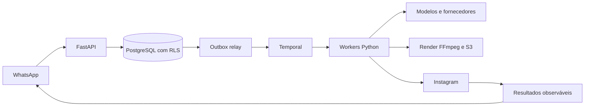

# SDD geral — Plataforma de conteúdo

**Navegação vigente P1–P8 (27/10/2026):** a entrada principal de pedidos é o
WhatsApp. O menu **WhatsApp** mantém configuração/vínculo e consentimentos,
com histórico secundário dos envios temporários. A BL03 acrescentará acervo
durável em **Sobre meu negócio**. As duas fontes têm retenção e finalidade
distintas; esta mudança não remove inbox, eventos, assets, transcrições,
exclusão ou processamento de materiais no backend.

`/app/content` é a área de acompanhamento e revisão de conteúdos; o endereço
legado `/app/ideas` redireciona para ela. A sequência manual de ideia,
roteiro, aceite intermediário e render fica acessível para ensaio técnico
em `/app/editorial-lab`, apenas no build de desenvolvimento. A experiência
principal não exige operar essa sequência. APIs e versões de propostas,
roteiros, prévias e decisões são preservadas, pois também sustentam o fluxo
automático. Textos datados abaixo mantêm o histórico das entregas anteriores;
não representam autorização para excluir o domínio editorial ou seus dados.

O resumo passa a **Início**. A página estática Primeiros passos é removida e
`/app/guide` redireciona para `/app`; as orientações usam estados reais do perfil.
Telefone sai do menu permanente e integra a configuração de WhatsApp, mantendo
correção/SMS e a rota utilitária. Consentimento de IA fica em Sobre meu negócio.
Um provider web compartilha organização/negócio ativos entre contexto, kits,
conteúdos, WhatsApp, telefone e plano; estado de autenticação continua em memória
e autorização no backend. O campo manual de frequência é retirado; o valor
histórico continua no contrato até cadência por formato/plano em F03/F07.

**Limpeza autorizada P9–P12:** remover `billing_outbox` por uma migração nova
que primeiro preserve eventos faltantes em `billing_audit`; jobs de cobrança,
Stripe, auditoria e reconciliação continuam. Remover helper de identidade sem
chamadas, stub de seed aposentado e declaração de volume Keycloak sem serviço;
não alterar usuários/IDs nem apagar volumes Docker. A aprovação é pontual e
não inclui os workflows de recibo do CRUD ou as tabelas gerais de outbox.
O [relatório de auditoria](audits/product-flow-and-ai-2026-10-27.md) diferencia
candidatos de remoção, infraestrutura necessária e capacidades ainda faltantes.

27/10/2026 — **Ordem vigente:** BL01 vitrine piloto local (entregue
tecnicamente), BL02 seleção e edição guiada do kit por formato, BL03 acervo
privado e progressivo em “Sobre meu negócio”, BL04 recuperação automática do
contexto e primeira peça nova com gate de qualidade/custo, BL05 jornada
WhatsApp local com ajuste, aprovação e proatividade, BL06 expansão para
manicure/personal e catálogo público em objetos/CDN. Esta sequência substitui
a numeração BL02/BL03/BL04/BL04.5 usada em registros de 26/10. Ver
[trilha BL](phases/BL-brand-library.md) e
[índice executivo](phases/README.md).

**Implementação BL02 (27/10/2026):** a API owner-only de kit por negócio expõe
catálogo, estado, rascunho, confirmação e histórico sob
`/api/v1/organizations/{tenant_id}/businesses/{business_id}/brand-kit`.
`expected_version` faz compare-and-swap; `operation_id` retorna a resposta
original no replay e rejeita payload divergente. Documento aplicado fica em
versões imutáveis com RLS por tenant, audit e evento outbox processado pelo
Temporal. A versão pública do manifesto continua imutável. A seleção do kit
`public_demo` só é habilitada em desenvolvimento/teste; produção exige status
`approved` após gate de direitos e qualidade. Upload de logo autoriza apenas
PNG/JPEG/WebP normalizado para PNG privado, limite de 2 MiB de origem e 3 MB
no corpo HTTP; exige confirmação de direito e devolve URL temporária. Intents
pendentes antigos são reconciliados pelo proprietário, por negócio, ao novo
upload ou por rota explícita; uma varredura global fica para F08 com política
RLS própria. Não há aprovação de publicação nessa API.

F03 congela `brand_kit_version` e o documento confirmado quando cria uma
proposta nova; o worker lê esse snapshot, inclusive paleta, fontes, composição,
frase de marca e CTA. Alterar o kit depois não reescreve proposta anterior.
BL04 ainda precisa reaplicar o kit na peça visual nova; a prévia da BL02 é local
na web e não representa aprovação comercial da receita.

A biblioteca atual é um pacote local versionado copiado para a web. O kit
de cafeteria inclui três artes 4:5 com texto incorporado no JPEG e origem
fictícia rastreada. O acervo planejado em BL03 guardará produto/serviço,
foto autorizada, preço e validade com RLS, versão, idempotência e armazenamento privado.
Cadastro opcional não bloqueia pedidos de conteúdo. Fatos livres atuais não
substituem esse acervo; F03/BL04 recupera automaticamente itens ativos
pertinentes de texto ou áudio livre e F04 usa suas fontes visuais.

Na BL04, o acervo será recuperado automaticamente de mensagem ou áudio livre:
F03 identificará o produto/serviço citado e consultará itens/fotos autorizados
daquele negócio, sem exigir escolha manual. F04 receberá foto do produto e,
quando a peça pretender mostrar o local físico, foto real do ambiente como
base da edição. Referências e versões entrarão no snapshot; fidelidade visual
e fatos vigentes serão revalidados antes da aprovação.

26/10/2026 — O kit público inclui seis cenários de entrada para mostrar a
diferença entre mensagem, material de origem e proposta. A vitrine é fictícia
e não afirma que o vídeo demonstrativo foi feito a partir de um clipe do
cliente. Na produção real, um café físico exige mídia própria/autorizada para
retratar o local; foto de prato/embalagem precisa manter o produto fiel. Sem
foto, IA pode ajudar a compor uma arte conceitual, mas não representar
local/produto inventado como real. O mesmo gate vale para delivery, que pode
usar fundo neutro sem mudar comida/embalagem. Ver
[biblioteca visual](design/brand-library.md).

A sequência de 26/10 que colocava três kits antes da escolha foi substituída
pela ordem acima. Primeiro o negócio precisa aplicar e editar o kit piloto,
depois registrar seu acervo e provar uma peça nova no mesmo estilo. Em
qualquer rota de IA, o briefing contém o manifesto e **zero ou uma imagem de
referência do kit da mesma receita/formato**; material real do cliente é uma
entrada distinta. Navegar na vitrine não gera conteúdo por visitante.

O [planejamento explicável](design/editorial-planning-and-evidence.md) separa
teto pago e cadência sugerida: cliente aprova o ritmo dentro da franquia, vê
motivo e incerteza de cada recomendação, e só muda de plano com aceite de preço.
Biblioteca publicável própria e referências observadas da concorrência são
acervos distintos; não copiar material de terceiros para os kits.

Na produção personalizada, F03/F04 resolvem a
[versão aprovada do kit](design/brand-library.md#produção-e-custo) e usam suas
receitas, regras de estilo e exemplos pertinentes junto ao contexto factual do
negócio. A galeria inteira não acompanha cada pedido; imagens de referência
podem aumentar tokens de entrada. A hipótese de menor custo depende de menos
falhas/revisões e precisa de comparação controlada por **peça aceita**, além de
impedir que a marca fictícia da vitrine apareça no conteúdo do cliente.

O [showroom do kit visual](design/brand-library.md#simulação-da-presença-futura)
carrega **arquivos pré-produzidos do catálogo**, iguais para todos os visitantes:
dez posts por kit, stories, reels e exemplos de conversa ou dia sem mensagem,
com marca fictícia. O simulador de Instagram/Facebook/TikTok fica **dentro da
nossa web** e não acessa a conta pessoal do cliente. A seleção não chama IA
visual nem exige materiais dele; F03 registra `kit_id/version`. Só a produção
posterior com contexto real aciona F04 e seus custos/gates. O primeiro kit
fictício agora tem manifesto, dez posts, dois stories e reel MP4, servidos como
arquivos versionados na web. `/kits` é público e `/app/kits` mantém a mesma
vitrine para clientes. A API de catálogo e escolha por negócio está implementada localmente; o gate
comercial bloqueia o kit `public_demo` em produção. Onboarding/checkout não são bloqueados por
plano; a API autorizará produção/publicação por capacidade contratada.

Atualização de produto (26/10/2026): [biblioteca de identidade e formatos](design/brand-library.md).
O negócio que não tem kit visual verá até três kits prontos da nossa biblioteca
quando BL06 ampliar o catálogo; hoje existe um kit piloto. Em BL02, escolhe
uma direção e pode editar cores, fontes, logo, textos e composição guiada de
feed, story e capa vertical. F03 persiste a escolha; F04
aplica receitas versionadas e testa composição local contra geração/edição por IA
para cada tipo de material, sob o mesmo gate de fidelidade e qualidade. Esta
decisão de **roteamento por evidência** refina a prioridade anterior de IA visual
para toda peça nova: IA permanece essencial onde cria valor, mas uma foto real
boa com layout aprovado pode ser composta localmente se o resultado for aceito.
Kit aprovado não aprova publicação; F06 pede aceite da peça final. A escolha
está integrada ao briefing F03; aplicação visual e roteamento de receitas em
F04 continuam pendentes, além da validação comercial.

Promessa central reafirmada em 26/10/2026: **o cliente contrata uma presença
digital útil e constante para atrair contatos e clientes, não acesso a um editor
de IA**. A jornada principal funciona quando ele envia ideia/mídia pelo WhatsApp
**e quando não envia nada novo**: contexto e materiais autorizados existentes,
preferências, fatos vigentes e cadência geram proposta proativa; ele recebe uma
prévia curta para aprovar/ajustar. Ausência de resposta não é aprovação. A
qualidade da peça e sinais observáveis de interesse (contatos, cliques, visitas,
mensagens quando disponíveis) orientam a melhoria; alcance não comprova venda.
Proatividade mínima de F03 entra antes do primeiro piloto comercial, não depois
do lançamento. Ver [F03](phases/F03-editorial-research.md) e
[ordem atualizada](phases/README.md).

Decisão de produto (26/10/2026): o percurso principal de novas peças deve usar
**geração visual por IA**, com briefing automático de contexto/kit de marca,
material autorizado, fato e CTA. F04 recebe a peça completa ou uma edição da
fonte; valida texto e fidelidade, oferece revisão e usa compositor local apenas
para acabamento/preservação. O produto ainda não implementa essa integração:
OpenAI é usado só para sugestão/roteiro, enquanto Pillow/FFmpeg fazem as prévias.
Vídeo generativo e avatar exigem orçamento e consentimento próprios. Ver
[plano criativo](design/creative-production-quality.md).

Ensaio de 26/10/2026: IA visual criou conceito privado a partir de foto CC0.
A primeira chamada direta falhou por saldo; após recarga, medimos uma edição
simples e um [eval de contexto completo](evals/visual-context-eval-v1.md) com
perfil fictício, kit de marca, catálogo, foto, logo e fatos vigentes. O mock
recupera esses dados antes de uma chamada de imagem; as ferramentas de leitura,
o kit e o adapter ainda não estão integrados ao produto. Uma imagem visualmente
boa não comprovou texto exato, fidelidade a produto real ou custo por peça
aceita. [Evidência inicial](evals/ai-visual-spike-2026-10-26.md).

Decisão de qualidade em 26/10/2026: as prévias Pillow/FFmpeg são demonstrações
técnicas e não satisfazem o padrão de publicação. A IA atual gera texto, não
imagem/vídeo visualmente novos. A sequência prioriza inspeção visual da fonte,
kit de marca, briefing versionado e comparação de edição local com IA visual
antes de ampliar formatos ou prometer frequência diária. F04 só libera uma
receita após aprovação humana e custo por peça aceita medido dentro do teto
mensal; F05/avatar tem gate próprio. Contratos e ordem em
[plano de qualidade criativa](design/creative-production-quality.md).

22/10/2026 — Produto renomeado para **Meu Braço Direito**. Diretórios e remotos
Git permanecem `local-spark-platform`/`local-spark-web`; os pacotes, Compose,
variáveis `MEU_BRACO_DIREITO_`, bancos e roles usam os identificadores novos.
A migração `0015_product_brand` precede a correlação WhatsApp, preserva IDs,
senhas/MFA e permissões, atualiza as duas identidades de demonstração e congela
as chaves Stripe de checkouts anteriores. Contas existentes conservam suas senhas;
as senhas de exemplo abaixo valem para instalações novas. Instruções e exceções
de compatibilidade em [renomeação do produto](product-rename.md).

Versão 1.2, 23/10/2026. Resumo implementável e índice das especificações detalhadas.

Decisão experimental em 26/10/2026: PhotoCraft e FilmCraft foram testados
localmente como motores opcionais de edição; o primeiro montou uma story privada
e o segundo exportou MP4 vertical. Nenhuma IA visual foi chamada e o resultado
não passou por revisão da proprietária. A receita F04 deve classificar arte já
finalizada, escolher composição por material/contexto e validar visualmente a
saída. O uso de editores locais é candidato, não troca de motor aprovada. Meta
de negócio para plano de R$ 99: custo mensal total por cliente <= R$ 50,
incluindo cobrança, mensageria, IA, render, infraestrutura, retentativas,
impostos, aquisição amortizada e atendimento atribuído;
franquias só após medição real. Ver
[ensaio e limites](evals/open-source-editors-2026-10-26.md).

F04.3/F06 locais (26/10/2026): evento WhatsApp processado e vinculado inicia
workflow Temporal que pede roteiro, aguarda proposta, pede prévia candidata sem
aceite artificial do roteiro e a entrega em uma caixa simulada. Falta de fato
confirmado gera pedido de esclarecimento. A decisão final do proprietário na
API ou por comando `Aprovar`/`Pedir ajustes` está vinculada à candidata única;
aprovação guarda hash da arte, legenda, destino e horário e é revalidada antes
de uma publicação **falsa**. Replay/tenant/RLS e resultado incerto do dispatcher
são parte do contrato. Nenhuma chamada real de WhatsApp ou Instagram é feita;
ambiguidade de comandos e ajuste solicitado ainda precisam resposta orientadora
e nova versão. A web em desenvolvimento mostra o simulador. Esta fatia técnica
não fecha os gates de qualidade/custo nem autoriza uso comercial.

Decisão de sequência em 26/10/2026: qualidade factual, criativa e visual de cada
receita é gate anterior à sua automação/publicação comercial. A prioridade atual
é concluir as avaliações e correções de F03.3b/F04.1b/F04.2b com negócios
consentidos e custo medido; depois F04.3 entrega a candidata no WhatsApp e F06
exercita aprovação/publicação com adapter fake. F05 e os demais formatos podem
vir após o primeiro percurso validado, sem reduzir o padrão de qualidade de
nenhuma receita ativada. A restrição da conta Meta não bloqueia desenvolvimento
local; WhatsApp e Instagram reais exigem homologação antes de clientes reais.
Ver [ordem e gates atuais](phases/README.md#qualidade-por-etapa-e-dependência-da-meta).

F04.1b em andamento (26/10/2026): ajuste visual de foto/story cria versão
privada vinculada à anterior, sem editar fato ou roteiro, com até quatro versões
e controle de concorrência. A web solicita e acompanha o ajuste. Um avaliador
de revisões humanas consentidas calcula os gates do piloto; ainda faltam
amostra real e medição de custo em staging. Ver [F04](phases/F04-media-recipes.md).

F04.1b em andamento (25/10/2026): template estático v4 conserva a foto inteira,
usa fundo desfocado apenas como preenchimento e fato em painel opaco; contraste
da marca é calculado. Corpus sintético PT-BR, folha de contato e CSV de revisão
permitem comparar versões localmente. O gate de 20 peças consentidas, revisão
com comerciantes, custo em staging e ajuste visual versionado ainda não passou.
Nenhuma peça está aprovada para publicação por essa mudança. Ver [F04](phases/F04-media-recipes.md).

F04.1 local (25/10/2026): a proposta F03.3 `completed` e `accepted` pode gerar
uma prévia estática JPEG (`photo`/`story`) após revalidar plano, versão do contexto,
fato, fonte e consentimento de IA externa. A solicitação é idempotente por
`operation_id` e `render_key` e o Temporal executa sob lease/fencing com até três
tentativas. O objeto fica privado; o proprietário recebe apenas link temporário.
Exclusão/expiração de fonte ou roteiro ocultam a prévia e acionam limpeza
assíncrona antes de remover o registro. Não existe aceite de peça, agenda ou
publicação nesta fatia. Ver [F04](phases/F04-media-recipes.md).

F04.2 local (25/10/2026): roteiro `short_video` aceito usa o mesmo fluxo
durável para renderizar MP4 H.264 privado de 1080×1920 e oito segundos com foto
ou trecho inicial de clipe autorizado e texto de cenas temporizado. O áudio
original do clipe é removido; voz e legenda sincronizada com fala não são
suportadas nesta primeira receita. A API informa tipo/duração; a web reproduz a
prévia sem publicar. F04.3 continua responsável pela automação e envio no
WhatsApp. Ver [F04](phases/F04-media-recipes.md).

F03.3b local (25/10/2026): edição de roteiro pelo proprietário usa operação
idempotente, versão esperada e documentos append-only sob RLS. O serviço mantém
proveniência de cenas e fato confirmado vigente, bloqueia padrões explícitos
de preço/promoção/garantia sem confirmação e zera o aceite ao editar. Cada prévia carrega a
versão do roteiro; a API deixa de listar/abrir versões antigas. A avaliação
humana de utilidade, clareza e custo por roteiro aceito ainda não passou pelo
gate de piloto. Há dez casos sintéticos e planilha de avaliação para iniciar
esse processo, sem afirmar qualidade comercial. Ver [F03](phases/F03-editorial-research.md).

Sequência de entrega atual em [fases](phases/README.md): F03.3 transforma material
F02 em roteiro de cenas com fontes e revisão local; falta avaliação de qualidade
comercial. F04.1 renderiza a primeira peça estática e F06 exercita
aprovação/agendamento/publicação com adapter fake. F05/avatares não bloqueiam
posts com foto/vídeo reais. Credenciais e homologação Meta são posteriores aos
testes locais, mas obrigatórias antes de operar com clientes reais. Ideias F03.2a
existem; qualidade comercial ainda não está aprovada.

Percurso principal planejado: após receber material e confirmar separadamente
fatos comerciais, F04.3 orquestra roteiro validado e prévia e os entrega pelo
WhatsApp, sem exigir que o cliente entre na web ou aceite manualmente o roteiro
para renderizar uma candidata. F06 colhe aprovação explícita da **peça final**
com versão/hash, legenda, destino e horário antes de publicar; "Confirmar" da
F02 não equivale a "Aprovar" da F06. Web continua alternativa. F03.3b entrega
edição/versionamento e avaliação de roteiros; F04.1b avalia e melhora a qualidade
visual das artes com amostra consentida; F04.2b evolui a narrativa, edição e
qualidade dos vídeos. A ordem após F04.2 é F03.3b → F04.1b → F04.2b → F04.3.
Esses gates são obrigatórios antes do piloto comercial; a edição técnica de
F03.3b e a primeira revisão de template/avaliação sintética F04.1b já existem,
sem aprovação de qualidade com negócios reais.

F04.2b iniciou sua fatia técnica: MP4 privado v3 usa os textos de abertura/CTA
do roteiro aceito, a foto real completa e dois cortes quando o clipe autorizado
comporta. O proprietário pode pedir revisão privada e idempotente do ritmo,
mantendo fato/roteiro e até quatro versões. Avaliação humana e custo real,
edição avançada e sincronização de fala/legenda seguem pendentes; a receita
continua sem áudio para evitar legenda falsa.

F04.2b avançou tecnicamente para vídeo v4 (26/10/2026): quadros horizontais e
verticais aparecem inteiros sobre fundo desfocado, sem cortar o assunto nas
bordas. Quatro casos sintéticos PT-BR e um avaliador de CSV consentido medem
qualidade no celular e separam resultado técnico de gate comercial. O worker
registra tempo, CPU e bytes locais, mas custo real em staging, revisão com
comerciantes e escolha semântica de trechos continuam pendentes. Ver [F04](phases/F04-media-recipes.md).

F02.2c6 diferencia resposta aceita pela Meta de recibo `sent`/`failed`/`delivered`/`read`, correlacionado pelo ID do provedor na inbox cifrada. Confirmação/descarte prepara uma resposta curta na transação da decisão; envio e recibo usam estados próprios. O dispatcher reserva tentativas sob teto diário por organização e bloqueio transacional; sem teto positivo, não habilita envio. Staff vê apenas metadados de falhas/incertezas e pode registrar revisão sem reenviar. O smoke externo, o valor monetário por mensagem e o opt-out explícito permanecem pendentes em [F02](phases/F02-whatsapp-ingestion.md).

F02.2c5 grava resposta cifrada na transação da decisão e só habilita envio Cloud
API com chave explícita. Estados distinguem pendente, submetendo, aceito pela API,
falha, prazo vencido e resultado incerto; este último não tem retry automático.
Aceite/descarte inbound usa `context.id` do prompt aceito ou exige uma única
proposta aceita nos últimos 30 minutos para o mesmo remetente e negócio. Recibos de entrega, reconciliação de
incertos e custo de mensagens seguem pendentes em [F02](phases/F02-whatsapp-ingestion.md).

F02.2c4 liga mensagens de texto vinculadas à decisão editorial no commit do
material processado: evento WhatsApp = operação idempotente, proprietário do
vínculo = ator, data local do negócio = validade da proposta. O proprietário
lista e decide pela API; o simulador continua local. Resposta no canal, comandos
de aceite via WhatsApp e LLM de texto livre permanecem em [F02](phases/F02-whatsapp-ingestion.md).

F02 inicia o assistente editorial por simulação local autenticada: mensagem e
`operation_id` entram em decisão durável por tenant/negócio; classificador
determinístico propõe preço ou horário de hoje e abstém-se em outros textos.
Confirmação do proprietário insere fato válido até a data local no contexto
versionado em transação; descarte não o altera. A tabela conserva hash e proposta
estruturada, não o texto integral. API disponível apenas em development/testing.
A ligação à inbox entrou na F02.2c4. Envio por outbox, LLM avaliada e publicação
permanecem em recortes posteriores de [F02](phases/F02-whatsapp-ingestion.md).

F03.2b bloqueia geração quando nenhum fato válido foi confirmado, inclusive se
um material foi recebido; não consome quota nem chama o modelo nesse caso.
F03.2c iniciou uma projeção administrativa auditada por pedido editorial: estado,
IDs, versões, tokens e erro. A API nunca devolve rascunho, prompt ou material
nesse endpoint; custo em moeda é nulo até existir tarifa versionada. O percurso
completo, feedback e custo por etapa ainda estão no plano F03.2c.
Uma segunda fatia correlaciona novos eventos ao ID interno do pedido, preservando
o vínculo com o `operation_id` externo, e
mostra suas etapas reais ao operador; eventos legados podem estar incompletos.
O resultado da avaliação F03.2b é **no-go comercial**: título e ângulo são
derivados deterministicamente de fato confirmado; formato, hipóteses e perguntas
do modelo continuam apenas para revisão. Revalidação semântica e staging são
gates antes de clientes reais.

F03.2c planeja personalização com contexto/fatos/feedback isolados por negócio,
sem treino automático por tenant ou reutilização cruzada de mensagens. Antes do
piloto, admin precisa ver a cadeia operacional e o custo por etapa; conteúdo
integral requer acesso separado, limitado e auditado. Ver [F03](phases/F03-editorial-research.md).

F03.2b avaliou o provedor com casos sintéticos e decidiu não ativar coorte
comercial. O contrato factual foi endurecido; comparação e revisão por coorte
continuam como gates do piloto. Ver [F03](phases/F03-editorial-research.md).

F03.1 entrega o contexto editorial confirmado pelo proprietário: fatos com origem
declarada e validade, preferências separadas, versões imutáveis, CAS/idempotência,
histórico/restauração, auditoria e RLS por negócio. A área do cliente edita e
restaura versões. Hipóteses continuam vazias e não há LLM interpretando as
mensagens ou gerando conteúdo nesta fatia. Ver [F03](phases/F03-editorial-research.md).

F03.2a acrescenta sugestões editoriais sob pedido do proprietário: snapshot
versionado, material opcional, baseline local, provedor OpenAI opt-in com quota
reservada antes da chamada, estado incerto sem retry pago e revisão na área do
cliente. Hipóteses não alteram fatos; não há publicação, pesquisa externa ou
interpretação automática de todo WhatsApp. Contratos, pendências de avaliação
e ativação em [F03](phases/F03-editorial-research.md).

F02.2c3a acrescenta `group_id` determinístico por tenant, negócio, remetente e
janela fixa de dez minutos, persistido na fila e no asset. A biblioteca mostra
materiais relacionados sem unir negócios ou depender da ordem dos workers.
Itens antigos formam grupos unitários. F02.2c3b implementou transcrição de áudio
com provedor configurado, reserva de orçamento, ledger e estado incerto; F03
tratará interpretação semântica e confirmação de fatos. Não há LLM/Jev/harness
interpretando mensagens agora. Ver [F02](phases/F02-whatsapp-ingestion.md).

F02.2c3b implementa transcrição opcional com `gpt-transcribe`, WAV normalizado,
limite de 180 s, reserva diária por tenant antes da chamada, ledger de segundos,
texto cifrado e reconciliação de submissões incertas sem repetir cobrança.
O envio à OpenAI exige consentimento separado por negócio; aceite antigo de
material não autoriza transcrição.
Transcrição não confirma fatos nem interpreta intenção; isso permanece F03.

F02.2c2 registra a tentativa de mídia antes do upload S3. Uma chave exclusiva
por tentativa e uma intenção transacional permitem reconciliar arquivos quando o
commit do material falha; limpeza com lease/fencing e retry roda no dispatcher.
Não há exposição de tentativas incompletas ao cliente. Agrupamento/transcrição
ficam em F02.2c3; operação real aguarda WABA liberada e smoke em staging.
Ver [F02](phases/F02-whatsapp-ingestion.md).

F02.2c1 adiciona prazo inicial de 30 dias e pedido de exclusão por proprietário,
com limpeza periódica de inbox/fila vencidas e remoção S3 por lease/fencing. Links
novos são bloqueados após o pedido; os já assinados vencem em até dois minutos.
F02.2c2 cobre objetos órfãos após upload sem commit; agrupamento e transcrição
continuam pendentes.
Ver [F02](phases/F02-whatsapp-ingestion.md).

O app/WABA sandbox Meta agora existe, mas o smoke ponta a ponta continua pendente:
handshake HTTPS e POST sintético assinado passaram; envio de teste retornou status
`failed`/`131031` (`Business Account locked`) e a inbox local ainda não recebeu
eventos reais. O painel de Qualidade da Conta exige verificação da empresa para
essa WABA e informa restrição permanente a início/resposta de conversas e adição
de números. Após o processo Meta, confirmar a remoção da restrição e a inscrição
do app na WABA.
Não interpretar o check de configuração do webhook como entrega homologada.

F02.2b1 entregue localmente: processo de correlação com login exclusivo associa
mensagens posteriores ao vínculo ao tenant/negócio, grava ciphertext numa fila
durável com retenção de sete dias e audita em transação. F02.2b2 foi
validada localmente: dispatcher e Temporal consomem a fila com identidade durável,
retry e fencing, revalidam consentimento/vínculo/plano, guardam texto e mídia em
biblioteca S3 privada e expõem conexão/recibos ao proprietário na web. Meta real,
transcrição, respostas e geração seguem pendentes; a reconciliação de uploads
órfãos entrou em F02.2c2.
Ver [F02](phases/F02-whatsapp-ingestion.md).

CI da F02 usa login Meta restrito e URL explícita para o mesmo banco `_test` dos
demais papéis. No Actions a porta é 5432; o exemplo local usa 55432. Pytest em
CI rejeita configuração incompleta antes de executar testes. A próxima fatia
F02.2b correlaciona eventos ao vínculo e os encaminha com identidade durável;
o vínculo isolado de F02.2a ainda não processa conteúdo.

F02.2a entregue localmente: vínculo WhatsApp requer dono autenticado, telefone
verificado, acesso ativo e mensagem com código único recebida do mesmo número
via webhook assinado. Desafio expira e é de uso único; troca do telefone revoga
o vínculo. Ingestão, vínculo e processamento são fronteiras distintas: a inbox
continua em quarentena até F02.2b criar correlação, outbox e workflows. Ver
[F02](phases/F02-whatsapp-ingestion.md). UI e smoke Meta real pendentes.

F02.1 entregue localmente: webhook WhatsApp Cloud API com handshake, HMAC do corpo
bruto, limite de 256 KiB e inbox criptografada/deduplicada em login próprio com RLS.
Mensagens ainda ficam em quarentena sem vínculo verificado ao negócio; não há
download, transcrição, resposta ou workflow de conteúdo. Ver
[F02](phases/F02-whatsapp-ingestion.md). Configuração Meta permanece desabilitada
até existirem App/WABA/número/chaves; teste real e restante de F02.2 pendentes.

F01.6: o billing worker agenda reconciliação canônica periódica de checkouts abertos
sem acesso pago, com jobs duráveis e dedupe por janela de cinco minutos; o webhook
continua sendo o caminho imediato. Convites de operadores têm token de uso único,
expiração de 48 horas, e-mail criptografado na outbox, MFA próprio e revogação de
sessões. Verificação do telefone do negócio usa Twilio Verify configurável, limite
de solicitações/tentativas e só grava `phone_verified=true` após aprovação do
provedor. O envio está desativado localmente até haver conta; staging AWS ainda
não foi criado.

Nome adotado: Meu Braço Direito; repositórios `local-spark-platform`, `local-spark-web`
e `local-spark-infra`. Configuração Python utiliza `MEU_BRACO_DIREITO_`; PostgreSQL usa
identificadores com underscore (`meu_braco_direito_platform`, roles `meu_braco_direito_*`).
Credenciais de exemplo são exclusivas de desenvolvimento; tokens locais anteriores
à troca de nome/assinatura precisam ser reemitidos. Nenhuma credencial de produção
é provisionada pelo Compose. PostgreSQL e o histórico Temporal de desenvolvimento
possuem volumes nomeados próprios; isso não equivale a persistência/HA de produção.
Debug local da API via VS Code utiliza `.venv`, `.env` e Uvicorn factory sem reload;
prelaunch libera a porta 8000 parando a API Docker e inicia dependências locais.
Credenciais permanecem no `.env`, sem valores de conexão nos arquivos do editor.
No macOS, pré-tarefas resolvem Docker Desktop por caminho absoluto e incluem seu
diretório no PATH para plugins/helpers, independentemente do PATH herdado pelo editor.
Contrato de versionamento: incluir código/testes, migrations, `uv.lock`, exemplos
sem credenciais de produção, CI, documentação e debug compartilhado; excluir
segredos, dados locais e artefatos de execução por `.gitignore`.
Auth local aceita localhost/127.0.0.1 na mesma porta/protocolo da origem web
configurada, somente em development/testing. Staging/production mantêm origem
exata; links de e-mail continuam canônicos e cookies host-only.
Checkout congela o Origin do pedido somente se estiver nessa allowlist; sem header,
usa PUBLIC_WEB_URL. Migration 0006 persiste a origem antes do worker, preservando o
host da sessão no retorno externo. Checkouts existentes conservam parâmetros originais.

## Objetivo e arquitetura

Automatizar pesquisa, planejamento, produção, aprovação, publicação e avaliação de
conteúdo para pequenos negócios através do WhatsApp. Frontend complementar para
OAuth, consentimento e operação. Interface diária não exige editor ou conhecimento de IA.

Backend modular: `app/core`, `api/v1`, `schemas`, `services`, `db`, `workflows` e
adapters por integração quando implementados. Um repositório, múltiplos processos:
API, relay, workflow/IO/media workers e manutenção. Web tem repositório próprio `local-spark-web`; infraestrutura terá
repositório próprio quando começar. Dados, arquivos, cache e permissões são tenant-scoped.

## Contratos de qualidade

- Constraints únicas, transações curtas, compare-and-swap e fencing conforme recurso.
- Inbox/outbox para travessias confiáveis; APIs externas não recebem garantia falsa
  de exactly-once. Resultado ambíguo fica UNKNOWN até reconciliação.
- Retry, backpressure e circuit breaker por fornecedor/tarefa; quota em ledger no DB.
- Aprovação por hash/versão/conta, fatos válidos e consentimento ativo antes de publicar.
- Roles de runtime sem superuser/BYPASSRLS; migração e relay com funções separadas.
- Logs JSON, rastreabilidade e auditoria com redaction. Nenhum segredo em imagens/git.
- CI com lint, tipos, unitários, integração PostgreSQL/Temporal e coverage 100%
  de linhas e branches. Testes usam configuração exclusiva `TEST_*` com precedência
  do ambiente sobre `.env.test` e `.env.test.example`; integração não é opcional
  na suíte completa e indisponibilidade de serviço não vira skip silencioso.
- Deploy preparado com GitHub Actions/OIDC, mas depende de infraestrutura e revisão
  de migração; não existe deploy comercial ativo nesta fase.

## Integrações planejadas

Cobrança inicial implementada com Stripe, mesmo adapter em teste/live e credenciais
isoladas; disabled por padrão. [SDD de cobrança](design/billing.md): checkout
idempotente, webhook assinado/inbox, Temporal, lease/fencing, consulta canônica,
concessão/revogação patrocinada e interfaces. Login DB billing próprio, sem escrita
em identidade/memberships; app comum não confirma pagamento. Um pagamento sandbox
foi confirmado; demais cenários e staging continuam pendentes. Cadastro/redirect
não ativam acesso nem franquia.
F01.5 inclui projeção administrativa paginada de checkouts abertos ou expirados sem
acesso ativo, com contato cadastrado e auditoria. Sessão aberta não é assinatura;
fechar a aba não equivale a abandono confirmado. A lista não distribui links Stripe.
A reconciliação periódica busca a sessão/assinatura na Stripe mesmo sem webhook
entregue, com lease/fencing do processamento existente.

Meta WhatsApp/Instagram; OpenAI texto/imagem/transcrição; HeyGen avatar/voz; Runway
cenas; Tavily pesquisa; Google Places descoberta conforme política; Jev opcional após
eval. FFmpeg/ffprobe e compositor próprio para mídia determinística. Seleção inicial
não substitui benchmark de acesso, custo e qualidade nem contratos comerciais.

## Fases

Cada fase tem contratos, testes, dependências e condições de liberação em
[docs/phases](phases/README.md). Implementar fatias com testes e integração frequente;
não aguardar toda a v0 para revisar. F00 não inclui geração real ou publicação.

## Especificações detalhadas

As decisões completas estão em [docs/design](design/README.md): arquitetura,
APIs, saga/recovery, pesquisa/modelos, tenancy e consistência/observabilidade.
Históricos v0.1 ficam identificados e não reintroduzem Celery/schema por tenant.

## Governança de mudanças

Para cada feature: atualizar SDD da fase, `PROJECT.md` e `CHANGELOG.md`; registrar
decisão arquitetural relevante antes de mudar fronteira/contrato; indicar testes
executados e pendências. Novo modelo, fornecedor ou permissão requer atualização de
perfil e gate de qualidade, não troca silenciosa. Status significa evidência, não intenção.

## Contexto inicial do negócio

Atividade sugerida ou livre (até 60 caracteres), descrição e cor principal HEX
personalizada. A web exige município do catálogo oficial com UF/código IBGE/nome;
API valida a combinação. GET /reference/states e /reference/cities/{UF} servem
snapshot IBGE versionado, carregado/cacheado por processo, sem rede ou DB na requisição.
Perfis antigos mantêm cidade livre e códigos nulos, sem inferência por nome. Novos
campos opcionais na API preservam clientes antigos e o hash de replay legado.
UF/município não comprovam endereço ou coordenadas; geocodificação/raio ficam na F03.

**Decisão para F02–F07 (21/10):** preservar o onboarding curto. Preferências e
produtos opcionais entram progressivamente pela conversa; F03 cria um
`BusinessContext` versionado por negócio, com fatos confirmados, preferências
explícitas e hipóteses observadas em grupos distintos. Aprovação de publicação
não transforma preço/horário/promoção em fato confirmado. O proprietário vê e
corrige o contexto; geração fixa a versão utilizada. Custo/franquia com reserva
atômica entram antes de qualquer pesquisa ou geração paga, sem aguardar F07.
F04/F05 usam adapters por capacidade e avaliação controlada de fornecedores;
nenhum modelo listado está aprovado para produção por constar na especificação.
Contrato e gates: [contexto, geração e custo](design/business-context-and-generation.md).

F03.2c agrega no admin o ledger editorial do dia UTC por organização: reservas,
tokens observados quando o provedor os informou e estados de quota calculados
com o limite atual (aviso em 80%, esgotado em 100%). A leitura é de staff,
auditada e limitada; não inclui material ou respostas. Reserva não equivale a
custo monetário. Tarifa versionada e percurso completo da operação seguem pendentes.

## Jornada comercial e interfaces (decisão F01)

Landing → contratação → webhook confirmado → provisionamento/ativação idempotentes
→ identidade/canal verificados → onboarding pelo WhatsApp. Identidade e organização
em setup podem existir antes do pagamento; geração paga exige concessão ativa e
franquia. Patrocínio de seis meses é concessão explícita, separado de receita.

F01 inicia React com admin mínimo e telas essenciais do cliente. Admin acompanha
organizações, usuários e onboarding. Pagantes/custos/resultados aparecem após
suas integrações, nunca como dados fictícios. Cliente usa web para identidade,
OAuth, consentimentos e revisão; rotina e relatório semanal continuam no WhatsApp.
Métricas próprias e snapshots externos alimentam a base e os painéis; não atribuir
faturamento à plataforma sem dados e método de mensuração.

SDDs de interface em `local-spark-web/docs`: geral, admin e cliente. F01.5 antecipa
cobrança mínima da F07. Autenticação própria aceita em 20/10/2026 substitui a
escolha inicial de Keycloak. Contrato em [auth nativa](design/native-auth.md).
Senhas, sessões, tokens de ação e MFA são responsabilidade do módulo auth da API;
permissões e memberships permanecem no domínio/RLS. OIDC do GitHub Actions para
AWS é independente da autenticação dos usuários e continua válido.

## Estado de implementação

F00 concluída localmente. F01.1–F01.4 entregues e validadas localmente nos dois
repositórios: identidade nativa, contexto, primeiro negócio com consentimentos,
admin com contagens reais e base React com áreas distintas. O onboarding inicial
é transacional e idempotente por ator, sem ativação de plano. Backend: 103 testes,
100% de linhas/branches, lint/tipos, migration rollback/reaplicação e build Docker.
Web: 59 testes, 100% de cobertura e quatro jornadas Playwright com identidade/API reais.
F01.5 tem checkout/webhook e patrocínio implementados. Em 21/10, pagamento real de
sandbox do titular confirmou assinatura de teste; retorno entre aliases locais
expôs perda de cookie, corrigida pelo congelamento de origem autorizada. Demais
cenários restantes de sandbox e staging permanecem pendentes. F01.6 tem código local
para convites e telefone; envio real do código e homologação AWS ainda faltam.
F02–F08 permanecem planejadas; diagrama completo acima descreve o destino do produto.
Não houve execução remota de CI, push ou deploy nesta entrega.
