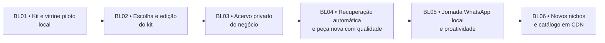

# BL — Biblioteca visual, acervo do negócio e produção personalizada

Data: 27/10/2026. Esta é a **ordem vigente** de implementação da trilha BL.
Ela cruza F01 (área do cliente), F02 (materiais/WhatsApp), F03 (contexto e
roteiro), F04 (mídia), F06 (aprovação/publicação) e F07 (custos). A arquitetura
PostgreSQL/RLS, armazenamento privado, Temporal e autorização por plano
continuam valendo.

## Objetivo e estado real

O cliente vê kits fictícios prontos na nossa web, escolhe uma direção visual,
ajusta-a com poucos controles, informa progressivamente o que vende e como é
seu espaço, e pode pedir conteúdo por texto/áudio livre. O sistema recupera
sozinho os itens e fotos pertinentes, gera uma peça nova, pede aprovação e
publica somente após autorização específica da peça. Um dia sem mensagem nova
também pode iniciar uma proposta dentro da cadência aceita.

| Entrega | Estado em 27/10/2026 |
| --- | --- |
| Vitrine de um kit de cafeteria em `/kits` e `/app/kits` | Implementada localmente com 10 posts, 2 stories, reel e 6 cenários fictícios; revisão criativa e de direitos antes de uso comercial. |
| Selecionar ou editar o kit para um negócio | BL02 implementada localmente na API e web; editor guiado, prévia ampliada, rascunho, confirmação, histórico e logo privado. |
| Acervo estruturado de produtos, serviços e fotos do local | BL03.1/BL03.2 implementadas localmente; importação automática fica em BL03.3. |
| IA visual usando kit + acervo no pipeline do produto | Não implementada; há ensaios isolados de IA e prévias locais com Pillow/FFmpeg. |
| Aprovação/publicação reais pelas contas Meta | Não homologadas; o fluxo local usa adapters falsos. |

A regra central é **não expandir a biblioteca antes de provar que conseguimos
reaplicar o primeiro kit em uma peça nova, fiel e aprovada**. O catálogo
fictício, o kit aplicado ao negócio e o acervo privado do negócio são objetos
diferentes. Escolher um kit jamais aprova uma publicação.

## Sequência de implementação

Cada fase entra em fatias revisáveis, mantendo API e web integradas:

| Fatia | Resultado que podemos demonstrar |
| --- | --- |
| BL02.1 | Seleção e versão do kit por negócio na API; `/app/kits` mostra a escolha salva e permite trocar. |
| BL02.2 | Editor guiado das três composições, cores, fontes, logo e textos permitidos, com simulação fiel às escolhas e opção de restaurar o padrão. |
| BL02.3 | Confirmação, histórico de versões, isolamento por tenant, concorrência e ligação da versão vigente ao briefing F03. |
| BL03.1 | CRUD privado e versionado de produtos/serviços, incluindo preço e validade, dentro de “Sobre meu negócio”. |
| BL03.2 | Upload privado, fotos dos itens e álbum do espaço, direitos, revisão e promoção consentida de mídia WhatsApp. |
| BL03.3 (posterior) | Extrair dados de fotos de cardápio/tabela de serviços e preencher fichas automaticamente para revisão/aceite. Reaproveita multimodal/custo BL04; não bloqueia a BL03 atual. |
| BL04.1 | Resolução automática de pedido livre em texto/áudio para itens/fotos/fatos pertinentes, com pergunta quando faltar fonte. |
| BL04.2 | Nova peça com kit aplicado e IA visual/receita, validação de fidelidade e ledger de todas as tentativas. |
| BL04.3 | Eval em celular e aceite de titular consentido, medindo retrabalho e custo completo por peça aceita. |
| BL05.1 | Mesmo fluxo com WhatsApp simulado: candidata, ajuste, aprovação, recusa, replay e publicação falsa. |
| BL05.2 | Proposta em dia sem mensagem, dentro da cadência/plano, com pausa e pedido de material quando necessário. |
| BL06 | Curadoria dos dois novos nichos e migração de amostras públicas para objetos/CDN, após o gate BL04/BL05. |

### BL01 — Kit piloto e vitrine local

**Entregue tecnicamente.** `cafe-pausas/v1` tem manifesto versionado,
hash/proveniência por ativo, dez posts 4:5 (três JPEGs com texto incorporado e
sete fotos editoriais), dois stories 9:16, reel MP4 silencioso de três cenas,
receitas e seis cenários de origem (texto, foto de produto, foto do espaço,
áudio, vídeo e dia sem mensagem). A web mostra esse mesmo pacote em simuladores
internos de Instagram, Facebook e TikTok, sem gerar imagem a cada visita ou
conectar a conta social. O vídeo demonstra o formato e não simula edição de um
clipe recebido. O preço de R$ 18 é fictício.

**Pendente para selo comercial:** revisão visual com comerciantes, licenças,
direitos e aplicabilidade das receitas. O manifesto continua `public_demo`.
A vitrine pública permanece exploratória; escolha e edição ficam na área
autenticada da BL02. Nenhuma das duas autoriza postagem.

### BL02 — Escolher e editar o kit piloto para um negócio

**Implementada localmente.** Na rota existente `/app/kits`, o proprietário
escolhe `kit_id/version` e cria uma versão **aplicada ao seu negócio**. O
editor é guiado para quem não domina edição: trocar cores, fontes licenciadas,
logo, textos permitidos, enquadramento da imagem e **composição de cada
formato** por alternativas curadas. Feed, story e capa vertical de reel têm
controles e prévias próprios; por exemplo, foto dominante ou oferta dominante,
posição do texto e do CTA. A pessoa compara com o original, desfaz ajustes
e confirma. A prévia responde sem chamada de IA a cada clique. Edição livre
de pixels/timeline não é necessária nesta primeira versão.

**Backend:** guardar seleção e overrides versionados por tenant/negócio,
validar slots/tamanhos/contraste/zona segura e direitos das fontes, aplicar
idempotência e controle de concorrência, auditar alterações e manter a versão
pública imutável. F03 recebe somente a versão aplicada vigente em novos
briefings. Mudanças posteriores não alteram peças antigas nem herdam sua
aprovação. API e web distinguem claramente `rascunho` de `confirmado`.
Assinatura e permissões de produção continuam na API.

**Contrato backend em 27/10:** o manifesto `cafe-pausas/v1` fornece fotos
de origem sem texto fictício incorporado, fontes licenciadas, layouts e
posições disponíveis. A API de kit é do proprietário e separa `draft` de
`confirmed`; cada mutação pede `operation_id` e `expected_version` e gera
versão imutável e auditoria transacional. Desde P14, essas mutações não emitem
o recibo `brand_kit.changed`; o snapshot do kit em F03 permanece. Outbox,
históricos e handlers legados são preservados para consumo manual compatível.
`public_demo` é selecionável só em
ambiente local/teste. Logos entram em armazenamento privado por tenant/negócio,
com validação de formato/dimensões/direitos, URL temporária e intent de upload
recuperável pelo proprietário. Falhas de upload não criam logo pronto;
pendências antigas são limpas em novo upload ou por `POST /logo/reconcile` do
mesmo dono. A limpeza global periódica permanece F08 e exigirá desenho de
permissão específico, sem acesso irrestrito entre tenants. F03 guarda no pedido
novo o kit confirmado e o documento exato vigente naquele momento; execução
tardia não resolve a versão atual. A seleção ainda não aciona F04 nem publica.

**Aceite:** dono escolhe o kit de cafeteria, muda ao menos um layout de cada
formato, vê simulações responsivas das composições e dos tokens configurados,
confirma e retorna para editar sem perder a versão. Outro tenant não lê nem
muda essa escolha. Seleção não consome geração paga nem publica nada.
As prévias podem ser ampliadas no celular e usam fotos fictícias limpas do
kit. A paridade com o arquivo de produção será avaliada em BL04, quando F04
passar a aplicar o kit à mídia real; esta simulação não encerra esse gate.

**Teste manual local:** iniciar a API pelo debug habitual e abrir
`http://localhost:5173/app/kits` com uma conta proprietária. Alterar nome,
cores/fontes e a composição de cada formato; ampliar a prévia e comparar com
o padrão. Salvar rascunho, sair da tela e voltar para conferir a persistência;
então usar **Usar este kit** e conferir a versão em uso e o histórico. Logo
PNG/JPEG/WebP de até 2 MiB é opcional e pede confirmação de direito. A
migração `0037_brand_kits` é necessária; o teste não exige credenciais Meta
nem chamadas de IA. Mudar um rascunho não troca o kit já confirmado.

**Validação histórica da entrega local BL02, anterior à P14:** `make ci` com 718 testes e 100% de cobertura
de linhas/ramos na plataforma; 220 testes web com 100% nos quatro critérios,
build e duas jornadas de navegador desktop/mobile aprovados. Migração 0037
aplicada no banco de desenvolvimento, relay/worker atualizados e manifesto
verificado dentro da imagem Docker. Próxima implementação: BL03.

### BL03 — Acervo progressivo em “Sobre meu negócio”

**BL03.1/BL03.2 implementadas localmente.** Contratos, limites e validação em [SDD BL03](BL03-business-collection.md).
Cadastro manual e fotos são o escopo atual aprovado. A importação automática de
cardápio/tabela de serviços está registrada como BL03.3 posterior: extrair e
preencher rascunhos, mostrar ambiguidades e confirmar sem redigitação.

A web mantém um único item lateral **Sobre meu negócio** e organiza a área
em seções: **Informações e preferências** (fatos livres atuais),
**Produtos e serviços** (itens estruturados) e **Meu espaço** (fotos reais do
estabelecimento, quando houver). O cadastro é opcional e progressivo: sugerir
até três itens principais para começar, sem limite rígido nem bloqueio para
pedir a primeira peça. Não transformar o onboarding ou checkout em formulário
longo. Um negócio de serviço pode cadastrar procedimentos, duração e forma de
agendamento sem fingir que vende produtos físicos.

`business_offerings` guarda tenant, negócio, ID, tipo `product|service`,
nome, sinônimos confirmados, descrição, categoria, estado
`draft|active|archived` e versão. Preço opcional em centavos BRL precisa
de validade; promoções são registros separados com intervalo e aceite do
dono. `business_offering_media` liga fotos autorizadas ao item. O álbum do
espaço guarda fotos de fachada, balcão, sala ou ambiente sem obrigar vínculo
com um produto. Uma foto registra origem, hash, escopo/direito de uso, estado e
versão. A mídia real vai para armazenamento privado por tenant/negócio, nunca
para o CDN dos kits fictícios.

**Backend e web:** CRUD guiado, upload temporário autorizado, edição,
arquivamento, ordenação e revisão. Importação de cardápio pode criar rascunhos;
nada vira fato confirmado automaticamente. Material recebido pelo WhatsApp só
se torna acervo durável após aceite explícito, pois sua retenção original é
temporária. RLS, idempotência, concorrência e auditoria protegem as alterações.
Uma identidade durável com outbox/Temporal é exigida quando houver um efeito
assíncrono específico, sem criar recibos de CRUD sem consumidor de negócio.
Não criar um editor administrativo ou catálogo de ecommerce aqui.

**Aceite:** cadastrar/editar um produto e um serviço, associar foto a um item
e ao local, expirar preço e arquivar item; as leituras por outro tenant falham.
A tela deixa visível o que está confirmado para a IA e o que ainda é rascunho.

### BL04 — Recuperar contexto e produzir uma peça nova

F02 recebe texto, foto, vídeo ou áudio; F03 transcreve quando necessário,
interpreta o pedido de conteúdo e **resolve automaticamente** itens ativos,
sinônimos, fotos e fatos vigentes do mesmo negócio. O cliente não escolhe
manualmente um produto a cada pedido. O briefing compacto inclui kit aplicado,
receita/formato, IDs/versões das fontes, restrições e somente as referências
pertinentes; a galeria inteira nunca acompanha a chamada. Se a rota de IA
precisar, envia no máximo **uma imagem do kit do mesmo formato**, separada das
fotos reais do cliente.

F04 integra ao produto uma rota de geração/edição visual por IA e a compara
com composição local por receita aprovada. O roteador escolhe pela fidelidade,
qualidade e **custo por peça aceita**, incluindo tentativas e revisões. Texto,
preço, CTA e logo exatos são validados e podem receber acabamento determinístico.
O template universal atual continua baseline técnico, não saída comercial
automática. A saída guarda custo, modelo, prompt/receita versionados e
proveniência sem expor dados privados por padrão ao operador.

**Regra de fidelidade:** “crie uma imagem de um croissant” deve localizar o
croissant do acervo se existir. Para mostrar o café real, a foto verdadeira
do espaço é base da edição e o produto precisa permanecer reconhecível;
apenas uma referência solta não comprova o lugar. Sem foto/contexto suficiente,
a IA faz pergunta curta ou oferece peça claramente conceitual, sem apresentar
um café ou alimento inventado como foto documental. Preço vencido, foto de
outro item e material sem direito bloqueiam a afirmação. Alterar item, mídia,
preço ou kit invalida candidatas pendentes que dependiam daquela versão.

**Gate de saída:** gerar ao menos um post e um story **novos** para um caso
consentido, com revisão em celular por titular, identificação correta de
produto/local, texto literal, identidade reconhecível, razões de rejeição,
tentativas e custo total por peça aceita. O ensaio sintético
[Café do Cedro](../evals/brand-kit-transfer-v1.md) comparou quatro rotas e
gastou US$ 0,074311 em três chamadas de IA, mas não percorreu o pipeline real
nem mede aceite comercial. A fase pode ser construída/testada localmente com
mocks enquanto a Meta está restrita; não se declara comercialmente aprovada
sem amostra e aceite real.
Para o plano de entrada de R$ 99/mês, a hipótese econômica é custo total de
até R$ 50 por cliente/mês, incluindo geração, mensageria, infraestrutura,
retentativas e suporte atribuível. F07 transforma a medição da BL04 em
franquias/preços; nenhuma quantidade de posts é prometida antes disso.

### BL05 — Jornada completa local, ajuste e proatividade mínima

Ligar BL04 à orquestração F02/F03/F04/F06 existente: pedido livre por
WhatsApp simulado **ou** horário da cadência aprovada cria uma candidata
privada; o dono recebe prévia, pode pedir ajuste, aprovar ou recusar.
Silêncio nunca aprova. A nova versão após ajuste deve reaplicar fatos,
kit e acervo atuais; aprovação liga hash da peça, legenda, canal e horário,
e a publicação falsa exercita falhas, replays e estados incertos. A web
mostra a trilha e oferece revisão complementar, sem exigir cliques para o
percurso principal. F03 pede material quando um dia sem input não tiver
fonte suficiente. Plano limita quantidade/formato; recomendação de cadência
não altera cobrança automaticamente.

**Aceite local:** rodar casos texto, áudio, foto, vídeo e dia sem mensagem
com o mesmo fluxo, incluindo correção, rejeição, repetição de webhook,
mudança de fato antes da aprovação e limite de custo. Medir qualidade, taxa
de aceite, custo por peça aceita e operação manual necessária. Homologação
Meta/Instagram real, permissões, cobrança/franquia final e staging F07/F08
são gates próprios antes de atender clientes; adapters falsos não provam
essas integrações.

### BL06 — Ampliar a biblioteca e servir o catálogo em escala

Após BL04 demonstrar reaplicação e BL05 fechar o percurso local, curar kits
próprios para **manicure com agenda** e **personal trainer**; cada nicho
precisa de formatos finais, receitas editáveis, fontes/direitos e revisão
própria. A cafeteria pode incluir variação de delivery com foto fiel do
prato/embalagem e fundo neutro. A API/índice público passa a servir versões
imutáveis de kits por armazenamento de objetos + CDN; o build da web não
carrega todos os futuros kits. Escolha/recomendação por segmento e
disponibilidade por plano usam esse catálogo; mídia de cliente continua
privada e separada. Medir custo de curadoria por versão e tráfego por visita.
Pesquisa de concorrentes e avatar F05 permanecem trilhas posteriores com
fontes, consentimento e gates próprios.

## Evidência e dependências

A BL02 e a BL03 podem avançar sem a conta Meta. BL04 precisa da versão do kit
e do acervo ou de um caso explicitamente sem item/foto; BL05 precisa de ao
menos uma receita BL04 que passe no gate de qualidade. BL06 depende da
reaplicação comprovada antes de prometer a novos nichos. O primeiro piloto
pode restringir-se à cafeteria e às receitas que passaram no gate; outros
formatos não entram por associação com o kit.

| Repositório/serviço | Responsabilidade |
| --- | --- |
| `local-spark-platform` | Seleção/versão do kit, fatos/acervo privado, resolução automática, briefing, geração, ledger, aprovação e API do catálogo público. |
| `local-spark-web` | Vitrine, editor guiado, seções de Sobre meu negócio, prévias/revisão e estados acessíveis. |
| Armazenamento de objetos + CDN | Só amostras públicas e imutáveis dos kits; material de clientes usa bucket/escopo privado e URLs temporárias. |

## Numeração substituída

As entradas históricas de 26/10 e o primeiro ensaio usavam BL02 para a
reaplicação, BL03 para três kits/CDN, BL04 para escolha e BL04.5 para acervo.
A partir de 27/10 a ordem executiva é: **BL02 escolha/edição; BL03 acervo;
BL04 geração/reaplicação com gate de qualidade; BL05 jornada local; BL06
expansão**. BL01 mantém o mesmo número. Referências históricas não representam
a fase vigente.
